# Jornadas do app

O mapa de tudo o que uma pessoa faz no app, dividido em dez jornadas. Cada
jornada tem um fluxograma, as regras técnicas que decidem os caminhos e as
lacunas encontradas no código. Foi escrito lendo o código em 2026-09-17, na
branch `finance-app-2.0`, e a navegação global foi revista em 2026-10-01,
quando entrou a busca (⌘K), junto com o menu do botão direito nas linhas de
lançamento, nos cartões de categoria e nas contas pendentes, com o seletor
de período que confirma no próprio popover, com o rascunho protegido do
formulário de lançamento, e com os menus do telefone em gaveta. As telas de
acesso foram revistas em 2026-10-12 (a casca no layout) e em 2026-10-14 (o
painel de marca animado) e as notificações em 2026-10-17 (o painel flutuante, o sino exato e a revisão do servidor, ainda não publicada) e em 2026-10-21 (o aviso de despesa e os crons passam ao banco, por migração, também ainda não publicados); a busca do telefone em 2026-10-19 (a lupa vira a barra) e, no mesmo dia, a aba "Você" no lugar do menu "Mais" (a página `/me`). Em 2026-10-21 entrou o Bloco 2, "fatura que bate e anexos": o estorno no cartão, o total da fatura segundo o banco, a conferência da fatura, a importação de extrato e de planilha e os anexos, com as telas em wireframe (`src/components/wireframe/`) e ainda não publicado (`supabase/BLOCO_2_DEPLOYMENT.md`). Em 2026-10-22 entrou o Bloco 3A, "captura sem abrir o app": o token pessoal em Minha conta, a Edge `capture` (o Atalho do iPhone e o Apple Pay), a frase rápida no "+", o compartilhar do Android, os atalhos do ícone, a lista "A conferir" e o lembrete das 20h, com as telas em wireframe e ainda não publicado (`supabase/BLOCO_3A_DEPLOYMENT.md`). Quando uma tela mudar de caminho, atualize o
diagrama dela.

## Como ler os diagramas

| Forma | Significa |
|---|---|
| `["/rota"]` retângulo | Página ou rota |
| `(["Diálogo"])` cápsula | Modal, folha, popover, menu |
| `{"Condição"}` losango | Guarda de rota ou decisão |
| `[("backend")]` cilindro | Supabase: Edge Function, RPC, trigger, tabela |
| `(("G5 Lançamentos"))` círculo | Saída para outra jornada |

O rótulo da seta é a ação da pessoa ou a condição (`sucesso`, `erro`,
`cancelar`). Os diagramas usam o tema escuro do Mermaid (`%%{init}%%` no topo
de cada bloco), em qualquer tema do leitor.

**Tudo o que decide acesso roda no navegador.** Não há `middleware.ts`,
`proxy.ts` nem rotas em `src/app/api`. A sessão é do `supabase-js`, os
redirecionamentos são do `AuthGuard` e a segurança real dos dados é a RLS do
banco.

## Sumário

0. [Mapa geral](#0-mapa-geral)
1. [Acesso: entrar, criar conta, senha e sair](#1-acesso-entrar-criar-conta-senha-e-sair)
2. [Carteiras e colaboração](#2-carteiras-e-colaboração)
3. [Navegação e ações globais](#3-navegação-e-ações-globais)
4. [Painel](#4-painel)
5. [Lançamentos](#5-lançamentos)
6. [Cartões e faturas](#6-cartões-e-faturas)
7. [Contas a pagar](#7-contas-a-pagar)
8. [Assinaturas](#8-assinaturas)
9. [Categorias e orçamentos](#9-categorias-e-orçamentos)
10. [Conta e segurança](#10-conta-e-segurança)
11. [Lacunas encontradas](#11-lacunas-encontradas)

---

## 0. Mapa geral

Como as jornadas se ligam. O Painel é o centro; Lançamentos é para onde quase
tudo desagua, porque assinatura, parcela e conta paga viram lançamento.

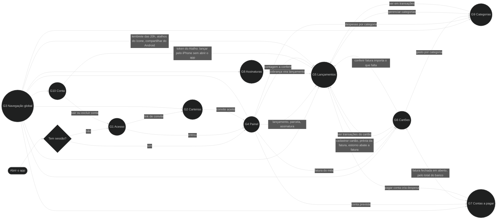

---

## 1. Acesso: entrar, criar conta, senha e sair

Tudo o que acontece antes de a pessoa estar dentro do app, e a volta para fora.
Criar conta e entrar são a mesma jornada: as duas telas se ligam e dividem o
parâmetro `next`. **O login social saiu** em set/2026; a autenticação é
e-mail e senha.

As cinco telas dividem uma casca só, e **a casca vive no layout de `(auth)`; o
formulário publica o id da cena.** O `AuthFrame` (`src/components/layout/auth-frame.tsx`)
monta o `SplitShellRoot` com o painel de marca uma vez, então o painel é o
mesmo nó entre as cinco rotas e troca de cena em vez de remontar: a partir de
48rem do próprio casco (container query); no telefone só o wordmark
(`asideMobile="logo"`); coluna de formulário à esquerda, painel à direita
(`side="end"`). Cada formulário devolve só a coluna, o `AuthShell`, com o id
da cena (`scene`), porque o título e a cena mudam com o estado (o cadastro vira
"Confira seu e-mail", a recuperação troca a cada passo). Sem id publicado, a
cena sai do caminho (`defaultSceneFor`). Todo estado devolve o `AuthShell` no
mesmo lugar da árvore, e a troca de `step` leva o foco ao título.

**O painel é um palco animado, e a família da cena decide o aparelho.** Desde
14/out/2026 o painel desenha o próprio app num aparelho (`AuthShowcase`, sobre
o `Showcase` do design system), com uma colagem de depoimentos ilustrativos em
volta e uma legenda no pé; os números e os nomes são de exemplo, e a tela diz
isso. Login no **navegador** (a busca ⌘K se digita sozinha até a fatura, e a
janela vira celular e volta), convite no **tablet** da casa, cadastro e
recuperação no **celular** (o fim da recuperação volta ao navegador). Trocar
de rota troca a cena no mesmo nó: o aparelho muda de forma e gira, sem
remontar e sem tocar a entrada de novo. O palco é `inert` e `aria-hidden`,
repousa em até 5 s, nasce no quadro final com movimento reduzido e não roda
no telefone, onde fica só o wordmark. **Nenhum caminho mudou**: o palco não tem link, campo nem foco, e
as cenas são uma tabela só (`src/components/auth/showcase/scenes.ts`).

### 1a. Entrada, login e cadastro

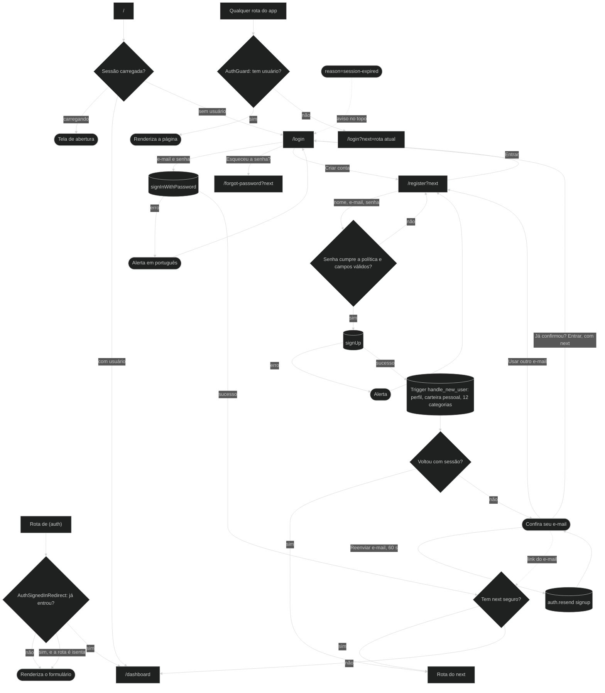

### 1b. Senha e saída

### Regras técnicas

| Ponto | Regra | Onde |
|---|---|---|
| Bootstrap | `/` manda para `/dashboard` ou `/login` depois de a sessão carregar; o sinal de carregando só aparece depois de 600 ms | `src/app/page-client.tsx`, `src/components/layout/app-bootstrap-screen.tsx` |
| Guarda | Toda rota de `(app)` sem usuário vai para `/login?next=` com `replace`. Sem exceções: `/invites/accept` saiu do grupo | `src/components/layout/auth-guard.tsx` |
| Guarda invertida | Quem já entrou em `(auth)` vai para o `next` ou o Painel. Isentas: `/forgot-password` e `/reset-password` (o `verifyOtp` cria sessão antes da troca de senha) e `/invites/accept` | `src/components/layout/auth-signed-in-redirect.tsx` |
| `next` | Só caminho interno começando com `/`; o padrão é `/dashboard` | `src/lib/auth-return-path.ts` |
| Casca | A casca vive no layout de `(auth)` (`AuthFrame`: `SplitShellRoot` e painel de marca, o mesmo nó entre as rotas); o formulário devolve só a coluna (`AuthShell`, um `SplitShellMain`) e publica o id da cena por `useAuthScene`. Sem publicação, `defaultSceneFor(pathname)`; o frame nunca lê a query. O `AuthStatus` saiu: a tela de status é o `AuthShell` com `icon` e `step` próprio. O painel desenha a cena pela tabela `SCENES`: navegador no login, tablet no convite, celular no cadastro e na recuperação | `src/app/(auth)/layout.tsx`, `src/components/layout/auth-frame.tsx`, `src/components/layout/auth-shell.tsx`, `src/components/auth/showcase/scene-context.tsx`, `src/components/auth/showcase/scenes.ts` |
| Senha | Uma política só — 8+, minúscula, maiúscula, número e símbolo — aplicada no cadastro e na redefinição | `src/lib/password-policy.ts` |
| Recuperação | Um formulário, duas portas: `/forgot-password` começa no código de 6 dígitos, `/reset-password` entra no passo da senha lendo o token do hash. O `resetPasswordForEmail` manda `redirectTo` para `/reset-password`, senão o link do e-mail cai na Site URL do projeto, que mora fora deste repositório | `src/components/password-recovery-form.tsx` |
| `next` na recuperação | `/forgot-password?next` e `/reset-password?next` leem o `next` por `recoveryLinks`, que usa `getSafeInternalNextPath`; o `redirectTo` do e-mail vira `/reset-password?next=…` e "Senha atualizada" leva a `/login?reason=password-updated&next=…`. "Pedir novo código" volta a `/forgot-password?next=…`. Sem `next` a URL não muda. Depende de a allowlist de redirecionamento do Supabase (fora do repositório) aceitar a query string | `src/lib/recovery-links.ts`, `src/components/password-recovery-form.tsx` |
| Reenviar | "Reenviar e-mail" (cadastro, `auth.resend({type:"signup"})`) e "Reenviar código" (recuperação, novo `resetPasswordForEmail`) esperam 60 s; a falha não zera a espera | `src/components/signup-form.tsx`, `src/components/password-recovery-form.tsx` |
| Convite aceito | Depois do `workspace-invites-accept` a página mostra o status "Convite aceito" com "Abrir a carteira" para `/dashboard`; não há redirecionamento automático. O fallback de carregamento já veste o `AuthShell` | `src/app/(auth)/invites/accept/page-client.tsx` |
| Erros | Tudo passa por `formatAuthErrorMessagePt`, inclusive esqueci e redefinir senha | `src/lib/supabase-errors.ts` |
| Primeira conta | Trigger `on_auth_user_created` → `handle_new_user` cria perfil, carteira "Carteira pessoal de Nome" e 7 categorias de despesa + 5 de receita | `supabase/migrations/00000000000000_baseline.sql` |
| Sessões | Ao entrar registra o aparelho; ao abrir confere se foi revogado | `src/components/providers.tsx`, edge `sessions` |
| Sair | Não navega: limpa tudo e deixa o `AuthGuard` redirecionar | `src/components/providers.tsx` |
| Motivo da saída | Sessão revogada grava o motivo em memória; o `AuthGuard` o anexa como `reason=` e o login o mostra | `src/lib/auth-signout-reason.ts` |

---

## 2. Carteiras e colaboração

A carteira é o espaço onde moram os dados. A pessoa ganha uma pessoal ao criar
a conta, pode criar carteiras compartilhadas e convidar gente para elas.

### 2a. Trocar, criar e ajustar carteira

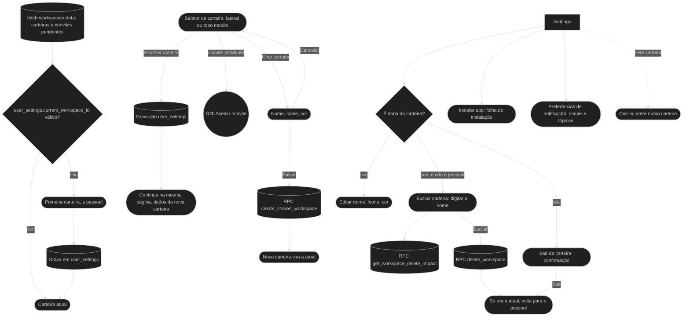

### 2b. Convidar e aceitar convite

### Regras técnicas

| Ponto | Regra | Onde |
|---|---|---|
| Carteira atual | `user_settings.current_workspace_id`; inválida cai na primeira, com a pessoal ordenada antes | `src/lib/queries/fetch-workspaces-data.ts` |
| Criar e excluir | RPCs `create_shared_workspace`, `get_workspace_delete_impact`, `delete_workspace` | `src/components/workspace-provider.tsx` |
| Sair da carteira | Diálogo próprio de confirmação | `src/components/settings/workspace-leave-dialog.tsx` |
| Membros | RPC `workspace_member_directory`; só a dona convida, revoga e remove | `src/app/(app)/members/page-client.tsx` |
| Convite | Edges `workspace-invites-create`, `-resend`, `-accept`; o email é montado no servidor | `supabase/functions/_shared/workspace-invite-email.ts` |
| Página de convite | Fica no grupo `(auth)`: veste o `AuthShell` e não atravessa a casca do app. O `WorkspaceProvider` é global, então a mudança de grupo não custou nada | `src/app/(auth)/invites/accept/page-client.tsx` |

---

## 3. Navegação e ações globais

O que está disponível em qualquer tela: a casca, o "+" de adicionar, a busca
(⌘K) e as notificações. O painel de notificações abre do sino da barra do topo; o
sino conta as não lidas direto no servidor.

```mermaid
%%{init: {"theme": "dark"}}%%
flowchart TD
    shell(["Casca do app"]) --> desktop{"Largura"}
    desktop -->|"desktop"| sidebar(["Lateral recolhível"])
    desktop -->|"mobile"| bottom(["Barra inferior: Painel, Transações, Categorias, +, Você"])

    sidebar --> nav1["/dashboard"]
    sidebar --> nav2["/transactions"]
    sidebar --> nav3["/categories"]
    sidebar --> nav4["/subscriptions"]
    sidebar --> nav5["/bills (Beta)"]
    sidebar --> nav6["/credit-cards"]
    sidebar --> nav7["/members"]
    sidebar --> nav8["/settings"]
    sidebar --> userMenu(["Menu do usuário: tema, Minha conta, Planos, Sair"])
    bottom -->|"aba Você, com o avatar"| mePage["/me: Carteira (Assinaturas, Contas, Cartões, Membros) · Conta (Minha conta, Configurações)"]
    mePage -->|"linha da página"| meDest["Tela de um item da página, com o voltar a /me no lugar do sino"]
    meDest -->|"voltar"| mePage
    userMenu --> G10(("G10 Conta"))
    mePage -->|"Minha conta"| G10

    sidebar -->|"+ Adicionar, direto, com Despesa"| txForm(("G5b Formulário de transação"))
    bottom -->|"+, a gaveta do formulário"| txForm
    txForm -.->|"formulário global indisponível"| fallback["/transactions?new= ou /subscriptions?new=1"]

    topbar(["Barra do topo: lupa"]) -->|"clicar"| palette(["Paleta de busca: Recentes, Telas, Ações, Transações, Cartões, Categorias, Parcelas, Assinaturas, Contas, Membros, Carteiras"])
    shell -->|"⌘K ou Ctrl+K"| palette
    palette -->|"Telas ou Recentes: as da lateral menos o Painel"| nav2
    palette -->|"Ações: Nova despesa, parcelada, receita"| txForm
    palette -->|"Ações: Nova assinatura"| subForm(("G8 Formulário de assinatura"))
    palette -->|"Ações: Nova categoria, Novo cartão"| createDialogs(["Diálogos de criar categoria e cartão"])
    palette -->|"Transações, consulta no banco"| txnDetail["/transactions?txn=id"]
    palette -->|"Ver todas em Transações"| txnList["/transactions?q, from, to, min, max"]
    palette -->|"Cartões"| cardDetail["/credit-cards/id"]
    palette -->|"Categorias"| catDetail["/categories/id"]
    palette -->|"Compras parceladas"| planPage["/transactions?plan=id"]
    palette -->|"Assinaturas"| subPage["/transactions?sub=id"]
    palette -->|"Contas a pagar"| billPage["/bills?detail=id"]
    palette -->|"Membros"| nav7
    palette -->|"Carteiras"| walletSwitch[("Troca a carteira atual")]

    bell(["Sino de notificações, com a contagem exata"]) -->|"clicar"| panel(["Painel flutuante: agrupado por dia, Todas ou Não lidas"])
    panel -->|"linha com destino: fecha, navega e marca como lida em segundo plano"| dest{"Destino da linha"}
    dest -->|"href explícito (orçamento, parcela, conta…)"| explicit["Rota do metadata.href"]
    dest -->|"category_created, só linhas antigas"| n1["/categories"]
    dest -->|"invite_accepted"| n2["/members"]
    dest -->|"cc_* com cartão"| n3["/credit-cards/id"]
    dest -->|"tipo bill"| n5["/bills"]
    dest -->|"member_expense_created"| n6["/transactions?txn=id"]
    dest -->|"metadata.href do lembrete das 20h"| n7["/transactions?conferir=1"]
    panel -->|"linha sem destino"| stay(["Só marca como lida; o painel fica aberto"])
    panel -->|"⋯ da linha"| rowMenu(["Marcar como lida ou não lida; Excluir, sem desfazer"])
    panel -->|"⋯ do cabeçalho"| headMenu(["Marcar todas como lidas; Configurar notificações; Limpar notificações"])
    headMenu -->|"Configurar notificações"| prefs["/settings#notificacoes"]
    headMenu -->|"Limpar notificações"| clearAsk(["Limpar todas as notificações?"])
    clearAsk -->|"Limpar ou Cancelar"| panel
    panel -->|"erro ao carregar"| retry(["Alerta: Tentar de novo"])
    retry -->|"Tentar de novo"| panel

    appIcon(["Ícone do app instalado: segurar"]) -->|"Nova despesa"| iconNew["/transactions?new=1"]
    appIcon -->|"A conferir"| n7
    appIcon -->|"Painel"| nav1
    iconNew --> txForm
    n7 --> G5c(("G5c A conferir"))

    old["Rotas antigas"] -->|"next.config.ts"| redirects["/dashboard/settings → /settings; /wallets → /dashboard; /assets → /credit-cards; /notifications → /dashboard?notifications=1"]
    unknown["Rota desconhecida"] --> notFound(["404: Ir para o painel ou Página inicial"])
```

### Regras técnicas

| Ponto | Regra | Onde |
|---|---|---|
| Itens de navegação | Lateral e mobile vêm de configuração, não de JSX solto | `src/config/navigation.ts`, `src/config/mobile-navigation.ts` |
| Atalhos do ícone e compartilhar (Bloco 3A) | O app instalado traz três atalhos ao segurar o ícone: "Nova despesa" (`/transactions?new=1`; era "Nova transação"), "A conferir" (`/transactions?conferir=1`) e "Painel". O `share_target` do Android manda o texto compartilhado por `GET` a `/transactions?frase=…` (ver 5c) | `src/app/manifest.ts` |
| Formulários globais | Transação e assinatura montados uma vez na casca; salvar invalida as listas abertas | `src/components/layout/global-shell-dialogs-provider.tsx` |
| Menus do telefone | O "+" abre direto a gaveta do formulário de lançamento, com Despesa marcada (o seletor do formulário troca para Parcelada e Receita; assinatura fica na tela dela e na paleta). Era uma folha de ações (`Drawer` com `DrawerActions`) antes do formulário, e no desktop um menu: um passo a mais na jornada mais comum. A quarta aba da barra é a **"Você"**, com o avatar da pessoa no lugar do glifo (a foto ou as iniciais; enquanto o perfil não chega, o círculo neutro vazio, sem esqueleto): ela leva à página `/me` (`ROUTES.ME`, título "Você") e não abre mais um menu (o `MobileAccountMenu`, o painel da rodada 278, saiu). Ela fica ativa em `/me` e em toda tela que a página lista, subrotas incluídas (`/account/sessions`, `/credit-cards/<id>`, `/settings/*`; `isVoceTabActive`). A página tem a identidade centrada (avatar, nome, e-mail) e dois grupos de linhas, cada um num cartão: **Carteira** (Assinaturas, Contas a pagar com o selo Beta, Cartões, Membros e convidados) e **Conta** (Minha conta, Configurações); as regras moram em `getVoceGroups`. Numa tela estreita, a aba que não cabe com folga na barra (o nome + 16, nunca menos de 44) sai do fim e entra no topo do grupo Carteira: num telefone de 320, Categorias; Painel e "Você" ficam sempre (rodada 342). A barra mede e publica quem saiu num armazém de módulo (`abas-fora.ts`, `useSyncExternalStore`) e a página o lê; no desktop, onde a barra some, nada é publicado. As telas das linhas da página (`/subscriptions`, `/bills`, `/credit-cards`, `/members`, `/account`, `/settings`) são subpáginas dela no telefone: o voltar toma o lugar do sino e leva a `/me` (`defaultMobileBackHref`); as que já têm pai (sessões e atividade → Minha conta, detalhe do cartão → Cartões) mantêm o pai, e a aba que saiu da barra não ganha o voltar. Tocar na aba "Você" já ativa numa dessas telas volta a `/me` (como no iOS, a pilha volta à raiz); só em `/me` o toque sobe ao topo (`BottomBarTab`). O desktop não muda: `/me` renderiza nele, mas nada leva até lá. O tema mora em Configurações (seção Aparência); o sair (o menu ⋯ do perfil) e Planos e pagamentos (a seção Plano, só no telefone) moram em Minha conta. Antes foi um painel de `DropdownMenu` que brotava da aba "Mais", antes uma gaveta de 625px com identidade, tema e sair, e antes dela um `Popover` de vidro escrito à mão | `src/components/layout/quick-actions.tsx`, `src/components/layout/mobile-bottom-nav.tsx`, `src/components/layout/abas-fora.ts`, `src/components/layout/voce-avatar.tsx`, `src/app/(app)/me/page-client.tsx`, `src/config/mobile-navigation.ts`, `src/components/layout/app-header.tsx` |
| Busca global (⌘K) | Montada uma vez no `AppHeader`, com a lupa nas duas árvores da barra. No telefone a lupa vira a barra de pesquisa no topo, sobre um véu: a pílula nasce no círculo da lupa (`lupaRef`, o `origin` do `CommandDialog`) e se estica para a esquerda, com o × à direita e o teclado aberto no mesmo toque; o ×, Esc e o toque no véu fecham, e o foco volta à lupa (era uma gaveta de baixo até 2026-10-19). A raiz busca tudo, sem as sub-páginas de categorias e cartões: o filtro é da paleta (`shouldFilter: false`) e cada grupo vem ranqueado por `ranquear` (`lib/app-search`), até 5 linhas. Telas (com sinônimos: "gastos" acha Transações, "fatura" Cartões, "boletos" Contas a pagar) são as da barra lateral menos o Painel, mais Membros (`navigation.ts`); Painel, Configurações, Minha conta, Planos e pagamentos, Sessões ativas, Atividade e Notificações ficam fora da busca, por decisão do dono. Ações chamam os mesmos ganchos do "+ Adicionar" (`useQuickCreateTransaction`, `useQuickCreateSubscription`) e os diálogos da casca (Nova categoria, Novo cartão). Transações são uma consulta de leitura ao banco (descrição, valor, data, nome da categoria e do cartão; as 8 mais recentes; espera de 250ms depois da digitação) e abrem `/transactions?txn=id`; "Ver todas em Transações" leva `q`, `from`, `to`, `min` e `max` na URL, e a lista filtra o texto só pela descrição. Transação nunca vira recente. Cartões e categorias leem o cache da casca (`useCategoriesQuery`, `useCreditCardsQuery`); parcelas (`?plan=id`), assinaturas (`?sub=id`) e membros (`/members`) saem das listas do espaço; contas a pagar vêm de uma consulta leve (`useBillsListQuery`) e abrem `/bills?detail=id`; escolher uma carteira troca a carteira atual. Os recentes ficam no `localStorage` (`app:busca`). Digitar `/` escolhe onde buscar (`/transacoes`, `/membros`…, `lib/app-search-scopes`): o nome entra no campo como escopo, só aquele grupo aparece (até 50 linhas; 20 transações), e dois Backspaces com o campo vazio voltam à busca em tudo; num escopo de lista do espaço, enquanto ela carrega o grupo diz "Buscando…" e, sem dado e com erro, "Não deu para carregar … agora." (o "Nada em …" só vale depois da resposta) | `src/components/layout/app-command-palette.tsx`, `src/lib/app-search-scopes.ts`, `src/components/layout/app-search-sources.ts`, `src/lib/app-search.ts`, `src/lib/transaction-search.ts`, `src/lib/queries/use-transactions-search.ts`, `src/lib/queries/use-bills-list.ts` |
| Nome da tela e voltar | No telefone a barra do topo mostra o título e o voltar das subpáginas (`/categories/id`, `/categories/new`, `/credit-cards/id`, as de `/account`), pelo `usePageChromeSlot`. As telas que a página Você lista (`/subscriptions`, `/bills`, `/credit-cards`, `/members`, `/account`, `/settings`) ganham o voltar a `/me`, e `/plans` volta a `/account` (só no telefone: a migalha do desktop não muda; `defaultMobileBackHref`). Nessas telas a aba "Você" fica ativa, e tocar nela volta a `/me`. No desktop ela não mostra o nome da tela (o `<h1>` fica só para o leitor de tela) nem a trilha: a lateral marca onde se está e é o caminho de volta. A trilha com o link para a tela de cima ("Categorias", "Cartões de crédito") saiu em 2026-10-16 | `src/components/layout/app-header.tsx` |
| Painel de notificações | O sino abre a folha flutuante (384px, recuo de 8px, o vidro do `Dialog`) no desktop e a gaveta no telefone (`NotificationsSheet`). As linhas se agrupam por dia local ("Hoje", "Ontem", a data), com o rótulo do dia preso ao rolar; cada uma tem o ladrilho de tom (âmbar, vermelho, azul ou cinza, por `notificationTone`), o título em negrito e o ponto enquanto não lida, a hora local e a seta quando leva a algum lugar. O filtro Todas / Não lidas aparece com ao menos uma notificação; sem nenhuma não lida, o filtro mostra "Tudo lido" com "Ver todas". A lista traz as 100 mais recentes e, cheia, avisa "Mostrando as 100 mais recentes". A falha de carga é um `Alert` com "Tentar de novo", nunca a caixa de entrada vazia (o "Limpar todas" otimista que falha não pode virar "Nenhuma notificação"). Trocar de carteira volta ao esqueleto | `src/components/layout/notifications-sheet.tsx`, `src/components/layout/notifications-panel.tsx`, `src/components/layout/notification-row.tsx`, `src/lib/notification-visuals.tsx` |
| Menu ⋯ do cabeçalho | "Marcar todas como lidas"; "Configurar notificações" leva a `/settings#notificacoes` (a seção tem esse `id`) e, por ser link de dentro da folha, a fecha antes de abrir a tela; "Limpar notificações" pede confirmação ("Limpar todas as notificações?") e apaga as da carteira; a confirmação abre por cima da folha. Não há mais a engrenagem avulsa | `src/components/layout/notifications-panel.tsx`, `src/components/settings/notification-preferences.tsx` |
| Ações da linha | Clicar numa linha com destino fecha o painel e navega na hora; marcar como lida corre em segundo plano. Linha sem destino só marca como lida e o painel fica aberto (o app não tem mais o destino `/dashboard` de reserva; ele ficou só no espelho do push). O botão do cursor e o ⋯ trazem "Marcar como lida" ou "Marcar como não lida" e "Excluir" (sem desfazer). Cada escrita é otimista, e o sino é refeito quando ela volta; uma que falha mostra o toast e o refazer corrige a lista | `src/components/layout/notification-row.tsx`, `src/lib/notification-actions.ts`, `src/lib/notifications.ts` |
| Sino | O número é o do servidor (`countUnreadNotifications`), exato: o painel nunca o sobrescreve com o tamanho da lista, que para em 100. Sondado a cada 60s com a aba visível e refeito ao voltar a ela; o painel o refaz depois de cada escrita (`invalidateUnreadBadge`); a falha de rede mantém o último número bom; trocar de carteira o zera até a contagem nova chegar. Sem Realtime: o teto é um minuto de atraso | `src/components/layout/notification-bell-link.tsx`, `src/lib/unread-count.ts`, `src/components/layout/notifications-ui-provider.tsx` |
| Destino da notificação | `metadata.href` seguro vence (começa em `/`, sem `//`, `\` nem caractere de controle); senão, o tipo decide. A função do app (`getNotificationAction`) devolve `null` quando nada casa; o espelho do servidor, que serve ao push, ainda cai em `/dashboard` | `src/lib/notification-actions.ts`, `src/lib/notification-href.ts`, `supabase/functions/_shared/notification-types.ts` |
| Quem notifica no app | Nova categoria não notifica mais (as linhas antigas `category_created` continuam abrindo `/categories`). Editar uma despesa roda a conferência de orçamento (`evaluate-budgets`); a compra parcelada no cartão roda a de cartão; mudar o valor de um orçamento rearma os avisos de 80%, 100% e estouro (`threshold_*_sent_at` volta a nulo). Ninguém avisa a si mesmo | `src/lib/transaction-detail-sheet-mutations.ts`, `src/components/transactions/transaction-form-persistence.ts`, `src/lib/category-budget-ops.ts` |
| Notificações no servidor | Edges `evaluate-budgets`, `evaluate-credit-card-alerts`, `evaluate-bills-reminders`, `credit-card-calendar-alerts`, `notify-transaction-created`. Os dois crons diários (`credit-card-calendar-alerts-daily` e `bills-reminders-daily`, `0 12 * * *`) e o trigger `transactions_notify_created` (despesa manual, sem assinatura nem parcela) moram na migração `20261021120000_internal_edge_dispatch.sql`: chamam a Edge por `pg_net`, com a URL e o segredo no Vault, pela função `invoke_edge_function`, que nunca derruba o `insert` (sem segredo, não avisa). O app não chama mais `notify-transaction-created`: quem avisa os membros é o trigger, também na despesa lançada offline e sincronizada depois. `dispatch-notifications` saiu. Revisadas no repositório em 2026-10-17 e ainda não publicadas (o app em produção segue com o comportamento antigo até lá): o link do orçamento leva `?month=AAAA-MM`; textos com categoria, mês e valores; o "limite usado" do cartão soma a fatura aberta e a última fechada se não paga; os lembretes de calendário só dependem do interruptor do calendário, pulam fatura zerada ou paga, toleram um dia de cron perdido, e "fechou" sai no dia seguinte ao fechamento; conta atrasada avisa no 1º dia e a cada 7; o interruptor "Promoções" saiu da tela de preferências. Passo a passo em `supabase/NOTIFICATION_DEPLOYMENT.md` | `supabase/migrations/20261021120000_internal_edge_dispatch.sql`, `supabase/functions/`, `supabase/NOTIFICATION_DEPLOYMENT.md` |
| Lembrete das 20h (Bloco 3A) | O cron `review-reminder-daily` (`0 23 * * *`, 20h em Brasília) chama a Edge `review-reminder` por `invoke_edge_function`. Ela avisa cada pessoa que lançou itens `needs_review` (pelo `user_id`), por carteira, uma vez por dia (`review_reminder_dedupe`; a entrega que falha devolve o dedupe), pelo `deliverNotification` com o tipo `review`, o título "Itens a conferir" e `metadata.href` `/transactions?conferir=1`. Vale para o aviso no app, o push e o e-mail. Desliga por carteira em Configurações, no wireframe "Lembrete de itens a conferir" (`notify_review`). O tipo entrou no check de `notifications`; o front antigo o mostra com o sino padrão. Migração `20261023120000_captura.sql`, ainda não publicada | `supabase/functions/review-reminder/`, `supabase/functions/_shared/review-reminder.ts`, `src/components/wireframe/a-conferir-lembrete-wireframe.tsx` |
| Push | Edges `push-subscribe` e `push-unsubscribe` | `supabase/functions/` |
| Redirecionamentos | Os únicos que acontecem no servidor | `next.config.ts` |

---

## 4. Painel

`/dashboard`: o resumo do mês e a porta para o resto. Ao abrir, ele também
recupera cobranças atrasadas de assinaturas e parcelas.

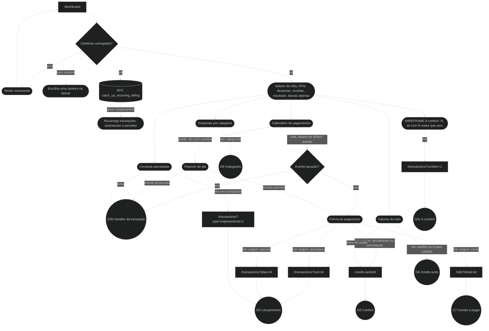

### Regras técnicas

| Ponto | Regra | Onde |
|---|---|---|
| Dados | Um hook agrega os blocos por mês e carteira | `src/components/dashboard/use-dashboard-data.ts` |
| Cobranças atrasadas | `catch_up_recurring_billing` roda uma vez por carteira ao montar; é idempotente com o cron | `src/lib/queries/use-recurring-billing-catchup.ts` |
| Calendário | Eventos: assinatura, parcela, fechamento, vencimento de cartão, vencimento de conta, receita e despesa lançadas. É a agenda do `Calendar` (rodada 242): na grade, o dia abre o popover e fica marcado (com a janela abaixo de 768px o popover abre como gaveta); abaixo de 40rem da largura da própria agenda ela vira a lista do mês — no telefone, e também num laptop estreito com a barra lateral aberta e o painel de próximos ao lado —, e o evento abre direto o detalhe ou a prévia, sem o popover. A lista mostra os últimos 5 dias passados com evento e todos os que vêm, com o selo do tipo. A grade de pontos do telefone saiu | `src/components/dashboard/dashboard-payments-calendar.tsx` |
| Prévia | "Ver origem" monta a rota pelo tipo do evento | `src/components/dashboard/dashboard-payment-event-preview-sheet.tsx` |
| A conferir (Bloco 3A) | Entre os indicadores e o calendário, o wireframe "A conferir: N" conta os lançamentos `needs_review` da carteira (pelo índice parcial `transactions_needs_review_idx`) e leva a `/transactions?conferir=1`. Com zero, some; um erro na contagem também o esconde | `src/components/wireframe/a-conferir-contagem-wireframe.tsx`, `src/app/(app)/dashboard/page-client.tsx` |
| Fatura e estorno (Bloco 2) | Nas faturas do mês, uma fatura fechada vale o total do banco quando a pessoa o informou (`credit_card_statement_totals`); a aberta segue o calculado. O estorno no cartão (receita com `payment_method = 'credit_card'`) abate a despesa do mês de fechamento e não conta como receita. A consulta do período pede `source`, `needs_review` e `import_batch_id`: sem a migração do Bloco 2, o Painel não carrega | `src/components/dashboard/use-dashboard-data.ts`, `src/lib/fatura/total-com-banco.ts`, `src/lib/expense-month-attribution.ts`, `src/lib/queries/use-transactions-range.ts` |

---

## 5. Lançamentos

`/transactions`: a lista de despesas e receitas, e o formulário que as cria.
É a jornada para onde as outras mandam a pessoa quando querem mostrar dinheiro
que já se mexeu.

### 5a. Lista e filtros

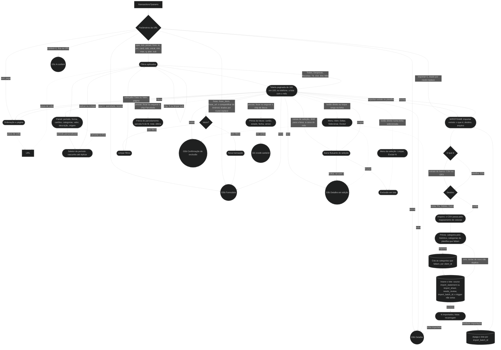

### 5b. Criar, editar e excluir

```mermaid
%%{init: {"theme": "dark"}}%%
flowchart TD
    open(["Formulário: modal no desktop, folha no mobile"]) --> type{"Tipo"}
    open -->|"criar"| frase(["WIREFRAME Frase rápida: escrever e Preencher; o Enter preenche e não salva"])
    frase -->|"Preencher: valor, descrição, data, tipo, forma, cartão, categoria pelo histórico"| type
    frase -.->|"com dúvida: o aviso Confira"| type
    type -->|"Despesa"| expense(["Valor, descrição, categoria, data, forma de pagamento"])
    type -->|"Receita"| income(["Valor, descrição, categoria, data"])
    type -->|"Parcelada"| inst(["Valor total ou por parcela, nº de parcelas, 1ª cobrança"])

    expense --> catPick(["Seletor de categoria"])
    income --> catPick
    catPick -->|"Gerenciar categorias"| G9(("G9 /categories"))
    expense -->|"forma: cartão de crédito"| cardPick(["Seletor de cartão"])
    cardPick -->|"Cadastrar cartão ou sem cartões"| G6(("G6 /credit-cards"))
    cardPick -.->|"sem cartão escolhido"| disabled(["Salvar desativado"])

    expense -->|"Salvar"| saveTx[("Insere transação; pela frase, source quick_text e needs_review com dúvida")]
    income -->|"Salvar"| saveTx
    income -->|"Estorno no cartão: escolher o cartão"| refund(["WIREFRAME Estorno: receita no crédito, com o cartão"])
    refund -->|"Salvar"| saveTx
    refund -.->|"abate a fatura do ciclo em que cai; fora da receita do Painel"| G6
    inst -->|"Salvar"| savePlan[("RPC create_workspace_installment_plan")]
    saveTx -->|"offline"| queued(["Salva na fila offline"])
    saveTx -->|"erro"| keep(["Aviso; formulário continua aberto"])
    saveTx -->|"sucesso"| after[("Edges evaluate-budgets, evaluate-credit-card-alerts")]
    saveTx -.->|"despesa manual, no insert"| notifyTrg[("Trigger transactions_notify_created: Edge notify-transaction-created avisa os membros")]
    after --> toast(["Transação criada; listas recarregam"])
    toast -->|"Ver, só online"| txOpen(("G5b Detalhe /transactions?txn=id"))
    savePlan -->|"sucesso"| toastPlan(["Compra parcelada registrada"])
    toastPlan -->|"Ver, só online"| planList(("G5 /transactions?plan=id"))
    open -->|"Cancelar, Esc ou fora, sem alterações"| closed(["Fecha e descarta"])
    open -->|"fechar com alterações"| discard(["Descartar alterações?"])
    discard -->|"Descartar"| closed
    discard -->|"Continuar editando"| open
    saveTx -.->|"salvando: nada fecha"| open

    detail(["Detalhe da transação"]) --> view(["Valor, data, categoria, forma, dica da fatura"])
    view -->|"é parcela"| planInfo(["Parcela k de n, total, lançado, restante"])
    view -->|"tem assinatura"| G8(("G8 /subscriptions"))
    view -->|"importado, a revisar ou Apple Pay com cartão da Wallet"| review(["WIREFRAME A conferir: Importado · a conferir"])
    review -->|"Confirmar"| reviewOk[("needs_review = false")] --> view
    review -->|"Lembrar 'nome' como este cartão, com o cartão escolhido"| walletAlias[("credit_cards.wallet_alias")] --> view
    review -->|"Desfazer importação do lote, confirmado"| reviewUndo[("Apaga o lote por import_batch_id")] --> sheetShut(["O detalhe fecha"])
    view --> attach(["WIREFRAME Anexos: lista, anexar foto ou PDF, abrir, apagar"])
    attach -->|"Anexar"| attachCheck{"Tipo aceito, até 10 MB e dentro da cota de 25 MB?"}
    attachCheck -->|"não"| attachErr(["Mensagem antes do envio"])
    attachCheck -->|"sim"| attachSave[("Foto vira WebP; objeto no bucket attachments e linha em attachments; a linha falhou, o objeto sai")]
    attachSave --> attach
    attach -->|"Abrir"| attachUrl(["URL assinada de 1 h em aba nova; popup bloqueado: link Abrir anexo, sem sair do app"])
    attach -->|"Apagar, confirmado"| attachDel[("Apaga a linha e o objeto")] --> attach
    view -->|"⋯ Editar"| editWhat{"É parcela?"}
    editWhat -->|"não"| editForm(["Editar campos"])
    editWhat -->|"sim"| scope(["O que editar: esta parcela ou plano da compra"]) --> editForm
    editForm -->|"Salvar: tira a marca, needs_review false"| updated(["Transação ou plano atualizado"]) --> view
    editForm -->|"Cancelar"| view
    view -->|"⋯ Excluir"| confirm(["Excluir transação?"])
    confirm -->|"Cancelar"| view
    confirm -->|"Excluir"| isInst{"É parcela?"}
    isInst -->|"não"| delTx[("Remove transação e os objetos dos anexos")] --> deleted(["Transação excluída"])
    isInst -->|"sim"| cascade[("RPC delete_workspace_installment_plan_cascade; objetos dos anexos ficam para o cron")] --> cancelled(["Compra parcelada cancelada"])
    confirm -.->|"offline"| queuedDel(["Exclusão enfileirada"])
```

### 5c. Captura sem abrir o app e "A conferir"

O Bloco 3A. A pessoa cria um token em Minha conta e instala o Atalho do iPhone
pelo guia; o Atalho e a automação do Apple Pay lançam pela Edge `capture`, como
a pessoa. O Android compartilha um texto, que abre o formulário com a frase.
O que tem dúvida cai em "A conferir", que o Painel conta e o lembrete das 20h
aponta.

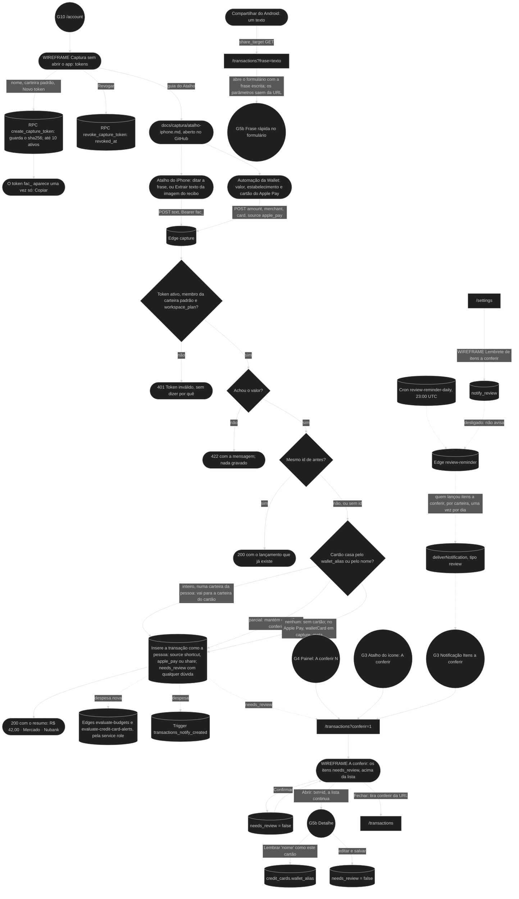

### Regras técnicas

| Ponto | Regra | Onde |
|---|---|---|
| Parâmetros | Lidos e gravados na URL; `new`, `txn` e `importar` são consumidos e removidos (`importar=1` abre o wireframe de importar e sai por `router.replace`, como o `new`). `frase`, `frase_titulo` e `frase_url` (o compartilhar do Android) também saem; `conferir=1` fica, porque é uma vista | `src/lib/transactions-list-search-params.ts`, `src/app/(app)/transactions/page-client.tsx` |
| Ordenação e página | `sort=date.desc` · `date.asc` · `amount.desc` · `amount.asc` e `page=N` (a partir de 1) vão para a URL e voltam dela, também no voltar e avançar; o padrão (`date.desc`, página 1) não é escrito. Trocar um filtro volta à página 1. Só na página, não no modo embutido | `src/components/transactions/use-transactions-list-controller.ts`, `src/lib/transactions-list-search-params.ts` |
| Tabela | `DataTable` em modo `manual` (o banco ordena e pagina): a seleção não alcança as projetadas, que também não abrem nem têm menu; o mês só agrupa ordenado por data; a barra de seleção é flutuante e cancelar a exclusão mantém a seleção; no telefone, a lista gerada das colunas | `src/components/transactions/transactions-table.tsx`, `src/components/ui/data-table.tsx` |
| Formulário | Um componente para criar, e o mesmo campo a campo na edição | `src/components/transactions/transaction-form-dialog.tsx`, `transaction-form-use.tsx` |
| Parcelada | RPC `create_workspace_installment_plan`; editar o plano não muda parcelas já lançadas | `src/components/transactions/transaction-form-persistence.ts` |
| Detalhe | Mesmo painel no Painel, em Cartões e em Categorias | `src/components/transactions/transaction-detail-sheet.tsx` |
| Exclusão | Parcela cancela o plano inteiro por `delete_workspace_installment_plan_cascade`. Continua com confirmação, e não com o Desfazer do toast: a exclusão é física (`delete`), sem `deleted_at` nem RPC de restaurar, e recriar mudaria o id e quebraria parcelas, recorrência e faturas (verificado na rodada 228) | `src/lib/transactions/mutations.ts` |
| "Ver" do toast | Criar uma transação (não editar) mostra "Ver", que leva a `/transactions?txn=id` e abre o detalhe; a compra parcelada leva a `?plan=id`. Offline não há id, e o toast sai sem "Ver". A trava que abre o `txn` uma vez só volta a soltar quando a URL perde o parâmetro — antes, com `/transactions` aberta, o segundo `?txn=` não abria nada | `persistTransactionSave` em `src/lib/transaction-detail-sheet-mutations.ts`, `transaction-form-persistence.ts`, `use-transactions-list-controller.ts` |
| Offline | Criar e excluir entram na fila; pagar conta exige conexão | `src/lib/offline/` |
| Aviso aos membros | O trigger `transactions_notify_created` (`AFTER INSERT` em `transactions`, só `expense` sem `subscription_id`, `installment_plan_id` nem `import_batch_id`: desde o Bloco 2 a importação não avisa) chama `notify-transaction-created` por `invoke_edge_function` (`pg_net`, `x-cron-secret`). A função repete o `WHEN` (`triggerSkipReason`, em `_shared/transaction-notify-rules.ts`) e responde 200 com `skipped` ao que ele pula, mesmo chamada por um Database Webhook antigo. O cliente não chama a função: a despesa offline avisa quando a fila a insere. Parcela e assinatura lançadas pelo cron não avisam. Sem segredo no Vault ou com falha de rede, a despesa é salva e o aviso se perde | `supabase/migrations/20261021120000_internal_edge_dispatch.sql`, `supabase/functions/notify-transaction-created/`, `supabase/functions/_shared/transaction-notify-rules.ts` |
| Rascunho | Fechar o formulário alterado (Cancelar, Esc, toque fora, ×, arrastar a gaveta) pergunta "Descartar alterações?"; salvar fecha sem perguntar. Trocar só a aba ou o tipo não conta como alteração. Enquanto salva, nada fecha (`Dialog pending`) | `isDirty` em `src/components/transactions/transaction-form-use.tsx`, `src/components/transactions/transaction-form-dialog.tsx` |
| Enter | O `Enter` na busca do seletor não salva a transação: o popover é portalizado, e a submissão implícita do navegador só conta os campos cujo dono no DOM é o `<form>` | `Form` em `src/components/ui/form.tsx` |
| Período personalizado | Um `DatePicker` de intervalo com `confirm`: as pontas ficam em rascunho até Aplicar, Limpar tira o filtro, Cancelar e Esc descartam. Era um formulário à parte (`transactions-date-range-form.tsx`, removido) | `src/components/transactions/transactions-filters-panel.tsx` |
| Prévias dos chips | O chip de fatura e o "Parcelada" abrem uma prévia ao pousar, no foco e no toque longo (`HoverCard`); o clique no chip continua abrindo o detalhe da linha. A da fatura leva a "Ver cartão" (o ciclo atual: a página do cartão não abre uma fatura passada por parâmetro). O chip de fatura só existe a partir de `md` | `CreditInvoiceChip` e `InstallmentChip` em `src/components/transactions/transactions-table.tsx` |
| Importar extrato ou planilha (Bloco 2) | Wireframe acima da barra, pelo link "Importar extrato ou planilha" ou `?importar=1`. Extrato do banco (CSV ou OFX, `source = 'import_statement'`) ou planilha da pessoa (CSV, `import_sheet`), numa conta (Pix, Débito, Outro) ou num cartão. A categoria vem do histórico (a descrição normalizada igual; senão, a transação mais recente com a mesma primeira palavra significativa); as categorias da planilha que faltam são criadas antes. Todo item importado nasce com `needs_review` e o `client_id` gerado uma vez: repetir "Importar" não duplica. Parcela vira despesa simples com "(k/n)" na descrição. "Desfazer importação" apaga o lote (`import_batch_id`). Não avisa os membros nem dispara alerta de orçamento ou de cartão | `src/components/wireframe/importar-extrato-wireframe.tsx`, `src/components/wireframe/mapeamento-csv.tsx`, `src/lib/import/` |
| Estorno no cartão (Bloco 2) | No formulário de receita, a caixa "Estorno no cartão" grava `payment_method = 'credit_card'` com o cartão. O estorno abate a fatura do ciclo em que cai (que pode ficar negativa, saldo credor), reduz a despesa do mês de fechamento e não conta como receita no Painel | `src/components/wireframe/estorno-wireframe.tsx`, `formaDoPayload` em `src/components/transactions/transaction-form-use.tsx`, `src/lib/expense-month-attribution.ts` |
| A conferir (Bloco 2) | No detalhe, o lançamento importado ou com `needs_review` mostra "Importado · a conferir". "Confirmar" tira o `needs_review`; "Desfazer importação do lote", depois do `confirm`, apaga o lote inteiro e fecha o detalhe. A lista "A conferir" veio no Bloco 3A (`?conferir=1`) | `src/components/wireframe/a-conferir-wireframe.tsx`, `src/components/transactions/transaction-detail-sheet.tsx` |
| Frase rápida (Bloco 3A) | Só ao criar, no topo do formulário: o wireframe "Frase rápida" lê a frase ("42 mercado nubank") com o mesmo parser da Edge (`_shared/frase.ts`) e, em "Preencher" ou no Enter, preenche valor, descrição, data, tipo, forma, cartão e a categoria pelo histórico da carteira (`carregarHistoricoDaFrase`, sem travar offline). Não salva: quem salva é a pessoa, pelo botão de sempre. O payload ganha `source: 'quick_text'` e, com dúvida do parser, `needsReview: true`; a categoria escolhida à mão conta como conferida. O Enter do campo chama `preventDefault` e não envia o formulário | `src/components/wireframe/frase-rapida-wireframe.tsx`, `src/lib/captura/frase-no-form.ts`, `src/components/transactions/transaction-form-use.tsx` |
| Editar tira a marca (Bloco 3A) | Toda edição salva grava `needs_review = false`; a criação só grava `source` e `needs_review` quando o payload os traz | `buildTransactionRow` em `src/lib/transactions/mutations.ts` |
| Compartilhar do Android (Bloco 3A) | O `share_target` do manifest é `GET /transactions` com `text`, `title` e `url` em `frase`, `frase_titulo` e `frase_url`. A tela junta os três (até 500 caracteres), abre o formulário de despesa pelo `openTransactionCreate` da casca com a frase escrita, sem aplicar, e tira os três da URL. Com o formulário já aberto, a frase nova troca a do campo. Só texto: arquivo pediria POST com service worker | `consumirParametroFrase` em `src/lib/transactions-list-search-params.ts`, `src/app/(app)/transactions/page-client.tsx`, `src/app/manifest.ts` |
| Captura (Bloco 3A) | A Edge `capture` aceita só JSON até 16 KB (`text`, ou `amount` + `merchant` + `card`; `date`, `id` e `source` opcionais) com `Authorization: Bearer fac_…`. Procura o token pelo `sha256`; revogado, desconhecido ou mal formado é o mesmo 401. Depois confere o `workspace_plan` da carteira padrão (402 sem plano) e se a pessoa ainda é membro dela. Grava com a service role repetindo a RLS: o autor é o dono do token, e cartão e categoria são da carteira de destino. Sem valor, 422 e nada gravado. Com `id`, o `client_id` deriva de `sha256(token_id:id)` e o retry devolve o mesmo lançamento. `needs_review` com qualquer dúvida do parser, cartão de crédito citado sem casar, nenhuma categoria pelo histórico ou compra parcelada. Despesa nova chama `evaluate-budgets` e `evaluate-credit-card-alerts` com o Bearer da service role; o aviso aos membros é o do trigger | `supabase/functions/capture/`, `supabase/functions/_shared/captura.ts`, `supabase/functions/_shared/frase.ts` |
| Apple Pay e lembrar cartão (Bloco 3A) | O cartão casa pelo `wallet_alias` ou pelo nome (`casarCartao`); casamento parcial mantém o cartão e marca a conferir; sem casamento, grava crédito sem cartão, a conferir, com o nome da Wallet em `capture_meta.walletCard`. No detalhe, com um cartão escolhido, o wireframe oferece "Lembrar '<nome>' como este cartão", que grava `credit_cards.wallet_alias` (até 60 caracteres); a próxima captura casa. Aparece também no item já conferido, só com o "Lembrar" | `src/components/wireframe/a-conferir-wireframe.tsx`, `src/components/transactions/transaction-detail-sheet.tsx` |
| A conferir: lista (Bloco 3A) | `?conferir=1` mostra, acima da lista de sempre, o wireframe com os lançamentos `needs_review` da carteira. "Confirmar" tira a marca; "Abrir" leva a `?txn=id` mantendo a lista; "Fechar" tira o `conferir` da URL. Não é filtro do controlador da lista: vira filtro na revisão de tela | `src/components/wireframe/a-conferir-lista-wireframe.tsx`, `src/app/(app)/transactions/page-client.tsx` |
| Avaliadores pelo servidor (Bloco 3A) | `evaluate-budgets` e `evaluate-credit-card-alerts` aceitam o Bearer da service role ou o `x-cron-secret` (`isServiceAuthorized`, agora em `_shared/service-auth.ts`), além do JWT da pessoa; pelo servidor, o corpo traz o `workspace_id`, e a checagem de membro é pulada | `supabase/functions/_shared/service-auth.ts`, `supabase/functions/evaluate-budgets/`, `supabase/functions/evaluate-credit-card-alerts/` |
| Anexos (Bloco 2) | No detalhe, a seção de anexos: WebP, JPEG, PNG ou PDF, até 10 MB, e 25 MB por carteira; a foto vira WebP de lado maior 1600 px. O objeto mora em `<workspace_id>/<uuid>.<ext>` no bucket privado `attachments`, e a cota conta o tamanho real do objeto (`attachments_enforce_quota`). Se a linha falha depois do envio, o objeto é apagado. "Abrir" pede uma URL assinada de 3600 s numa aba aberta no clique; com o popup bloqueado, a seção mostra o link "Abrir anexo" com a URL assinada (`target="_blank"`), e a pessoa não sai do app. Excluir a transação avulsa apaga os objetos; em lote, parcelada ou offline, quem apaga é o cron semanal | `src/components/wireframe/anexos-wireframe.tsx`, `src/lib/anexos.ts`, `src/lib/transactions/mutations.ts`, `supabase/migrations/20261022130000_anexos.sql` |
| Botão direito na linha | Atalho das ações da linha (os botões da coluna Ações continuam); sobre uma linha selecionada age na seleção inteira (`contextMenuTargets`); linhas projetadas não têm menu | `TransactionRowContextMenu` em `src/components/transactions/transactions-table.tsx` |

---

## 6. Cartões e faturas

`/credit-cards` e `/credit-cards/[cardId]`: cadastro dos cartões e o ciclo de
cada fatura.

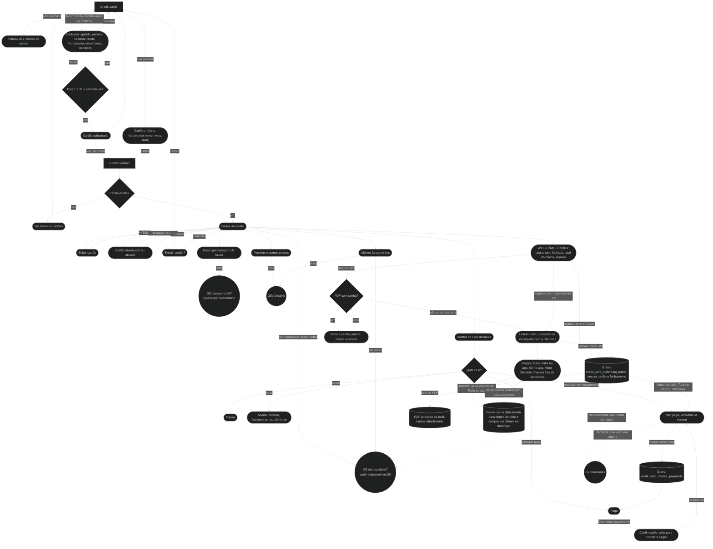

### Regras técnicas

| Ponto | Regra | Onde |
|---|---|---|
| Status no detalhe | `Futura`, `Aberta`, `Não paga`, `Paga`, pelo ciclo selecionado | `src/app/(app)/credit-cards/[cardId]/page-client.tsx` |
| Selo na tabela de transações | `Aberta`, `Fechada`, `Anterior`, `Paga`; Aberta é verde, Fechada âmbar, Anterior vermelha | `src/lib/credit-card-display.ts` |
| Pagamento de fatura | Linha em `credit_card_invoice_payments`, sem criar despesa | `src/lib/bills/pay-bill-flow.ts` |
| "Ver" do toast | Cadastrar um cartão (pela página ou pelo diálogo do "+ Adicionar") mostra "Ver", que leva a `/credit-cards/id`; na fila offline, sem "Ver" | `src/app/(app)/credit-cards/page-client.tsx`, `src/components/credit-cards/credit-card-create-dialog.tsx` |
| Conferir fatura (Bloco 2) | Wireframe na página do cartão, sobre os ciclos já fechados. O arquivo do banco é `.pdf` (lido no aparelho por `pdfjs-dist`, sem IA; com senha, pede e tenta de novo, e a errada mostra "Senha incorreta"), `.csv` (com o mapeamento de colunas) ou `.ofx`. A leitura cuja soma não fecha com o total fica incompleta e mostra a diferença, e ainda deixa importar o que achou. Os grupos são Bate, Falta no app, Só no app, Valor diferente e Parcela fora de sequência; o que já foi importado cai em Bate. "Importar selecionados" grava os itens de Falta no app como despesas do cartão (estorno como receita), com a data levada para dentro do ciclo (`ajustarAoCiclo`, que acrescenta "compra em dd/mm" à descrição), `source` `import_pdf` (PDF) ou `import_statement` (CSV, OFX), `needs_review` e o lote em `import_batch_id`, e recarrega só os lançamentos do cartão | `src/components/wireframe/conferir-fatura-wireframe.tsx`, `src/lib/fatura/ciclo.ts`, `src/lib/fatura/conferir.ts`, `src/lib/import/pdf-texto.ts`, `src/lib/import/fatura-texto.ts` |
| Total do banco (Bloco 2) | Gravar o total (digitado ou lido) faz um `upsert` em `credit_card_statement_totals` (`workspace_id`, `credit_card_id`, `statement_close_date`), com `source` `manual`, `pdf`, `csv` ou `ofx`. Lido de PDF, o PDF vira anexo do total (o mesmo PDF não sobe duas vezes; falhar aqui não desfaz o total). Numa fatura fechada, o painel mostra "Total do banco · diferença", e o Painel, Contas a pagar e os avisos de fatura da Edge usam o total do banco no lugar do calculado | `src/components/wireframe/conferir-fatura-wireframe.tsx`, `src/lib/fatura/total-com-banco.ts`, `src/components/credit-cards/credit-card-invoice-analytics-panel.tsx` |
| Estorno (Bloco 2) | A fatura é despesas menos estornos (receita no cartão), e pode ficar negativa; os percentuais por categoria seguem sobre o gasto bruto. Os alertas de limite, fechamento e vencimento descontam o estorno | `src/lib/credit-card-billing.ts`, `src/lib/credit-card-invoice-analytics.ts`, `supabase/functions/_shared/credit-card-cycle.ts` |
| Alertas | Limite, fechamento e vencimento geram notificações `cc_*`. A compra parcelada no cartão roda a conferência de limite, como a despesa avulsa. Numa fatura fechada (fechou, vence em breve, vence hoje e, no limite, a última fechada não paga), o valor é o total do banco quando gravado (`escolherTotal` em `_shared/credit-card-cycle.ts`, a regra de `totalComBanco`); o calendário lê `credit_card_statement_totals` numa consulta só por execução. A fatura que ainda fecha usa o calculado | edges `evaluate-credit-card-alerts`, `credit-card-calendar-alerts`; `src/components/transactions/transaction-form-persistence.ts` |

---

## 7. Contas a pagar

`/bills` (Beta): contas recorrentes e o que está pendente, incluindo as faturas
de cartão que fecharam em aberto.

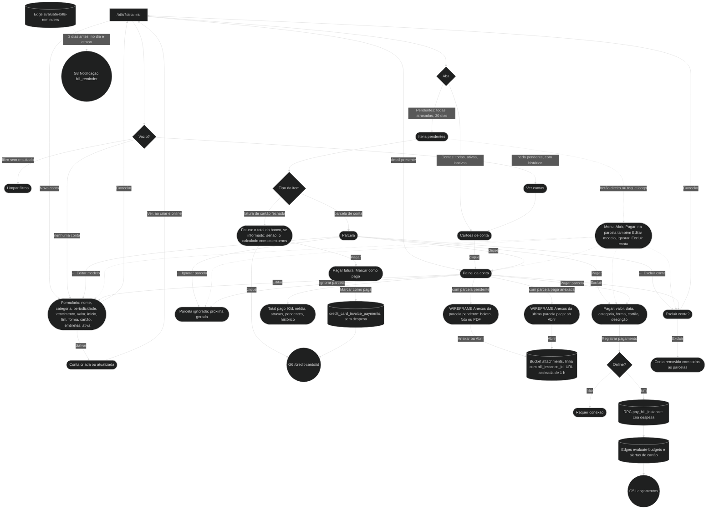

### Regras técnicas

| Ponto | Regra | Onde |
|---|---|---|
| Dados | Um RPC traz a página inteira; desde o Bloco 2 ele traz também as receitas no cartão (os estornos), e o total do banco das faturas vem à parte (`credit_card_statement_totals`) | `rpc_fetch_bills_page_bundle` em `src/lib/queries/fetch-bills-page-bundle.ts`, `supabase/migrations/20261022121000_bills_bundle_estornos.sql`, `src/lib/queries/use-statement-totals.ts` |
| Fatura como pendência | Projetada no cliente a partir dos ciclos fechados com valor em aberto. O valor é o total do banco quando a pessoa o informou na conferência da fatura; senão, o calculado (despesas menos estornos). Total zero ou negativo (saldo credor) não vira pendência | `src/lib/bills/credit-card-bill-projector.ts`, `src/lib/fatura/total-com-banco.ts` |
| Anexos (Bloco 2) | O painel da conta (`?detail=`) mostra os anexos da parcela pendente que ele exibe (`bill_instance_id`), com as mesmas regras dos anexos do lançamento, e abaixo os da última parcela paga (por vencimento), só para abrir: sem anexar nem apagar, e a seção some se ela não tem anexo | `src/components/bills/bill-detail-sheet.tsx`, `src/components/wireframe/anexos-wireframe.tsx` |
| Pagar conta | `pay_bill_instance` cria a despesa e avança a recorrência; bloqueado offline | `src/lib/bills/pay-bill-flow.ts` |
| Pagar fatura | Só marca como paga: as compras já estão lançadas no cartão | `src/lib/bills/pay-bill-flow.ts` |
| Recorrência | Mensal, Bimestral, Trimestral, Anual, Única | `src/lib/bills/recurrence.ts` |
| Botão direito | No cartão de pendência, repete o "Pagar" e o menu de três pontos, que continuam à vista | `src/components/bills/bill-pending-card.tsx` |
| "Ver" do toast | Criar uma conta mostra "Ver", que leva a `/bills?detail=id` e abre o painel dela (sem levar os outros filtros da URL); na fila offline, sem "Ver" | `src/app/(app)/bills/page-client.tsx` |

---

## 8. Assinaturas

`/subscriptions`: cobranças recorrentes que viram lançamentos sozinhas.

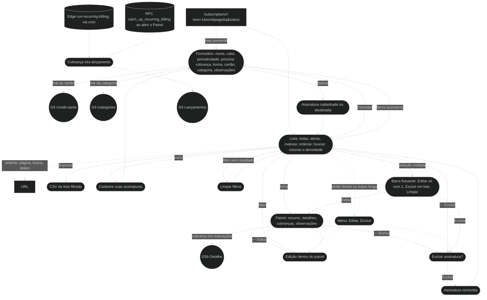

### Regras técnicas

| Ponto | Regra | Onde |
|---|---|---|
| Dados | `rpc_fetch_subscriptions_page_bundle` | `src/lib/queries/fetch-subscriptions-page-bundle.ts` |
| Periodicidade | Semanal, Mensal, Bimestral, Anual | `src/components/subscriptions/subscription-form-dialog.tsx` |
| Cobrança | `run-recurring-billing` só aceita chamada com `CRON_SECRET`; o Painel recupera o atraso | `supabase/functions/run-recurring-billing/index.ts` |
| Filtro por assinatura | `/transactions?sub=id` | `src/lib/transactions-list-search-params.ts` |
| Estado na URL | `sort=<coluna>.<asc\|desc>`, `page=N` (a partir de 1), `q` (a busca) e `status=active` ou `inactive`, lidos ao abrir e gravados a cada troca; trocar de carteira zera os quatro | `urlState` do `DataTable` em `src/app/(app)/subscriptions/page-client.tsx` |
| Tabela | `DataTable` no cliente: busca sem acento, exportar CSV, colunas e densidade guardadas; Excluir da linha está no ⋯ (Editar fica à vista); cancelar a exclusão em lote mantém a seleção | `src/app/(app)/subscriptions/page-client.tsx` |

---

## 9. Categorias e orçamentos

`/categories`: as categorias da carteira e o limite mensal de cada uma. Não há
tela separada de orçamento: o limite mora na categoria. Na primeira visita de
cada carteira aparece um assistente.

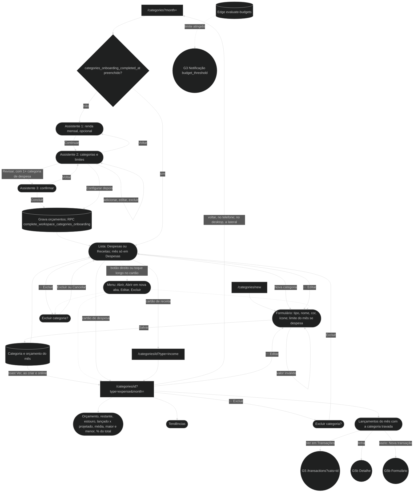

### Regras técnicas

| Ponto | Regra | Onde |
|---|---|---|
| Assistente | Só em `/categories`, por carteira; nada redireciona para ele | `src/components/categories/categories-onboarding-wizard.tsx` |
| Detalhe | `rpc_fetch_category_detail_bundle` | `src/lib/queries/fetch-category-detail-bundle.ts` |
| "Ver" do toast | Criar uma categoria (pela tela ou pelo diálogo do "+ Adicionar") mostra "Categoria criada" com "Ver", que leva a `/categories/id?type=`; se o orçamento falhar, o aviso "Categoria criada, mas o orçamento não foi salvo" leva ao mesmo detalhe. Na fila offline, sem "Ver". A tela de categorias não mostrava toast nenhum ao criar | `src/components/categories/category-create-dialog.tsx`, `src/app/(app)/categories/page-client.tsx` |
| Entradas no detalhe | Lista de categorias, gasto por categoria do cartão, notificação de orçamento | `src/components/categories/detail/` |
| Orçamento | Avaliado depois de cada despesa criada ou editada e de cada conta paga; mudar o valor do orçamento rearma os avisos de 80%, 100% e estouro. Criar a categoria não notifica mais | edge `evaluate-budgets`, `src/lib/category-budget-ops.ts` |
| Botão direito | No cartão de categoria, o menu toma o lugar do menu do navegador sobre o link, por isso traz "Abrir em nova aba"; o ⋯ continua | `src/components/categories/category-card-context-menu.tsx` |

---

## 10. Conta e segurança

`/account` e subpáginas: o que é da pessoa, não da carteira.

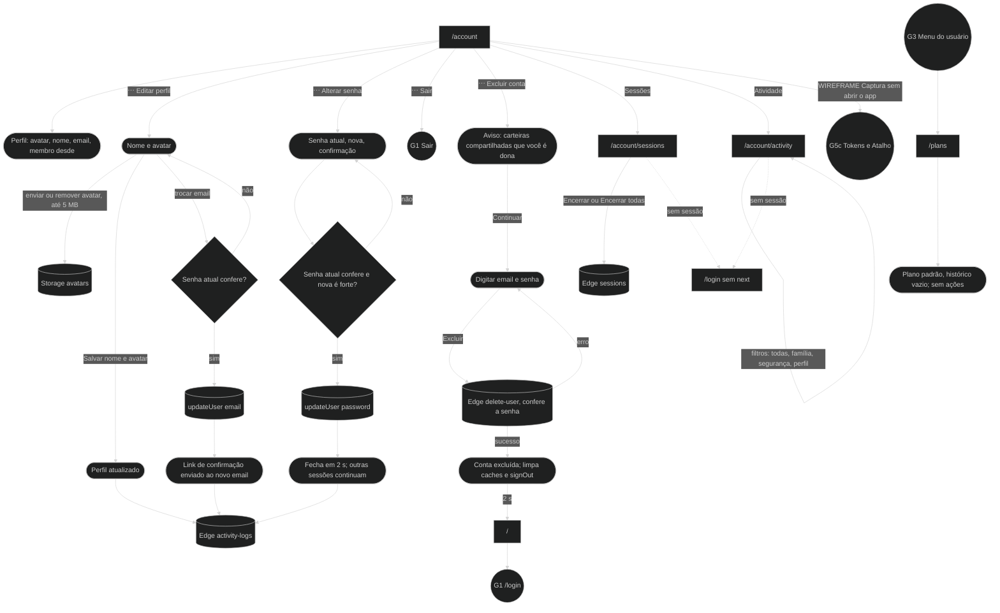

### Regras técnicas

| Ponto | Regra | Onde |
|---|---|---|
| Troca de email e senha | Confere a senha atual entrando de novo antes de `updateUser` | `src/components/account/edit-profile-dialog.tsx`, `src/components/security/ChangePasswordDialog.tsx` |
| Excluir conta | Dois passos; a senha é conferida na Edge Function | `src/components/security/DeleteAccountDialog.tsx`, `src/lib/delete-account.ts` |
| Sessões | Listar e encerrar pela edge `sessions` | `src/lib/sessions.ts` |
| Atividade | Perfil, email e senha gravam log | edge `activity-logs` |
| Tokens de captura (Bloco 3A) | Seção "Captura sem abrir o app" (wireframe): nome do aparelho (1 a 60 caracteres) e carteira padrão; "Novo token" chama `create_capture_token`, que devolve o `fac_…` uma vez só, para copiar; "Revogar" chama `revoke_capture_token`. A lista lê só as colunas sem o hash e nunca mostra o valor. Até 10 ativos por pessoa. O link do guia abre `docs/captura/atalho-iphone.md` no GitHub | `src/components/wireframe/captura-tokens-wireframe.tsx`, `docs/captura/atalho-iphone.md` |

---

## 11. Lacunas encontradas

Coisas que o mapeamento achou no caminho. As de acesso foram corrigidas na
rodada de set/2026 e estão registradas abaixo da tabela; as que sobraram
continuam aqui para registro.

| # | Jornada | Lacuna |
|---|---|---|
| 1 | G2 | `/members` mostra o formulário de convite numa carteira pessoal, e o servidor recusa só depois do envio. |
| 2 | G3 | O provider global expõe abrir convite, mas nada chama essa função. (Nova categoria e novo cartão saem da paleta ⌘K desde 16/out/2026.) |
| 3 | G10 | `/account/sessions` e `/account/activity` redirecionam para `/login` sem `next`, então a pessoa não volta para a página depois de entrar. |
| 4 | G1 | A política de senha não vale para a troca de senha de dentro do app (`ChangePasswordDialog`), que ainda confere só o comprimento. |
| 5 | G8 | O detalhe de uma assinatura só abre pelo estado da tela; nenhum parâmetro de URL o abre (só existe `?new=1`). Por isso o toast de assinatura criada não tem "Ver", ao contrário de transação, cartão, conta e categoria (rodada 228). |
| 6 | G5 | Excluir uma transação é físico e sem volta: não há `deleted_at` nem RPC de restaurar, então o "Desfazer" do toast não substitui a confirmação. Ter o desfazer exige exclusão lógica no banco. |
| 7 | G2 | Os erros de carga do diretório de membros mostram ao usuário o arquivo SQL e a RPC a aplicar — texto de desenvolvedor (`members/page-client.tsx`). |
| 8 | G3 | O servidor das notificações foi revisado (textos, `?month=` no link do orçamento, regras de disparo), e o aviso de despesa e os crons passaram para uma migração (trigger e `pg_cron` com Vault). **Banco e funções publicados em 21/10/2026**: produção já manda os textos e as regras novas, o aviso de despesa vem do trigger e os dois crons diários estão agendados (não havia Webhook). Falta o front novo, depois dele apagar a `dispatch-notifications`, o teste de fumaça com duas pessoas e o backup semanal: ver `supabase/NOTIFICATION_DEPLOYMENT.md`. |
| 9 | G5 | Só a exclusão avulsa online apaga o objeto do anexo na hora. A exclusão em lote, a de compra parcelada (o plano sai em cascata no banco), a feita offline e o desfazer de um lote importado apagam as linhas de `attachments` em cascata, mas deixam os objetos no bucket até o cron `attachments-cleanup-weekly` (domingo) apagar o que não tem linha e passou de 24 h. Até lá eles ocupam o armazenamento do projeto, não a cota da carteira. |
| 12 | G5, G6, G7 | O Bloco 2 (estorno, total do banco, conferência da fatura, importação e anexos) está no repositório, com as telas em wireframe. **Banco e funções publicados em 21/10/2026** (migrações, bucket, políticas e cron conferidos); o front novo não foi publicado, então ninguém usa nada disso ainda. Aberta até o front subir e o teste de fumaça passar: `supabase/BLOCO_2_DEPLOYMENT.md`. |
| 14 | G3, G4, G5, G10 | O Bloco 3A (captura sem abrir o app) está no repositório, com as telas em wireframe, e **nada foi publicado**. O backend pode subir antes do front, porque nada dele aparece no front de `main`: `supabase/BLOCO_3A_DEPLOYMENT.md`. |
| 15 | G5 | Imagem crua, PDF e arquivo compartilhado ficam para o Bloco 3B (IA). A `capture` só aceita JSON (a foto do recibo passa pelo "Extrair texto da imagem" do Atalho), e o compartilhar do Android só leva texto. |
| 16 | G5 | Uma compra parcelada capturada vira um lançamento simples, com "(1/N)" na descrição e a conferir; o plano de parcelas no servidor fica para o 3B. |
| 17 | G5 | Uma compra parcelada escrita na frase rápida do formulário é salva pelo `create_workspace_installment_plan` com `source` `app` e sem a marca de a conferir. |
| 18 | G5 | Um item do Apple Pay com casamento parcial gravado antes de a `capture` guardar o `walletCard` nesse caso não tem `capture_meta.walletCard` e não oferece "Lembrar". |
| 19 | G10 | O link do guia do Atalho aponta para `docs/captura/atalho-iphone.md` em `main` no GitHub e dá 404 até o `finance-app-2.0` ir para `main`. |
| 20 | G5 | A captura pelo WhatsApp está pendente (Bloco 3B), à espera das contas de terceiros. |

### Fechadas na rodada de acesso (set/2026)

| Era | Lacuna | O que fechou |
|---|---|---|
| 1 | "Confirme seu e-mail" aparecia mesmo quando o `signUp` voltava com sessão | A condição passou a ser só `data.session`, sem exigir `next` |
| 2 | `/login` e `/register` sem guarda para quem já entrou | `AuthSignedInRedirect`, com `/forgot-password`, `/reset-password` e `/invites/accept` isentas |
| 3 | Dois fluxos de redefinir senha que não se conversavam | Um formulário só, com duas portas de entrada |
| 4 | Erro de esqueci/redefinir senha em inglês | Tudo passa por `formatAuthErrorMessagePt` |
| 5 | `/invites/accept` cercada pela casca do app para quem não entrou | A rota foi para o grupo `(auth)` |

### Fechadas em 12/out/2026

| Era | Lacuna | O que fechou |
|---|---|---|
| 1 | O `next` se perdia na recuperação de senha | `recoveryLinks` o leva do pedido ao `redirectTo`, a "Pedir novo código" e ao login final |
| 2 | Sem como reenviar o código ou o e-mail de confirmação | "Reenviar código" e "Reenviar e-mail", com espera de 60 s |
| 3 | O fallback de carregamento do convite ficava fora do casco | Passou a vestir o `AuthShell` |

Risco conhecido: o `redirectTo` com `?next=` só funciona se a allowlist de
redirecionamento do Supabase, configurada fora do repositório, aceitar a query
string. Se recusar, o link cai na Site URL como antes.

### Fechadas em 21/out/2026

| Era | Lacuna | O que fechou |
|---|---|---|
| 10 | O painel da conta mostrava só os anexos da parcela pendente; o boleto da parcela paga sumia | O painel mostra também os anexos da última parcela paga, só para abrir (`AnexosWireframe somenteLeitura`) |
| 11 | Com o popup bloqueado, "Abrir" um anexo levava a URL assinada à mesma janela, e a pessoa saía do app | Com o popup bloqueado, a seção mostra o link "Abrir anexo" com a URL assinada, numa aba nova |
| 13 | Os avisos de fatura da Edge usavam o total calculado e podiam discordar do total do banco | `credit-card-calendar-alerts` e `evaluate-credit-card-alerts` usam o total do banco na fatura fechada (`escolherTotal`, `_shared/credit-card-cycle.ts`), lido numa consulta só por execução |
