# Jornadas do app

O mapa de tudo o que uma pessoa faz no app, dividido em onze jornadas. Cada
jornada tem um fluxograma, as regras técnicas que decidem os caminhos e as
lacunas encontradas no código. Foi escrito lendo o código em 2026-09-17, na
branch `finance-app-2.0`, e a navegação global foi revista em 2026-10-01,
quando entrou a busca (⌘K), junto com o menu do botão direito nas linhas de
lançamento, nos cartões de categoria e nas contas pendentes, com o seletor
de período que confirma no próprio popover, com o rascunho protegido do
formulário de lançamento, e com os menus do telefone em gaveta. As telas de
acesso foram revistas em 2026-10-12 (a casca no layout) e em 2026-10-14 (o
painel de marca animado). Quando uma tela mudar de caminho, atualize o
diagrama dela.

## Como ler os diagramas

| Forma | Significa |
|---|---|
| `["/rota"]` retângulo | Página ou rota |
| `(["Diálogo"])` cápsula | Modal, folha, popover, menu |
| `{"Condição"}` losango | Guarda de rota ou decisão |
| `[("backend")]` cilindro | Supabase: Edge Function, RPC, trigger, tabela |
| `(("G5 Lançamentos"))` círculo | Saída para outra jornada |

O rótulo da seta é a ação da pessoa ou a condição (`sucesso`, `erro`,
`cancelar`). Os diagramas usam o tema escuro do Mermaid (`%%{init}%%` no topo
de cada bloco), em qualquer tema do leitor.

**Tudo o que decide acesso roda no navegador.** Não há `middleware.ts`,
`proxy.ts` nem rotas em `src/app/api`. A sessão é do `supabase-js`, os
redirecionamentos são do `AuthGuard` e a segurança real dos dados é a RLS do
banco.

## Sumário

0. [Mapa geral](#0-mapa-geral)
1. [Acesso: entrar, criar conta, senha e sair](#1-acesso-entrar-criar-conta-senha-e-sair)
2. [Carteiras e colaboração](#2-carteiras-e-colaboração)
3. [Navegação e ações globais](#3-navegação-e-ações-globais)
4. [Painel](#4-painel)
5. [Lançamentos](#5-lançamentos)
6. [Cartões e faturas](#6-cartões-e-faturas)
7. [Contas a pagar](#7-contas-a-pagar)
8. [Assinaturas](#8-assinaturas)
9. [Categorias e orçamentos](#9-categorias-e-orçamentos)
10. [Conta e segurança](#10-conta-e-segurança)
11. [Lacunas encontradas](#11-lacunas-encontradas)

---

## 0. Mapa geral

Como as jornadas se ligam. O Painel é o centro; Lançamentos é para onde quase
tudo desagua, porque assinatura, parcela e conta paga viram lançamento.

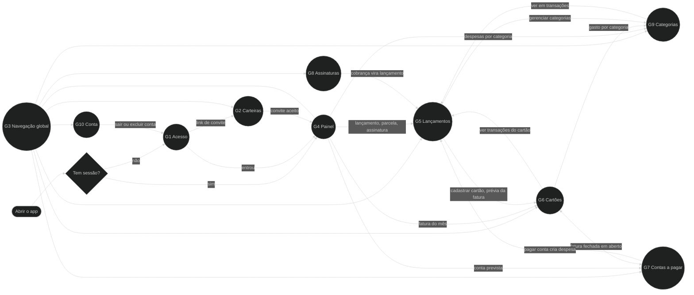

---

## 1. Acesso: entrar, criar conta, senha e sair

Tudo o que acontece antes de a pessoa estar dentro do app, e a volta para fora.
Criar conta e entrar são a mesma jornada: as duas telas se ligam e dividem o
parâmetro `next`. **O login social saiu** em set/2026; a autenticação é
e-mail e senha.

As cinco telas dividem uma casca só, e **a casca vive no layout de `(auth)`; o
formulário publica o id da cena.** O `AuthFrame` (`src/components/layout/auth-frame.tsx`)
monta o `SplitShellRoot` com o painel de marca uma vez, então o painel é o
mesmo nó entre as cinco rotas e troca de cena em vez de remontar: a partir de
48rem do próprio casco (container query); no telefone só o wordmark
(`asideMobile="logo"`); coluna de formulário à esquerda, painel à direita
(`side="end"`). Cada formulário devolve só a coluna, o `AuthShell`, com o id
da cena (`scene`), porque o título e a cena mudam com o estado (o cadastro vira
"Confira seu e-mail", a recuperação troca a cada passo). Sem id publicado, a
cena sai do caminho (`defaultSceneFor`). Todo estado devolve o `AuthShell` no
mesmo lugar da árvore, e a troca de `step` leva o foco ao título.

**O painel é um palco animado, e a família da cena decide o aparelho.** Desde
14/out/2026 o painel desenha o próprio app num aparelho (`AuthShowcase`, sobre
o `Showcase` do design system), com uma colagem de depoimentos ilustrativos em
volta e uma legenda no pé; os números e os nomes são de exemplo, e a tela diz
isso. Login no **navegador** (a busca ⌘K se digita sozinha até a fatura, e a
janela vira celular e volta), convite no **tablet** da casa, cadastro e
recuperação no **celular** (o fim da recuperação volta ao navegador). Trocar
de rota troca a cena no mesmo nó: o aparelho muda de forma e gira, sem
remontar e sem tocar a entrada de novo. O palco é `inert` e `aria-hidden`,
repousa em até 5 s, nasce no quadro final com movimento reduzido e não roda
no telefone, onde fica só o wordmark. **Nenhum caminho mudou**: o palco não tem link, campo nem foco, e
as cenas são uma tabela só (`src/components/auth/showcase/scenes.ts`).

### 1a. Entrada, login e cadastro

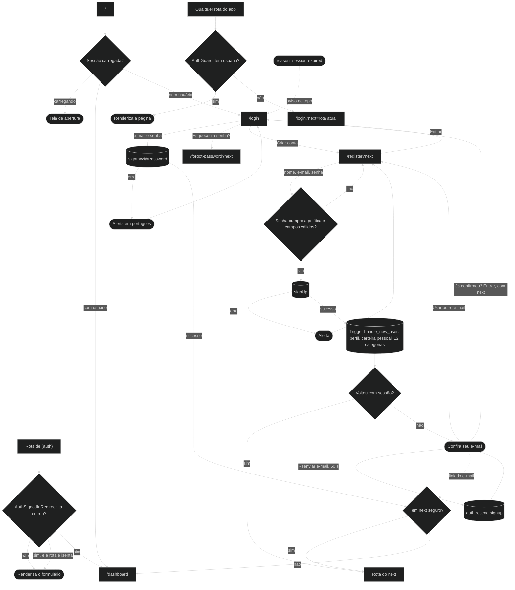

### 1b. Senha e saída

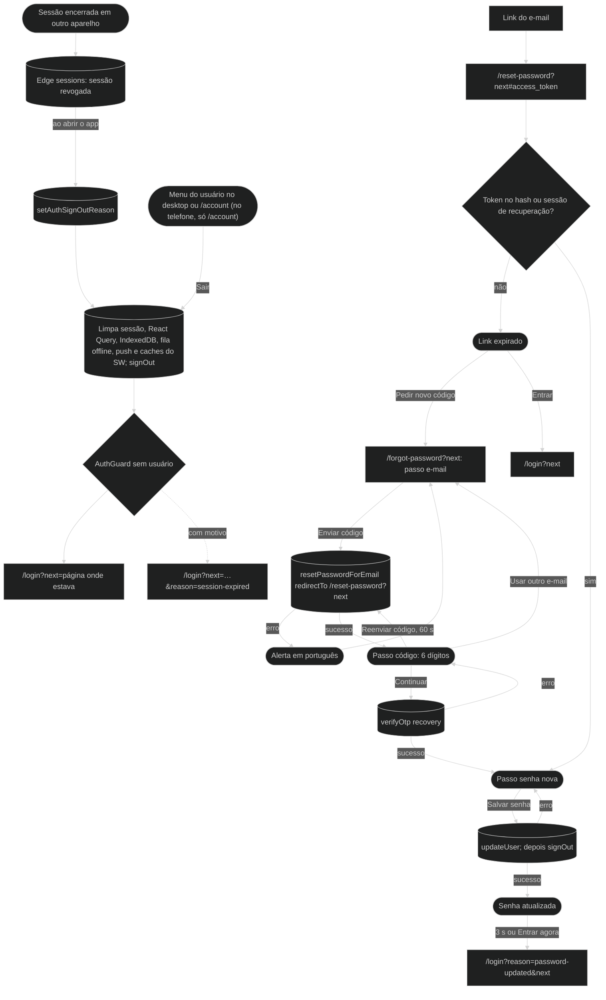

### Regras técnicas

| Ponto | Regra | Onde |
|---|---|---|
| Bootstrap | `/` manda para `/dashboard` ou `/login` depois de a sessão carregar; o sinal de carregando só aparece depois de 600 ms | `src/app/page-client.tsx`, `src/components/layout/app-bootstrap-screen.tsx` |
| Guarda | Toda rota de `(app)` sem usuário vai para `/login?next=` com `replace`. Sem exceções: `/invites/accept` saiu do grupo | `src/components/layout/auth-guard.tsx` |
| Guarda invertida | Quem já entrou em `(auth)` vai para o `next` ou o Painel. Isentas: `/forgot-password` e `/reset-password` (o `verifyOtp` cria sessão antes da troca de senha) e `/invites/accept` | `src/components/layout/auth-signed-in-redirect.tsx` |
| `next` | Só caminho interno começando com `/`; o padrão é `/dashboard` | `src/lib/auth-return-path.ts` |
| Casca | A casca vive no layout de `(auth)` (`AuthFrame`: `SplitShellRoot` e painel de marca, o mesmo nó entre as rotas); o formulário devolve só a coluna (`AuthShell`, um `SplitShellMain`) e publica o id da cena por `useAuthScene`. Sem publicação, `defaultSceneFor(pathname)`; o frame nunca lê a query. O `AuthStatus` saiu: a tela de status é o `AuthShell` com `icon` e `step` próprio. O painel desenha a cena pela tabela `SCENES`: navegador no login, tablet no convite, celular no cadastro e na recuperação | `src/app/(auth)/layout.tsx`, `src/components/layout/auth-frame.tsx`, `src/components/layout/auth-shell.tsx`, `src/components/auth/showcase/scene-context.tsx`, `src/components/auth/showcase/scenes.ts` |
| Senha | Uma política só — 8+, minúscula, maiúscula, número e símbolo — aplicada no cadastro e na redefinição | `src/lib/password-policy.ts` |
| Recuperação | Um formulário, duas portas: `/forgot-password` começa no código de 6 dígitos, `/reset-password` entra no passo da senha lendo o token do hash. O `resetPasswordForEmail` manda `redirectTo` para `/reset-password`, senão o link do e-mail cai na Site URL do projeto, que mora fora deste repositório | `src/components/password-recovery-form.tsx` |
| `next` na recuperação | `/forgot-password?next` e `/reset-password?next` leem o `next` por `recoveryLinks`, que usa `getSafeInternalNextPath`; o `redirectTo` do e-mail vira `/reset-password?next=…` e "Senha atualizada" leva a `/login?reason=password-updated&next=…`. "Pedir novo código" volta a `/forgot-password?next=…`. Sem `next` a URL não muda. Depende de a allowlist de redirecionamento do Supabase (fora do repositório) aceitar a query string | `src/lib/recovery-links.ts`, `src/components/password-recovery-form.tsx` |
| Reenviar | "Reenviar e-mail" (cadastro, `auth.resend({type:"signup"})`) e "Reenviar código" (recuperação, novo `resetPasswordForEmail`) esperam 60 s; a falha não zera a espera | `src/components/signup-form.tsx`, `src/components/password-recovery-form.tsx` |
| Convite aceito | Depois do `workspace-invites-accept` a página mostra o status "Convite aceito" com "Abrir a carteira" para `/dashboard`; não há redirecionamento automático. O fallback de carregamento já veste o `AuthShell` | `src/app/(auth)/invites/accept/page-client.tsx` |
| Erros | Tudo passa por `formatAuthErrorMessagePt`, inclusive esqueci e redefinir senha | `src/lib/supabase-errors.ts` |
| Primeira conta | Trigger `on_auth_user_created` → `handle_new_user` cria perfil, carteira "Carteira pessoal de Nome" e 7 categorias de despesa + 5 de receita | `supabase/migrations/00000000000000_baseline.sql` |
| Sessões | Ao entrar registra o aparelho; ao abrir confere se foi revogado | `src/components/providers.tsx`, edge `sessions` |
| Sair | Não navega: limpa tudo e deixa o `AuthGuard` redirecionar | `src/components/providers.tsx` |
| Motivo da saída | Sessão revogada grava o motivo em memória; o `AuthGuard` o anexa como `reason=` e o login o mostra | `src/lib/auth-signout-reason.ts` |

---

## 2. Carteiras e colaboração

A carteira é o espaço onde moram os dados. A pessoa ganha uma pessoal ao criar
a conta, pode criar carteiras compartilhadas e convidar gente para elas.

### 2a. Trocar, criar e ajustar carteira

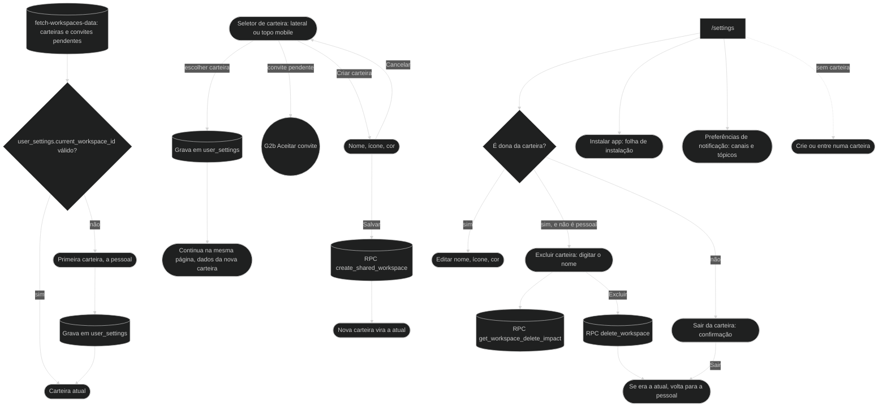

### 2b. Convidar e aceitar convite

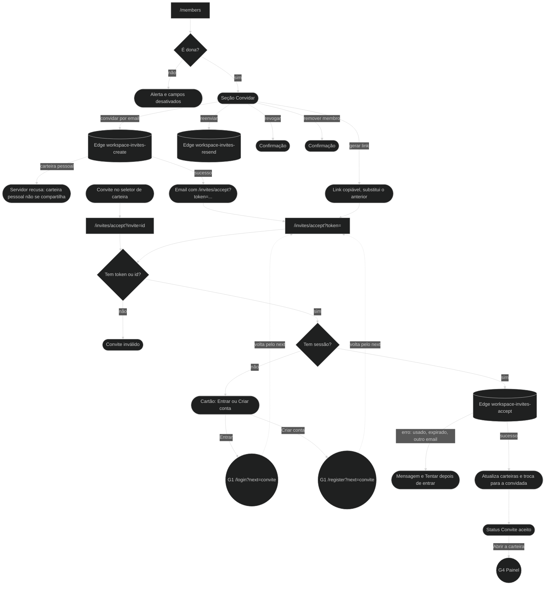

### Regras técnicas

| Ponto | Regra | Onde |
|---|---|---|
| Carteira atual | `user_settings.current_workspace_id`; inválida cai na primeira, com a pessoal ordenada antes | `src/lib/queries/fetch-workspaces-data.ts` |
| Criar e excluir | RPCs `create_shared_workspace`, `get_workspace_delete_impact`, `delete_workspace` | `src/components/workspace-provider.tsx` |
| Sair da carteira | Diálogo próprio de confirmação | `src/components/settings/workspace-leave-dialog.tsx` |
| Membros | RPC `workspace_member_directory`; só a dona convida, revoga e remove | `src/app/(app)/members/page-client.tsx` |
| Convite | Edges `workspace-invites-create`, `-resend`, `-accept`; o email é montado no servidor | `supabase/functions/_shared/workspace-invite-email.ts` |
| Página de convite | Fica no grupo `(auth)`: veste o `AuthShell` e não atravessa a casca do app. O `WorkspaceProvider` é global, então a mudança de grupo não custou nada | `src/app/(auth)/invites/accept/page-client.tsx` |

---

## 3. Navegação e ações globais

O que está disponível em qualquer tela: a casca, o "+" de adicionar, a busca
(⌘K) e as notificações.

```mermaid
%%{init: {"theme": "dark"}}%%
flowchart TD
    shell(["Casca do app"]) --> desktop{"Largura"}
    desktop -->|"desktop"| sidebar(["Lateral recolhível"])
    desktop -->|"mobile"| bottom(["Barra inferior: Painel, Transações, Categorias, +, conta"])

    sidebar --> nav1["/dashboard"]
    sidebar --> nav2["/transactions"]
    sidebar --> nav3["/categories"]
    sidebar --> nav4["/subscriptions"]
    sidebar --> nav5["/bills (Beta)"]
    sidebar --> nav6["/credit-cards"]
    sidebar --> nav7["/members"]
    sidebar --> nav8["/settings"]
    sidebar --> userMenu(["Menu do usuário: tema, Minha conta, Planos, Sair"])
    bottom --> accountMenu(["Menu da conta, painel que brota da aba: Assinaturas, Contas, Cartões, Membros · Minha conta, Configurações"])
    userMenu --> G10(("G10 Conta"))
    accountMenu --> G10

    sidebar -->|"+ Adicionar, direto, com Despesa"| txForm(("G5b Formulário de transação"))
    bottom -->|"+, a gaveta do formulário"| txForm
    txForm -.->|"formulário global indisponível"| fallback["/transactions?new= ou /subscriptions?new=1"]

    topbar(["Barra do topo: lupa"]) -->|"clicar"| palette(["Paleta de busca: Recentes, Telas, Ações, Transações, Cartões, Categorias, Parcelas, Assinaturas, Contas, Membros, Carteiras"])
    shell -->|"⌘K ou Ctrl+K"| palette
    palette -->|"Telas ou Recentes: as da lateral menos o Painel"| nav2
    palette -->|"Ações: Nova despesa, parcelada, receita"| txForm
    palette -->|"Ações: Nova assinatura"| subForm(("G8 Formulário de assinatura"))
    palette -->|"Ações: Nova categoria, Novo cartão"| createDialogs(["Diálogos de criar categoria e cartão"])
    palette -->|"Transações, consulta no banco"| txnDetail["/transactions?txn=id"]
    palette -->|"Ver todas em Transações"| txnList["/transactions?q, from, to, min, max"]
    palette -->|"Cartões"| cardDetail["/credit-cards/id"]
    palette -->|"Categorias"| catDetail["/categories/id"]
    palette -->|"Compras parceladas"| planPage["/transactions?plan=id"]
    palette -->|"Assinaturas"| subPage["/transactions?sub=id"]
    palette -->|"Contas a pagar"| billPage["/bills?detail=id"]
    palette -->|"Membros"| nav7
    palette -->|"Carteiras"| walletSwitch[("Troca a carteira atual")]

    bell(["Sino de notificações"]) -->|"clicar"| read[("Marca como lida")] --> dest{"Tipo da notificação"}
    dest -->|"href explícito"| explicit["Rota do metadata.href"]
    dest -->|"category_created"| n1["/categories"]
    dest -->|"invite_accepted"| n2["/members"]
    dest -->|"cc_*"| n3["/credit-cards/id"]
    dest -->|"budget_threshold"| n4["/categories/id"]
    dest -->|"bill_reminder"| n5["/bills"]
    dest -->|"member_expense_created"| n6["/transactions?txn=id"]
    dest -->|"outros"| n7["/dashboard"]
    bell -->|"engrenagem"| nav8
    bell -->|"marcar lida, excluir, limpar tudo"| bell

    old["Rotas antigas"] -->|"next.config.ts"| redirects["/dashboard/settings → /settings; /wallets → /dashboard; /assets → /credit-cards; /notifications → /dashboard?notifications=1"]
    unknown["Rota desconhecida"] --> notFound(["404: Ir para o painel ou Página inicial"])
```

### Regras técnicas

| Ponto | Regra | Onde |
|---|---|---|
| Itens de navegação | Lateral e mobile vêm de configuração, não de JSX solto | `src/config/navigation.ts`, `src/config/mobile-navigation.ts` |
| Formulários globais | Transação e assinatura montados uma vez na casca; salvar invalida as listas abertas | `src/components/layout/global-shell-dialogs-provider.tsx` |
| Menus do telefone | O "+" abre direto a gaveta do formulário de lançamento, com Despesa marcada (o seletor do formulário troca para Parcelada e Receita; assinatura fica na tela dela e na paleta). Era uma folha de ações (`Drawer` com `DrawerActions`) antes do formulário, e no desktop um menu: um passo a mais na jornada mais comum. A aba "Mais" (fixa: não troca de ícone nem de rótulo e não fica ativa nas páginas do menu; era o avatar) abre o menu da conta num painel (`DropdownMenu variant="panel"`) que brota dela para cima, só com as telas que não cabem na barra; cada link fecha o painel e leva à tela. Em cima as telas da carteira, embaixo Minha conta e Configurações. O tema mora em Configurações (seção Aparência); o sair (o menu ⋯ do perfil) e Planos e pagamentos (a seção Plano, só no telefone) moram em Minha conta. Antes foi uma gaveta de 625px com identidade, tema e sair, e antes dela um `Popover` de vidro escrito à mão | `src/components/layout/quick-actions.tsx`, `src/components/layout/mobile-account-menu.tsx` |
| Busca global (⌘K) | Montada uma vez no `AppHeader`, com a lupa nas duas árvores da barra; no telefone abre como gaveta. A raiz busca tudo, sem sub-página: o filtro é da paleta (`shouldFilter: false`) e cada grupo vem ranqueado por `ranquear` (`lib/app-search`), até 5 linhas. Telas (com sinônimos: "gastos" acha Transações, "fatura" Cartões, "boletos" Contas a pagar) são as da barra lateral menos o Painel, mais Membros (`navigation.ts`); Painel, Configurações, Minha conta, Planos e pagamentos, Sessões ativas, Atividade e Notificações ficam fora da busca, por decisão do dono. Ações chamam os mesmos ganchos do "+ Adicionar" (`useQuickCreateTransaction`, `useQuickCreateSubscription`) e os diálogos da casca (Nova categoria, Novo cartão). Transações são uma consulta de leitura ao banco (descrição, valor, data, nome da categoria e do cartão; as 8 mais recentes; espera de 250ms depois da digitação) e abrem `/transactions?txn=id`; "Ver todas em Transações" leva `q`, `from`, `to`, `min` e `max` na URL, e a lista filtra o texto só pela descrição. Transação nunca vira recente. Cartões e categorias leem o cache da casca (`useCategoriesQuery`, `useCreditCardsQuery`); parcelas (`?plan=id`), assinaturas (`?sub=id`) e membros (`/members`) saem das listas do espaço; contas a pagar vêm de uma consulta leve (`useBillsListQuery`) e abrem `/bills?detail=id`; escolher uma carteira troca a carteira atual. Os recentes ficam no `localStorage` (`app:busca`). Digitar `/` escolhe onde buscar (`/transacoes`, `/membros`…, `lib/app-search-scopes`): o nome entra no campo como escopo, só aquele grupo aparece (até 50 linhas; 20 transações), e dois Backspaces com o campo vazio voltam à busca em tudo | `src/components/layout/app-command-palette.tsx`, `src/lib/app-search-scopes.ts`, `src/components/layout/app-search-sources.ts`, `src/lib/app-search.ts`, `src/lib/transaction-search.ts`, `src/lib/queries/use-transactions-search.ts`, `src/lib/queries/use-bills-list.ts` |
| Nome da tela e voltar | No telefone a barra do topo mostra o título e o voltar das subpáginas (`/categories/id`, `/categories/new`, `/credit-cards/id`, as de `/account`), pelo `usePageChromeSlot`. No desktop ela não mostra o nome da tela (o `<h1>` fica só para o leitor de tela) nem a trilha: a lateral marca onde se está e é o caminho de volta. A trilha com o link para a tela de cima ("Categorias", "Cartões de crédito") saiu em 2026-10-16 | `src/components/layout/app-header.tsx` |
| Destino da notificação | `metadata.href` seguro vence; senão, o tipo decide. Espelha o servidor para o push | `src/lib/notification-href.ts`, `supabase/functions/_shared/notification-types.ts` |
| Notificações no servidor | Edges `dispatch-notifications`, `evaluate-budgets`, `evaluate-credit-card-alerts`, `evaluate-bills-reminders`, `credit-card-calendar-alerts`, `notify-transaction-created` | `supabase/functions/` |
| Push | Edges `push-subscribe` e `push-unsubscribe` | `supabase/functions/` |
| Redirecionamentos | Os únicos que acontecem no servidor | `next.config.ts` |

---

## 4. Painel

`/dashboard`: o resumo do mês e a porta para o resto. Ao abrir, ele também
recupera cobranças atrasadas de assinaturas e parcelas.

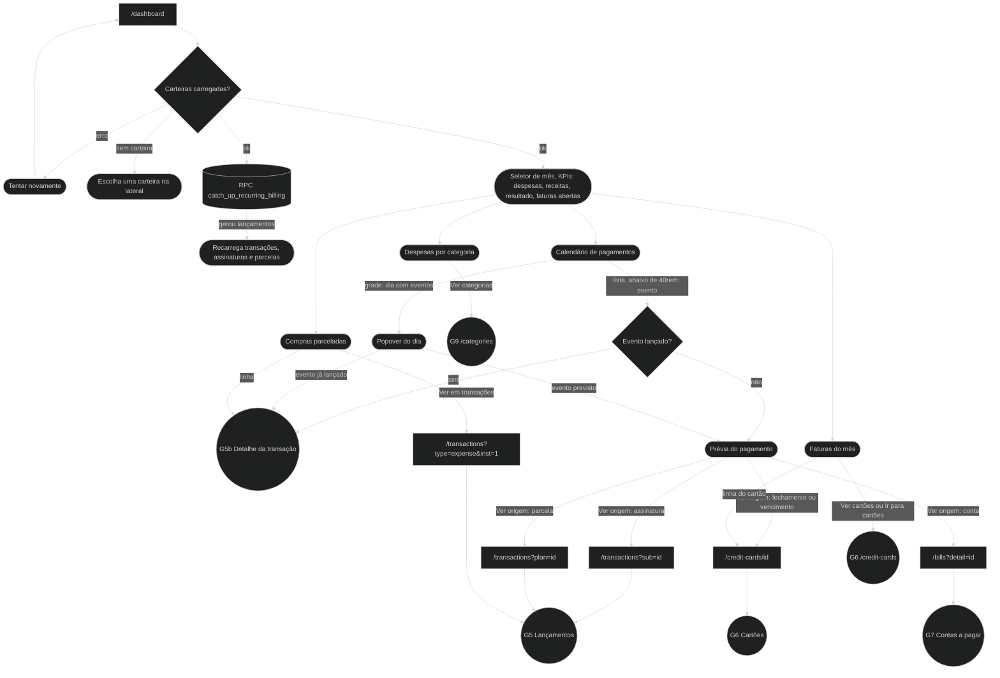

### Regras técnicas

| Ponto | Regra | Onde |
|---|---|---|
| Dados | Um hook agrega os blocos por mês e carteira | `src/components/dashboard/use-dashboard-data.ts` |
| Cobranças atrasadas | `catch_up_recurring_billing` roda uma vez por carteira ao montar; é idempotente com o cron | `src/lib/queries/use-recurring-billing-catchup.ts` |
| Calendário | Eventos: assinatura, parcela, fechamento, vencimento de cartão, vencimento de conta, receita e despesa lançadas. É a agenda do `Calendar` (rodada 242): na grade, o dia abre o popover e fica marcado (com a janela abaixo de 768px o popover abre como gaveta); abaixo de 40rem da largura da própria agenda ela vira a lista do mês — no telefone, e também num laptop estreito com a barra lateral aberta e o painel de próximos ao lado —, e o evento abre direto o detalhe ou a prévia, sem o popover. A lista mostra os últimos 5 dias passados com evento e todos os que vêm, com o selo do tipo. A grade de pontos do telefone saiu | `src/components/dashboard/dashboard-payments-calendar.tsx` |
| Prévia | "Ver origem" monta a rota pelo tipo do evento | `src/components/dashboard/dashboard-payment-event-preview-sheet.tsx` |

---

## 5. Lançamentos

`/transactions`: a lista de despesas e receitas, e o formulário que as cria.
É a jornada para onde as outras mandam a pessoa quando querem mostrar dinheiro
que já se mexeu.

### 5a. Lista e filtros

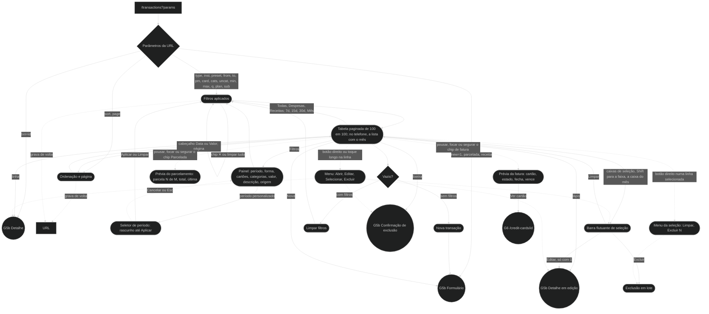

### 5b. Criar, editar e excluir

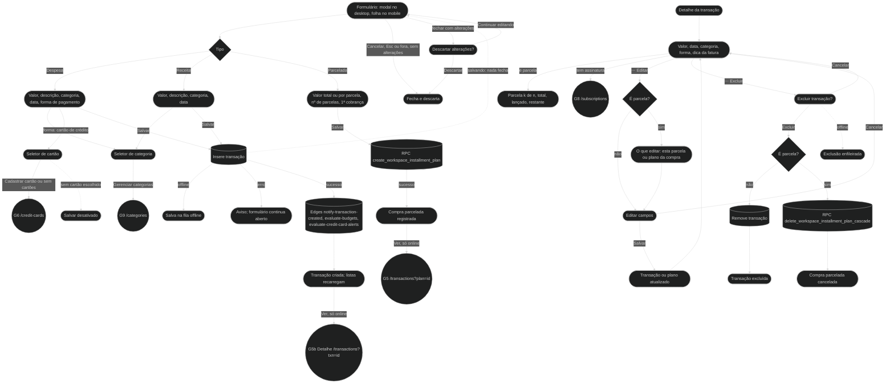

### Regras técnicas

| Ponto | Regra | Onde |
|---|---|---|
| Parâmetros | Lidos e gravados na URL; `new` e `txn` são consumidos e removidos | `src/lib/transactions-list-search-params.ts` |
| Ordenação e página | `sort=date.desc` · `date.asc` · `amount.desc` · `amount.asc` e `page=N` (a partir de 1) vão para a URL e voltam dela, também no voltar e avançar; o padrão (`date.desc`, página 1) não é escrito. Trocar um filtro volta à página 1. Só na página, não no modo embutido | `src/components/transactions/use-transactions-list-controller.ts`, `src/lib/transactions-list-search-params.ts` |
| Tabela | `DataTable` em modo `manual` (o banco ordena e pagina): a seleção não alcança as projetadas, que também não abrem nem têm menu; o mês só agrupa ordenado por data; a barra de seleção é flutuante e cancelar a exclusão mantém a seleção; no telefone, a lista gerada das colunas | `src/components/transactions/transactions-table.tsx`, `src/components/ui/data-table.tsx` |
| Formulário | Um componente para criar, e o mesmo campo a campo na edição | `src/components/transactions/transaction-form-dialog.tsx`, `transaction-form-use.tsx` |
| Parcelada | RPC `create_workspace_installment_plan`; editar o plano não muda parcelas já lançadas | `src/components/transactions/transaction-form-persistence.ts` |
| Detalhe | Mesmo painel no Painel, em Cartões e em Categorias | `src/components/transactions/transaction-detail-sheet.tsx` |
| Exclusão | Parcela cancela o plano inteiro por `delete_workspace_installment_plan_cascade`. Continua com confirmação, e não com o Desfazer do toast: a exclusão é física (`delete`), sem `deleted_at` nem RPC de restaurar, e recriar mudaria o id e quebraria parcelas, recorrência e faturas (verificado na rodada 228) | `src/lib/transactions/mutations.ts` |
| "Ver" do toast | Criar uma transação (não editar) mostra "Ver", que leva a `/transactions?txn=id` e abre o detalhe; a compra parcelada leva a `?plan=id`. Offline não há id, e o toast sai sem "Ver". A trava que abre o `txn` uma vez só volta a soltar quando a URL perde o parâmetro — antes, com `/transactions` aberta, o segundo `?txn=` não abria nada | `persistTransactionSave` em `src/lib/transaction-detail-sheet-mutations.ts`, `transaction-form-persistence.ts`, `use-transactions-list-controller.ts` |
| Offline | Criar e excluir entram na fila; pagar conta exige conexão | `src/lib/offline/` |
| Rascunho | Fechar o formulário alterado (Cancelar, Esc, toque fora, ×, arrastar a gaveta) pergunta "Descartar alterações?"; salvar fecha sem perguntar. Trocar só a aba ou o tipo não conta como alteração. Enquanto salva, nada fecha (`Dialog pending`) | `isDirty` em `src/components/transactions/transaction-form-use.tsx`, `src/components/transactions/transaction-form-dialog.tsx` |
| Enter | O `Enter` na busca do seletor não salva a transação: o popover é portalizado, e a submissão implícita do navegador só conta os campos cujo dono no DOM é o `<form>` | `Form` em `src/components/ui/form.tsx` |
| Período personalizado | Um `DatePicker` de intervalo com `confirm`: as pontas ficam em rascunho até Aplicar, Limpar tira o filtro, Cancelar e Esc descartam. Era um formulário à parte (`transactions-date-range-form.tsx`, removido) | `src/components/transactions/transactions-filters-panel.tsx` |
| Prévias dos chips | O chip de fatura e o "Parcelada" abrem uma prévia ao pousar, no foco e no toque longo (`HoverCard`); o clique no chip continua abrindo o detalhe da linha. A da fatura leva a "Ver cartão" (o ciclo atual: a página do cartão não abre uma fatura passada por parâmetro). O chip de fatura só existe a partir de `md` | `CreditInvoiceChip` e `InstallmentChip` em `src/components/transactions/transactions-table.tsx` |
| Botão direito na linha | Atalho das ações da linha (os botões da coluna Ações continuam); sobre uma linha selecionada age na seleção inteira (`contextMenuTargets`); linhas projetadas não têm menu | `TransactionRowContextMenu` em `src/components/transactions/transactions-table.tsx` |

---

## 6. Cartões e faturas

`/credit-cards` e `/credit-cards/[cardId]`: cadastro dos cartões e o ciclo de
cada fatura.

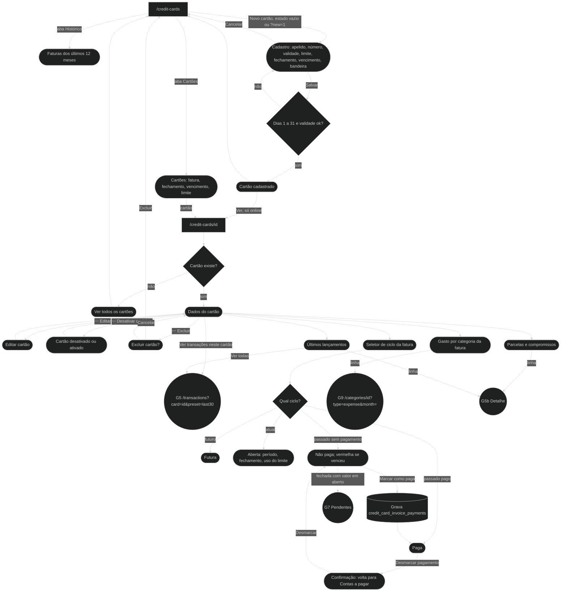

### Regras técnicas

| Ponto | Regra | Onde |
|---|---|---|
| Status no detalhe | `Futura`, `Aberta`, `Não paga`, `Paga`, pelo ciclo selecionado | `src/app/(app)/credit-cards/[cardId]/page-client.tsx` |
| Selo na tabela de transações | `Aberta`, `Fechada`, `Anterior`, `Paga`; Aberta é verde, Fechada âmbar, Anterior vermelha | `src/lib/credit-card-display.ts` |
| Pagamento de fatura | Linha em `credit_card_invoice_payments`, sem criar despesa | `src/lib/bills/pay-bill-flow.ts` |
| "Ver" do toast | Cadastrar um cartão (pela página ou pelo diálogo do "+ Adicionar") mostra "Ver", que leva a `/credit-cards/id`; na fila offline, sem "Ver" | `src/app/(app)/credit-cards/page-client.tsx`, `src/components/credit-cards/credit-card-create-dialog.tsx` |
| Alertas | Limite, fechamento e vencimento geram notificações `cc_*` | edges `evaluate-credit-card-alerts`, `credit-card-calendar-alerts` |

---

## 7. Contas a pagar

`/bills` (Beta): contas recorrentes e o que está pendente, incluindo as faturas
de cartão que fecharam em aberto.

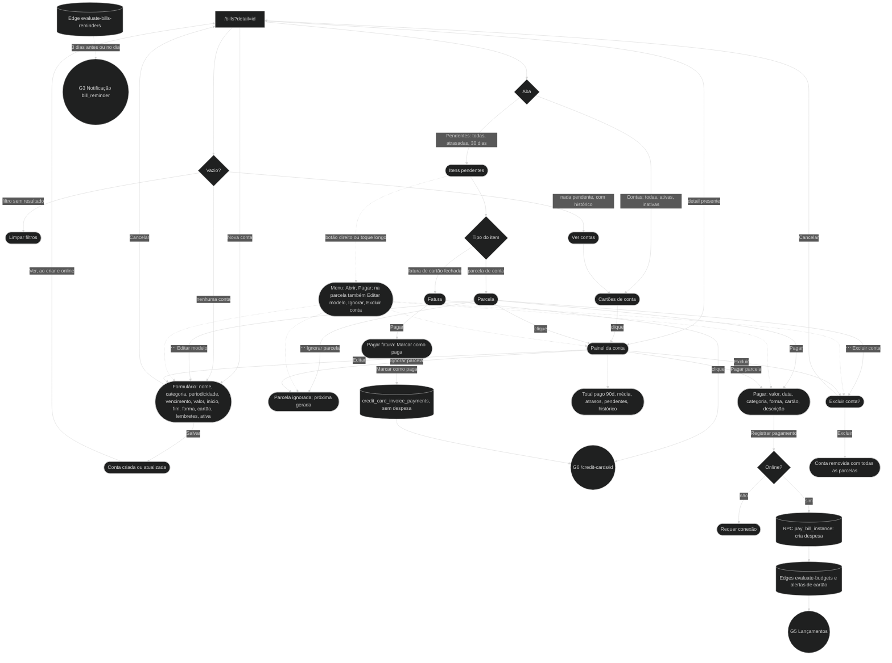

### Regras técnicas

| Ponto | Regra | Onde |
|---|---|---|
| Dados | Um RPC traz a página inteira | `rpc_fetch_bills_page_bundle` em `src/lib/queries/fetch-bills-page-bundle.ts` |
| Fatura como pendência | Projetada no cliente a partir dos ciclos fechados com valor em aberto | `src/lib/bills/credit-card-bill-projector.ts` |
| Pagar conta | `pay_bill_instance` cria a despesa e avança a recorrência; bloqueado offline | `src/lib/bills/pay-bill-flow.ts` |
| Pagar fatura | Só marca como paga: as compras já estão lançadas no cartão | `src/lib/bills/pay-bill-flow.ts` |
| Recorrência | Mensal, Bimestral, Trimestral, Anual, Única | `src/lib/bills/recurrence.ts` |
| Botão direito | No cartão de pendência, repete o "Pagar" e o menu de três pontos, que continuam à vista | `src/components/bills/bill-pending-card.tsx` |
| "Ver" do toast | Criar uma conta mostra "Ver", que leva a `/bills?detail=id` e abre o painel dela (sem levar os outros filtros da URL); na fila offline, sem "Ver" | `src/app/(app)/bills/page-client.tsx` |

---

## 8. Assinaturas

`/subscriptions`: cobranças recorrentes que viram lançamentos sozinhas.

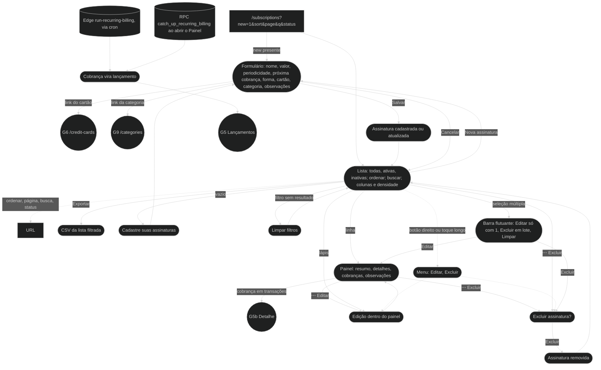

### Regras técnicas

| Ponto | Regra | Onde |
|---|---|---|
| Dados | `rpc_fetch_subscriptions_page_bundle` | `src/lib/queries/fetch-subscriptions-page-bundle.ts` |
| Periodicidade | Semanal, Mensal, Bimestral, Anual | `src/components/subscriptions/subscription-form-dialog.tsx` |
| Cobrança | `run-recurring-billing` só aceita chamada com `CRON_SECRET`; o Painel recupera o atraso | `supabase/functions/run-recurring-billing/index.ts` |
| Filtro por assinatura | `/transactions?sub=id` | `src/lib/transactions-list-search-params.ts` |
| Estado na URL | `sort=<coluna>.<asc\|desc>`, `page=N` (a partir de 1), `q` (a busca) e `status=active` ou `inactive`, lidos ao abrir e gravados a cada troca; trocar de carteira zera os quatro | `urlState` do `DataTable` em `src/app/(app)/subscriptions/page-client.tsx` |
| Tabela | `DataTable` no cliente: busca sem acento, exportar CSV, colunas e densidade guardadas; Excluir da linha está no ⋯ (Editar fica à vista); cancelar a exclusão em lote mantém a seleção | `src/app/(app)/subscriptions/page-client.tsx` |

---

## 9. Categorias e orçamentos

`/categories`: as categorias da carteira e o limite mensal de cada uma. Não há
tela separada de orçamento: o limite mora na categoria. Na primeira visita de
cada carteira aparece um assistente.

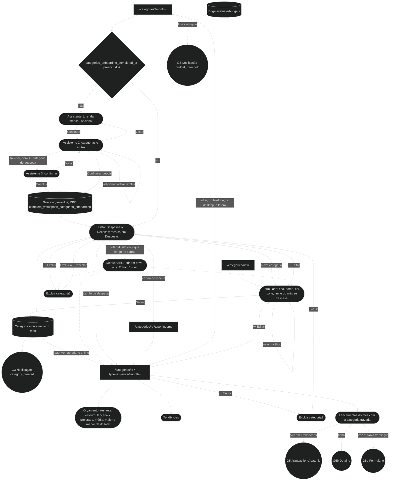

### Regras técnicas

| Ponto | Regra | Onde |
|---|---|---|
| Assistente | Só em `/categories`, por carteira; nada redireciona para ele | `src/components/categories/categories-onboarding-wizard.tsx` |
| Detalhe | `rpc_fetch_category_detail_bundle` | `src/lib/queries/fetch-category-detail-bundle.ts` |
| "Ver" do toast | Criar uma categoria (pela tela ou pelo diálogo do "+ Adicionar") mostra "Categoria criada" com "Ver", que leva a `/categories/id?type=`; se o orçamento falhar, o aviso "Categoria criada, mas o orçamento não foi salvo" leva ao mesmo detalhe. Na fila offline, sem "Ver". A tela de categorias não mostrava toast nenhum ao criar | `src/components/categories/category-create-dialog.tsx`, `src/app/(app)/categories/page-client.tsx` |
| Entradas no detalhe | Lista de categorias, gasto por categoria do cartão, notificação de orçamento | `src/components/categories/detail/` |
| Orçamento | Avaliado depois de cada despesa e de cada conta paga | edge `evaluate-budgets` |
| Botão direito | No cartão de categoria, o menu toma o lugar do menu do navegador sobre o link, por isso traz "Abrir em nova aba"; o ⋯ continua | `src/components/categories/category-card-context-menu.tsx` |

---

## 10. Conta e segurança

`/account` e subpáginas: o que é da pessoa, não da carteira.

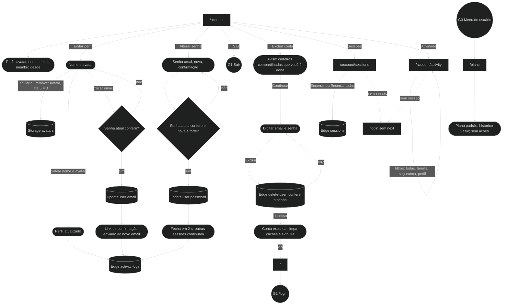

### Regras técnicas

| Ponto | Regra | Onde |
|---|---|---|
| Troca de email e senha | Confere a senha atual entrando de novo antes de `updateUser` | `src/components/account/edit-profile-dialog.tsx`, `src/components/security/ChangePasswordDialog.tsx` |
| Excluir conta | Dois passos; a senha é conferida na Edge Function | `src/components/security/DeleteAccountDialog.tsx`, `src/lib/delete-account.ts` |
| Sessões | Listar e encerrar pela edge `sessions` | `src/lib/sessions.ts` |
| Atividade | Perfil, email e senha gravam log | edge `activity-logs` |

---

## 11. Lacunas encontradas

Coisas que o mapeamento achou no caminho. As de acesso foram corrigidas na
rodada de set/2026 e estão registradas abaixo da tabela; as que sobraram
continuam aqui para registro.

| # | Jornada | Lacuna |
|---|---|---|
| 1 | G2 | `/members` mostra o formulário de convite numa carteira pessoal, e o servidor recusa só depois do envio. |
| 2 | G3 | O provider global expõe abrir convite, mas nada chama essa função. (Nova categoria e novo cartão saem da paleta ⌘K desde 16/out/2026.) |
| 3 | G10 | `/account/sessions` e `/account/activity` redirecionam para `/login` sem `next`, então a pessoa não volta para a página depois de entrar. |
| 4 | G1 | A política de senha não vale para a troca de senha de dentro do app (`ChangePasswordDialog`), que ainda confere só o comprimento. |
| 5 | G8 | O detalhe de uma assinatura só abre pelo estado da tela; nenhum parâmetro de URL o abre (só existe `?new=1`). Por isso o toast de assinatura criada não tem "Ver", ao contrário de transação, cartão, conta e categoria (rodada 228). |
| 6 | G5 | Excluir uma transação é físico e sem volta: não há `deleted_at` nem RPC de restaurar, então o "Desfazer" do toast não substitui a confirmação. Ter o desfazer exige exclusão lógica no banco. |
| 7 | G2 | Os erros de carga do diretório de membros mostram ao usuário o arquivo SQL e a RPC a aplicar — texto de desenvolvedor (`members/page-client.tsx`). |

### Fechadas na rodada de acesso (set/2026)

| Era | Lacuna | O que fechou |
|---|---|---|
| 1 | "Confirme seu e-mail" aparecia mesmo quando o `signUp` voltava com sessão | A condição passou a ser só `data.session`, sem exigir `next` |
| 2 | `/login` e `/register` sem guarda para quem já entrou | `AuthSignedInRedirect`, com `/forgot-password`, `/reset-password` e `/invites/accept` isentas |
| 3 | Dois fluxos de redefinir senha que não se conversavam | Um formulário só, com duas portas de entrada |
| 4 | Erro de esqueci/redefinir senha em inglês | Tudo passa por `formatAuthErrorMessagePt` |
| 5 | `/invites/accept` cercada pela casca do app para quem não entrou | A rota foi para o grupo `(auth)` |

### Fechadas em 12/out/2026

| Era | Lacuna | O que fechou |
|---|---|---|
| 1 | O `next` se perdia na recuperação de senha | `recoveryLinks` o leva do pedido ao `redirectTo`, a "Pedir novo código" e ao login final |
| 2 | Sem como reenviar o código ou o e-mail de confirmação | "Reenviar código" e "Reenviar e-mail", com espera de 60 s |
| 3 | O fallback de carregamento do convite ficava fora do casco | Passou a vestir o `AuthShell` |

Risco conhecido: o `redirectTo` com `?next=` só funciona se a allowlist de
redirecionamento do Supabase, configurada fora do repositório, aceitar a query
string. Se recusar, o link cai na Site URL como antes.
