# Jornadas do app

O mapa de tudo o que uma pessoa faz no app, dividido em catorze jornadas. Cada
jornada tem um fluxograma, as regras técnicas que decidem os caminhos e as
lacunas encontradas no código. Foi escrito lendo o código em 2026-09-17, na
branch `finance-app-2.0`, e a navegação global foi revista em 2026-10-01,
quando entrou a busca (⌘K), junto com o menu do botão direito nas linhas de
lançamento, nos cartões de categoria e nas contas pendentes, com o seletor
de período que confirma no próprio popover, com o rascunho protegido do
formulário de lançamento, e com os menus do telefone em gaveta. As telas de
acesso foram revistas em 2026-10-12 (a casca no layout) e em 2026-10-14 (o
painel de marca animado) e as notificações em 2026-10-17 (o painel flutuante, o sino exato e a revisão do servidor, ainda não publicada) e em 2026-10-21 (o aviso de despesa e os crons passam ao banco, por migração, também ainda não publicados); a busca do telefone em 2026-10-19 (a lupa vira a barra) e, no mesmo dia, a aba "Você" no lugar do menu "Mais" (a página `/me`). Em 2026-10-21 entrou o Bloco 2, "fatura que bate e anexos": o estorno no cartão, o total da fatura segundo o banco, a conferência da fatura, a importação de extrato e de planilha e os anexos, com as telas em wireframe (`src/components/wireframe/`) e ainda não publicado (`supabase/BLOCO_2_DEPLOYMENT.md`). Em 2026-10-22 entrou o Bloco 3A, "captura sem abrir o app": o token pessoal em Minha conta, a Edge `capture` (o Atalho do iPhone e o Apple Pay), a frase rápida no "+", o compartilhar do Android, os atalhos do ícone, a lista "A conferir" e o lembrete das 20h, com as telas em wireframe e ainda não publicado (`supabase/BLOCO_3A_DEPLOYMENT.md`). No mesmo dia entrou o Bloco 3B, "IA grátis na captura e na fatura": "Tentar com IA" na frase rápida, a foto do recibo no formulário, a foto e a frase confusa na Edge `capture`, a compra parcelada capturada que vira plano, o compartilhar de foto e PDF do Android, "Ler com IA" na conferência da fatura e a política de privacidade em `/privacidade`, com as telas em wireframe e ainda não publicado (`supabase/BLOCO_3B_DEPLOYMENT.md`). Em 2026-10-23 entrou o Bloco 4, "planos e confiança": a rota pública `/precos`, o plano em `/plans` (teste de 14 dias, vitalício, cobertura da família e "só leitura" no banco, desligados enquanto `billing_settings.enforced_since` é nulo), a faixa de só leitura na casca, o Piloto Automático (`/piloto`), o Cofre aberto (`/cofre`, com "Exportar tudo" e "Apagar a conta") e a jornada de 4 passos (`/comecar`), com as telas em wireframe e ainda não publicado (`supabase/BLOCO_4_DEPLOYMENT.md`); o assinar de verdade fica para o Bloco 8. Em 2026-10-24 entrou o Bloco 5, "previsão": o "seguro para gastar" no Painel e em `/previsao` (com a linha do tempo de 6 meses e a reserva), a receita recorrente nas assinaturas, o quadro de impacto da parcela, o orçamento que se repete todo mês, o aviso de orçamento pelo mês do fechamento da fatura e o aviso de fatura acima do normal, com as telas em wireframe e ainda não publicado (`supabase/BLOCO_5_DEPLOYMENT.md`). Em 2026-10-24 entrou também o Bloco 6A, "contas a pagar" revista: a conta que não é paga não para de recorrer (passo 0 do cron), o lembrete por janela, a edição da agenda que reprograma a pendente, o pular atômico, os estados Encerrada e Concluída, o valor variável pela média, o casamento automático do pagamento ("Isso pagou a conta X?"), o boleto no pagamento e no lançamento pago, a explicação "conta ou assinatura" e a saída do "Beta", com as telas novas em wireframe e ainda não publicado (`supabase/BLOCO_6A_DEPLOYMENT.md`). Em 2026-10-25 entrou o Bloco 6B, "insights": o cron diário das 10h que acha fatos nas carteiras (a fatura que fechou, o relatório do mês, a recorrência, o gasto atípico, a mudança de preço, o lançamento repetido, as parcelas acabando, o sazonal e o "a conferir"), a caixa de insights no Painel com as ações de um toque (virar assinatura ou conta, atualizar o preço, apagar um repetido, ver a fatura, a previsão ou os itens a conferir), o "Não mostrar mais este tipo", o teto de 3 push por semana por pessoa e a chave "Insights" nas preferências de aviso, com as telas em wireframe e ainda não publicado (`supabase/BLOCO_6B_DEPLOYMENT.md`). Quando uma tela mudar de caminho, atualize o
diagrama dela.

## Como ler os diagramas

| Forma | Significa |
|---|---|
| `["/rota"]` retângulo | Página ou rota |
| `(["Diálogo"])` cápsula | Modal, folha, popover, menu |
| `{"Condição"}` losango | Guarda de rota ou decisão |
| `[("backend")]` cilindro | Supabase: Edge Function, RPC, trigger, tabela |
| `(("G5 Lançamentos"))` círculo | Saída para outra jornada |

O rótulo da seta é a ação da pessoa ou a condição (`sucesso`, `erro`,
`cancelar`). Os diagramas usam o tema escuro do Mermaid (`%%{init}%%` no topo
de cada bloco), em qualquer tema do leitor.

**Tudo o que decide acesso roda no navegador.** Não há `middleware.ts`,
`proxy.ts` nem rotas em `src/app/api` (o único *route handler* é o
`POST /transactions/compartilhar`, a reserva do compartilhar do Android sem
service worker). A sessão é do `supabase-js`, os
redirecionamentos são do `AuthGuard` e a segurança real dos dados é a RLS do
banco.

## Sumário

0. [Mapa geral](#0-mapa-geral)
1. [Acesso: entrar, criar conta, senha e sair](#1-acesso-entrar-criar-conta-senha-e-sair)
2. [Carteiras e colaboração](#2-carteiras-e-colaboração)
3. [Navegação e ações globais](#3-navegação-e-ações-globais)
4. [Painel](#4-painel)
5. [Lançamentos](#5-lançamentos)
6. [Cartões e faturas](#6-cartões-e-faturas)
7. [Contas a pagar](#7-contas-a-pagar)
8. [Assinaturas](#8-assinaturas)
9. [Categorias e orçamentos](#9-categorias-e-orçamentos)
10. [Conta e segurança](#10-conta-e-segurança)
11. [Plano e só leitura](#11-plano-e-só-leitura)
12. [Confiança: Piloto, Cofre e o começo](#12-confiança-piloto-cofre-e-o-começo)
13. [Previsão](#13-previsão)
14. [Insights](#14-insights)
15. [Lacunas encontradas](#15-lacunas-encontradas)

---

## 0. Mapa geral

Como as jornadas se ligam. O Painel é o centro; Lançamentos é para onde quase
tudo desagua, porque assinatura, parcela e conta paga viram lançamento.

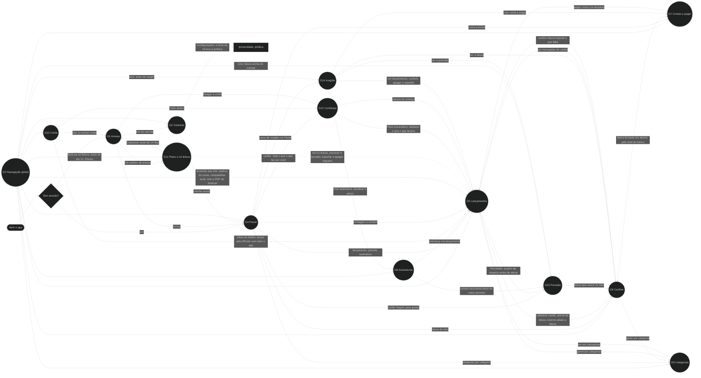

---

## 1. Acesso: entrar, criar conta, senha e sair

Tudo o que acontece antes de a pessoa estar dentro do app, e a volta para fora.
Criar conta e entrar são a mesma jornada: as duas telas se ligam e dividem o
parâmetro `next`. **O login social saiu** em set/2026; a autenticação é
e-mail e senha.

As cinco telas dividem uma casca só, e **a casca vive no layout de `(auth)`; o
formulário publica o id da cena.** O `AuthFrame` (`src/components/layout/auth-frame.tsx`)
monta o `SplitShellRoot` com o painel de marca uma vez, então o painel é o
mesmo nó entre as cinco rotas e troca de cena em vez de remontar: a partir de
48rem do próprio casco (container query); no telefone só o wordmark
(`asideMobile="logo"`); coluna de formulário à esquerda, painel à direita
(`side="end"`). Cada formulário devolve só a coluna, o `AuthShell`, com o id
da cena (`scene`), porque o título e a cena mudam com o estado (o cadastro vira
"Confira seu e-mail", a recuperação troca a cada passo). Sem id publicado, a
cena sai do caminho (`defaultSceneFor`). Todo estado devolve o `AuthShell` no
mesmo lugar da árvore, e a troca de `step` leva o foco ao título.

**O painel é um palco animado, e a família da cena decide o aparelho.** Desde
14/out/2026 o painel desenha o próprio app num aparelho (`AuthShowcase`, sobre
o `Showcase` do design system), com uma colagem de depoimentos ilustrativos em
volta e uma legenda no pé; os números e os nomes são de exemplo, e a tela diz
isso. Login no **navegador** (a busca ⌘K se digita sozinha até a fatura, e a
janela vira celular e volta), convite no **tablet** da casa, cadastro e
recuperação no **celular** (o fim da recuperação volta ao navegador). Trocar
de rota troca a cena no mesmo nó: o aparelho muda de forma e gira, sem
remontar e sem tocar a entrada de novo. O palco é `inert` e `aria-hidden`,
repousa em até 5 s, nasce no quadro final com movimento reduzido e não roda
no telefone, onde fica só o wordmark. **Nenhum caminho mudou**: o palco não tem link, campo nem foco, e
as cenas são uma tabela só (`src/components/auth/showcase/scenes.ts`).

### 1a. Entrada, login e cadastro

### 1b. Senha e saída

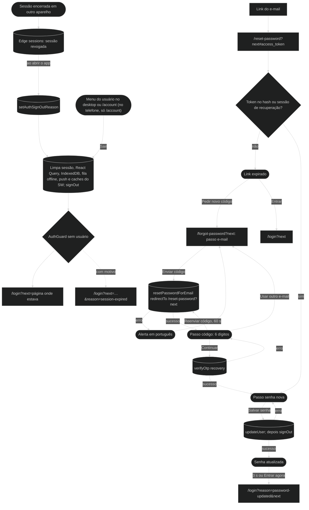

### Regras técnicas

| Ponto | Regra | Onde |
|---|---|---|
| Bootstrap | `/` manda para `/dashboard` ou `/login` depois de a sessão carregar; o sinal de carregando só aparece depois de 600 ms | `src/app/page-client.tsx`, `src/components/layout/app-bootstrap-screen.tsx` |
| Guarda | Toda rota de `(app)` sem usuário vai para `/login?next=` com `replace`. Sem exceções: `/invites/accept` saiu do grupo | `src/components/layout/auth-guard.tsx` |
| Guarda invertida | Quem já entrou em `(auth)` vai para o `next` ou o Painel. Isentas: `/forgot-password` e `/reset-password` (o `verifyOtp` cria sessão antes da troca de senha) e `/invites/accept` | `src/components/layout/auth-signed-in-redirect.tsx` |
| `next` | Só caminho interno começando com `/`; o padrão é `/dashboard` | `src/lib/auth-return-path.ts` |
| Casca | A casca vive no layout de `(auth)` (`AuthFrame`: `SplitShellRoot` e painel de marca, o mesmo nó entre as rotas); o formulário devolve só a coluna (`AuthShell`, um `SplitShellMain`) e publica o id da cena por `useAuthScene`. Sem publicação, `defaultSceneFor(pathname)`; o frame nunca lê a query. O `AuthStatus` saiu: a tela de status é o `AuthShell` com `icon` e `step` próprio. O painel desenha a cena pela tabela `SCENES`: navegador no login, tablet no convite, celular no cadastro e na recuperação | `src/app/(auth)/layout.tsx`, `src/components/layout/auth-frame.tsx`, `src/components/layout/auth-shell.tsx`, `src/components/auth/showcase/scene-context.tsx`, `src/components/auth/showcase/scenes.ts` |
| Senha | Uma política só — 8+, minúscula, maiúscula, número e símbolo — aplicada no cadastro e na redefinição | `src/lib/password-policy.ts` |
| Recuperação | Um formulário, duas portas: `/forgot-password` começa no código de 6 dígitos, `/reset-password` entra no passo da senha lendo o token do hash. O `resetPasswordForEmail` manda `redirectTo` para `/reset-password`, senão o link do e-mail cai na Site URL do projeto, que mora fora deste repositório | `src/components/password-recovery-form.tsx` |
| `next` na recuperação | `/forgot-password?next` e `/reset-password?next` leem o `next` por `recoveryLinks`, que usa `getSafeInternalNextPath`; o `redirectTo` do e-mail vira `/reset-password?next=…` e "Senha atualizada" leva a `/login?reason=password-updated&next=…`. "Pedir novo código" volta a `/forgot-password?next=…`. Sem `next` a URL não muda. Depende de a allowlist de redirecionamento do Supabase (fora do repositório) aceitar a query string | `src/lib/recovery-links.ts`, `src/components/password-recovery-form.tsx` |
| Reenviar | "Reenviar e-mail" (cadastro, `auth.resend({type:"signup"})`) e "Reenviar código" (recuperação, novo `resetPasswordForEmail`) esperam 60 s; a falha não zera a espera | `src/components/signup-form.tsx`, `src/components/password-recovery-form.tsx` |
| Convite aceito | Depois do `workspace-invites-accept` a página mostra o status "Convite aceito" com "Abrir a carteira" para `/dashboard`; não há redirecionamento automático. O fallback de carregamento já veste o `AuthShell` | `src/app/(auth)/invites/accept/page-client.tsx` |
| Erros | Tudo passa por `formatAuthErrorMessagePt`, inclusive esqueci e redefinir senha | `src/lib/supabase-errors.ts` |
| Primeira conta | Trigger `on_auth_user_created` → `handle_new_user` cria perfil, carteira "Carteira pessoal de Nome" e 7 categorias de despesa + 5 de receita | `supabase/migrations/00000000000000_baseline.sql` |
| Sessões | Ao entrar registra o aparelho; ao abrir confere se foi revogado | `src/components/providers.tsx`, edge `sessions` |
| Sair | Não navega: limpa tudo e deixa o `AuthGuard` redirecionar | `src/components/providers.tsx` |
| Motivo da saída | Sessão revogada grava o motivo em memória; o `AuthGuard` o anexa como `reason=` e o login o mostra | `src/lib/auth-signout-reason.ts` |

---

## 2. Carteiras e colaboração

A carteira é o espaço onde moram os dados. A pessoa ganha uma pessoal ao criar
a conta, pode criar carteiras compartilhadas e convidar gente para elas.

### 2a. Trocar, criar e ajustar carteira

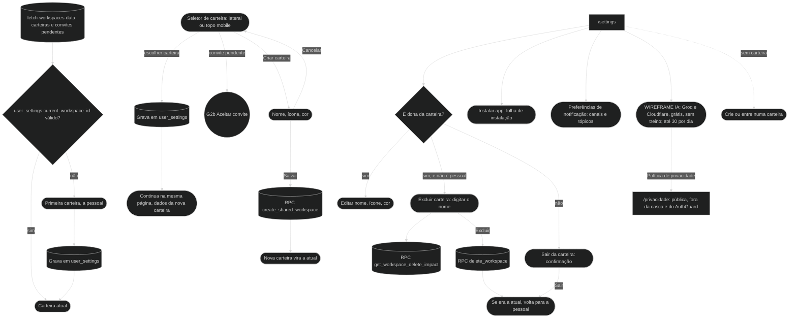

### 2b. Convidar e aceitar convite

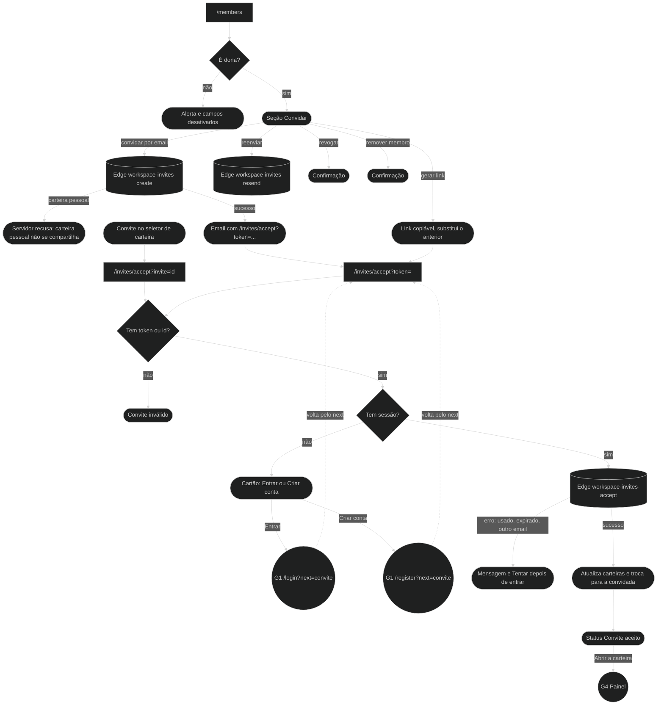

### Regras técnicas

| Ponto | Regra | Onde |
|---|---|---|
| Carteira atual | `user_settings.current_workspace_id`; inválida cai na primeira, com a pessoal ordenada antes | `src/lib/queries/fetch-workspaces-data.ts` |
| Criar e excluir | RPCs `create_shared_workspace`, `get_workspace_delete_impact`, `delete_workspace` | `src/components/workspace-provider.tsx` |
| Sair da carteira | Diálogo próprio de confirmação | `src/components/settings/workspace-leave-dialog.tsx` |
| Membros | RPC `workspace_member_directory`; só a dona convida, revoga e remove | `src/app/(app)/members/page-client.tsx` |
| Convite | Edges `workspace-invites-create`, `-resend`, `-accept`; o email é montado no servidor | `supabase/functions/_shared/workspace-invite-email.ts` |
| IA e privacidade (Bloco 3B) | Configurações mostra o wireframe "IA": "IA: Groq e Cloudflare, grátis, sem treino", o limite de 30 chamadas de IA por dia e o link "Política de privacidade". `/privacidade` fica fora de `(app)` e de `(auth)`: pública, sem `AuthGuard`, sem a casca e sem esqueleto. Ela diz o que o app guarda, os dois provedores (a transferência internacional), o que o app tenta tirar do texto antes do envio (e que a remoção automática pode falhar), que a foto vai como está, o limite, o cache, e como exportar (só as assinaturas, em CSV) e apagar a conta | `src/components/wireframe/ia-configuracoes-wireframe.tsx`, `src/components/wireframe/privacidade-wireframe.tsx`, `src/app/privacidade/page.tsx` |
| Página de convite | Fica no grupo `(auth)`: veste o `AuthShell` e não atravessa a casca do app. O `WorkspaceProvider` é global, então a mudança de grupo não custou nada | `src/app/(auth)/invites/accept/page-client.tsx` |

---

## 3. Navegação e ações globais

O que está disponível em qualquer tela: a casca, o "+" de adicionar, a busca
(⌘K) e as notificações. O painel de notificações abre do sino da barra do topo; o
sino conta as não lidas direto no servidor.

```mermaid
%%{init: {"theme": "dark"}}%%
flowchart TD
    shell(["Casca do app"]) --> desktop{"Largura"}
    desktop -->|"desktop"| sidebar(["Lateral recolhível"])
    desktop -->|"mobile"| bottom(["Barra inferior: Painel, Transações, Categorias, +, Você"])

    sidebar --> nav1["/dashboard"]
    sidebar --> nav2["/transactions"]
    sidebar --> nav3["/categories"]
    sidebar --> nav4["/subscriptions"]
    sidebar --> nav5["/bills"]
    sidebar --> nav6["/credit-cards"]
    sidebar --> nav7["/members"]
    sidebar --> nav8["/settings"]
    sidebar --> userMenu(["Menu do usuário: tema, Minha conta, Planos, Cofre aberto, Sair"])
    bottom -->|"aba Você, com o avatar"| mePage["/me: Carteira (Assinaturas, Contas, Cartões, Membros) · Conta (Minha conta, Cofre aberto, Configurações)"]
    mePage -->|"linha da página"| meDest["Tela de um item da página, com o voltar a /me no lugar do sino"]
    meDest -->|"voltar"| mePage
    userMenu --> G10(("G10 Conta"))
    mePage -->|"Minha conta"| G10
    mePage -->|"Cofre aberto"| G12(("G12 Confiança"))
    userMenu -->|"Cofre aberto"| G12
    shell -.->|"plano leitura: faixa de só leitura acima da tela"| G11(("G11 Plano e só leitura"))

    sidebar -->|"+ Adicionar, direto, com Despesa"| txForm(("G5b Formulário de transação"))
    bottom -->|"+, a gaveta do formulário"| txForm
    txForm -.->|"formulário global indisponível"| fallback["/transactions?new= ou /subscriptions?new=1"]

    topbar(["Barra do topo: lupa"]) -->|"clicar"| palette(["Paleta de busca: Recentes, Telas, Ações, Transações, Cartões, Categorias, Parcelas, Assinaturas, Contas, Membros, Carteiras"])
    shell -->|"⌘K ou Ctrl+K"| palette
    palette -->|"Telas ou Recentes: as da lateral menos o Painel"| nav2
    palette -->|"Ações: Nova despesa, parcelada, receita"| txForm
    palette -->|"Ações: Nova assinatura"| subForm(("G8 Formulário de assinatura"))
    palette -->|"Ações: Nova categoria, Novo cartão"| createDialogs(["Diálogos de criar categoria e cartão"])
    palette -->|"Transações, consulta no banco"| txnDetail["/transactions?txn=id"]
    palette -->|"Ver todas em Transações"| txnList["/transactions?q, from, to, min, max"]
    palette -->|"Cartões"| cardDetail["/credit-cards/id"]
    palette -->|"Categorias"| catDetail["/categories/id"]
    palette -->|"Compras parceladas"| planPage["/transactions?plan=id"]
    palette -->|"Assinaturas"| subPage["/transactions?sub=id"]
    palette -->|"Contas a pagar"| billPage["/bills?detail=id"]
    palette -->|"Membros"| nav7
    palette -->|"Carteiras"| walletSwitch[("Troca a carteira atual")]

    bell(["Sino de notificações, com a contagem exata"]) -->|"clicar"| panel(["Painel flutuante: agrupado por dia, Todas ou Não lidas"])
    panel -->|"linha com destino: fecha, navega e marca como lida em segundo plano"| dest{"Destino da linha"}
    dest -->|"href explícito (orçamento, parcela, conta…)"| explicit["Rota do metadata.href"]
    dest -->|"category_created, só linhas antigas"| n1["/categories"]
    dest -->|"invite_accepted"| n2["/members"]
    dest -->|"cc_* com cartão"| n3["/credit-cards/id"]
    dest -->|"tipo bill"| n5["/bills"]
    dest -->|"member_expense_created"| n6["/transactions?txn=id"]
    dest -->|"metadata.href do lembrete das 20h"| n7["/transactions?conferir=1"]
    dest -->|"tipo insight: o href da ação, senão o Painel"| G14(("G14 Insights"))
    panel -->|"linha sem destino"| stay(["Só marca como lida; o painel fica aberto"])
    panel -->|"⋯ da linha"| rowMenu(["Marcar como lida ou não lida; Excluir, sem desfazer"])
    panel -->|"⋯ do cabeçalho"| headMenu(["Marcar todas como lidas; Configurar notificações; Limpar notificações"])
    headMenu -->|"Configurar notificações"| prefs["/settings#notificacoes"]
    headMenu -->|"Limpar notificações"| clearAsk(["Limpar todas as notificações?"])
    clearAsk -->|"Limpar ou Cancelar"| panel
    panel -->|"erro ao carregar"| retry(["Alerta: Tentar de novo"])
    retry -->|"Tentar de novo"| panel

    appIcon(["Ícone do app instalado: segurar"]) -->|"Nova despesa"| iconNew["/transactions?new=1"]
    appIcon -->|"A conferir"| n7
    appIcon -->|"Painel"| nav1
    iconNew --> txForm
    n7 --> G5c(("G5c A conferir"))

    old["Rotas antigas"] -->|"next.config.ts"| redirects["/dashboard/settings → /settings; /wallets → /dashboard; /assets → /credit-cards; /notifications → /dashboard?notifications=1"]
    unknown["Rota desconhecida"] --> notFound(["404: Ir para o painel ou Página inicial"])
```

### Regras técnicas

| Ponto | Regra | Onde |
|---|---|---|
| Itens de navegação | Lateral e mobile vêm de configuração, não de JSX solto | `src/config/navigation.ts`, `src/config/mobile-navigation.ts` |
| Atalhos do ícone e compartilhar (Blocos 3A e 3B) | O app instalado traz três atalhos ao segurar o ícone: "Nova despesa" (`/transactions?new=1`; era "Nova transação"), "A conferir" (`/transactions?conferir=1`) e "Painel". O `share_target` do Android manda o texto, a foto e o PDF compartilhados por `POST` multipart a `/transactions/compartilhar`, que o service worker atende e redireciona a `/transactions?frase=…` ou `?compartilhado=…` (ver 5c; era `GET` com só o texto no Bloco 3A) | `src/app/manifest.ts`, `src/sw.ts` |
| Formulários globais | Transação e assinatura montados uma vez na casca; salvar invalida as listas abertas | `src/components/layout/global-shell-dialogs-provider.tsx` |
| Menus do telefone | O "+" abre direto a gaveta do formulário de lançamento, com Despesa marcada (o seletor do formulário troca para Parcelada e Receita; assinatura fica na tela dela e na paleta). Era uma folha de ações (`Drawer` com `DrawerActions`) antes do formulário, e no desktop um menu: um passo a mais na jornada mais comum. A quarta aba da barra é a **"Você"**, com o avatar da pessoa no lugar do glifo (a foto ou as iniciais; enquanto o perfil não chega, o círculo neutro vazio, sem esqueleto): ela leva à página `/me` (`ROUTES.ME`, título "Você") e não abre mais um menu (o `MobileAccountMenu`, o painel da rodada 278, saiu). Ela fica ativa em `/me` e em toda tela que a página lista, subrotas incluídas (`/account/sessions`, `/credit-cards/<id>`, `/settings/*`; `isVoceTabActive`). A página tem a identidade centrada (avatar, nome, e-mail) e dois grupos de linhas, cada um num cartão: **Carteira** (Assinaturas, Contas a pagar, Cartões, Membros e convidados) e **Conta** (Minha conta, Cofre aberto, Configurações); as regras moram em `getVoceGroups`. Numa tela estreita, a aba que não cabe com folga na barra (o nome + 16, nunca menos de 44) sai do fim e entra no topo do grupo Carteira: num telefone de 320, Categorias; Painel e "Você" ficam sempre (rodada 342). A barra mede e publica quem saiu num armazém de módulo (`abas-fora.ts`, `useSyncExternalStore`) e a página o lê; no desktop, onde a barra some, nada é publicado. As telas das linhas da página (`/subscriptions`, `/bills`, `/credit-cards`, `/members`, `/account`, `/settings`) são subpáginas dela no telefone: o voltar toma o lugar do sino e leva a `/me` (`defaultMobileBackHref`); as que já têm pai (sessões e atividade → Minha conta, detalhe do cartão → Cartões) mantêm o pai, e a aba que saiu da barra não ganha o voltar. Tocar na aba "Você" já ativa numa dessas telas volta a `/me` (como no iOS, a pilha volta à raiz); só em `/me` o toque sobe ao topo (`BottomBarTab`). O desktop não muda: `/me` renderiza nele, mas nada leva até lá. O tema mora em Configurações (seção Aparência); o sair (o menu ⋯ do perfil) e Planos e pagamentos (a seção Plano, só no telefone) moram em Minha conta. Antes foi um painel de `DropdownMenu` que brotava da aba "Mais", antes uma gaveta de 625px com identidade, tema e sair, e antes dela um `Popover` de vidro escrito à mão | `src/components/layout/quick-actions.tsx`, `src/components/layout/mobile-bottom-nav.tsx`, `src/components/layout/abas-fora.ts`, `src/components/layout/voce-avatar.tsx`, `src/app/(app)/me/page-client.tsx`, `src/config/mobile-navigation.ts`, `src/components/layout/app-header.tsx` |
| Busca global (⌘K) | Montada uma vez no `AppHeader`, com a lupa nas duas árvores da barra. No telefone a lupa vira a barra de pesquisa no topo, sobre um véu: a pílula nasce no círculo da lupa (`lupaRef`, o `origin` do `CommandDialog`) e se estica para a esquerda, com o × à direita e o teclado aberto no mesmo toque; o ×, Esc e o toque no véu fecham, e o foco volta à lupa (era uma gaveta de baixo até 2026-10-19). A raiz busca tudo, sem as sub-páginas de categorias e cartões: o filtro é da paleta (`shouldFilter: false`) e cada grupo vem ranqueado por `ranquear` (`lib/app-search`), até 5 linhas. Telas (com sinônimos: "gastos" acha Transações, "fatura" Cartões, "boletos" Contas a pagar) são as da barra lateral menos o Painel, mais Membros (`navigation.ts`); Painel, Configurações, Minha conta, Planos e pagamentos, Sessões ativas, Atividade e Notificações ficam fora da busca, por decisão do dono. Ações chamam os mesmos ganchos do "+ Adicionar" (`useQuickCreateTransaction`, `useQuickCreateSubscription`) e os diálogos da casca (Nova categoria, Novo cartão). Transações são uma consulta de leitura ao banco (descrição, valor, data, nome da categoria e do cartão; as 8 mais recentes; espera de 250ms depois da digitação) e abrem `/transactions?txn=id`; "Ver todas em Transações" leva `q`, `from`, `to`, `min` e `max` na URL, e a lista filtra o texto só pela descrição. Transação nunca vira recente. Cartões e categorias leem o cache da casca (`useCategoriesQuery`, `useCreditCardsQuery`); parcelas (`?plan=id`), assinaturas (`?sub=id`) e membros (`/members`) saem das listas do espaço; contas a pagar vêm de uma consulta leve (`useBillsListQuery`) e abrem `/bills?detail=id`; escolher uma carteira troca a carteira atual. Os recentes ficam no `localStorage` (`app:busca`). Digitar `/` escolhe onde buscar (`/transacoes`, `/membros`…, `lib/app-search-scopes`): o nome entra no campo como escopo, só aquele grupo aparece (até 50 linhas; 20 transações), e dois Backspaces com o campo vazio voltam à busca em tudo; num escopo de lista do espaço, enquanto ela carrega o grupo diz "Buscando…" e, sem dado e com erro, "Não deu para carregar … agora." (o "Nada em …" só vale depois da resposta) | `src/components/layout/app-command-palette.tsx`, `src/lib/app-search-scopes.ts`, `src/components/layout/app-search-sources.ts`, `src/lib/app-search.ts`, `src/lib/transaction-search.ts`, `src/lib/queries/use-transactions-search.ts`, `src/lib/queries/use-bills-list.ts` |
| Nome da tela e voltar | No telefone a barra do topo mostra o título e o voltar das subpáginas (`/categories/id`, `/categories/new`, `/credit-cards/id`, as de `/account`), pelo `usePageChromeSlot`. As telas que a página Você lista (`/subscriptions`, `/bills`, `/credit-cards`, `/members`, `/account`, `/settings`) ganham o voltar a `/me`, e `/plans` volta a `/account` (só no telefone: a migalha do desktop não muda; `defaultMobileBackHref`). Nessas telas a aba "Você" fica ativa, e tocar nela volta a `/me`. No desktop ela não mostra o nome da tela (o `<h1>` fica só para o leitor de tela) nem a trilha: a lateral marca onde se está e é o caminho de volta. A trilha com o link para a tela de cima ("Categorias", "Cartões de crédito") saiu em 2026-10-16 | `src/components/layout/app-header.tsx` |
| Painel de notificações | O sino abre a folha flutuante (384px, recuo de 8px, o vidro do `Dialog`) no desktop e a gaveta no telefone (`NotificationsSheet`). As linhas se agrupam por dia local ("Hoje", "Ontem", a data), com o rótulo do dia preso ao rolar; cada uma tem o ladrilho de tom (âmbar, vermelho, azul ou cinza, por `notificationTone`), o título em negrito e o ponto enquanto não lida, a hora local e a seta quando leva a algum lugar. O filtro Todas / Não lidas aparece com ao menos uma notificação; sem nenhuma não lida, o filtro mostra "Tudo lido" com "Ver todas". A lista traz as 100 mais recentes e, cheia, avisa "Mostrando as 100 mais recentes". A falha de carga é um `Alert` com "Tentar de novo", nunca a caixa de entrada vazia (o "Limpar todas" otimista que falha não pode virar "Nenhuma notificação"). Trocar de carteira volta ao esqueleto | `src/components/layout/notifications-sheet.tsx`, `src/components/layout/notifications-panel.tsx`, `src/components/layout/notification-row.tsx`, `src/lib/notification-visuals.tsx` |
| Menu ⋯ do cabeçalho | "Marcar todas como lidas"; "Configurar notificações" leva a `/settings#notificacoes` (a seção tem esse `id`) e, por ser link de dentro da folha, a fecha antes de abrir a tela; "Limpar notificações" pede confirmação ("Limpar todas as notificações?") e apaga as da carteira; a confirmação abre por cima da folha. Não há mais a engrenagem avulsa | `src/components/layout/notifications-panel.tsx`, `src/components/settings/notification-preferences.tsx` |
| Ações da linha | Clicar numa linha com destino fecha o painel e navega na hora; marcar como lida corre em segundo plano. Linha sem destino só marca como lida e o painel fica aberto (o app não tem mais o destino `/dashboard` de reserva; ele ficou só no espelho do push). O botão do cursor e o ⋯ trazem "Marcar como lida" ou "Marcar como não lida" e "Excluir" (sem desfazer). Cada escrita é otimista, e o sino é refeito quando ela volta; uma que falha mostra o toast e o refazer corrige a lista | `src/components/layout/notification-row.tsx`, `src/lib/notification-actions.ts`, `src/lib/notifications.ts` |
| Sino | O número é o do servidor (`countUnreadNotifications`), exato: o painel nunca o sobrescreve com o tamanho da lista, que para em 100. Sondado a cada 60s com a aba visível e refeito ao voltar a ela; o painel o refaz depois de cada escrita (`invalidateUnreadBadge`); a falha de rede mantém o último número bom; trocar de carteira o zera até a contagem nova chegar. Sem Realtime: o teto é um minuto de atraso | `src/components/layout/notification-bell-link.tsx`, `src/lib/unread-count.ts`, `src/components/layout/notifications-ui-provider.tsx` |
| Destino da notificação | `metadata.href` seguro vence (começa em `/`, sem `//`, `\` nem caractere de controle); senão, o tipo decide. A função do app (`getNotificationAction`) devolve `null` quando nada casa; o espelho do servidor, que serve ao push, ainda cai em `/dashboard` | `src/lib/notification-actions.ts`, `src/lib/notification-href.ts`, `supabase/functions/_shared/notification-types.ts` |
| Quem notifica no app | Nova categoria não notifica mais (as linhas antigas `category_created` continuam abrindo `/categories`). Editar uma despesa roda a conferência de orçamento (`evaluate-budgets`); a compra parcelada no cartão roda a de cartão; mudar o valor de um orçamento rearma os avisos de 80%, 100% e estouro (`threshold_*_sent_at` volta a nulo). Ninguém avisa a si mesmo | `src/lib/transaction-detail-sheet-mutations.ts`, `src/components/transactions/transaction-form-persistence.ts`, `src/lib/category-budget-ops.ts` |
| Notificações no servidor | Edges `evaluate-budgets`, `evaluate-credit-card-alerts`, `evaluate-bills-reminders`, `credit-card-calendar-alerts`, `notify-transaction-created`. Os dois crons diários (`credit-card-calendar-alerts-daily` e `bills-reminders-daily`, `0 12 * * *`) e o trigger `transactions_notify_created` (despesa manual, sem assinatura nem parcela) moram na migração `20261021120000_internal_edge_dispatch.sql`: chamam a Edge por `pg_net`, com a URL e o segredo no Vault, pela função `invoke_edge_function`, que nunca derruba o `insert` (sem segredo, não avisa). O app não chama mais `notify-transaction-created`: quem avisa os membros é o trigger, também na despesa lançada offline e sincronizada depois. `dispatch-notifications` saiu. Revisadas no repositório em 2026-10-17 e ainda não publicadas (o app em produção segue com o comportamento antigo até lá): o link do orçamento leva `?month=AAAA-MM`; textos com categoria, mês e valores; o "limite usado" do cartão soma a fatura aberta e a última fechada se não paga; os lembretes de calendário só dependem do interruptor do calendário, pulam fatura zerada ou paga, toleram um dia de cron perdido, e "fechou" sai no dia seguinte ao fechamento; conta atrasada avisa no 1º dia e a cada 7; o interruptor "Promoções" saiu da tela de preferências. Passo a passo em `supabase/NOTIFICATION_DEPLOYMENT.md` | `supabase/migrations/20261021120000_internal_edge_dispatch.sql`, `supabase/functions/`, `supabase/NOTIFICATION_DEPLOYMENT.md` |
| Lembrete das 20h (Bloco 3A) | O cron `review-reminder-daily` (`0 23 * * *`, 20h em Brasília) chama a Edge `review-reminder` por `invoke_edge_function`. Ela avisa cada pessoa que lançou itens `needs_review` (pelo `user_id`), por carteira, uma vez por dia (`review_reminder_dedupe`; a entrega que falha devolve o dedupe), pelo `deliverNotification` com o tipo `review`, o título "Itens a conferir" e `metadata.href` `/transactions?conferir=1`. Vale para o aviso no app, o push e o e-mail. Desliga por carteira em Configurações, no wireframe "Lembrete de itens a conferir" (`notify_review`). O tipo entrou no check de `notifications`; o front antigo o mostra com o sino padrão. Migração `20261023120000_captura.sql`, ainda não publicada | `supabase/functions/review-reminder/`, `supabase/functions/_shared/review-reminder.ts`, `src/components/wireframe/a-conferir-lembrete-wireframe.tsx` |
| Faixa de só leitura e Cofre no menu (Bloco 4) | A casca renderiza a faixa de só leitura acima de toda tela do app, e só com o plano `leitura` (ver 11). "Cofre aberto" (`ROUTES.COFRE`) é um item de `ACCOUNT_MENU_PROFILE_LINK_ITEMS`: aparece no grupo Conta de `/me` (o telefone não tem outro menu de conta) e no menu do usuário do desktop, depois de Minha conta e Planos, e a aba "Você" fica ativa em `/cofre`. `APP_PAGE_TITLES` ganhou `/piloto`, `/cofre` e `/comecar` | `src/components/layout/sidebar-app-shell.tsx`, `src/components/layout/account-menu-links.ts`, `src/config/navigation.ts`, `src/config/mobile-navigation.ts` |
| Aviso de insight (Bloco 6B) | O tipo `insight` entra no check de `notifications` sem tirar nenhum e tem a preferência `notify_insights` (por carteira, padrão ligada, a chave "Insights" em Configurações). O `metadata` traz `kind`, `insight_id` e o `href` da ação; sem `href`, `getNotificationAction` devolve "Ver no Painel". O front de `main` mostraria o tipo novo com o sino padrão, mas a Edge só sobe com o front do 2.0. Ver 14 | `supabase/functions/_shared/notification-types.ts`, `src/lib/notification-actions.ts`, `src/lib/notification-href.ts` |
| Push | Edges `push-subscribe` e `push-unsubscribe` | `supabase/functions/` |
| Redirecionamentos | Os únicos que acontecem no servidor | `next.config.ts` |

---

## 4. Painel

`/dashboard`: o resumo do mês e a porta para o resto. Ao abrir, ele também
recupera cobranças atrasadas de assinaturas e parcelas.

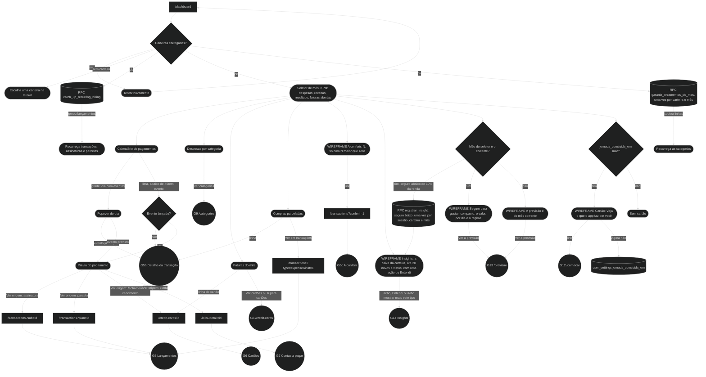

### Regras técnicas

| Ponto | Regra | Onde |
|---|---|---|
| Dados | Um hook agrega os blocos por mês e carteira | `src/components/dashboard/use-dashboard-data.ts` |
| Cobranças atrasadas | `catch_up_recurring_billing` roda uma vez por carteira ao montar; é idempotente com o cron | `src/lib/queries/use-recurring-billing-catchup.ts` |
| Calendário | Eventos: assinatura, parcela, fechamento, vencimento de cartão, vencimento de conta, receita e despesa lançadas. É a agenda do `Calendar` (rodada 242): na grade, o dia abre o popover e fica marcado (com a janela abaixo de 768px o popover abre como gaveta); abaixo de 40rem da largura da própria agenda ela vira a lista do mês — no telefone, e também num laptop estreito com a barra lateral aberta e o painel de próximos ao lado —, e o evento abre direto o detalhe ou a prévia, sem o popover. A lista mostra os últimos 5 dias passados com evento e todos os que vêm, com o selo do tipo. A grade de pontos do telefone saiu | `src/components/dashboard/dashboard-payments-calendar.tsx` |
| Prévia | "Ver origem" monta a rota pelo tipo do evento | `src/components/dashboard/dashboard-payment-event-preview-sheet.tsx` |
| A conferir (Bloco 3A) | Entre os indicadores e o calendário, o wireframe "A conferir: N" conta os lançamentos `needs_review` da carteira (pelo índice parcial `transactions_needs_review_idx`) e leva a `/transactions?conferir=1`. Com zero, some; um erro na contagem também o esconde | `src/components/wireframe/a-conferir-contagem-wireframe.tsx`, `src/app/(app)/dashboard/page-client.tsx` |
| Cartão da jornada (Bloco 4) | No alto do Painel, o wireframe "Veja o que o app faz por você" leva a `/comecar` enquanto `user_settings.jornada_concluida_em` é nulo; "Agora não" grava a data e o cartão some. Sem resposta da leitura, não aparece. Não há redirecionamento automático para a jornada | `src/components/wireframe/jornada-cartao-wireframe.tsx`, `src/app/(app)/dashboard/page-client.tsx` |
| Seguro para gastar (Bloco 5) | Entre o seletor de mês e os indicadores, o wireframe "Seguro para gastar" mostra o valor, o valor por dia (contando hoje) e o regime ("Caixa: o dinheiro que sai neste mês. A fatura conta no mês em que vence."), com o link "Ver a previsão" para `/previsao`. É compacto: o detalhe mora na rota. Só no mês corrente; em outro mês do seletor, o cartão diz "A previsão é do mês corrente" e mantém o link. Carregando ou em erro, o cartão diz isso e mantém o link. O Painel lê a previsão por `usePrevisao`, com os mesmos hooks e `queryKey` dele | `src/components/wireframe/seguro-para-gastar-wireframe.tsx`, `src/lib/previsao/use-previsao.ts`, `src/app/(app)/dashboard/page-client.tsx` |
| Insights (Bloco 6) | Entre o seguro para gastar e os indicadores, o wireframe "Insights" lista os `new` e `seen` da carteira, até 20, do mais novo ao mais velho (a RLS já tira o de outra pessoa e o tipo que a pessoa silenciou). Cada um tem uma ação ou "Entendi"; "Mais" abre "Dispensar este" e "Não mostrar mais este tipo". Os novos que aparecem viram `seen` (`marcar_insight`, uma vez por sessão). Sem a tabela (migração ainda não aplicada) a caixa fica vazia; um erro de leitura aparece como alerta. Ver 14 | `src/components/wireframe/insights-wireframe.tsx`, `src/lib/insights/use-insights.ts`, `src/app/(app)/dashboard/page-client.tsx` |
| Seguro baixo (Bloco 6B) | É o único insight que o cliente produz: ao abrir o Painel no mês corrente, se o seguro para gastar (`seguroParaGastar`, o mesmo do cartão ao lado) está abaixo de 10% da renda do mês (e há renda), `registrar_insight` grava o do mês, uma vez por sessão, carteira e mês. O texto da caixa mostra o seguro de agora, nunca o gravado; o insight some quando deixou de estar baixo e não aparece em mês que passou | `src/lib/insights/use-insights.ts` (`useSeguroBaixo`), `src/lib/insights/acoes.ts` (`textoNaCaixa`) |
| Orçamentos que repetem (Bloco 5) | Ao abrir, o Painel chama `garantir_orcamentos_do_mes` (a mesma chamada de Categorias, no máximo uma vez por carteira e mês na sessão). Se a RPC criou linhas, as categorias são invalidadas e a tela refaz a busca. Erro vai ao console e a próxima abertura tenta de novo | `src/hooks/use-garantir-orcamentos-do-mes.ts`, `src/lib/category-budget-ops.ts` |
| "Em aberto" e "prevista" (Bloco 5) | O "em aberto" das faturas do Painel segue o `buildCardMonthlyInvoiceSnapshot`: **não** soma as assinaturas do cartão que ainda vão cair. A fatura "prevista" da previsão (`faturaPrevista`) soma. São dois números com dois nomes; a revisão de tela decide se o "em aberto" passa a ser o previsto | `src/components/dashboard/use-dashboard-data.ts`, `src/lib/previsao/fatura-prevista.ts` |
| Fatura e estorno (Bloco 2) | Nas faturas do mês, uma fatura fechada vale o total do banco quando a pessoa o informou (`credit_card_statement_totals`); a aberta segue o calculado. O estorno no cartão (receita com `payment_method = 'credit_card'`) abate a despesa do mês de fechamento e não conta como receita. A consulta do período pede `source`, `needs_review` e `import_batch_id`: sem a migração do Bloco 2, o Painel não carrega | `src/components/dashboard/use-dashboard-data.ts`, `src/lib/fatura/total-com-banco.ts`, `src/lib/expense-month-attribution.ts`, `src/lib/queries/use-transactions-range.ts` |

---

## 5. Lançamentos

`/transactions`: a lista de despesas e receitas, e o formulário que as cria.
É a jornada para onde as outras mandam a pessoa quando querem mostrar dinheiro
que já se mexeu.

### 5a. Lista e filtros

### 5b. Criar, editar e excluir

```mermaid
%%{init: {"theme": "dark"}}%%
flowchart TD
    open(["Formulário: modal no desktop, folha no mobile"]) --> type{"Tipo"}
    open -->|"criar"| frase(["WIREFRAME Frase rápida: escrever e Preencher; o Enter preenche e não salva"])
    frase -->|"Preencher: valor, descrição, data, tipo, forma, cartão, categoria pelo histórico"| type
    frase -.->|"com dúvida: o aviso Confira"| type
    frase -.->|"sem valor: Tentar com IA"| iaFrase[("Edge ia-ler, op frase: o texto redigido; cota de 30 por dia")]
    iaFrase -->|"campos; a dúvida ia deixa a conferir"| type
    iaFrase -.->|"cota, sem IA ou erro: o aviso, e a pessoa preenche"| type
    open -->|"criar"| foto(["WIREFRAME Foto do recibo: câmera ou arquivo; vira WebP de 1600 px"])
    foto -->|"multipart, op imagem"| iaFoto[("Edge ia-ler: a foto vai crua, sem redação; até 4 MB")]
    iaFoto -->|"campos; source share, a conferir"| type
    iaFoto -.->|"cota, sem IA ou foto ilegível: o aviso; a foto fica"| type
    type -->|"Despesa"| expense(["Valor, descrição, categoria, data, forma de pagamento"])
    type -->|"Receita"| income(["Valor, descrição, categoria, data"])
    type -->|"Parcelada"| inst(["Valor total ou por parcela, nº de parcelas, 1ª cobrança"])

    expense --> catPick(["Seletor de categoria"])
    income --> catPick
    catPick -->|"Gerenciar categorias"| G9(("G9 /categories"))
    expense -->|"forma: cartão de crédito"| cardPick(["Seletor de cartão"])
    cardPick -->|"Cadastrar cartão ou sem cartões"| G6(("G6 /credit-cards"))
    cardPick -.->|"sem cartão escolhido"| disabled(["Salvar desativado"])

    expense -->|"Salvar"| saveTx[("Insere transação; pela frase, source quick_text; pela foto, share; needs_review com dúvida ou IA")]
    income -->|"Salvar"| saveTx
    income -->|"Estorno no cartão: escolher o cartão"| refund(["WIREFRAME Estorno: receita no crédito, com o cartão"])
    refund -->|"Salvar"| saveTx
    refund -.->|"abate a fatura do ciclo em que cai; fora da receita do Painel"| G6
    inst -.->|"2 ou mais parcelas e valor, antes de salvar"| impacto(["WIREFRAME Impacto da parcela: parcela e fim, pico, próximas faturas, renda, mês no vermelho e limite"])
    frase -.->|"com parcelas e valor"| impacto
    planInfo -.->|"detalhe de compra parcelada"| impacto
    impacto -.->|"a mesma conta da previsão"| G13(("G13 Previsão"))
    inst -->|"Salvar"| savePlan[("RPC create_workspace_installment_plan")]
    saveTx -->|"offline"| queued(["Salva na fila offline"])
    saveTx -->|"erro"| keep(["Aviso; formulário continua aberto"])
    saveTx -->|"sucesso"| after[("Edges evaluate-budgets, evaluate-credit-card-alerts")]
    saveTx -.->|"com a foto do recibo"| fotoAnexo[("A foto vira anexo do lançamento; falhando, o lançamento fica")]
    saveTx -.->|"despesa manual, no insert"| notifyTrg[("Trigger transactions_notify_created: Edge notify-transaction-created avisa os membros")]
    after --> toast(["Transação criada; listas recarregam"])
    toast -->|"Ver, só online"| txOpen(("G5b Detalhe /transactions?txn=id"))
    savePlan -->|"sucesso"| toastPlan(["Compra parcelada registrada"])
    savePlan -.->|"pela frase ou pela IA"| markPlan[("Parcelas lançadas recebem source e needs_review; a foto vai à 1ª")]
    toastPlan -->|"Ver, só online"| planList(("G5 /transactions?plan=id"))
    open -->|"Cancelar, Esc ou fora, sem alterações"| closed(["Fecha e descarta"])
    open -->|"fechar com alterações"| discard(["Descartar alterações?"])
    discard -->|"Descartar"| closed
    discard -->|"Continuar editando"| open
    saveTx -.->|"salvando: nada fecha"| open

    detail(["Detalhe da transação"]) --> view(["Valor, data, categoria, forma, dica da fatura"])
    view -->|"é parcela"| planInfo(["Parcela k de n, total, lançado, restante"])
    view -->|"tem assinatura"| G8(("G8 /subscriptions"))
    view -->|"importado, a revisar ou Apple Pay com cartão da Wallet"| review(["WIREFRAME A conferir: Importado · a conferir"])
    review -->|"Confirmar"| reviewOk[("needs_review = false")] --> view
    review -->|"Lembrar 'nome' como este cartão, com o cartão escolhido"| walletAlias[("credit_cards.wallet_alias")] --> view
    review -->|"Desfazer importação do lote, confirmado"| reviewUndo[("Apaga o lote por import_batch_id")] --> sheetShut(["O detalhe fecha"])
    view --> attach(["WIREFRAME Anexos: lista, anexar foto ou PDF, abrir, apagar"])
    attach -->|"Anexar"| attachCheck{"Tipo aceito, até 10 MB e dentro da cota de 25 MB?"}
    attachCheck -->|"não"| attachErr(["Mensagem antes do envio"])
    attachCheck -->|"sim"| attachSave[("Foto vira WebP; objeto no bucket attachments e linha em attachments; a linha falhou, o objeto sai")]
    attachSave --> attach
    attach -->|"Abrir"| attachUrl(["URL assinada de 1 h em aba nova; popup bloqueado: link Abrir anexo, sem sair do app"])
    attach -->|"Apagar, confirmado"| attachDel[("Apaga a linha e o objeto")] --> attach
    view -->|"⋯ Editar"| editWhat{"É parcela?"}
    editWhat -->|"não"| editForm(["Editar campos"])
    editWhat -->|"sim"| scope(["O que editar: esta parcela ou plano da compra"]) --> editForm
    editForm -->|"Salvar: tira a marca, needs_review false"| updated(["Transação ou plano atualizado"]) --> view
    editForm -->|"Cancelar"| view
    view -->|"⋯ Excluir"| confirm(["Excluir transação?"])
    confirm -->|"Cancelar"| view
    confirm -->|"Excluir"| isInst{"É parcela?"}
    isInst -->|"não"| delTx[("Remove transação e os objetos dos anexos")] --> deleted(["Transação excluída"])
    isInst -->|"sim"| cascade[("RPC delete_workspace_installment_plan_cascade; objetos dos anexos ficam para o cron")] --> cancelled(["Compra parcelada cancelada"])
    confirm -.->|"offline"| queuedDel(["Exclusão enfileirada"])
```

### 5c. Captura sem abrir o app e "A conferir"

O Bloco 3A. A pessoa cria um token em Minha conta e instala o Atalho do iPhone
pelo guia; o Atalho e a automação do Apple Pay lançam pela Edge `capture`, como
a pessoa. O Android compartilha um texto, que abre o formulário com a frase.
O que tem dúvida cai em "A conferir", que o Painel conta e o lembrete das 20h
aponta.

O Bloco 3B pôs a IA no caminho: a `capture` aceita a foto do recibo em
multipart e manda à IA a frase que o parser não leu; a compra parcelada
capturada vira plano; e o Android compartilha também foto e PDF, pelo service
worker.

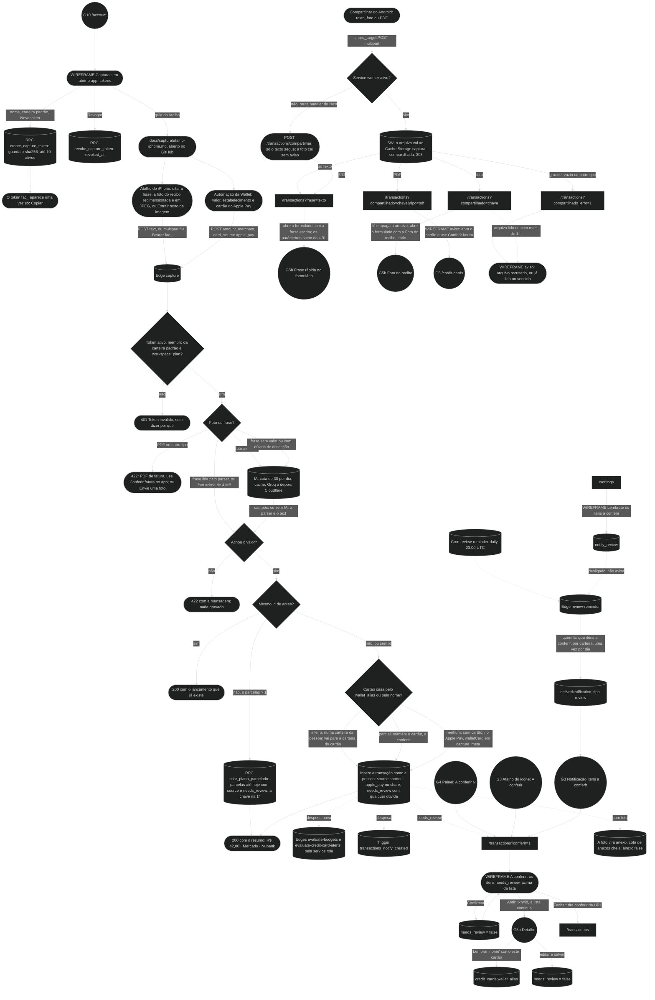

### Regras técnicas

| Ponto | Regra | Onde |
|---|---|---|
| Parâmetros | Lidos e gravados na URL; `new`, `txn` e `importar` são consumidos e removidos (`importar=1` abre o wireframe de importar e sai por `router.replace`, como o `new`). `frase`, `frase_titulo` e `frase_url` (o compartilhar do Android) também saem, e desde o Bloco 3B `compartilhado`, `tipo` e `compartilhado_erro` (o arquivo compartilhado); `conferir=1` fica, porque é uma vista | `src/lib/transactions-list-search-params.ts`, `src/app/(app)/transactions/page-client.tsx` |
| Ordenação e página | `sort=date.desc` · `date.asc` · `amount.desc` · `amount.asc` e `page=N` (a partir de 1) vão para a URL e voltam dela, também no voltar e avançar; o padrão (`date.desc`, página 1) não é escrito. Trocar um filtro volta à página 1. Só na página, não no modo embutido | `src/components/transactions/use-transactions-list-controller.ts`, `src/lib/transactions-list-search-params.ts` |
| Tabela | `DataTable` em modo `manual` (o banco ordena e pagina): a seleção não alcança as projetadas, que também não abrem nem têm menu; o mês só agrupa ordenado por data; a barra de seleção é flutuante e cancelar a exclusão mantém a seleção; no telefone, a lista gerada das colunas | `src/components/transactions/transactions-table.tsx`, `src/components/ui/data-table.tsx` |
| Formulário | Um componente para criar, e o mesmo campo a campo na edição | `src/components/transactions/transaction-form-dialog.tsx`, `transaction-form-use.tsx` |
| Parcelada | RPC `create_workspace_installment_plan`; editar o plano não muda parcelas já lançadas. Desde o Bloco 3B, a compra preenchida pela frase ou pela IA marca depois da RPC as parcelas já lançadas (`source` e `needs_review`, pela RLS de membro; falhando, o plano fica), e a foto do recibo vai à 1ª parcela (`primeiraParcelaDoPlano`). As parcelas que o cron lança depois nascem `app`, sem marca | `src/components/transactions/transaction-form-persistence.ts`, `src/components/transactions/transaction-form-use.tsx` |
| Impacto da parcela (Bloco 5) | O wireframe "Impacto da parcela" aparece em três lugares: no formulário, no modo Parcelada, com 2 ou mais parcelas, data e valor (e, no crédito, o cartão escolhido); na frase rápida, quando a frase aplicada traz parcelas e valor; e no detalhe de um lançamento de compra parcelada, com o plano ativo. Com "em 10x" na frase, o quadro aparece duas vezes (na frase e no formulário). Nenhuma conta própria: o "depois" é a mesma `projecaoMensal` e a mesma `faturaPrevista` com um plano sintético igual ao que o banco gravaria. Mostra a parcela e o mês da última, o pico de parcelas num mês (pelo mês da cobrança), as 3 próximas faturas antes e depois (só com cartão), a parcela como % da renda recorrente (`kind = income`; sem receita, diz que não há), o primeiro mês da linha do tempo com o seguro negativo, antes e depois, e o limite. O limite disponível desconta as faturas fechadas não pagas (o total do banco, quando gravado), o lançado na aberta e todas as parcelas futuras, e **não** as assinaturas; sem cartão (Pix, por exemplo), não há faturas nem limite, e o cartão sem `credit_limit` diz "Sem limite cadastrado" em vez de "Não cabe no limite do cartão" | `src/components/wireframe/impacto-parcela-wireframe.tsx`, `src/lib/previsao/impacto-parcela.ts`, `src/components/transactions/transaction-form-fields.tsx`, `src/components/wireframe/frase-rapida-wireframe.tsx`, `src/components/transactions/transaction-detail-sheet.tsx` |
| Detalhe | Mesmo painel no Painel, em Cartões e em Categorias | `src/components/transactions/transaction-detail-sheet.tsx` |
| Exclusão | Parcela cancela o plano inteiro por `delete_workspace_installment_plan_cascade`. Continua com confirmação, e não com o Desfazer do toast: a exclusão é física (`delete`), sem `deleted_at` nem RPC de restaurar, e recriar mudaria o id e quebraria parcelas, recorrência e faturas (verificado na rodada 228) | `src/lib/transactions/mutations.ts` |
| "Ver" do toast | Criar uma transação (não editar) mostra "Ver", que leva a `/transactions?txn=id` e abre o detalhe; a compra parcelada leva a `?plan=id`. Offline não há id, e o toast sai sem "Ver". A trava que abre o `txn` uma vez só volta a soltar quando a URL perde o parâmetro — antes, com `/transactions` aberta, o segundo `?txn=` não abria nada | `persistTransactionSave` em `src/lib/transaction-detail-sheet-mutations.ts`, `transaction-form-persistence.ts`, `use-transactions-list-controller.ts` |
| Offline | Criar e excluir entram na fila; pagar conta exige conexão | `src/lib/offline/` |
| Aviso aos membros | O trigger `transactions_notify_created` (`AFTER INSERT` em `transactions`, só `expense` sem `subscription_id`, `installment_plan_id` nem `import_batch_id`: desde o Bloco 2 a importação não avisa) chama `notify-transaction-created` por `invoke_edge_function` (`pg_net`, `x-cron-secret`). A função repete o `WHEN` (`triggerSkipReason`, em `_shared/transaction-notify-rules.ts`) e responde 200 com `skipped` ao que ele pula, mesmo chamada por um Database Webhook antigo. O cliente não chama a função: a despesa offline avisa quando a fila a insere. Parcela e assinatura lançadas pelo cron não avisam. Sem segredo no Vault ou com falha de rede, a despesa é salva e o aviso se perde | `supabase/migrations/20261021120000_internal_edge_dispatch.sql`, `supabase/functions/notify-transaction-created/`, `supabase/functions/_shared/transaction-notify-rules.ts` |
| Rascunho | Fechar o formulário alterado (Cancelar, Esc, toque fora, ×, arrastar a gaveta) pergunta "Descartar alterações?"; salvar fecha sem perguntar. Trocar só a aba ou o tipo não conta como alteração. Enquanto salva, nada fecha (`Dialog pending`) | `isDirty` em `src/components/transactions/transaction-form-use.tsx`, `src/components/transactions/transaction-form-dialog.tsx` |
| Enter | O `Enter` na busca do seletor não salva a transação: o popover é portalizado, e a submissão implícita do navegador só conta os campos cujo dono no DOM é o `<form>` | `Form` em `src/components/ui/form.tsx` |
| Período personalizado | Um `DatePicker` de intervalo com `confirm`: as pontas ficam em rascunho até Aplicar, Limpar tira o filtro, Cancelar e Esc descartam. Era um formulário à parte (`transactions-date-range-form.tsx`, removido) | `src/components/transactions/transactions-filters-panel.tsx` |
| Prévias dos chips | O chip de fatura e o "Parcelada" abrem uma prévia ao pousar, no foco e no toque longo (`HoverCard`); o clique no chip continua abrindo o detalhe da linha. A da fatura leva a "Ver cartão" (o ciclo atual: a página do cartão não abre uma fatura passada por parâmetro). O chip de fatura só existe a partir de `md` | `CreditInvoiceChip` e `InstallmentChip` em `src/components/transactions/transactions-table.tsx` |
| Importar extrato ou planilha (Bloco 2) | Wireframe acima da barra, pelo link "Importar extrato ou planilha" ou `?importar=1`. Extrato do banco (CSV ou OFX, `source = 'import_statement'`) ou planilha da pessoa (CSV, `import_sheet`), numa conta (Pix, Débito, Outro) ou num cartão. A categoria vem do histórico (a descrição normalizada igual; senão, a transação mais recente com a mesma primeira palavra significativa); as categorias da planilha que faltam são criadas antes. Todo item importado nasce com `needs_review` e o `client_id` gerado uma vez: repetir "Importar" não duplica. Parcela vira despesa simples com "(k/n)" na descrição. "Desfazer importação" apaga o lote (`import_batch_id`). Não avisa os membros nem dispara alerta de orçamento ou de cartão | `src/components/wireframe/importar-extrato-wireframe.tsx`, `src/components/wireframe/mapeamento-csv.tsx`, `src/lib/import/` |
| Estorno no cartão (Bloco 2) | No formulário de receita, a caixa "Estorno no cartão" grava `payment_method = 'credit_card'` com o cartão. O estorno abate a fatura do ciclo em que cai (que pode ficar negativa, saldo credor), reduz a despesa do mês de fechamento e não conta como receita no Painel | `src/components/wireframe/estorno-wireframe.tsx`, `formaDoPayload` em `src/components/transactions/transaction-form-use.tsx`, `src/lib/expense-month-attribution.ts` |
| A conferir (Bloco 2) | No detalhe, o lançamento importado ou com `needs_review` mostra "Importado · a conferir". "Confirmar" tira o `needs_review`; "Desfazer importação do lote", depois do `confirm`, apaga o lote inteiro e fecha o detalhe. A lista "A conferir" veio no Bloco 3A (`?conferir=1`) | `src/components/wireframe/a-conferir-wireframe.tsx`, `src/components/transactions/transaction-detail-sheet.tsx` |
| Frase rápida (Bloco 3A) | Só ao criar, no topo do formulário: o wireframe "Frase rápida" lê a frase ("42 mercado nubank") com o mesmo parser da Edge (`_shared/frase.ts`) e, em "Preencher" ou no Enter, preenche valor, descrição, data, tipo, forma, cartão e a categoria pelo histórico da carteira (`carregarHistoricoDaFrase`, sem travar offline). Não salva: quem salva é a pessoa, pelo botão de sempre. O payload ganha `source: 'quick_text'` e, com dúvida do parser, `needsReview: true`; a categoria escolhida à mão conta como conferida. O Enter do campo chama `preventDefault` e não envia o formulário. Desde o Bloco 3B, quando o parser não acha o valor, aparece "Tentar com IA": a frase vai à `ia-ler` (`lerFraseComIA`), e o que a IA leu se junta ao que o parser leu (forma, parcelas, estorno); a dúvida `ia` deixa o lançamento a conferir, e a data futura vira hoje com a dúvida `data`. Sem IA, o aviso diz por quê ("Você usou a IA 30 vezes hoje. Amanhã volta.", "A IA não respondeu agora. Confira à mão.") | `src/components/wireframe/frase-rapida-wireframe.tsx`, `src/lib/captura/frase-no-form.ts`, `src/components/transactions/transaction-form-use.tsx` |
| Editar tira a marca (Bloco 3A) | Toda edição salva grava `needs_review = false`; a criação só grava `source` e `needs_review` quando o payload os traz | `buildTransactionRow` em `src/lib/transactions/mutations.ts` |
| Compartilhar do Android (Blocos 3A e 3B) | Desde o Bloco 3B, o `share_target` do manifest é `POST /transactions/compartilhar` em `multipart/form-data`, com `files` (foto e PDF), `text`, `title` e `url`. Com o service worker ativo, a rota é dele (`receberCompartilhar`): guarda o primeiro arquivo aceito (JPEG, PNG, WebP, HEIC ou PDF, não vazio, até 10 MB) no Cache Storage `captura-compartilhada` e responde 303 para `/transactions?compartilhado=<chave>` (o PDF com `&tipo=pdf`); arquivo recusado leva a `?compartilhado_erro=1`; só texto, ao `?frase=` do 3A. A tela lê o arquivo pela chave e o apaga do cache (vale 1 hora): a foto abre o formulário de despesa com a "Foto do recibo" lendo (`fotoInicial`); o PDF, o arquivo que sumiu e o recusado viram o wireframe de aviso ("Para conferir a fatura, abra o cartão e use Conferir fatura.", com "Abrir cartões"). Sem service worker ativo (primeira instalação, troca de versão), o *route handler* do Next responde 303 só com o texto, e a foto cai sem aviso. O texto continua como no 3A: `frase`, `frase_titulo` e `frase_url` juntos (até 500 caracteres) abrem o formulário com a frase escrita, sem aplicar; com o formulário aberto, a frase nova troca a do campo | `src/lib/captura/compartilhado.ts`, `src/sw.ts`, `src/app/(app)/transactions/compartilhar/route.ts`, `src/app/(app)/transactions/page-client.tsx`, `src/components/wireframe/compartilhado-aviso-wireframe.tsx`, `src/app/manifest.ts` |
| Captura (Blocos 3A e 3B) | A Edge `capture` aceita JSON até 16 KB (`text`, ou `amount` + `merchant` + `card`; `date`, `id` e `source` opcionais) e, desde o Bloco 3B, `multipart/form-data` até 10 MB (`file`, a foto em JPEG, PNG ou WebP pelos bytes, e `text`, `source` e `id` opcionais), com `Authorization: Bearer fac_…`. PDF volta 422 "PDF de fatura: use Conferir fatura no app."; outro tipo, 422 "Envie uma foto (JPG, PNG ou WebP)."; o corpo só é lido depois do token, do plano e do membro. A foto até 4 MB vai à IA (`lerImagem`); a frase vai à IA (`interpretar`) só quando o parser não achou o valor ou ficou com dúvida de descrição, e o resultado passa pelo mesmo casamento de cartão e histórico. Sem IA (cota, provedor fora, sem chave), segue o parser; sem valor, 422 (com foto, "Não entendi a foto. Mande o valor no texto."). Todo lançamento que passou pela IA nasce `needs_review`, com `capture_meta.ia` (provedor e modelo). A foto vira anexo; com a cota de anexos cheia, o lançamento fica e a resposta diz `anexo: false`. A resposta ganha `ia` e `anexo`. Data de compra futura vira hoje, a conferir. Procura o token pelo `sha256`; revogado, desconhecido ou mal formado é o mesmo 401. Depois confere o `workspace_plan` da carteira padrão (402 sem plano) e se a pessoa ainda é membro dela. Grava com a service role repetindo a RLS: o autor é o dono do token, e cartão e categoria são da carteira de destino. Sem valor, 422 e nada gravado. Com `id`, o `client_id` deriva de `sha256(token_id:id)` e o retry devolve o mesmo lançamento. `needs_review` com qualquer dúvida do parser, cartão de crédito citado sem casar, nenhuma categoria pelo histórico ou compra parcelada. Despesa nova chama `evaluate-budgets` e `evaluate-credit-card-alerts` com o Bearer da service role; o aviso aos membros é o do trigger | `supabase/functions/capture/`, `supabase/functions/_shared/captura.ts`, `supabase/functions/_shared/frase.ts` |
| Parcela capturada vira plano (Bloco 3B) | Com `parcelas > 1`, a `capture` chama a RPC interna `criar_plano_parcelado` (só a service role; confere o membro pelo `p_user_id`) com `source` da captura e `needs_review`: a parcela é `round(total / N, 2)` e a última fecha a diferença; a 1ª cobrança é a data do lançamento. As parcelas vencidas até hoje nascem marcadas; o `client_id` e a `capture_meta` vão na 1ª, que é o `id` da resposta e a guarda do retry. Dois retries simultâneos podem criar dois planos | `supabase/functions/capture/`, `supabase/migrations/20261024120000_ia.sql` |
| Foto do recibo (Bloco 3B) | Só ao criar, abaixo da frase rápida: o wireframe "Foto do recibo" (câmera ou arquivo) comprime a foto para WebP de lado maior 1600 px e a manda à `ia-ler` em multipart (`lerImagemComIA`, com o token da sessão). O que a IA leu preenche o formulário como a frase, com `source: 'share'` e a conferir; quem salva é a pessoa. A foto fica no formulário (suja o rascunho) e vira anexo do lançamento depois do salvar (na compra parcelada, da 1ª parcela); falhando o anexo, o lançamento fica. A resposta atrasada de uma foto trocada é jogada fora; o Enter do campo abre a câmera e não salva | `src/components/wireframe/foto-recibo-wireframe.tsx`, `src/lib/ia/ler.ts`, `src/components/transactions/transaction-form-use.tsx` |
| IA (Bloco 3B) | Um módulo só, `_shared/ia.ts`, com a cadeia em `_shared/ia-config.ts`: texto e fatura na Groq (`openai/gpt-oss-20b`, `openai/gpt-oss-120b`) e depois na Cloudflare (`@cf/qwen/qwen3-30b-a3b-fp8`); imagem na Groq (`qwen/qwen3.8-27b`, *preview*) e depois na Cloudflare (`@cf/meta/llama-4-scout-17b-16e-instruct`). Ordem: cache (`ia_cache`, não gasta cota) → chaves → cota (`consumir_cota_ia`, 30 por pessoa por dia de São Paulo) → provedores, 10 s cada; 429, 5xx, 401, 403, prazo e JSON inválido passam ao próximo, e cada chamada conta em `ia_eventos`. A saída é validada à mão (valor positivo até 1.000.000, data válida). Antes de enviar texto, `redigir` tenta tirar cartão (fica `•••• 1234`), CPF, CNPJ, e-mail, telefone, CEP, endereço e os nomes dos membros da carteira. É heurística e pode falhar em formatos incomuns (cartão que não passa no Luhn, nomes com menos de 3 letras, e-mail com acento), e a política diz isso; a imagem vai crua. A `ia-ler` (JWT da pessoa; confere membro e `workspace_plan`) devolve campos e nunca grava: `op` `frase`, `fatura` ou `imagem` (multipart, até 4 MB). Os motivos sem IA são `cota`, `sem_ia` e `fatura_grande` | `supabase/functions/_shared/ia.ts`, `supabase/functions/_shared/ia-config.ts`, `supabase/functions/_shared/redigir.ts`, `supabase/functions/ia-ler/`, `src/lib/ia/ler.ts` |
| Apple Pay e lembrar cartão (Bloco 3A) | O cartão casa pelo `wallet_alias` ou pelo nome (`casarCartao`); casamento parcial mantém o cartão e marca a conferir; sem casamento, grava crédito sem cartão, a conferir, com o nome da Wallet em `capture_meta.walletCard`. No detalhe, com um cartão escolhido, o wireframe oferece "Lembrar '<nome>' como este cartão", que grava `credit_cards.wallet_alias` (até 60 caracteres); a próxima captura casa. Aparece também no item já conferido, só com o "Lembrar" | `src/components/wireframe/a-conferir-wireframe.tsx`, `src/components/transactions/transaction-detail-sheet.tsx` |
| A conferir: lista (Bloco 3A) | `?conferir=1` mostra, acima da lista de sempre, o wireframe com os lançamentos `needs_review` da carteira. "Confirmar" tira a marca; "Abrir" leva a `?txn=id` mantendo a lista; "Fechar" tira o `conferir` da URL. Não é filtro do controlador da lista: vira filtro na revisão de tela | `src/components/wireframe/a-conferir-lista-wireframe.tsx`, `src/app/(app)/transactions/page-client.tsx` |
| Avaliadores pelo servidor (Bloco 3A) | `evaluate-budgets` e `evaluate-credit-card-alerts` aceitam o Bearer da service role ou o `x-cron-secret` (`isServiceAuthorized`, agora em `_shared/service-auth.ts`), além do JWT da pessoa; pelo servidor, o corpo traz o `workspace_id`, e a checagem de membro é pulada | `supabase/functions/_shared/service-auth.ts`, `supabase/functions/evaluate-budgets/`, `supabase/functions/evaluate-credit-card-alerts/` |
| Anexos (Bloco 2) | No detalhe, a seção de anexos: WebP, JPEG, PNG ou PDF, até 10 MB, e 25 MB por carteira; a foto vira WebP de lado maior 1600 px. O objeto mora em `<workspace_id>/<uuid>.<ext>` no bucket privado `attachments`, e a cota conta o tamanho real do objeto (`attachments_enforce_quota`). Se a linha falha depois do envio, o objeto é apagado. "Abrir" pede uma URL assinada de 3600 s numa aba aberta no clique; com o popup bloqueado, a seção mostra o link "Abrir anexo" com a URL assinada (`target="_blank"`), e a pessoa não sai do app. Excluir a transação avulsa apaga os objetos; em lote, parcelada ou offline, quem apaga é o cron semanal | `src/components/wireframe/anexos-wireframe.tsx`, `src/lib/anexos.ts`, `src/lib/transactions/mutations.ts`, `supabase/migrations/20261022130000_anexos.sql` |
| Botão direito na linha | Atalho das ações da linha (os botões da coluna Ações continuam); sobre uma linha selecionada age na seleção inteira (`contextMenuTargets`); linhas projetadas não têm menu | `TransactionRowContextMenu` em `src/components/transactions/transactions-table.tsx` |

---

## 6. Cartões e faturas

`/credit-cards` e `/credit-cards/[cardId]`: cadastro dos cartões e o ciclo de
cada fatura.

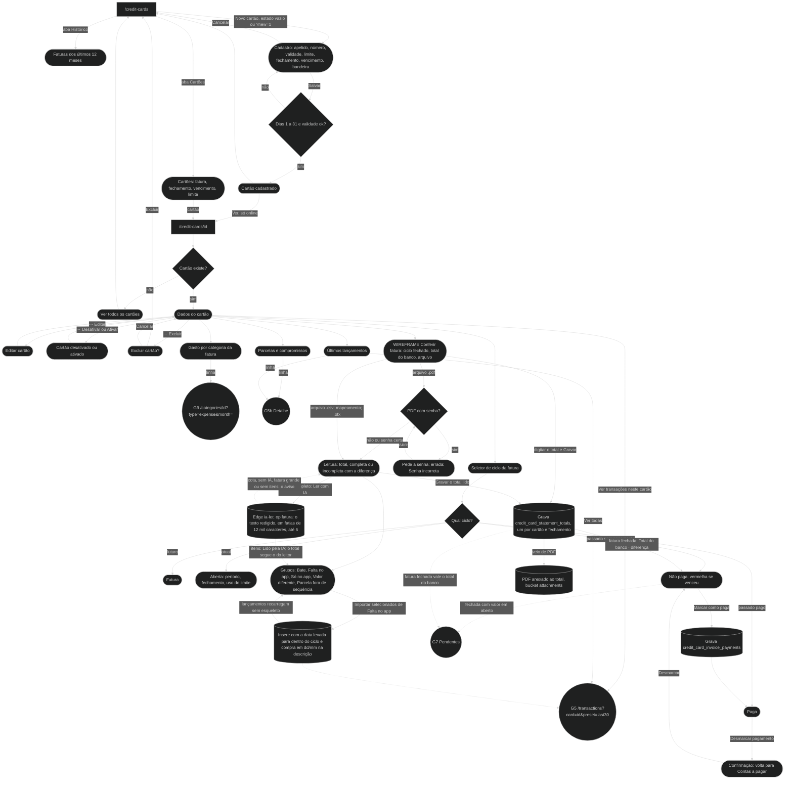

### Regras técnicas

| Ponto | Regra | Onde |
|---|---|---|
| Status no detalhe | `Futura`, `Aberta`, `Não paga`, `Paga`, pelo ciclo selecionado | `src/app/(app)/credit-cards/[cardId]/page-client.tsx` |
| Selo na tabela de transações | `Aberta`, `Fechada`, `Anterior`, `Paga`; Aberta é verde, Fechada âmbar, Anterior vermelha | `src/lib/credit-card-display.ts` |
| Pagamento de fatura | Linha em `credit_card_invoice_payments`, sem criar despesa | `src/lib/bills/pay-bill-flow.ts` |
| "Ver" do toast | Cadastrar um cartão (pela página ou pelo diálogo do "+ Adicionar") mostra "Ver", que leva a `/credit-cards/id`; na fila offline, sem "Ver" | `src/app/(app)/credit-cards/page-client.tsx`, `src/components/credit-cards/credit-card-create-dialog.tsx` |
| Conferir fatura (Bloco 2) | Wireframe na página do cartão, sobre os ciclos já fechados. O arquivo do banco é `.pdf` (lido no aparelho por `pdfjs-dist`, sem IA; com senha, pede e tenta de novo, e a errada mostra "Senha incorreta"), `.csv` (com o mapeamento de colunas) ou `.ofx`. A leitura cuja soma não fecha com o total fica incompleta e mostra a diferença, e ainda deixa importar o que achou. Os grupos são Bate, Falta no app, Só no app, Valor diferente e Parcela fora de sequência; o que já foi importado cai em Bate. "Importar selecionados" grava os itens de Falta no app como despesas do cartão (estorno como receita), com a data levada para dentro do ciclo (`ajustarAoCiclo`, que acrescenta "compra em dd/mm" à descrição), `source` `import_pdf` (PDF) ou `import_statement` (CSV, OFX), `needs_review` e o lote em `import_batch_id`, e recarrega só os lançamentos do cartão | `src/components/wireframe/conferir-fatura-wireframe.tsx`, `src/lib/fatura/ciclo.ts`, `src/lib/fatura/conferir.ts`, `src/lib/import/pdf-texto.ts`, `src/lib/import/fatura-texto.ts` |
| Ler com IA (Bloco 3B) | Quando a leitura de um PDF fica incompleta, aparece "Ler com IA": o texto do PDF já redigido no aparelho (`removerIdentificacao`), guardado da leitura, vai à `ia-ler` com o fechamento do ciclo, sem reler o arquivo nem pedir a senha. A Edge redige de novo e corta em fatias de 12.000 caracteres (até 6; acima, "Fatura grande demais para a IA. Use o CSV do banco."), cada uma gastando uma cota. Os itens da IA substituem os do leitor, com "Lido pela IA" no topo; o total continua o do leitor determinístico. Sem item válido, os itens do leitor ficam e o aviso diz "A IA não achou itens nesta fatura. Confira à mão.". Lida pela IA, o botão some | `src/components/wireframe/conferir-fatura-wireframe.tsx`, `src/lib/ia/fatura.ts`, `src/lib/ia/ler.ts` |
| Total do banco (Bloco 2) | Gravar o total (digitado ou lido) faz um `upsert` em `credit_card_statement_totals` (`workspace_id`, `credit_card_id`, `statement_close_date`), com `source` `manual`, `pdf`, `csv` ou `ofx`. Lido de PDF, o PDF vira anexo do total (o mesmo PDF não sobe duas vezes; falhar aqui não desfaz o total). Numa fatura fechada, o painel mostra "Total do banco · diferença", e o Painel, Contas a pagar e os avisos de fatura da Edge usam o total do banco no lugar do calculado | `src/components/wireframe/conferir-fatura-wireframe.tsx`, `src/lib/fatura/total-com-banco.ts`, `src/components/credit-cards/credit-card-invoice-analytics-panel.tsx` |
| Estorno (Bloco 2) | A fatura é despesas menos estornos (receita no cartão), e pode ficar negativa; os percentuais por categoria seguem sobre o gasto bruto. Os alertas de limite, fechamento e vencimento descontam o estorno | `src/lib/credit-card-billing.ts`, `src/lib/credit-card-invoice-analytics.ts`, `supabase/functions/_shared/credit-card-cycle.ts` |
| Alertas | Limite, fechamento e vencimento geram notificações `cc_*`. A compra parcelada no cartão roda a conferência de limite, como a despesa avulsa. Numa fatura fechada (fechou, vence em breve, vence hoje e, no limite, a última fechada não paga), o valor é o total do banco quando gravado (`escolherTotal` em `_shared/credit-card-cycle.ts`, a regra de `totalComBanco`); o calendário lê `credit_card_statement_totals` numa consulta só por execução. A fatura que ainda fecha usa o calculado. Desde o Bloco 5 o `credit-card-calendar-alerts` também avisa a fatura acima do normal (ver a jornada 13, Previsão), com consulta própria | edges `evaluate-credit-card-alerts`, `credit-card-calendar-alerts`; `src/components/transactions/transaction-form-persistence.ts` |

---

## 7. Contas a pagar

`/bills`: contas recorrentes e o que está pendente, incluindo as faturas de
cartão que fecharam em aberto. A conta a pagar é paga pela pessoa, e o app
lembra e confirma; a assinatura (jornada 8) cobra sozinha, e o app lança. O
Pix Automático é assinatura.

### Regras técnicas

| Ponto | Regra | Onde |
|---|---|---|
| Dados | Um RPC traz a página inteira; desde o Bloco 2 ele traz também as receitas no cartão (os estornos), e o total do banco das faturas vem à parte (`credit_card_statement_totals`) | `rpc_fetch_bills_page_bundle` em `src/lib/queries/fetch-bills-page-bundle.ts`, `supabase/migrations/20261022121000_bills_bundle_estornos.sql`, `src/lib/queries/use-statement-totals.ts` |
| Fatura como pendência | Projetada no cliente a partir dos ciclos fechados com valor em aberto. O valor é o total do banco quando a pessoa o informou na conferência da fatura; senão, o calculado (despesas menos estornos). Total zero ou negativo (saldo credor) não vira pendência | `src/lib/bills/credit-card-bill-projector.ts`, `src/lib/fatura/total-com-banco.ts` |
| Anexos (Bloco 2) | O painel da conta (`?detail=`) mostra os anexos da parcela pendente que ele exibe (`bill_instance_id`), com as mesmas regras dos anexos do lançamento, e abaixo os da última parcela paga (por vencimento), só para abrir: sem anexar nem apagar, e a seção some se ela não tem anexo | `src/components/bills/bill-detail-sheet.tsx`, `src/components/wireframe/anexos-wireframe.tsx` |
| Boleto (Bloco 6A) | O boleto é anexo da **instância** e não é copiado ao pagar. O diálogo de pagar o mostra só para abrir (a fatura virtual não tem instância); o detalhe do lançamento pago mostra os anexos da instância ligada (`bill_instances.transaction_id`), sem "Apagar" ali. `attachments` não ganhou política de `update` | `src/components/bills/pay-bill-dialog.tsx`, `src/lib/bills/anexos-da-conta.ts`, `src/components/transactions/transaction-detail-sheet.tsx` |
| Pagar conta | `pay_bill_instance` cria a despesa e avança a recorrência a partir do **vencimento pago**, e não do dia do pagamento (o ciclo é a referência); bloqueado offline. A data do pagamento não pode ser depois de hoje ("A data do pagamento não pode ser depois de hoje.") | `src/lib/bills/pay-bill-flow.ts`, `src/components/bills/pay-bill-dialog.tsx` |
| Pagar fatura | Só marca como paga: as compras já estão lançadas no cartão | `src/lib/bills/pay-bill-flow.ts` |
| Recorrência | Mensal, Bimestral, Trimestral, Anual, Única. **Uma regra só**, no `_shared`, que o cliente reexporta e a Edge usa: o dia 31 vence no último dia do mês curto (28 ou 29 em fevereiro, 30 em abril); a trimestral iniciada em 31/01 vence em 30/04; a anual de 29/02 vence em 28/02 no ano que não é bissexto | `supabase/functions/_shared/recorrencia-conta.ts`, `src/lib/bills/recurrence.ts` |
| Passo 0 (Bloco 6A) | A conta que não é paga não para: o primeiro passo do `evaluate-bills-reminders` cria, para cada conta ativa e não `one_time`, a pendência de cada vencimento que já chegou (até hoje), a partir da última instância. Respeita o `end_date`; `upsert` com `ignoreDuplicates` em `(bill_id, due_date)`, então o passo 0, o pagamento e o pular dão uma instância só por vencimento. Três meses sem pagar viram três pendências vencidas. O limite de 60 dias do lembrete vale para o aviso, não para a geração; a resposta traz `geradas` | `supabase/functions/evaluate-bills-reminders/index.ts`, `vencimentosQueFaltam` em `_shared/recorrencia-conta.ts` |
| Lembrete por janela (Bloco 6A) | A vencer: a instância avisa o **menor offset** da janela (`0 <= dias até o vencimento <= offset`), uma vez por offset, então um dia sem cron não perde o aviso. Atrasada: no 1º dia e a cada 7. Nos dois, `sent_on` fica no vencimento, e o `releaseDedupe` filtra também por `sent_on`. Depois do `end_date` não há aviso | `offsetDaJanela` em `supabase/functions/_shared/notification-schedule.ts`, `evaluate-bills-reminders/index.ts` |
| Editar a agenda | Mudar `due_day_of_month`, `frequency`, `start_date`, `end_date` ou reativar reprograma a pendente: a que ainda não venceu passa à próxima data do ciclo a partir do último vencimento pago ou pulado (nunca antes de hoje nem do início); a depois do fim é apagada; se a data já existe (23505), avança ao ciclo seguinte. A pendente vencida não muda, é dívida de um ciclo que passou. Reativar uma conta sem pendente cria a próxima. O replay offline faz o mesmo | `src/lib/bills/reprogramar.ts`, `updateBillRow` em `src/lib/bills/mutations.ts`, `src/lib/offline/handlers/bills.ts` |
| Pular | `pular_instancia_da_conta` é atômico: a instância é reivindicada com `status = 'pending'` e a próxima nasce com `on conflict do nothing`. Falha com `BILL_INSTANCE_NOT_PENDING` quando já não está pendente | `supabase/migrations/20261027120000_contas.sql`, `skipBillInstance` em `src/lib/bills/mutations.ts` |
| Encerrada e Concluída | Estados calculados, sem coluna: sem pendente, a `one_time` é **Concluída** e a recorrente com `end_date` antes de hoje é **Encerrada**; o resto é Ativa ou Inativa. Não nasce instância depois do `end_date`, nem a primeira | `statusDaConta` em `src/components/bills/bill-status.ts` |
| Valor variável (Bloco 6A) | `bills.valor_variavel` (padrão `false`). Quando a conta é variável, o gatilho `media_da_conta` grava `amount_estimated` como a média dos `paid_amount` das 3 últimas pagas (arredondada a centavo), dentro da carteira da instância, ao pagar, reabrir, editar o valor ou apagar uma instância paga. Sem nenhuma paga com valor, fica o valor digitado. Lista, lembrete e previsão já leem `amount_estimated`: a fonte é uma só | `supabase/migrations/20261027120000_contas.sql`, `src/components/wireframe/conta-valor-variavel-wireframe.tsx` |
| Lançamento apagado ou editado | Apagar o lançamento de uma conta paga reabre a instância (`pending`, com `paid_at`, `paid_amount`, `transaction_id` e `amount` nulos): ela volta às Pendentes e o lembrete volta a valer. Mudar o valor do lançamento acompanha o `paid_amount`. Os dois são gatilhos em `transactions` (`reabrir_instancia_ao_apagar`, `acompanhar_valor_pago`) | `supabase/migrations/20261027120000_contas.sql` |
| Instância da carteira da conta | O gatilho `same_ws_bill_id` impede `bill_instances.bill_id` de apontar para a conta de outra carteira | `supabase/migrations/20261027120000_contas.sql` |
| Casamento automático (Bloco 6A) | Na aba Pendentes, o cliente cruza as despesas dos últimos 40 dias com as pendentes: descrição parecida (o casador de palavras da conferência da fatura), valor dentro de ±15% e data dentro de ±5 dias do vencimento. Cada lançamento casa com uma conta só (a de maior semelhança), receita nunca casa, e um lançamento já ligado a qualquer conta não reaparece. "Sim" chama `ligar_pagamento_da_conta` (marca a instância paga com o valor e a data do lançamento e liga os dois, sem lançamento novo; `TRANSACTION_ALREADY_LINKED` e `BILL_INSTANCE_NOT_PENDING` fazem a pergunta sair). "Não" fica em `localStorage`, neste aparelho | `src/lib/bills/casamento.ts`, `src/components/wireframe/casamento-conta-wireframe.tsx`, `src/app/(app)/bills/page-client.tsx` |
| Conta ou assinatura | A explicação (wireframe) fica nos dois formulários e leva ao outro cadastro: `/subscriptions?new=1` e `/bills?new=1`. `new=1` abre o cadastro uma vez e sai da URL | `src/components/wireframe/conta-ou-assinatura-wireframe.tsx`, `src/app/(app)/bills/page-client.tsx` |
| O "hoje" da tela | Recalculado quando a janela volta ao foco e na virada do dia, e não mais congelado ao abrir a página | `src/hooks/use-hoje-ymd.ts` |
| Botão direito | No cartão de pendência, repete o "Pagar" e o menu de três pontos, que continuam à vista | `src/components/bills/bill-pending-card.tsx` |
| "Ver" do toast | Criar uma conta mostra "Ver", que leva a `/bills?detail=id` e abre o painel dela (sem levar os outros filtros da URL); na fila offline, sem "Ver" | `src/app/(app)/bills/page-client.tsx` |

---

## 8. Assinaturas

`/subscriptions`: cobranças recorrentes que viram lançamentos sozinhas.

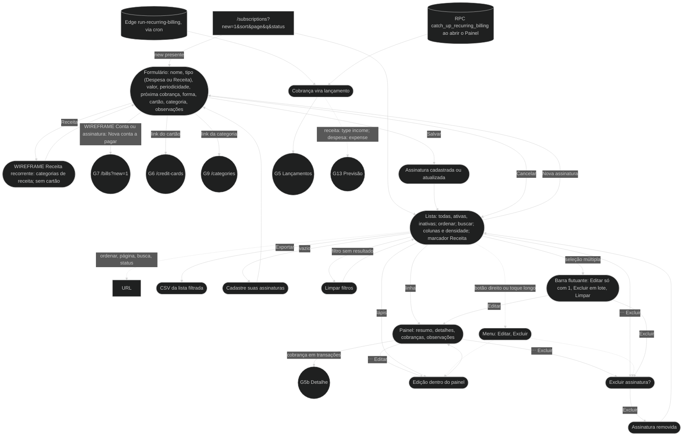

### Regras técnicas

| Ponto | Regra | Onde |
|---|---|---|
| Dados | `rpc_fetch_subscriptions_page_bundle` | `src/lib/queries/fetch-subscriptions-page-bundle.ts` |
| Periodicidade | Semanal, Mensal, Bimestral, Anual | `src/components/subscriptions/subscription-form-dialog.tsx` |
| Cobrança | `run-recurring-billing` só aceita chamada com `CRON_SECRET`; o Painel recupera o atraso | `supabase/functions/run-recurring-billing/index.ts` |
| Receita recorrente (Bloco 5) | `workspace_subscriptions.kind` é `expense` (o padrão) ou `income`. O formulário ganha o wireframe "Receita recorrente" (Despesa ou Receita): com Receita, a categoria é de receita e a forma de pagamento perde o cartão (o check `workspace_subscriptions_income_no_card`: receita no cartão é estorno). `charge_subscription_cycle` e `seed_subscription_first_transaction` gravam `type = kind`, e o check `transactions_subscription_expense_only` saiu. A lista marca a receita com "Receita" e mantém o valor neutro. O salário cadastrado entra no extrato como `income` e soma no seguro; **não** aparece nos eventos de pagamento do calendário, nos compromissos da categoria de despesa nem na fatura de um cartão. A previsão trata as duas à parte (`fluxoDoMes`: a receita vai a "previstas" de receitas) | `src/components/wireframe/receita-recorrente-wireframe.tsx`, `src/components/subscriptions/subscription-form-fields.tsx`, `src/components/subscriptions/subscription-form-shared.ts`, `src/components/dashboard/payment-events.ts`, `supabase/migrations/20261026120000_previsao.sql` |
| Conta ou assinatura (Bloco 6A) | O formulário abre com a explicação (wireframe): a assinatura cobra sozinha e o app lança; o que a pessoa paga por boleto ou Pix é conta a pagar, e o link leva a `/bills?new=1` | `src/components/wireframe/conta-ou-assinatura-wireframe.tsx` |
| Filtro por assinatura | `/transactions?sub=id` | `src/lib/transactions-list-search-params.ts` |
| Estado na URL | `sort=<coluna>.<asc\|desc>`, `page=N` (a partir de 1), `q` (a busca) e `status=active` ou `inactive`, lidos ao abrir e gravados a cada troca; trocar de carteira zera os quatro | `urlState` do `DataTable` em `src/app/(app)/subscriptions/page-client.tsx` |
| Tabela | `DataTable` no cliente: busca sem acento, exportar CSV, colunas e densidade guardadas; Excluir da linha está no ⋯ (Editar fica à vista); cancelar a exclusão em lote mantém a seleção | `src/app/(app)/subscriptions/page-client.tsx` |

---

## 9. Categorias e orçamentos

`/categories`: as categorias da carteira e o limite mensal de cada uma. Não há
tela separada de orçamento: o limite mora na categoria. Na primeira visita de
cada carteira aparece um assistente.

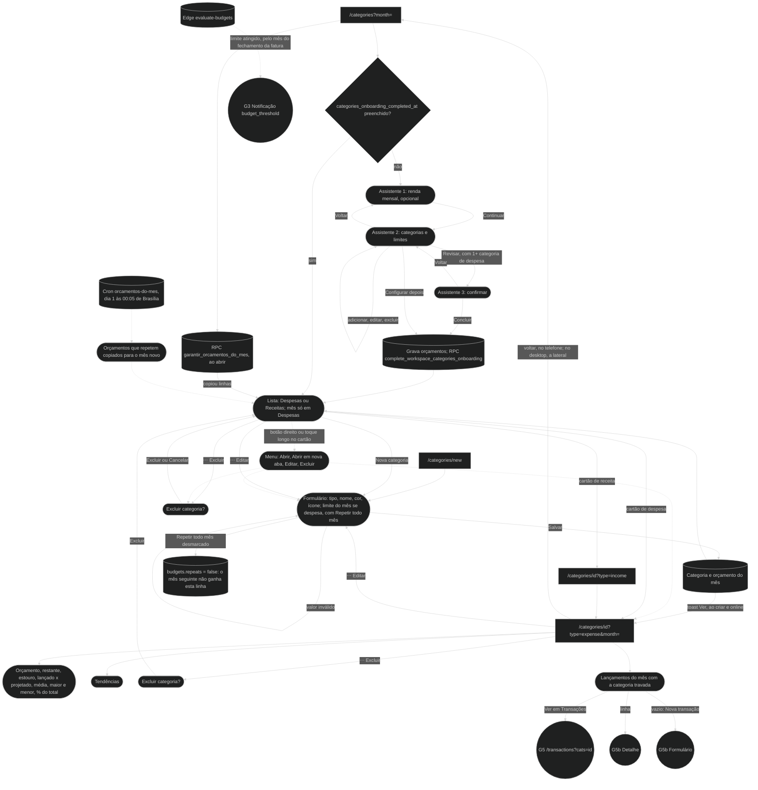

### Regras técnicas

| Ponto | Regra | Onde |
|---|---|---|
| Assistente | Só em `/categories`, por carteira; nada redireciona para ele | `src/components/categories/categories-onboarding-wizard.tsx` |
| Detalhe | `rpc_fetch_category_detail_bundle` | `src/lib/queries/fetch-category-detail-bundle.ts` |
| "Ver" do toast | Criar uma categoria (pela tela ou pelo diálogo do "+ Adicionar") mostra "Categoria criada" com "Ver", que leva a `/categories/id?type=`; se o orçamento falhar, o aviso "Categoria criada, mas o orçamento não foi salvo" leva ao mesmo detalhe. Na fila offline, sem "Ver". A tela de categorias não mostrava toast nenhum ao criar | `src/components/categories/category-create-dialog.tsx`, `src/app/(app)/categories/page-client.tsx` |
| Entradas no detalhe | Lista de categorias, gasto por categoria do cartão, notificação de orçamento | `src/components/categories/detail/` |
| Orçamento | Avaliado depois de cada despesa criada ou editada e de cada conta paga; mudar o valor do orçamento rearma os avisos de 80%, 100% e estouro. Criar a categoria não notifica mais | edge `evaluate-budgets`, `src/lib/category-budget-ops.ts` |
| Orçamento que se repete (Bloco 5) | O formulário da categoria de despesa ganha o wireframe "Repetir todo mês" (ligado por padrão), que grava `budgets.repeats`. Sem novo valor, o upsert não roda e só a repetição do orçamento já salvo muda (`definirRepeticao`). O padrão do banco é `true`; só o mês corrente foi marcado na migração, e o histórico ficou `false`. `copiar_orcamentos_do_mes(p_period_start, p_workspace_id)` copia a linha do mês anterior com `repeats` para o mês dado, **uma vez por carteira e mês**: o marcador `orcamentos_copiados` entra antes e é ele que impede o orçamento apagado no mês de voltar. O mês que já tem a categoria não ganha outra (`on conflict do nothing` na chave única), a categoria apagada já levou o orçamento pela FK em cascata, e os avisos (`threshold_*`) nascem nulos. Roda pelo cron `orcamentos-do-mes` (`5 3 1 * *`, 00:05 em Brasília) e pelo RPC `garantir_orcamentos_do_mes(p_workspace_id)`, que confere o membro e a Categorias e o Painel chamam ao abrir | `src/components/wireframe/orcamento-repete-wireframe.tsx`, `src/lib/category-budget-ops.ts`, `src/hooks/use-garantir-orcamentos-do-mes.ts`, `supabase/migrations/20261026120000_previsao.sql` |
| Aviso pelo mês do fechamento (Bloco 5) | `evaluate-budgets` soma a categoria no mês pelo `gastoDaCategoriaNoMes` (`_shared/orcamento-mes.ts`): a despesa fora do cartão conta pelo dia; a do cartão, pelo mês do **fechamento** da fatura da compra. É a mesma regra do `postedTotal` de `buildCategoryCommitmentsForMonth`, travada pelos vetores dourados (`orcamento-mes-vectors.json`). A receita (o estorno no cartão também) não entra: **a categoria não abate o estorno**, como a tela. Os chamadores (formulário, edição, conta paga, a fila offline e a `capture`) mandam `payment_method` e `payment_credit_card_id`, e a Edge avalia o orçamento do mês do fechamento. O front antigo de `main` não manda: a Edge avalia o dia e o fechamento da compra em cada cartão da carteira | `supabase/functions/evaluate-budgets/index.ts`, `supabase/functions/_shared/orcamento-mes.ts`, `src/lib/fixtures/orcamento-mes-vectors.json` |
| Botão direito | No cartão de categoria, o menu toma o lugar do menu do navegador sobre o link, por isso traz "Abrir em nova aba"; o ⋯ continua | `src/components/categories/category-card-context-menu.tsx` |

---

## 10. Conta e segurança

`/account` e subpáginas: o que é da pessoa, não da carteira.

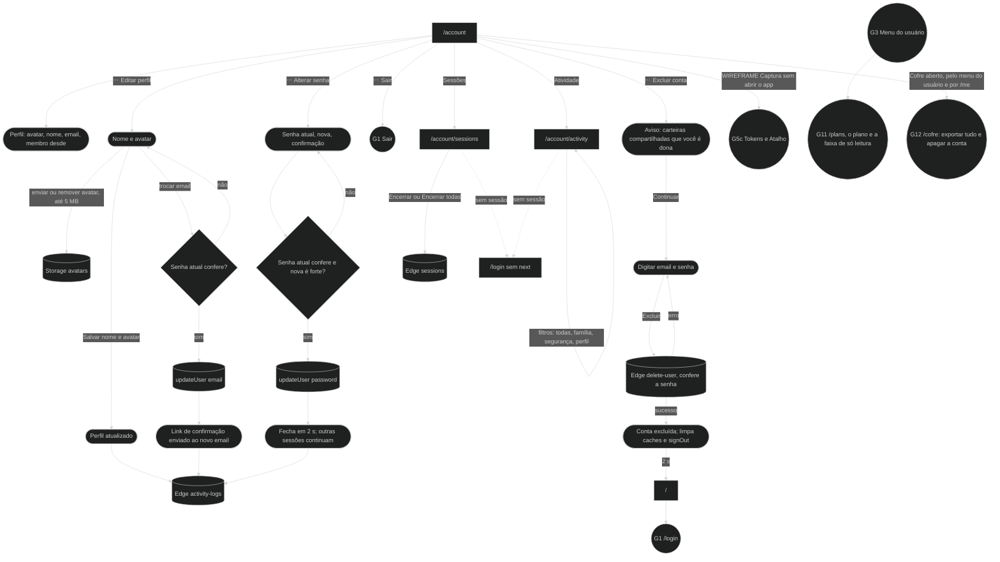

### Regras técnicas

| Ponto | Regra | Onde |
|---|---|---|
| Troca de email e senha | Confere a senha atual entrando de novo antes de `updateUser` | `src/components/account/edit-profile-dialog.tsx`, `src/components/security/ChangePasswordDialog.tsx` |
| Excluir conta | Dois passos; a senha é conferida na Edge Function. Desde o Bloco 4 o mesmo diálogo também abre em `/cofre` ("Apagar a conta"), e vale em só leitura (a Edge usa a service role) | `src/components/security/DeleteAccountDialog.tsx`, `src/lib/delete-account.ts` |
| Sessões | Listar e encerrar pela edge `sessions` | `src/lib/sessions.ts` |
| Atividade | Perfil, email e senha gravam log | edge `activity-logs` |
| Tokens de captura (Bloco 3A) | Seção "Captura sem abrir o app" (wireframe): nome do aparelho (1 a 60 caracteres) e carteira padrão; "Novo token" chama `create_capture_token`, que devolve o `fac_…` uma vez só, para copiar; "Revogar" chama `revoke_capture_token`. A lista lê só as colunas sem o hash e nunca mostra o valor. Até 10 ativos por pessoa. O link do guia abre `docs/captura/atalho-iphone.md` no GitHub | `src/components/wireframe/captura-tokens-wireframe.tsx`, `docs/captura/atalho-iphone.md` |

---

## 11. Plano e só leitura

`/precos`, `/plans` e a faixa de "só leitura": quanto custa, o que a pessoa tem
hoje e o que muda quando o direito de uso acaba. **Tudo isso está desligado:**
com `billing_settings.enforced_since` nulo, todo mundo é `familia`, ninguém é
barrado e o botão "Assinar" (que só aparece com origem `teste` ou `nenhuma`) não faz nada. O gateway (Asaas) é do Bloco 8.

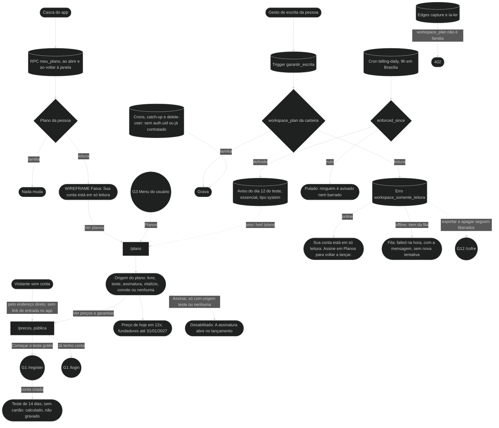

### Regras técnicas

| Ponto | Regra | Onde |
|---|---|---|
| O interruptor | `billing_settings.enforced_since` (uma linha só) nulo desliga tudo: `plano_do_usuario` e `workspace_plan` devolvem `familia` antes de ler qualquer outra coisa, o gatilho não lança erro e o cron do teste não acha ninguém. `billing_lancar()` o liga, só pela service role, e é do Bloco 8: o roteiro manda não rodá-lo | `supabase/migrations/20261025120000_planos.sql`, `supabase/BLOCO_4_DEPLOYMENT.md` |
| `plano_do_usuario` | `familia` ou `leitura`. É `familia` com plano próprio (`tem_plano_proprio`: assinatura `active` no período, ou vitalícia sem `current_period_end`, ou `past_due` dentro da carência), dentro do teste (`greatest(created_at, enforced_since)` mais 14 dias) ou coberta (`tem_cobertura`). Senão, `leitura`. O teste é calculado, não gravado | `supabase/migrations/20261025120000_planos.sql` |
| Cobertura | Ficam cobertas as até 5 pessoas distintas (fora o assinante) que entraram primeiro, por `min(joined_at)`, nas carteiras em que o assinante é `owner`. Não é transitiva, e nenhum convite é bloqueado: a 6ª pessoa só perde a cobertura da carteira pessoal dela | `supabase/migrations/20261025120000_planos.sql` |
| `workspace_plan` | Substitui o stub do Bloco 3A, com a mesma assinatura, e só a service role a executa (o stub a dava a `authenticated`, e com o uuid a pessoa descobriria o plano de outra carteira); o `garantir_escrita` a chama como dono, por ser `security definer`. A carteira segue o dono: `familia` se algum `owner` dela é `familia`. A `capture` e a `ia-ler` já devolvem 402 quando ele não é `familia` | `supabase/migrations/20261025120000_planos.sql`, `supabase/functions/capture/`, `supabase/functions/ia-ler/` |
| `garantir_escrita` | Gatilho antes de `insert`, `update` e `delete` em `transactions` e antes de `insert` em `workspace_installment_plans`, `workspace_subscriptions` e `attachments`. Barra com `workspace_somente_leitura` o gesto da pessoa em `leitura`. Passa sem `auth.uid()` (crons, service role, `delete-user`), em cascata (`pg_trigger_depth() > 1`) e o lançamento de plano ou assinatura que já existia antes da transação. Criar o parcelamento ou a assinatura é que é barrado | `supabase/migrations/20261025120000_planos.sql` |
| `origem_do_cron` | Gatilho antes de `insert` em `transactions`: um lançamento `app` de um plano ou assinatura que já existia vira `recurring` (o cron e o catch-up do navegador, sem reescrever as funções deles). A captura grava a própria origem pela `criar_plano_parcelado`. É a origem que o Piloto Automático lê | `supabase/migrations/20261025120000_planos.sql` |
| `meu_plano()` | A RPC da pessoa logada: `plano`, `origem` (`livre`, `vitalicio`, `assinatura`, `teste`, `convite`, `nenhuma`), `status`, `teste_ate`, `periodo_ate`, `cancelar_no_fim`, `preco_centavos`, `fundador`. A tela e a faixa leem por `usePlano`, ao montar e quando a janela volta ao foco; em erro, `plano` fica nulo e nada aparece | `src/lib/planos/plano.ts`, `src/components/wireframe/planos-wireframe.tsx` |
| Faixa de só leitura | `SomenteLeituraWireframe`, na casca do app, acima de toda tela. Aparece só com o plano `leitura` e leva a `/plans`. Carregando ou em erro, não aparece | `src/components/wireframe/somente-leitura-wireframe.tsx`, `src/components/layout/sidebar-app-shell.tsx` |
| Mensagem e fila offline | O erro `workspace_somente_leitura` vira "Sua conta está em só leitura. Assine em Planos para voltar a lançar." (`SOMENTE_LEITURA_PT`). Na fila offline, o item rejeitado com essa mensagem fica `failed` na hora, sem as novas tentativas: nunca some calado | `src/lib/supabase-errors.ts`, `src/lib/offline/sync-engine.ts` |
| `/precos` | Rota pública fora de `(app)`, como `/privacidade`, sem mexer no `AuthGuard`. Mostra o Plano Família (12x de R$ 29,90, R$ 358,80 por ano) e, até 31/01/2027, o de fundadores (12x de R$ 19,90, congelado enquanto ativo), 14 dias grátis sem cartão e as garantias. Liga a `/register` e `/login` | `src/app/precos/page.tsx`, `src/components/wireframe/precos-wireframe.tsx`, `supabase/functions/_shared/plano.ts` |
| `/plans` | Dentro do app, é a gestão do plano: a origem e as datas, o preço do dia e o link para `/precos`. "Assinar" aparece desabilitado ("A assinatura abre no lançamento") só quando a pessoa precisa dele (origem `teste` ou `nenhuma`; com `livre`, o estado de hoje, não aparece); não faz nada até o Bloco 8 | `src/app/(app)/plans/page.tsx`, `src/lib/planos/plano.ts` |
| Aviso do dia 12 | O cron `billing-daily` (`0 12 * * *` UTC, 9h em Brasília) chama a Edge `billing-daily` por `invoke_edge_function`; só aceita o `x-cron-secret`. Enquanto `enforced_since` é nulo, sai com `pulado: 'desligado'`. Depois, avisa quem está entre o 12º e o 14º dia do teste, sem plano próprio nem cobertura, com o que o app fez no teste. Um aviso por pessoa (`billing_avisos`), pelo `deliverNotification` com o tipo `system`, `metadata.href` `/plans`, na carteira pessoal e com `essencial: true`: ignora o interruptor do tipo, o `notify_in_app` e o `notify_email`, e o push segue a preferência | `supabase/functions/billing-daily/index.ts`, `supabase/functions/_shared/deliver-notification.ts`, `supabase/functions/_shared/notification-types.ts` |

---

## 12. Confiança: Piloto, Cofre e o começo

`/comecar`, `/piloto` e `/cofre`: mostrar o que o app faz sozinho, deixar desfazer
e abrir tudo o que ele guarda. As três são telas em wireframe, e a jornada de 4
passos não redireciona ninguém: a pessoa chega por um cartão do Painel.

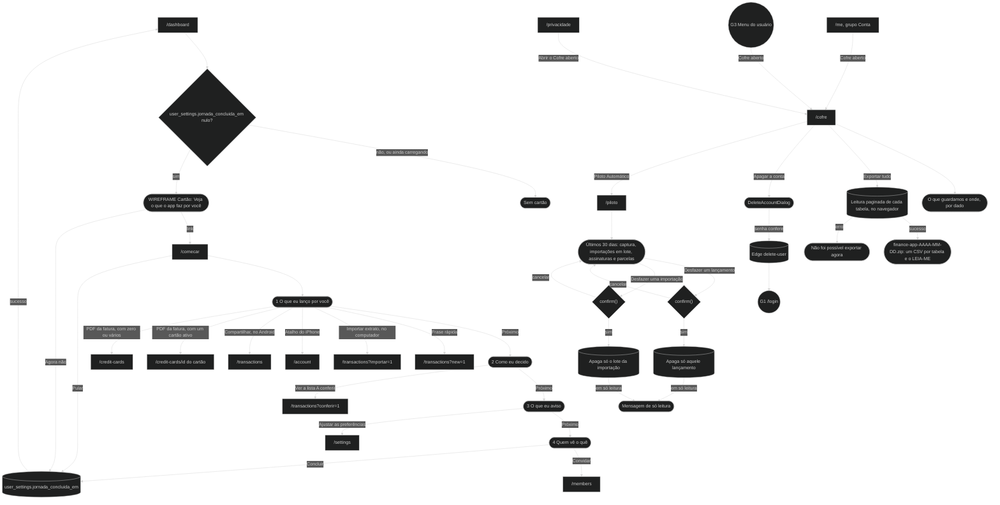

### Regras técnicas

| Ponto | Regra | Onde |
|---|---|---|
| Cartão do Painel | Aparece enquanto `user_settings.jornada_concluida_em` é nulo; sem resposta (carregando ou erro de leitura) não aparece, para não piscar. "Agora não" grava a data. Não há redirecionamento automático, então nenhuma ponte de jornada existente muda | `src/components/wireframe/jornada-cartao-wireframe.tsx`, `src/app/(app)/dashboard/page-client.tsx` |
| `/comecar` | Quatro passos. O 1º muda com a plataforma (`plataformaDe`): Frase rápida e PDF da fatura valem sempre, e o terceiro canal é o Atalho do iPhone, o compartilhar do Android (com o como: instalar pelo menu do navegador e usar Compartilhar → Finance App) ou a importação de extrato. O PDF leva ao detalhe do cartão (`creditCardDetailPath`) quando a carteira tem um cartão ativo só, e à lista de cartões com zero ou vários. O 3º lista os avisos ligados e o próximo de cada um (`proximosAvisos`), só com os cartões ativos e a conta em aberto que vence hoje ou depois; enquanto as preferências carregam, a coluna diz "carregando". "Concluir" e "Pular" gravam `jornada_concluida_em` e levam ao Painel; em erro, a tela fica e mostra o motivo | `src/components/wireframe/jornada-wireframe.tsx`, `src/lib/jornada/jornada.ts` |
| `/piloto` | Lê as `transactions` da carteira atual com `source` diferente de `app` e `created_at` nos últimos 30 dias, com `range` (todas, sem teto de 1.000). Agrupa: captura (frase rápida, atalho, Apple Pay, compartilhado), importações por `import_batch_id` e `recurring`. "Desfazer" pede `confirm()`; o de um lançamento recorrente avisa que o app não o lança de novo (o cron não recria a parcela). Desfazer uma importação apaga só o lote | `src/components/wireframe/piloto-automatico-wireframe.tsx`, `src/lib/piloto/piloto.ts`, `src/lib/import/importar.ts` |
| Desfazer em só leitura | Apagar é escrita da pessoa: o `garantir_escrita` a barra em `leitura`, e a tela mostra a mensagem do mapa de erros | `supabase/migrations/20261025120000_planos.sql`, `src/lib/supabase-errors.ts` |
| `/cofre` | Lista o que o app guarda (dado, onde fica, quem vê, por que pedimos). "Exportar tudo" lê cada tabela de todas as carteiras da pessoa, paginando por `range`, e monta o ZIP no navegador: um CSV por tabela, com `;`, aspas e quebra de linha tratadas, mais um `LEIA-ME.txt`; os anexos saem só como metadados. O ZIP é "store", sem compressão (CRC-32 e cabeçalhos escritos à mão). Só lê, então vale também em só leitura. A região do banco ainda diz "a confirmar" (roteiro, passo 4) | `src/components/wireframe/cofre-aberto-wireframe.tsx`, `src/lib/cofre/exportar.ts`, `src/lib/cofre/zip.ts` |
| Apagar a conta | O mesmo `DeleteAccountDialog` de Minha conta, que confere a senha e chama a Edge `delete-user` (service role, sem `auth.uid()`, então livre em só leitura) | `src/components/security/DeleteAccountDialog.tsx`, `src/lib/delete-account.ts` |
| Entrada no menu | `ROUTES.COFRE` entra em `ACCOUNT_MENU_PROFILE_LINK_ITEMS` como "Cofre aberto": a linha do grupo Conta de `/me` (no telefone, a única entrada) e o item do menu do usuário do desktop, depois de Minha conta e Planos. A aba "Você" fica ativa em `/cofre` (`isVoceTabActive`). `/piloto` e `/comecar` não têm entrada no menu | `src/components/layout/account-menu-links.ts`, `src/config/mobile-navigation.ts`, `src/config/navigation.ts` |
| Título da tela | `APP_PAGE_TITLES` ganhou `/piloto` ("Piloto Automático"), `/cofre` ("Cofre aberto") e `/comecar` ("Começar") | `src/config/navigation.ts` |
| Privacidade | `/privacidade` diz que o teste de 14 dias não pede cartão, que o plano é guardado (tipo, situação e fim do período) e liga ao Cofre aberto, onde se exporta tudo e se apaga a conta | `src/components/wireframe/privacidade-wireframe.tsx` |

---

## 13. Previsão

`/previsao` e o cartão do Painel: quanto sobra para gastar no mês, os próximos 6
meses e o que uma compra parcelada faz a eles. É a jornada nova do Bloco 5, em
wireframe. **Os números são de caixa** (o dinheiro que sai no mês, com a fatura
contada no mês em que **vence**); o orçamento da categoria é de competência (a
compra no crédito conta no mês do **fechamento**). Cada tela diz qual regime mostra.

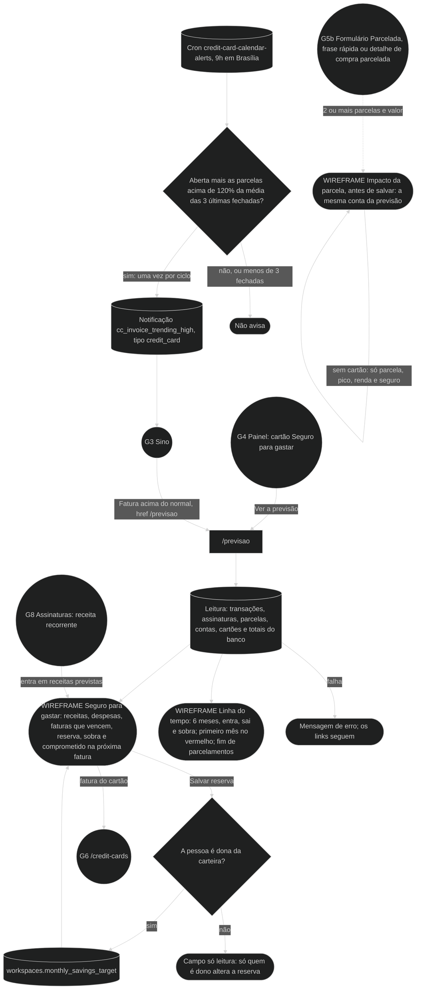

### Regras técnicas

| Ponto | Regra | Onde |
|---|---|---|
| Rota | `/previsao`, dentro do app, sem entrada no menu: a porta é o cartão do Painel (e o sino, quando a fatura passa do normal). `ROUTES.PREVISAO` e o título "Previsão" em `APP_PAGE_TITLES`; tem `loading.tsx` e `AdiarMontagem` | `src/app/(app)/previsao/`, `src/config/navigation.ts` |
| Regime e mês | O mês é o do calendário (sem `cycle_start_day`), e **não há saldo de partida**: cada mês começa do zero. O dia vem de `America/Sao_Paulo` (`localYmdFromDate` no cliente). O "seguro para gastar" é caixa; o orçamento é competência (ver 9) | `src/lib/previsao/fluxo.ts` |
| `fluxoDoMes` | A única fonte do seguro e da linha do tempo. **Entra:** receita fora do cartão (a que já passou e a prevista) e as cobranças de assinatura `income` ainda não lançadas. **Sai:** a despesa fora do cartão (paga e prevista), as cobranças de assinatura e de parcela fora do cartão ainda não lançadas, as contas a pagar e as faturas que **vencem** no mês. A receita no cartão é estorno: abate a fatura e não conta como receita. A conta é em centavos | `src/lib/previsao/fluxo.ts` |
| `faturaPrevista` | A fatura do snapshot (compras, estornos e parcelas projetadas) **mais** as assinaturas de despesa do cartão ainda não lançadas na janela. Fechada e com o total do banco, vale o do banco; **a aberta nunca usa o total do banco**. O rótulo é "prevista", não "em aberto" (ver Painel) | `src/lib/previsao/fatura-prevista.ts` |
| Contas a pagar | Toda instância `pending` com vencimento até o fim do mês entra pelo valor da instância ou o `amount_estimated` da conta, inclusive a vencida de mês anterior (sai no mês de hoje, porque o dinheiro ainda vai sair). As ocorrências seguintes da mesma conta são projetadas pela recorrência (`computeNextBillInstanceDueYmd`). Conta sem valor entra com 0 e é listada como "sem valor". A fatura paga continua no caixa do mês do vencimento e é marcada `paga` | `src/lib/previsao/fluxo.ts` |
| `seguroParaGastar` | `sobra do mês − reserva`. `diasRestantes` conta o dia de hoje (no último dia do mês, 1) e `porDia` é o seguro dividido por eles, 0 se o seguro não é positivo. "Já comprometido na próxima fatura" soma a fatura aberta de cada cartão que vence depois do mês. O fechamento no dia 31 vira o último dia do mês, e a fatura cujo vencimento cai no mês seguinte não entra no caixa deste | `src/lib/previsao/fluxo.ts` |
| `projecaoMensal` | Os 6 meses a partir do atual, cada um um `fluxoDoMes`, mais o "fim de parcelamentos" (o mês em que sai o dinheiro da última parcela: a data da cobrança fora do cartão, o vencimento da fatura que a contém no cartão) e o primeiro mês de sobra negativa | `src/lib/previsao/fluxo.ts` |
| Reserva | `workspaces.monthly_savings_target`, editada no campo "Reserva do mês" do detalhe. A escrita segue a política `Owners can update workspace`: o membro vê o campo desabilitado com o aviso; se o `update` não alcança linha, a tela diz que só o dono altera. Vale por carteira (o campo remonta ao trocar) | `src/components/wireframe/seguro-para-gastar-wireframe.tsx`, `supabase/migrations/20261026120000_previsao.sql` |
| Dados | `usePrevisao` usa os mesmos hooks e `queryKey` do Painel, mais as contas ativas (`previsaoContas`, só as colunas que a previsão lê) e uma janela própria de transações: do dia 1 de dois meses atrás ao fim do sexto mês à frente. Qualquer consulta pendente deixa a tela em "Carregando…"; qualquer falha mostra a mensagem | `src/lib/previsao/use-previsao.ts`, `src/lib/queries/invalidate-workspace-data.ts` |
| Impacto da parcela | Ver 5, "Impacto da parcela (Bloco 5)": o mesmo núcleo, com um plano sintético. O limite é o do banco: faturas fechadas não pagas, o lançado na aberta e todas as parcelas futuras, **sem** assinaturas | `src/lib/previsao/impacto-parcela.ts` |
| Alerta de fatura alta | No cron diário `credit-card-calendar-alerts` (12:00 UTC), para cada cartão ativo: a fatura em aberto mais as parcelas que ainda caem nela contra a média das 3 últimas fechadas (o total do banco, se gravado; a fatura sem movimento não conta). Acima de 120% (120% exatos não) e com 3 fechadas, avisa. Tipo `credit_card` e preferência `notify_credit_cards`, `metadata.href` `/previsao`, dedupe `cal:trending_high:{fechamento}:c:{cartão}` (uma vez por ciclo). A consulta é própria e paginada: falhar não derruba os outros avisos do calendário. **A mensagem diz o valor previsto e quanto ele passa da média, mas não diz quanto sobra no mês do vencimento**: isso exigiria reescrever o seguro em Deno, uma segunda conta; a pessoa vê o seguro em `/previsao` | `supabase/functions/credit-card-calendar-alerts/index.ts`, `supabase/functions/_shared/fatura-tendencia.ts`, `supabase/functions/_shared/notification-copy.ts` |
| Paridade | A projeção de parcelas do alerta espelha `sumProjectedCreditCardInstallmentsInWindow` do cliente, travada por `fatura-tendencia-vectors.json`; o gasto do orçamento, por `orcamento-mes-vectors.json` | `src/lib/fatura-tendencia-parity.test.ts`, `src/lib/orcamento-mes-parity.test.ts` |

---

## 14. Insights

O que o app nota sozinho nas carteiras: a fatura que fechou, o relatório do mês,
um gasto que se repete todo mês, um gasto fora do comum, uma assinatura que
mudou de preço, um lançamento repetido, parcelas que estão acabando, uma conta de
começo de ano que vem aí, itens a conferir e o seguro para gastar baixo. É a
jornada nova do Bloco 6B, em wireframe. Todo insight tem uma ação ou um
"Entendi", existe o "Não mostrar mais este tipo", e o tom é neutro.

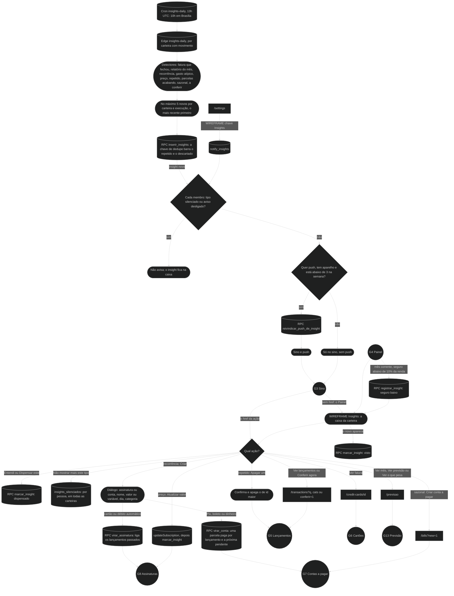

### Regras técnicas

| Ponto | Regra | Onde |
|---|---|---|
| Quem produz | O cron `insights-daily` (`0 13 * * *`, 10h em Brasília) produz tudo, menos o seguro baixo: a fatura que fechou ontem ou anteontem, o relatório do mês (no dia 1), a recorrência, o gasto atípico, a mudança de preço, a duplicidade, as parcelas acabando, o sazonal e o "a conferir". O seguro baixo é do cliente, ao abrir o Painel (ver 4). Os insights do cron são da carteira (`user_id` nulo) | `supabase/functions/insights-daily/index.ts`, `supabase/functions/_shared/insights/detectores.ts` |
| O catálogo | Recorrência: a mesma descrição normalizada (minúsculas, sem acento, sem dígito nem pontuação) e o valor a ±10% em 3 meses seguidos, ou 2 meses no mesmo dia ±3, e sem vínculo (assinatura, conta ou parcela). Gasto atípico: acima de 2× a média dos 3 meses anteriores. Seguro baixo: abaixo de 10% da renda do mês. A conferir: mais de 5 itens. Duplicidade: o mesmo valor e a mesma descrição no mesmo dia, fora de parcela, assinatura e estorno. Sazonal: de 1º de janeiro a 15 de fevereiro, `ipva`, `iptu`, `material escolar`, `matricula` ou `licenciamento` em janeiro a março do ano anterior, sem conta ativa parecida | `supabase/functions/_shared/insights/detectores.ts`, `src/lib/insights/insights.ts` (reexporta) |
| Quando vê o fato | O lançamento novo é visto pelo cron do dia seguinte, e não por gatilho: o caminho do lançamento não ganha mais uma chamada | `supabase/functions/insights-daily/index.ts` |
| Dedupe | Cada insight tem `dedupe_key`, e `(workspace_id, coalesce(user_id, zero-uuid), kind, dedupe_key)` é único. O cron e o de amanhã sobre o mesmo fato dão um só (o "a conferir" tem a chave da semana: um por semana); o insight descartado fica na tabela e não volta com a mesma chave. O cron grava por `inserir_insights` (o `on conflict` no índice de expressão), e só as linhas novas voltam: é a elas que manda o aviso | `supabase/migrations/20261028120000_insights.sql` |
| Limites do primeiro dia | A duplicidade só olha os últimos 30 dias e lançamentos de R$ 10 ou mais. No máximo 5 insights novos por carteira em cada execução, o mais recente primeiro e, no mesmo dia, o que mais vale (fatura, relatório, a conferir, repetido…); o que já está gravado sai antes do corte, então o resto volta nos dias seguintes enquanto continuar verdade | `supabase/functions/insights-daily/index.ts`, `supabase/functions/_shared/insights/limitar.ts` |
| Teto de push | 3 por pessoa e semana (segunda a domingo, Brasília), somando todas as carteiras dela (`insights_push_semana`). `reivindicar_push_de_insight` soma 1 só abaixo de 3, num comando só. Quem não reivindicou, ou quem não tem aparelho inscrito, recebe o aviso só no app (`semPush` do `deliverNotification`); quem não tem aparelho não gasta o teto. E-mail não: insight não é essencial | `supabase/functions/insights-daily/index.ts`, `supabase/functions/_shared/deliver-notification.ts`, `supabase/functions/_shared/insights/semana.ts` |
| Silenciar | "Não mostrar mais este tipo" grava `insights_silenciados(user_id, kind)`: vale por pessoa, em todas as carteiras dela. O cron e `registrar_insight` não criam o insight pessoal de um tipo silenciado; o aviso também não vai. Num insight da carteira, quem silenciou não o vê (o filtro é na leitura, pela RLS), e `marcar_insight` o recusa | `src/lib/insights/use-insights.ts`, `supabase/migrations/20261028120000_insights.sql` |
| Estado compartilhado | O insight da carteira (`user_id` nulo) tem um status só: o "Entendi", a ação ou o visto de um membro vale para todos. Silenciar continua por pessoa. O `acted` não volta atrás e o `dismissed` não volta a `seen`; usar duas vezes é `INSIGHT_JA_USADO`, e dois toques ao mesmo tempo não criam a mesma assinatura duas vezes | `supabase/migrations/20261028120000_insights.sql` (`marcar_insight`) |
| Recorrência: assinatura ou conta | O destino vem sugerido pelo meio de pagamento: cartão de crédito ou débito automático (`credit_card`, `debit_card`) vira assinatura; Pix, TED, dinheiro ou outro (`pix`, `ted`, `cash`, `other`) vira conta a pagar. A pessoa pode trocar no diálogo, que também confere nome, valor, dia e categoria | `supabase/functions/_shared/insights/detectores.ts`, `src/components/wireframe/insights-wireframe.tsx` |
| `virar_assinatura` | `security invoker`: valem a RLS e o `garantir_escrita`. Marca o insight `acted` primeiro (uma falha desfaz a marca). Cria a assinatura mensal com a primeira cobrança no próximo `p_dia` depois de hoje (no dia de hoje, vai ao mês que vem, para não cobrar duas vezes) e grava `subscription_id` nos lançamentos do insight, no máximo um por dia; pela regra do Bloco 5 eles viram `recurring`. Ignora o lançamento que já tem assinatura ou conta | `supabase/migrations/20261028120000_insights.sql`, `src/lib/insights/acoes.ts` |
| `virar_conta` | Marca `acted`, cria a conta mensal (a estimativa é a média dos 3 últimos lançamentos), uma instância `paga` por lançamento (com `transaction_id`, `paid_amount` e `paid_at`) e a próxima `pendente` em `p_next_due_date`, que o cliente calcula pela recorrência do 6A e nunca nasce atrasada. O valor variável vem sugerido quando os valores diferem mais de 5%. Dois lançamentos no mesmo dia dão uma paga só | `supabase/migrations/20261028120000_insights.sql`, `src/lib/insights/acoes.ts` |
| Atualizar o preço e apagar um | "Atualizar valor" muda o `amount` da assinatura e só então marca `acted`; "Apagar um" pede confirmação e apaga, dos dois lançamentos iguais, o de id maior. A mutação já vale quando o `marcar` falha: o insight volta na próxima leitura e repetir é inofensivo | `src/lib/insights/acoes.ts` |
| Os links | Ver fatura (`/credit-cards/id`), Ver mês, Ver previsão e Ver o que pesa (`/previsao`), Ver lançamentos (`/transactions?q=…` ou `?cats=…`), Conferir agora (`/transactions?conferir=1`) e o sazonal (`/bills?new=1`). Tocar no link marca `acted`; o sazonal só abre o cadastro e fica `seen` | `supabase/functions/_shared/insights/textos.ts`, `src/lib/insights/acoes.ts` (`statusAoTocarOLink`) |
| O texto | Os modelos de frase moram num módulo só, sem import, que o servidor e o cliente usam (`textoDoInsight`). Tom neutro: nenhum modelo tem "culpado", "irresponsável", "deveria", "cuidado" nem "!", e a variação sai com sinal e uma casa. O "seguro cumprido" do relatório do mês é calculado na hora de mostrar, no cliente, com o `fluxoDoMes` do mês anterior; o payload do servidor não o traz | `supabase/functions/_shared/insights/textos.ts`, `src/lib/insights/acoes.ts` (`linhaDoSeguroDoMes`) |
| Aviso e preferência | O aviso é do tipo `insight`, vai pelo `deliverNotification` e respeita `notify_insights` (a chave "Insights" em Configurações), `notify_in_app` e `notify_push` da carteira. Desligar a chave não esconde a caixa do Painel | `supabase/functions/insights-daily/index.ts`, `src/components/wireframe/insights-wireframe.tsx` (`InsightsAvisoWireframe`) |
| Banco | `insights` (RLS: membro da carteira, `user_id` nulo ou o da pessoa, e tipo não silenciado), `insights_silenciados` (a pessoa lê, insere e apaga o seu) e `insights_push_semana` (só a service role). Ninguém escreve em `insights` direto: só as funções e a service role do cron | `supabase/migrations/20261028120000_insights.sql` |

---

## 15. Lacunas encontradas

Coisas que o mapeamento achou no caminho. As de acesso foram corrigidas na
rodada de set/2026 e estão registradas abaixo da tabela; as que sobraram
continuam aqui para registro.

| # | Jornada | Lacuna |
|---|---|---|
| 1 | G2 | `/members` mostra o formulário de convite numa carteira pessoal, e o servidor recusa só depois do envio. |
| 2 | G3 | O provider global expõe abrir convite, mas nada chama essa função. (Nova categoria e novo cartão saem da paleta ⌘K desde 16/out/2026.) |
| 3 | G10 | `/account/sessions` e `/account/activity` redirecionam para `/login` sem `next`, então a pessoa não volta para a página depois de entrar. |
| 4 | G1 | A política de senha não vale para a troca de senha de dentro do app (`ChangePasswordDialog`), que ainda confere só o comprimento. |
| 5 | G8 | O detalhe de uma assinatura só abre pelo estado da tela; nenhum parâmetro de URL o abre (só existe `?new=1`). Por isso o toast de assinatura criada não tem "Ver", ao contrário de transação, cartão, conta e categoria (rodada 228). |
| 6 | G5 | Excluir uma transação é físico e sem volta: não há `deleted_at` nem RPC de restaurar, então o "Desfazer" do toast não substitui a confirmação. Ter o desfazer exige exclusão lógica no banco. |
| 7 | G2 | Os erros de carga do diretório de membros mostram ao usuário o arquivo SQL e a RPC a aplicar — texto de desenvolvedor (`members/page-client.tsx`). |
| 8 | G3 | O servidor das notificações foi revisado (textos, `?month=` no link do orçamento, regras de disparo), e o aviso de despesa e os crons passaram para uma migração (trigger e `pg_cron` com Vault). **Banco e funções publicados em 21/10/2026**: produção já manda os textos e as regras novas, o aviso de despesa vem do trigger e os dois crons diários estão agendados (não havia Webhook). Falta o front novo, depois dele apagar a `dispatch-notifications`, o teste de fumaça com duas pessoas e o backup semanal: ver `supabase/NOTIFICATION_DEPLOYMENT.md`. |
| 9 | G5 | Só a exclusão avulsa online apaga o objeto do anexo na hora. A exclusão em lote, a de compra parcelada (o plano sai em cascata no banco), a feita offline e o desfazer de um lote importado apagam as linhas de `attachments` em cascata, mas deixam os objetos no bucket até o cron `attachments-cleanup-weekly` (domingo) apagar o que não tem linha e passou de 24 h. Até lá eles ocupam o armazenamento do projeto, não a cota da carteira. |
| 12 | G5, G6, G7 | O Bloco 2 (estorno, total do banco, conferência da fatura, importação e anexos) está no repositório, com as telas em wireframe. **Banco e funções publicados em 21/10/2026** (migrações, bucket, políticas e cron conferidos); o front novo não foi publicado, então ninguém usa nada disso ainda. Aberta até o front subir e o teste de fumaça passar: `supabase/BLOCO_2_DEPLOYMENT.md`. |
| 14 | G3, G4, G5, G10 | O Bloco 3A (captura sem abrir o app) está no repositório, com as telas em wireframe, e **nada foi publicado**. O backend pode subir antes do front, porque nada dele aparece no front de `main`: `supabase/BLOCO_3A_DEPLOYMENT.md`. |
| 18 | G5 | Um item do Apple Pay com casamento parcial gravado antes de a `capture` guardar o `walletCard` nesse caso não tem `capture_meta.walletCard` e não oferece "Lembrar". |
| 19 | G10 | O link do guia do Atalho aponta para `docs/captura/atalho-iphone.md` em `main` no GitHub e dá 404 até o `finance-app-2.0` ir para `main`. |
| 20 | G5 | A captura pelo WhatsApp foi adiada pelo dono em 22/10/2026 e ficou fora do Bloco 3B. Só o Atalho do iPhone, o Apple Pay e o compartilhar do Android lançam de fora do app. |
| 21 | G5, G6 | A foto vai à IA sem redação: não há como tirar dado de uma imagem. Ela vai crua à Groq e, se a Groq falhar, à Cloudflare. Recibo e comprovante costumam mostrar o cartão mascarado, mas um documento fotografado vai inteiro. A política de `/privacidade` diz isso. |
| 22 | G5 | O modelo de visão da Groq (`qwen/qwen3.8-27b`) é *preview* e pode sair sem aviso. A Cloudflare cobre a foto enquanto isso; a troca é em `_shared/ia-config.ts`. |
| 23 | G5 | Dois reenvios simultâneos de uma compra parcelada pela `capture` podem criar dois planos: o plano não tem `client_id`, e a chave do retry mora na 1ª parcela, gravada depois da RPC. Um reenvio depois do outro não duplica. |
| 24 | G5 | Numa compra parcelada capturada, ou preenchida pela frase ou pela IA, só as parcelas lançadas na hora levam a origem e a marca de a conferir. As que o cron lança nos meses seguintes nascem com `source` `recurring` (desde o Bloco 4; antes, `app`) e sem a marca de a conferir. |
| 25 | G5 | Sem service worker ativo (a primeira instalação, a troca de versão), o compartilhar do Android cai no *route handler* do Next, que segue só com o texto: a foto ou o PDF compartilhado some sem aviso. |
| 26 | G2, G5, G6 | O Bloco 3B (IA na captura e na fatura, e a política de privacidade) está no repositório, com as telas em wireframe, e **nada foi publicado**. O backend sobe junto com o do 3A ou depois dele, e pode subir antes do front: `supabase/BLOCO_3B_DEPLOYMENT.md`. |
| 27 | G11 | "Assinar" só abre no Bloco 8: o gateway (Asaas) saiu do Bloco 4. Até lá o botão em `/plans`, quando aparece (origem `teste` ou `nenhuma`; com `livre` não aparece), fica desabilitado ("A assinatura abre no lançamento"), ninguém consegue assinar e `enforced_since` continua nulo, então ninguém é barrado nem avisado. Quem fica de graça (o dono e a família) entra por `insert` manual (`provider` `manual`). |
| 28 | G3, G4, G10, G11, G12 | O Bloco 4 (planos e só leitura, `/precos`, Piloto Automático, Cofre aberto e a jornada de 4 passos) está no repositório, com as telas em wireframe, e **nada foi publicado**. O backend pode subir antes do front, porque com `enforced_since` nulo nada dele muda o front de `main`: `supabase/BLOCO_4_DEPLOYMENT.md`. |
| 29 | G12 | O Cofre ainda diz "região a confirmar" em cada dado. Troca por "no Brasil" (ou pela região) quando a região do projeto Supabase for conferida (passo 4 do roteiro). |
| 30 | G1, G11 | Nenhuma tela de acesso (`/login`, `/register`, a raiz) leva a `/precos`: hoje só se chega a ela pelo endereço direto ou pelo `/plans`. A porta pública do preço existe, mas ninguém a encontra antes de ter conta. |
| 31 | G4, G13 | O "em aberto" das faturas do Painel não soma as assinaturas do cartão que ainda vão cair; a "prevista" da previsão soma. Os dois números têm nomes diferentes de propósito, mas a mesma fatura mostra valores diferentes no Painel e em `/previsao`. A revisão de tela decide se o "em aberto" passa a ser o previsto. |
| 32 | G13, G3 | O aviso de fatura acima do normal diz o valor previsto e quanto ele passa da média, mas não quanto sobra no mês do vencimento. Para dizer, a conta do seguro teria de ser reescrita em Deno, uma segunda implementação. O link leva a `/previsao`, onde o seguro está. |
| 33 | G6, G13 | O vencimento de um cartão é sempre posto no mês seguinte ao do fechamento (`estimatedDueDateForClose`), regra antiga mantida. Um cartão que fecha no dia 5 e vence no dia 25 do mesmo mês é previsto um mês depois do real. |
| 34 | G5 | Com "em 10x" na frase rápida, o quadro de impacto da parcela aparece duas vezes: na frase e, depois de aplicada, no formulário no modo Parcelada. |
| 35 | G9, G13 | O orçamento da categoria não abate o estorno no cartão: a Edge `evaluate-budgets` e a tela de Categorias somam só a despesa. A fatura e a previsão abatem. |
| 36 | G4, G5, G8, G9, G13 | O Bloco 5 (previsão, receita recorrente, orçamento que se repete e aviso de fatura alta) está no repositório, com as telas em wireframe, e **nada foi publicado**. O backend pode subir antes do front, menos a Edge `credit-card-calendar-alerts`, que sobe com o front porque o aviso de fatura alta leva a `/previsao`, e com dois cuidados (uma receita recorrente cadastrada aparece como despesa em `main` e precisa ser apagada; o aviso de orçamento de `main` avalia mais de um mês): `supabase/BLOCO_5_DEPLOYMENT.md`. |
| 37 | G7 | Se a reprogramação da agenda falhar depois de o `update` da conta gravar (só no replay offline), o replay seguinte não a refaz: a agenda lida de antes já é a nova. Guardar a agenda de antes no payload resolve. |
| 38 | G7 | Uma conta `one_time` com `end_date` antes do 1º vencimento fica sem pendente e aparece como "Concluída", sem nunca ter sido paga. |
| 39 | G3, G7 | Os atrasos não são agrupados por conta: no 1º dia depois do deploy, o passo 0 cria as pendências vencidas que faltavam, e uma conta atrasada pode receber até 2 avisos de atraso nesse primeiro dia (um por instância atrasada que cai numa janela de aviso). |
| 40 | G3, G7, G8 | O Bloco 6A (contas a pagar revista: recorrência que não trava, lembrete por janela, reprogramar, pular atômico, valor variável, casamento e boleto) está no repositório, com as telas novas em wireframe, e **nada foi publicado**. A migração sobe antes do front (o front do 2.0 chama as RPCs novas e manda `valor_variavel`) e o `evaluate-bills-reminders` sobe junto com ela; a `credit-card-calendar-alerts` segue o Bloco 5 e só sobe com o front (§7 de `BLOCO_5_DEPLOYMENT.md`): `supabase/BLOCO_6A_DEPLOYMENT.md`. |
| 41 | G14 | O "limite da pessoa" (o gasto de alguém da família passou do limite dela) e o "o convidado recebe só os insights do próprio limite" ficam para o Bloco 7: o limite por pessoa e o papel `guest` ainda não existem. O motor nasce com `user_id` opcional para servi-los. |
| 42 | G14 | Um lançamento novo é visto pelo cron do dia seguinte (até 1 dia de atraso), e não na hora: desvio consciente, para o caminho do lançamento não ganhar mais uma chamada. |
| 43 | G3, G4, G5, G7, G8, G13, G14 | O Bloco 6B (insights) está no repositório, com as telas em wireframe, e **nada foi publicado**. A migração sobe antes de tudo e o cron já nasce nela (sem a Edge, só deixa um 404 em `net._http_response`, sem erro); a Edge `insights-daily` só sobe junto com o front do 2.0, porque os links dela (`/previsao`, a caixa do Painel) não existem em `main`: `supabase/BLOCO_6B_DEPLOYMENT.md`. |

### Fechadas na rodada de acesso (set/2026)

| Era | Lacuna | O que fechou |
|---|---|---|
| 1 | "Confirme seu e-mail" aparecia mesmo quando o `signUp` voltava com sessão | A condição passou a ser só `data.session`, sem exigir `next` |
| 2 | `/login` e `/register` sem guarda para quem já entrou | `AuthSignedInRedirect`, com `/forgot-password`, `/reset-password` e `/invites/accept` isentas |
| 3 | Dois fluxos de redefinir senha que não se conversavam | Um formulário só, com duas portas de entrada |
| 4 | Erro de esqueci/redefinir senha em inglês | Tudo passa por `formatAuthErrorMessagePt` |
| 5 | `/invites/accept` cercada pela casca do app para quem não entrou | A rota foi para o grupo `(auth)` |

### Fechadas em 12/out/2026

| Era | Lacuna | O que fechou |
|---|---|---|
| 1 | O `next` se perdia na recuperação de senha | `recoveryLinks` o leva do pedido ao `redirectTo`, a "Pedir novo código" e ao login final |
| 2 | Sem como reenviar o código ou o e-mail de confirmação | "Reenviar código" e "Reenviar e-mail", com espera de 60 s |
| 3 | O fallback de carregamento do convite ficava fora do casco | Passou a vestir o `AuthShell` |

Risco conhecido: o `redirectTo` com `?next=` só funciona se a allowlist de
redirecionamento do Supabase, configurada fora do repositório, aceitar a query
string. Se recusar, o link cai na Site URL como antes.

### Fechadas em 21/out/2026

| Era | Lacuna | O que fechou |
|---|---|---|
| 10 | O painel da conta mostrava só os anexos da parcela pendente; o boleto da parcela paga sumia | O painel mostra também os anexos da última parcela paga, só para abrir (`AnexosWireframe somenteLeitura`) |
| 11 | Com o popup bloqueado, "Abrir" um anexo levava a URL assinada à mesma janela, e a pessoa saía do app | Com o popup bloqueado, a seção mostra o link "Abrir anexo" com a URL assinada, numa aba nova |
| 13 | Os avisos de fatura da Edge usavam o total calculado e podiam discordar do total do banco | `credit-card-calendar-alerts` e `evaluate-credit-card-alerts` usam o total do banco na fatura fechada (`escolherTotal`, `_shared/credit-card-cycle.ts`), lido numa consulta só por execução |

### Fechadas em 22/out/2026

| Era | Lacuna | O que fechou |
|---|---|---|
| 15 | Imagem crua, PDF e arquivo compartilhado ficavam para o Bloco 3B: a `capture` só aceitava JSON, e o compartilhar do Android só levava texto | A `capture` aceita a foto em multipart e a lê com IA (o PDF volta 422 com o caminho da conferência); o compartilhar do Android leva foto e PDF pelo service worker |
| 16 | Uma compra parcelada capturada virava um lançamento simples, com "(1/N)" na descrição | A `capture` cria o plano de verdade pela `criar_plano_parcelado`, com as parcelas lançadas marcadas a conferir |
| 17 | Uma compra parcelada escrita na frase rápida do formulário era salva com `source` `app` e sem a marca de a conferir | Depois da RPC, o formulário marca as parcelas já lançadas com a origem e o `needs_review` da frase ou da IA |

### Fechadas em 24/out/2026

| Era | Lacuna | O que fechou |
|---|---|---|
| — | A recorrência da conta travava sem pagamento: a próxima instância só nascia quando a atual era paga ou pulada, então uma conta esquecida parava de vencer e de lembrar | O passo 0 do `evaluate-bills-reminders` gera, todo dia, a pendência de cada vencimento que já chegou, a partir da última instância, pela regra única de `_shared/recorrencia-conta.ts`; o lembrete passou a valer pela janela |
