# Jornadas do app

O mapa de tudo o que uma pessoa faz no app, dividido em dezenove jornadas. Cada
jornada tem um fluxograma, as regras técnicas que decidem os caminhos e as
lacunas encontradas no código. Foi escrito lendo o código em 2026-09-17, na
branch `finance-app-2.0`, e a navegação global foi revista em 2026-10-01,
quando entrou a busca (⌘K), junto com o menu do botão direito nas linhas de
lançamento, nos cartões de categoria e nas contas pendentes, com o seletor
de período que confirma no próprio popover, com o rascunho protegido do
formulário de lançamento, e com os menus do telefone em gaveta. As telas de
acesso foram revistas em 2026-10-12 (a casca no layout) e em 2026-10-14 (o
painel de marca animado) e as notificações em 2026-10-17 (o painel flutuante, o sino exato e a revisão do servidor, ainda não publicada) e em 2026-10-21 (o aviso de despesa e os crons passam ao banco, por migração, também ainda não publicados); a busca do telefone em 2026-10-19 (a lupa vira a barra) e, no mesmo dia, a aba "Você" no lugar do menu "Mais" (a página `/me`). Em 2026-10-21 entrou o Bloco 2, "fatura que bate e anexos": o estorno no cartão, o total da fatura segundo o banco, a conferência da fatura, a importação de extrato e de planilha e os anexos, com as telas em wireframe (`src/components/wireframe/`) e ainda não publicado (`supabase/BLOCO_2_DEPLOYMENT.md`). Em 2026-10-22 entrou o Bloco 3A, "captura sem abrir o app": o token pessoal em Minha conta, a Edge `capture` (o Atalho do iPhone e o Apple Pay), a frase rápida no "+", o compartilhar do Android, os atalhos do ícone, a lista "A conferir" e o lembrete das 20h, com as telas em wireframe e ainda não publicado (`supabase/BLOCO_3A_DEPLOYMENT.md`). No mesmo dia entrou o Bloco 3B, "IA grátis na captura e na fatura": "Tentar com IA" na frase rápida, a foto do recibo no formulário, a foto e a frase confusa na Edge `capture`, a compra parcelada capturada que vira plano, o compartilhar de foto e PDF do Android, "Ler com IA" na conferência da fatura e a política de privacidade em `/privacidade`, com as telas em wireframe e ainda não publicado (`supabase/BLOCO_3B_DEPLOYMENT.md`). Em 2026-10-23 entrou o Bloco 4, "planos e confiança": a rota pública `/precos`, o plano em `/plans` (teste de 14 dias, vitalício, cobertura da família e "só leitura" no banco, desligados enquanto `billing_settings.enforced_since` é nulo), a faixa de só leitura na casca, o Piloto Automático (`/piloto`) e o Cofre aberto (`/cofre`), que saíram em 4/nov/2026 (exportar e apagar moram só em Excluir conta; desfazer uma importação mora no fluxo de importação e em A conferir) e a jornada de 4 passos (`/comecar`), com as telas em wireframe e ainda não publicado (`supabase/BLOCO_4_DEPLOYMENT.md`); o assinar de verdade fica para o Bloco 8. Em 2026-10-24 entrou o Bloco 5, "previsão": o "seguro para gastar" no Painel e em `/previsao` (com a linha do tempo de 6 meses e a reserva), a receita recorrente nas assinaturas, o quadro de impacto da parcela, o orçamento que se repete todo mês, o aviso de orçamento pelo mês do fechamento da fatura e o aviso de fatura acima do normal, com as telas em wireframe e ainda não publicado (`supabase/BLOCO_5_DEPLOYMENT.md`). Em 2026-10-24 entrou também o Bloco 6A, "contas a pagar" revista: a conta que não é paga não para de recorrer (passo 0 do cron), o lembrete por janela, a edição da agenda que reprograma a pendente, o pular atômico, os estados Encerrada e Concluída, o valor variável pela média, o casamento automático do pagamento ("Isso pagou a conta X?"), o boleto no pagamento e no lançamento pago, a explicação "conta ou assinatura" e a saída do "Beta", com as telas novas em wireframe e ainda não publicado (`supabase/BLOCO_6A_DEPLOYMENT.md`). Em 2026-10-25 entrou o Bloco 6B, "insights": o cron diário das 10h que acha fatos nas carteiras (a fatura que fechou, o relatório do mês, a recorrência, o gasto atípico, a mudança de preço, o lançamento repetido, as parcelas acabando, o sazonal e o "a conferir"), a caixa de insights no Painel com as ações de um toque (virar assinatura ou conta, atualizar o preço, apagar um repetido, ver a fatura, a previsão ou os itens a conferir), o "Não mostrar mais este tipo", o teto de 3 push por semana por pessoa e a chave "Insights" nas preferências de aviso, com as telas em wireframe e ainda não publicado (`supabase/BLOCO_6B_DEPLOYMENT.md`). Em 2026-10-25 entrou também o Bloco 7A, "papéis e limites": o papel de convidado (lança despesa, vê só o que é dele, lê categorias e cartões e não tem orçamento, contas, previsão nem membros), o convite com papel e o consentimento do responsável legal quando o convidado é menor de idade, a troca de papel pelo dono, o app curto do convidado (navegação filtrada, guarda de rota e o Painel dele) e o limite mensal por pessoa, com aviso em 80% e 100% à pessoa e ao dono e o insight do limite, com as telas em wireframe e ainda não publicado (`supabase/BLOCO_7A_DEPLOYMENT.md`). Em 2026-10-25 entrou também o Bloco 7B, que chegou a trazer o gasto privado e hoje é só o titular do cartão: o titular escolhido pelo dono entre os adultos da carteira e a conferência da fatura e o PDF de um cartão com titular abertos só ao titular e ao dono, com os avisos de dado do banco só a eles, as telas em wireframe e ainda não publicado (`supabase/BLOCO_7B_DEPLOYMENT.md`). Em 2026-10-25 entrou também o Bloco 7C, "projetos, modelos de carteira e divisão da conta": a regra de escolha entre projeto e carteira, os modelos Casa, Casal, Pessoal, Viagem, Reforma e Evento (e o "Criar a Casa" do primeiro uso), o projeto (`/projetos`, com o resumo e o arquivar), a carteira de projeto sem Previsão nem orçamento do mês, e a divisão por quem pagou: o modo da carteira, os pesos, as partes que o banco gera, o saldo e o acerto, com as telas em wireframe, nenhuma Edge nova e ainda não publicado (`supabase/BLOCO_7C_DEPLOYMENT.md`). Em 2026-10-26 entrou o Bloco 8, "cobrança pelo Asaas": o assinar de verdade em `/plans` (o formulário com nome e CPF, a fatura de 12x do Asaas, a volta por `/plans?pago=1` e o "Continuar o pagamento"), o webhook do Asaas, a renovação pelo token do cartão a partir de dois dias antes do fim, o aviso de renovação e o do cartão recusado, cancelar e desfazer em 1 toque, o reembolso dos 7 dias, a devolução da cobrança em dobro e a NFS-e, com as telas em wireframe, três Edges novas (`billing-checkout`, `asaas-webhook` e `billing-cancel`) e a `billing-daily` estendida, ainda não publicado (`supabase/BLOCO_8_DEPLOYMENT.md`). Em 2026-10-26 entrou o Bloco 9, "correções antes do lançamento": o gasto privado saiu (numa carteira todo adulto vê todos os gastos) e ficou o titular do cartão, que o banco solta quando a pessoa sai da carteira; o convite por link recusa quem saiu como convidado; a captura reenviada de uma compra parcelada dá um plano só; o vencimento do cartão passa a ser o primeiro depois do fechamento, no mesmo mês quando cabe; o estorno no cartão escolhe uma categoria de despesa e a abate; a só leitura cobre projetos, pesos e limites; "Apagar um" mantém o lançamento com anexo; o cliente do Asaas é atualizado a cada compra; e os avisos de cobrança de texto fixo não se perdem, ainda não publicado (`supabase/BLOCO_9_DEPLOYMENT.md`). Em 2026-10-27 entrou o MCP, "conectar uma IA": a Edge `mcp` (oito ferramentas de leitura e o `registrar_lancamento`), o consentimento OAuth em `/oauth/consent` e o bloco "IAs conectadas" em Minha conta, com as telas em wireframe, o lançamento da IA caindo na conferência do Bloco 9 e ainda não publicado (`supabase/MCP_DEPLOYMENT.md`). Em 2026-11-04, em Configurações, a seção dos aparelhos do Atalho passou a existir só no iPhone com o app instalado; no navegador do celular entra o convite "Instale o app", e no computador a propaganda "No celular". Ainda em 2026-11-04 entrou a reativação: o app registra o último acesso uma vez por dia, a propaganda "No celular" some do computador enquanto o app instalado foi aberto nos últimos 10 dias, o diálogo "Que bom te ver de volta" abre depois de 10 dias sem acesso e a Edge `reativacao` manda push no 3º e no 7º dia de ausência, ainda não publicado. Ainda em 2026-11-04 a página Você passou a cobrir o que Configurações fazia no telefone: abaixo do `md`, `/settings` redireciona para `/me`, três rotas novas (`/settings/lancar-pelo-iphone`, `/settings/ias`, `/settings/notificacoes`) abrem cada seção sozinha com o voltar a Você, e Você ganha o cartão de Lançar pelo iPhone e o de IAs conectadas. Quando uma tela mudar de caminho, atualize o
diagrama dela.

## Como ler os diagramas

| Forma | Significa |
|---|---|
| `["/rota"]` retângulo | Página ou rota |
| `(["Diálogo"])` cápsula | Modal, folha, popover, menu |
| `{"Condição"}` losango | Guarda de rota ou decisão |
| `[("backend")]` cilindro | Supabase: Edge Function, RPC, trigger, tabela |
| `(("G5 Lançamentos"))` círculo | Saída para outra jornada |

O rótulo da seta é a ação da pessoa ou a condição (`sucesso`, `erro`,
`cancelar`). Os diagramas usam o tema escuro do Mermaid (`%%{init}%%` no topo
de cada bloco), em qualquer tema do leitor.

**Tudo o que decide acesso roda no navegador.** Não há `middleware.ts`,
`proxy.ts` nem rotas em `src/app/api` (o único *route handler* é o
`POST /transactions/compartilhar`, a reserva do compartilhar do Android sem
service worker). A sessão é do `supabase-js`, os
redirecionamentos são do `AuthGuard` e a segurança real dos dados é a RLS do
banco.

## Sumário

0. [Mapa geral](#0-mapa-geral)
1. [Acesso: entrar, criar conta, senha e sair](#1-acesso-entrar-criar-conta-senha-e-sair)
2. [Carteiras e colaboração](#2-carteiras-e-colaboração)
3. [Navegação e ações globais](#3-navegação-e-ações-globais)
4. [Painel](#4-painel)
5. [Lançamentos](#5-lançamentos)
6. [Cartões e faturas](#6-cartões-e-faturas)
7. [Contas a pagar](#7-contas-a-pagar)
8. [Assinaturas](#8-assinaturas)
9. [Categorias e orçamentos](#9-categorias-e-orçamentos)
10. [Conta e segurança](#10-conta-e-segurança)
11. [Plano e só leitura](#11-plano-e-só-leitura)
12. [Confiança: o começo](#12-confiança-o-começo)
13. [Previsão](#13-previsão)
14. [Insights](#14-insights)
15. [Papéis: dono, membro e convidado](#15-papéis-dono-membro-e-convidado)
16. [Limite por pessoa](#16-limite-por-pessoa)
17. [Titular do cartão](#17-titular-do-cartão)
18. [Projetos, modelos de carteira e divisão](#18-projetos-modelos-de-carteira-e-divisão)
19. [Conectar uma IA](#19-conectar-uma-ia)
20. [Lacunas encontradas](#20-lacunas-encontradas)

---

## 0. Mapa geral

Como as jornadas se ligam. O Painel é o centro; Lançamentos é para onde quase
tudo desagua, porque assinatura, parcela e conta paga viram lançamento.

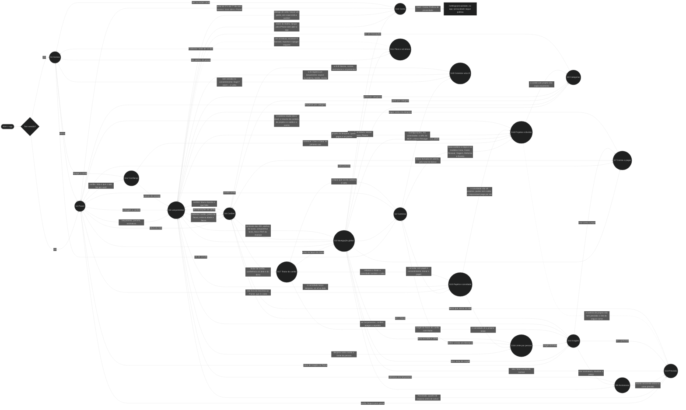

---

## 1. Acesso: entrar, criar conta, senha e sair

Tudo o que acontece antes de a pessoa estar dentro do app, e a volta para fora.
Criar conta e entrar são a mesma jornada: as duas telas se ligam e dividem o
parâmetro `next`. **O login social saiu** em set/2026; a autenticação é
e-mail e senha.

As cinco telas dividem uma casca só, e **a casca vive no layout de `(auth)`; o
formulário publica o id da cena.** O `AuthFrame` (`src/components/layout/auth-frame.tsx`)
monta o `SplitShellRoot` com o painel de marca uma vez, então o painel é o
mesmo nó entre as cinco rotas e troca de cena em vez de remontar: a partir de
48rem do próprio casco (container query); no telefone só o wordmark
(`asideMobile="logo"`); coluna de formulário à esquerda, painel à direita
(`side="end"`). Cada formulário devolve só a coluna, o `AuthShell`, com o id
da cena (`scene`), porque o título e a cena mudam com o estado (o cadastro vira
"Confira seu e-mail", a recuperação troca a cada passo). Sem id publicado, a
cena sai do caminho (`defaultSceneFor`). Todo estado devolve o `AuthShell` no
mesmo lugar da árvore, e a troca de `step` leva o foco ao título.

**O painel é um palco animado, e a família da cena decide o aparelho.** Desde
14/out/2026 o painel desenha o próprio app num aparelho (`AuthShowcase`, sobre
o `Showcase` do design system), com uma colagem de depoimentos ilustrativos em
volta e uma legenda no pé; os números e os nomes são de exemplo, e a tela diz
isso. Login no **navegador** (a busca ⌘K se digita sozinha até a fatura, e a
janela vira celular e volta), convite no **tablet** da casa, cadastro e
recuperação no **celular** (o fim da recuperação volta ao navegador). Trocar
de rota troca a cena no mesmo nó: o aparelho muda de forma e gira, sem
remontar e sem tocar a entrada de novo. O palco é `inert` e `aria-hidden`,
repousa em até 5 s, nasce no quadro final com movimento reduzido e não roda
no telefone, onde fica só o wordmark. **Nenhum caminho mudou**: o palco não tem link, campo nem foco, e
as cenas são uma tabela só (`src/components/auth/showcase/scenes.ts`).

### 1a. Entrada, login e cadastro

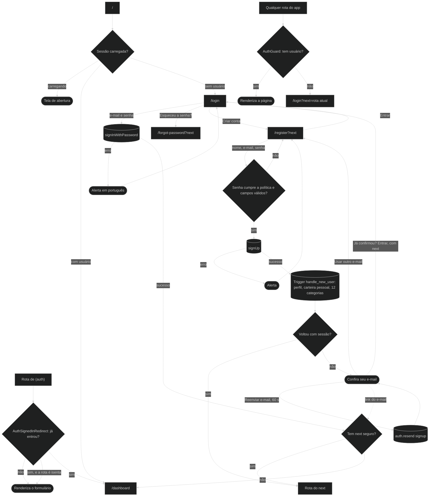

### 1b. Senha e saída

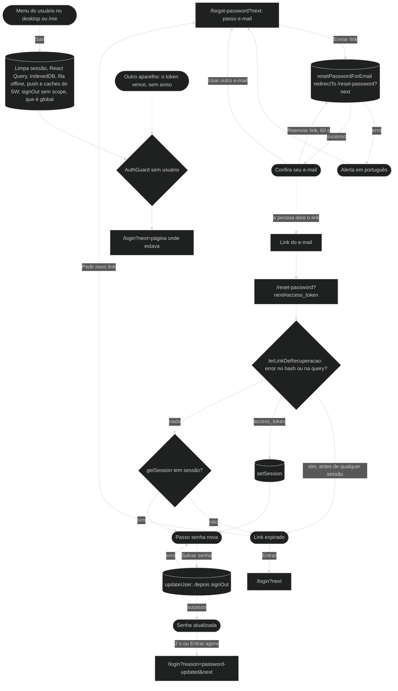

### Regras técnicas

| Ponto | Regra | Onde |
|---|---|---|
| Bootstrap | `/` manda para `/dashboard` ou `/login` depois de a sessão carregar; o sinal de carregando só aparece depois de 600 ms | `src/app/page-client.tsx`, `src/components/layout/app-bootstrap-screen.tsx` |
| Guarda | Toda rota de `(app)` sem usuário vai para `/login?next=` com `replace`; o `next` leva caminho, query e hash (`/me#no-celular`). Sem exceções: `/invites/accept` saiu do grupo | `src/components/layout/auth-guard.tsx` |
| Guarda invertida | Quem já entrou em `(auth)` vai para o `next` ou o Painel. Isentas: `/forgot-password` e `/reset-password` (o link do e-mail traz a sessão de recuperação antes da troca de senha) e `/invites/accept` | `src/components/layout/auth-signed-in-redirect.tsx` |
| `next` | Só caminho interno começando com `/`; o padrão é `/dashboard` | `src/lib/auth-return-path.ts` |
| Casca | A casca vive no layout de `(auth)` (`AuthFrame`: `SplitShellRoot` e painel de marca, o mesmo nó entre as rotas); o formulário devolve só a coluna (`AuthShell`, um `SplitShellMain`) e publica o id da cena por `useAuthScene`. Sem publicação, `defaultSceneFor(pathname)`; o frame nunca lê a query. O `AuthStatus` saiu: a tela de status é o `AuthShell` com `icon` e `step` próprio. O painel desenha a cena pela tabela `SCENES`: navegador no login, tablet no convite, celular no cadastro e na recuperação | `src/app/(auth)/layout.tsx`, `src/components/layout/auth-frame.tsx`, `src/components/layout/auth-shell.tsx`, `src/components/auth/showcase/scene-context.tsx`, `src/components/auth/showcase/scenes.ts` |
| Senha | Uma política só — 8+, minúscula, maiúscula, número e símbolo — aplicada no cadastro e na redefinição | `src/lib/password-policy.ts` |
| Recuperação | Um formulário, duas portas: `/forgot-password` pede o e-mail e mostra "Confira seu e-mail" (prop `entry`: `request` \| `link`); `/reset-password` é a porta do link. O e-mail é o modelo padrão "Reset password" do Supabase (`{{ .ConfirmationURL }}`), configurado no painel, fora do repositório. `lerLinkDeRecuperacao(hash, search)` lê a URL: `error`/`error_code` no hash ou na query dá "Link expirado", **antes de olhar qualquer sessão** (quem já entrou e abre um link morto não vê o campo de senha); `access_token` vira `setSession`; sem nada, `getSession` (o cliente pode ter consumido o hash). Depois `updateUser`, `signOut` e "Senha atualizada". O `redirectTo` aponta para `/reset-password`, senão o link cai na Site URL | `src/components/password-recovery-form.tsx`, `src/lib/recovery-links.ts` |
| `next` na recuperação | `/forgot-password?next` e `/reset-password?next` leem o `next` por `recoveryLinks`, que usa `getSafeInternalNextPath`; o `redirectTo` do e-mail vira `/reset-password?next=…` e "Senha atualizada" leva a `/login?reason=password-updated&next=…`. "Pedir novo link" volta a `/forgot-password?next=…`. Sem `next` a URL não muda. Depende de a allowlist de redirecionamento do Supabase (fora do repositório) aceitar a query string: `http://localhost:3000/**` no projeto novo | `src/lib/recovery-links.ts`, `src/components/password-recovery-form.tsx` |
| Reenviar | "Reenviar e-mail" (cadastro, `auth.resend({type:"signup"})`) e "Reenviar link" (recuperação, novo `resetPasswordForEmail`) esperam 60 s; a falha não zera a espera | `src/components/signup-form.tsx`, `src/components/password-recovery-form.tsx` |
| Convite aceito | Depois do `workspace-invites-accept` a página mostra o status "Convite aceito" com "Abrir a carteira" para `/dashboard`; não há redirecionamento automático. O fallback de carregamento já veste o `AuthShell` | `src/app/(auth)/invites/accept/page-client.tsx` |
| Erros | Tudo passa por `formatAuthErrorMessagePt`, inclusive esqueci e redefinir senha | `src/lib/supabase-errors.ts` |
| Primeira conta | Trigger `on_auth_user_created` → `handle_new_user` cria perfil, carteira "Carteira pessoal de Nome" e 7 categorias de despesa + 5 de receita | `supabase/migrations/00000000000000_baseline.sql` |
| Sair é global | `signOut()` não passa `scope`, e o padrão do Supabase é `global`: Sair encerra a conta em todos os aparelhos, e é o caminho para um aparelho perdido. Os outros só caem quando o token deles vence, sem aviso, e vão ao login (`AuthGuard`, com `next`). O segundo caminho para um aparelho perdido é trocar a senha: os outros aparelhos terminam quando o token deles vence, e este continua aberto. Não há lista de aparelhos nem encerrar um só | `src/components/providers.tsx` |
| Sair | Não navega: chama o Supabase primeiro e só com sucesso limpa tudo (fila offline, caches, sessão do aparelho), deixando o `AuthGuard` redirecionar; sem rede nada se apaga e a pessoa vê o erro. Em `/me` pede confirmação antes, num `AlertDialog` "Sair da conta?" que fica aberto com o erro se falhar, porque a fila offline é perdida; no menu do usuário do desktop não pede (o erro vai em toast) | `src/components/providers.tsx`, `src/app/(app)/me/page-client.tsx` |

---

## 2. Carteiras e colaboração

A carteira é o espaço onde moram os dados. A pessoa ganha uma pessoal ao criar
a conta, pode criar carteiras compartilhadas e convidar gente para elas.

### 2a. Trocar, criar e ajustar carteira

```mermaid
%%{init: {"theme": "dark"}}%%
flowchart TD
    load[("fetch-workspaces-data: carteiras e convites pendentes")] --> current{"user_settings.current_workspace_id válido?"}
    current -->|"sim"| use(["Carteira atual"])
    current -->|"não"| first(["Primeira carteira, a pessoal"]) --> save[("Grava em user_settings")] --> use

    switcher(["Seletor de carteira: lateral ou topo mobile"]) -->|"escolher carteira"| save2[("Grava em user_settings")] --> same(["Continua na mesma página, dados da nova carteira"])
    switcher -->|"convite pendente"| accept(("G2b Aceitar convite"))
    switcher -->|"Criar carteira"| createDlg(["Nome, ícone, cor"])
    createDlg -->|"Salvar"| createRpc[("RPC create_shared_workspace")] --> newCurrent(["Nova carteira vira a atual"])
    createDlg -->|"Cancelar"| switcher
    createDlg -.->|"a regra da escolha e os modelos de carteira"| G18a(("G18a Criar com um modelo"))

    switcher -->|"lápis da carteira atual"| owner{"É dona da carteira?"}
    owner -->|"sim"| edit(["Editar carteira: nome, ícone, cor, e as linhas Divisão, Datas e orçamento e Excluir carteira"])
    edit -->|"Divisão, no próprio Editar"| divisao(["Trilho Pote único ou Dividida e, dividida, os pesos; grava no Salvar do Editar"])
    edit -->|"Datas e orçamento, carteira de projeto"| datas(["Alterar Datas e orçamento: diálogo, por cima do Editar"])
    edit -->|"Excluir carteira, e não é a primeira"| del(["Excluir carteira: digitar o nome"])
    del --> impact[("RPC get_workspace_delete_impact")]
    del -->|"Excluir"| delRpc[("RPC delete_workspace")] --> fallback(["Se era a atual, volta para a pessoal"])
    owner -->|"não"| leave(["Ícone Sair da carteira atual: confirmação"]) -->|"Sair"| fallback
    settings -->|"desktop"| qr(["No celular: o cartão que vende o celular, com QR Code e Copiar link"])
    qr -.->|"app instalado aberto nos últimos 10 dias: a seção some"| hide(["Sem No celular até 10 dias sem abrir o app, ou o push recusado"])
    qr -->|"câmera do telefone"| meTel["/me#no-celular no telefone"]
    meTel --> pwa(["Neste celular: tema, lançamento inteligente e instalar o app"])
    settings -->|"abaixo do md: replace"| voce["/me: Você"]
    voce --> meTel
    settings --> notif(["Notificações: as chaves à vista"])
    settings -.->|"sem carteira"| empty(["Crie ou entre numa carteira"])

    voce -->|"Neste celular, iPhone com o app, sem aparelho: o cartão Lançar pelo iPhone"| iphInst["/settings/lancar-pelo-iphone: a seção dos aparelhos, Você acesa, voltar a Você"]
    voce -->|"com aparelho: a linha Lançar pelo iPhone"| iphInst
    voce -->|"Neste celular, navegador do iPhone: o cartão Instale o app, e a linha Instalar o app some"| conviteIph(["Instale o app: Como instalar abre a folha de instalação"])
    settings -->|"≥ md, iPhone com o app instalado"| iphInst
    iphInst -->|"Adicionar iPhone, ou Conectar o iPhone no vazio"| newDev(["GuiaDoAtalho, num Dialog: 6 passos, o primeiro cria o código"])
    newDev --> tokFlow(("G5c Tokens e Atalho"))
    iphInst -->|"Lançar ao pagar: Configurar, com aparelho ativo"| payDev(["GuiaDoApplePay, num Dialog: 5 passos: o app Atalhos, o +, colar a frase em Descrever um atalho, conferir, e a notificação; sem criar código"])
    payDev --> tokFlow
    iphInst -->|"Desconectar, no ⋯ da linha do aparelho"| revDev(["AlertDialog Desconectar este aparelho?: ele para de lançar"])
    revDev -->|"Desconectar"| tokFlow

    voce -->|"Conta, nenhuma IA: o cartão IAs conectadas; com IA, a linha"| iasTela["/settings/ias: IAs conectadas, Você acesa, voltar a Você"]
    voce -->|"Conta: a linha Preferências de notificação"| notifTela["/settings/notificacoes: as chaves, Você acesa, voltar a Você"]
    settings -->|"≥ md, Conectar, em IAs conectadas"| connAi
    iasTela -->|"Conectar"| connAi(["Dialog: a URL do MCP e as três instruções"])
    iasTela -->|"Desconectar, no ⋯ da linha da IA"| discAi(["AlertDialog: ela perde o acesso na hora"])
    connAi --> aiFlow(("G19 Conectar uma IA"))
    discAi --> aiFlow
```

### 2b. Convidar e aceitar convite

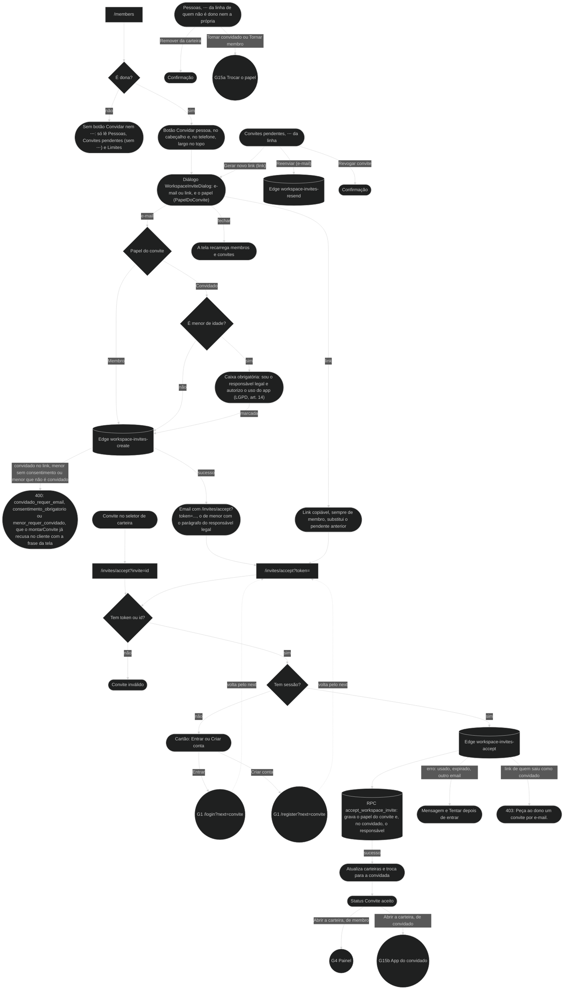

### Regras técnicas

| Ponto | Regra | Onde |
|---|---|---|
| Carteira atual | `user_settings.current_workspace_id`; inválida cai na primeira, com a pessoal ordenada antes | `src/lib/queries/fetch-workspaces-data.ts` |
| Criar e excluir | RPCs `create_shared_workspace`, `get_workspace_delete_impact`, `delete_workspace` | `src/components/workspace-provider.tsx` |
| Sair da carteira | Diálogo próprio de confirmação | `src/components/settings/workspace-leave-dialog.tsx` |
| Ações da carteira (3/nov/2026) | A seção Carteira saiu de Configurações (`/settings` ficou só com o app). As ações moram no seletor de carteira, na lateral e no cabeçalho do telefone: na linha da carteira atual há um botão só com ícone à direita, o lápis "Editar carteira <nome>" para o dono e "Sair da carteira <nome>" para quem não é dono; o ⋯ saiu. Divisão, Datas e orçamento e Excluir carteira moram no diálogo Editar carteira: a Divisão logo abaixo do ícone, num trilho de duas opções ("Dividida" travada com "Ainda não disponível" enquanto as partes não estão no banco) e, dividida, os pesos, tudo gravado no mesmo Salvar (pesos inválidos não gravam nada; depois do nome, os pesos e então o modo); Datas e orçamento abre o diálogo dele por cima; Excluir carteira é a última linha do diálogo, na largura toda | `src/components/workspace/acoes-da-carteira.tsx`, `src/components/layout/workspace-picker-menu-body.tsx`, `src/components/layout/workspace-switcher.tsx`, `src/components/settings/workspace-appearance-edit-dialog.tsx`, `src/components/settings/carteira-divisao.tsx` |
| Membros | RPC `workspace_member_directory`; só a dona convida, revoga e remove. A tela tem o botão "Convidar pessoa" (só da dona) que abre o diálogo local `WorkspaceInviteDialog`, e três seções: Pessoas (`pessoas-secao.tsx`), Convites pendentes (`convites-pendentes-secao.tsx`, `#workspace-invites`) e Limites (`limites-secao.tsx`, `#limites`, só adulto). Fechar o diálogo recarrega membros e convites. O formulário de convite e o "Gerar link de convite" soltos saíram da página | `src/app/(app)/members/page-client.tsx`, `src/components/members/` |
| Convite | Edges `workspace-invites-create`, `-resend`, `-accept`; o email é montado no servidor | `supabase/functions/_shared/workspace-invite-email.ts` |
| Papel do convite (Bloco 7A) | O convite por e-mail escolhe o papel: `member` ou `guest` (`workspace_invites.role`). O corpo sem `role` é `member`, como o front de `main` manda. O link é **sempre de membro**: `guest` no link volta 400 `convidado_requer_email` (sem e-mail e sem ser link, a Edge devolve a recusa antiga `invited_email is required`; a frase em português vem do `montarConvite`, no cliente), e o check `workspace_invites_guest_requer_email` repete a regra no banco. O corpo do convite vem de `montarConvite`, que recusa o que a Edge recusa, na mesma ordem | `supabase/functions/workspace-invites-create/index.ts`, `src/lib/papeis/papeis.ts`, `src/components/members/papel-do-convite.tsx` (o `PapelDoConvite`, do design system) |
| Menor de idade e consentimento (Bloco 7A, LGPD art. 14) | "É menor de idade" só aparece com Convidado. Marcada, a caixa obrigatória diz "Sou o responsável legal e autorizo o uso do app (LGPD, art. 14)." A Edge recusa `menor` sem `consentimento: true` (400 `consentimento_obrigatorio`) e `menor` sem `guest` (400 `menor_requer_convidado`, que o check do banco repetiria como 500), e grava `menor` e `consentimento_em` (a hora do convite). O e-mail de um convite `menor` traz o parágrafo "{responsável} criou este convite como responsável legal e autorizou o uso do app por você, como pede a LGPD (art. 14)."; o reenvio repete o parágrafo, com o responsável buscado no `created_by` do convite | `supabase/functions/workspace-invites-create/index.ts`, `supabase/functions/workspace-invites-resend/index.ts`, `supabase/functions/_shared/workspace-invite-email.ts` |
| O aceite grava o papel e o responsável (Bloco 7A) | `accept_workspace_invite` grava `role = v_invite.role` (era `'member'` fixo) e, no convidado, `sponsor_user_id = v_invite.created_by`. A RPC continua só da service role: a Edge de aceite não mudou | `supabase/migrations/20261029120000_papeis.sql` |
| O ex-convidado (Bloco 9) | `workspace_ex_convidados(workspace_id, user_id, saiu_em)`, com RLS ligada e sem grant, é preenchida pelo gatilho `lembrar_ex_convidado` (depois de apagar um membro com `role = 'guest'`; pula a cascata). O `accept_workspace_invite` devolve o status `ex_convidado` para um convite **por link** de quem está nela, e a Edge `workspace-invites-accept` responde 403 "Peça ao dono um convite por e-mail."; o convite por e-mail passa, e um aceite com sucesso apaga a linha (fecha a lacuna 60). **A Edge sobe antes da migração**: sem o `case`, o status novo cai no `default` e vira 500 | `supabase/migrations/20261102120000_bloco9.sql`, `supabase/functions/workspace-invites-accept/index.ts` |
| Lista de membros e convites (Bloco 7A) | O selo mostra Dono, Membro ou Convidado (`rotuloDoPapel`); o convite por e-mail pendente mostra o papel; a troca de papel e o remover estão no ⋯ da linha de Pessoas, só do dono e só em quem não é dono nem a própria pessoa (ver 15a); Reenviar, Gerar novo link (o link novo revoga o pendente anterior, em `workspace-invites-create`) e Revogar convite estão no ⋯ do convite pendente; sem convite, "Nenhum convite pendente". O membro adulto também lê a seção Limites (ver 16) | `src/app/(app)/members/page-client.tsx`, `src/components/members/workspace-invite-dialog.tsx` |
| Política de privacidade (Bloco 3B) | `/privacidade` fica fora de `(app)` e de `(auth)`: pública, sem `AuthGuard`, sem a casca e sem esqueleto. Ela diz o que o app guarda, os dois provedores (a transferência internacional), o que o app tenta tirar do texto antes do envio (e que a remoção automática pode falhar), que a foto vai como está, o limite, o cache, e como exportar (só as assinaturas, em CSV) e apagar a conta. A seção "IA e privacidade" saiu de Configurações em 2/nov/2026, e o caminho do app até a política é a linha "Política de privacidade" do grupo Conta da página Você (ver 10), que abre `/settings/privacidade` (dentro do app, com o título na barra e o voltar a Você; o conteúdo é o mesmo `PrivacidadeWireframe`); a `/privacidade` pública segue como está, e o texto diz que Excluir conta mora no Editar perfil (Segurança) | `src/app/(app)/settings/privacidade/page-client.tsx`, `src/components/wireframe/privacidade-wireframe.tsx`, `src/app/privacidade/page.tsx` |
| Notificações: as chaves à vista (2/nov/2026) | As chaves moram na seção Notificações de `/settings`, sob os subtítulos "Canais" (só o push neste aparelho) e "O que receber" (os temas de aviso). O email e a central do app não têm chave própria: desligar um tema desliga os dois. Não há rota própria: as duas telas saíram. Os avisos ficam em cima, sem botão de ação; o de push bloqueado pode ser dispensado, e o aparelho lembra. Cada chave salva ao tocar. "Como instalar" segue na linha do push | `src/components/settings/notification-preferences.tsx`, `src/components/settings/notificacoes-canais.tsx`, `src/components/settings/notificacoes-temas.tsx` |
| No celular e Neste celular (2/nov/2026) | Do `md` para cima, Configurações tem Aparência e "No celular", e o QR abre `/me#no-celular`. Abaixo do `md`, Configurações não mostra nenhuma das duas: o grupo "Neste celular" (Tema, Lançamento inteligente e Instalar o app, `id="no-celular"`) mora na seção Neste celular da página Você, `NesteCelularGrupo`. Com o app instalado a linha "Instalar o app" some, e no lugar dela, só com pendências na fila, fica a linha "Sincronização". No desktop e no tablet, o QR (`QrCode link={false}`, sem link, porque ele apontaria para a própria tela) e o "Copiar link" levam ao telefone; num iPhone ou iPad não instalado aparece a linha "Instalar o app" com o "Como instalar" (a folha de instalação), e senão, com pendências na fila, a linha "Sincronização". Na página Você, o "Como instalar" do iPhone abre a mesma folha. A folha de instalação tem quatro passos, com o caminho do iOS 27 (menu, Compartilhar, Ver Mais, Adicionar à Tela de Início, Adicionar), e fechar o aviso automático também o dispensa. | `src/components/settings/theme-settings.tsx`, `src/components/settings/neste-celular-grupo.tsx`, `src/components/settings/no-celular-cartao.tsx`, `src/app/(app)/me/page-client.tsx`, `src/components/ui/qr-code.tsx` |
| Você sem Configurações no celular (4/nov/2026) | Abaixo do `md`, `/settings` faz `router.replace("/me")`; do `md` para cima nada muda. Quatro rotas abrem uma seção sozinha, com o voltar a Você e a aba Você acesa (`ROTAS_DE_VOCE_EM_SETTINGS`): `/settings/lancar-pelo-iphone`, `/settings/privacidade`, `/settings/ias` e `/settings/notificacoes`. Em `/me`, **Neste celular** (Tema, Lançamento inteligente, Instalar o app) mostra, por `lancarNaVoce`, só a linha "Lançar pelo iPhone" quando há aparelho (nome de um ou dois aparelhos, ou a contagem), que leva à rota. Sem aparelho, no iPhone com o app, o cartão "Lançar pelo iPhone" e, no navegador do iPhone, o convite "Instale o app" (e a linha "Instalar o app" some) formam uma seção própria **abaixo** de Neste celular, com os subtítulos "Lançar pelo iPhone" e "App no iPhone"; em outros aparelhos, nada. **Conta** traz, nesta ordem, Planos e pagamentos (`/plans`, com o voltar a Você), IAs conectadas (só depois de conectar uma IA), Preferências de notificação e Política de privacidade (`/settings/privacidade`, a última); o **Sair** fica abaixo do cartão, sem moldura (não é linha da lista), em vermelho e com a confirmação "Sair da conta?". Minha conta e o Cofre aberto não existem mais; enquanto nenhuma IA está conectada (`iaNaVoce`), o cartão de conectar é uma seção própria, "Inteligência artificial", acima de Conta, e a linha IAs conectadas some; depois de conectada, a linha volta ao grupo Conta. Lista carregando ou em erro mostra a linha, nunca o cartão. Configurações não está mais na lista do telefone. O painel de notificações leva a `/settings/notificacoes` no telefone | `src/config/mobile-navigation.ts`, `src/app/(app)/me/page-client.tsx`, `src/components/me/estado-na-voce.ts`, `src/components/settings/neste-celular-grupo.tsx`, `src/app/(app)/settings/(raiz)/page-client.tsx` |
| Editar e selo na Você (4/nov/2026) | No topo de `/me`, a foto é o botão de editar (`Avatar onEdit`, lápis no canto, nome "Editar perfil") e abre o `EditProfileDialog`, com a seção Segurança (Alterar senha, Excluir conta); fechar volta a `/me`. No desktop o mesmo diálogo abre pelo item "Editar perfil" do menu do usuário (era "Minha conta"; ver 10). Sob o e-mail, uma linha centrada (some sem `created_at`) mostra o `SeloDeMembro` com "Membro desde <mês> de <ano>"; tocado, abre grande (inclina, gira; Esc ou toque fora fecha). **O selo mora só em `/me`**: saiu do desktop junto com a página Minha conta | `src/app/(app)/me/page-client.tsx`, `src/components/layout/voce-avatar.tsx`, `src/components/account/selo-de-membro.tsx` |
| Aparelho de lançar e o convite (4/nov/2026) | `useAparelhoDeLancar` diz onde a pessoa está: `computador`, `navegador-iphone`, `navegador-android`, `iphone-instalado` ou `android-instalado` (`sabendo` no servidor e na hidratação, quando nada aparece). Só o iPhone entra como iPhone (iPad e Mac não). `/settings` desenha por ele: `iphone-instalado` mostra a seção dos aparelhos; `navegador-iphone` mostra o convite "Instale o app" (`ConviteDeInstalar iphone`), com as três vantagens do iPhone e "Como instalar", que abre o `InstallPwaSheet`; `navegador-android` não mostra nada nesse lugar (o Android já vê o convite para instalar fora de Configurações; o de Configurações saiu em 4/nov/2026, a pedido do dono); `computador` e `android-instalado` não mostram nada dessa seção. No computador resta a propaganda "No celular" (`NoCelularCartao`): "O dia a dia é no celular" e duas vantagens, Siri ou toque (marcada "no iPhone") e a frase digitada, com o QR e "Copiar link"; o formulário e o Apple Pay ficam só no convite do iPhone | `src/hooks/use-aparelho-de-lancar.ts`, `src/app/(app)/settings/(raiz)/page-client.tsx`, `src/components/settings/convite-de-instalar.tsx`, `src/components/settings/no-celular-cartao.tsx`, `src/components/pwa/install-pwa-sheet.tsx` |
| A propaganda "No celular" que some (4/nov/2026) | No computador, `ThemeSettings` mostra o "No celular" só se `useAparelhoDeLancar() === "computador"` **e** o app instalado não foi aberto nos últimos 10 dias: `appRecente(app_aberto_em)` falso (coluna nula ou com 10 dias ou mais). Enquanto a conta carrega (`useAcesso`), nada aparece, para não piscar. O `app_aberto_em` é gravado pelo registro de acesso (ver 10, Reativação) e zerado pelo envio de push quando a pessoa fica sem inscrição (404 ou 410), o que devolve a seção na hora. Quem nunca ligou o push não tem 410: para essa pessoa só o prazo de 10 dias faz a seção voltar | `src/components/settings/theme-settings.tsx`, `src/lib/reativacao.ts`, `src/hooks/use-acesso.ts` |
| Tokens de captura (Bloco 3A) | Seção "Lançar pelo iPhone" de `/settings`, **só no iPhone com o app instalado** (`useAparelhoDeLancar` devolve `iphone-instalado`; desde 4/nov/2026 ela não aparece no computador, no navegador do celular nem no Android instalado, e o computador não gerencia mais aparelhos), depois de Aparência e antes de IAs conectadas (saiu de Minha conta em 3/nov/2026): uma linha por token ativo (o ladrilho do iPhone, o nome, a carteira com a marca dela · "último gasto" em tempo relativo ou "ainda não lançou nada", e o ⋯ com "Desconectar"; os desconectados somem; a linha mudou em 3/nov/2026). Com aparelhos, ou com a lista em erro, a última linha da lista "iPhones conectados" é "Adicionar iPhone" (a linha inteira é o toque, desde 4/nov/2026; era o "Conectar aparelho" do cabeçalho), e o Lançar ao pagar fica abaixo, sob o subtítulo "Apple Pay" (a tela tem duas subseções, "iPhones conectados" e "Apple Pay"; o cartão do Apple Pay traz a imagem do celular à esquerda e, à direita, título e texto; abaixo, em largura toda, o estado como texto colorido com ícone, sem selo, relógio e "Aguardando a 1ª compra" em âmbar ou marca e "Funcionando" em verde, e depois o botão secundário de largura toda, "Configurar" ou "Ver os passos de novo"); sem nenhum, o vazio é um `EmptyState` ("Lance gastos sem abrir o app") com "Conectar o iPhone". Os dois abrem o `GuiaDoAtalho`, um `Dialog` de 6 passos, com as telas reais do iOS na moldura do iPhone: (1) nome (1 a 60 caracteres) e carteira padrão, "Criar código" chama `create_capture_token` e copia o `fac_…` quando o navegador deixa; (2) "Baixar o atalho" baixa `public/atalho/Lançar gasto.shortcut`, assinado por `scripts/atalho/gerar-atalho.py` (sem link do iCloud nem variável de ambiente); (3) abrir o arquivo; (4) Configurar Atalho; (5) colar o código na pergunta de importação; (6) "Como abrir o atalho": cinco abas, Siri, Botão, Toque, Bloqueio (o controle Executar Atalho, desde 4/nov/2026) e Ícone (a tela de início), e o passo mostra só o caminho da escolhida (desde 3/nov/2026). O nome sugerido a um aparelho novo nunca repete o de um já conectado: "iPhone de X", "iPhone de X 2"… (desde 4/nov/2026). O código vive só no estado do guia: fechar por qualquer caminho o descarta. A automação da Carteira saiu do guia e mora na seção "Lançar ao pagar" (linha abaixo). "Desconectar" é um `AlertDialog` ("Desconectar este aparelho?") e chama `revoke_capture_token`. **Atalho v2 (3/nov/2026)**: sem entrada, o atalho faz um `GET` na `capture` (o mesmo código, cabeçalho `X-Atalho-Versao: 2`) e recebe `{ modo, categorias, pagamentos }` da carteira padrão; `modo` segue `user_settings.lancamento_inteligente` (o interruptor passou do aparelho para a conta). "frase" pede a frase como antes e, se a resposta vier com `codigo: "sem_valor"`, cai no formulário; "formulario" pede valor (teclado numérico), descrição, categoria e forma de pagamento (listas do `GET`, por nome) e a data (Hoje ou Outro dia), e manda `amount`, `merchant`, `category`, `payment`, `date`. A Edge grava `capture_tokens.atalho_versao` quando o cabeçalho vem; aparelho já usado sem versão mostra "Baixe o atalho de novo para ter o formulário", e o ⋯ ganha "Baixar o atalho de novo", que abre o guia com o nome e a carteira do aparelho, cria um código novo e desliga o antigo. A lista lê só as colunas sem o hash. Até 10 ativos por pessoa | `src/components/account/atalho-secao.tsx`, `src/components/account/guia-do-atalho.tsx`, `src/hooks/use-lancamento-inteligente.ts`, `supabase/functions/capture/index.ts`, `scripts/atalho/gerar-atalho.py`, `docs/captura/atalho-iphone.md` |
| Lançar ao pagar | Um cartão dentro de "Lançar pelo iPhone" (portanto só no iPhone com o app instalado, desde 4/nov/2026), abaixo dos aparelhos (`ApplePayConvite`), que só aparece com aparelho ativo e a lista sem erro: a automação da Carteira que roda o Lançar gasto a cada compra com Apple Pay. "Configurar" abre o `GuiaDoApplePay`, um `Dialog` de 5 passos (desde 3/nov/2026), com a tela real do iPhone e o alvo pulsando onde tocar: (1) o app Atalhos, na tela de início; (2) Automação e o +; (3) colar a frase pronta (`DESCRICAO_DA_AUTOMACAO`, com o botão Copiar) em "Descrever um atalho" do iOS 27, e, para iPhone mais antigo, o caminho à mão numa linha (Transação, cartões, Executar Imediatamente, Lançar gasto); (4) conferir e salvar; (5) a notificação depois de pagar. O "Pronto" do último passo grava `user_settings.apple_pay_configurado_em` (desde 3/nov/2026), e o cartão muda: "Configurar" (sem a data e sem compra), "Aguardando a 1ª compra" (com a data) e "Funcionando", com a última compra lançada (a primeira transação da pessoa com `source` `apple_pay`; vale mesmo sem o Pronto); nos dois últimos, o botão é "Ver os passos de novo". A compra chega pela Edge `capture` com `source` `apple_pay`, publicada em produção em 3/nov/2026 (antes o atalho batia num 404), e toda resposta traz o `resumo` que o atalho põe na notificação do iPhone: "Gasto lançado: …" (ou "Receita lançada", com "a conferir") e, em erro, "Não lançado: <motivo>" | `src/components/account/apple-pay-convite.tsx`, `src/components/account/lancar-ao-pagar.ts`, `src/components/account/guia-do-apple-pay.tsx`, `src/components/account/aparelhos-de-captura.ts` |
| Página de convite | Fica no grupo `(auth)`: veste o `AuthShell` e não atravessa a casca do app. O `WorkspaceProvider` é global, então a mudança de grupo não custou nada | `src/app/(auth)/invites/accept/page-client.tsx` |
| Modelos de carteira (Bloco 7C) | Criar carteira ganha a regra da escolha e os modelos Casa, Casal, Pessoal, Viagem, Reforma e Evento, que criam pela RPC `criar_carteira_de_modelo` (com as categorias e o modo de cada um); "Sem modelo" segue o `create_shared_workspace`. Ver a jornada 18 | `src/components/workspace/project-form-dialog.tsx`, `src/components/wireframe/modelos-de-carteira-wireframe.tsx` |

---

## 3. Navegação e ações globais

O que está disponível em qualquer tela: a casca, o "+" de adicionar, a busca
(⌘K) e as notificações. O painel de notificações abre do sino da barra do topo; o
sino conta as não lidas direto no servidor.

```mermaid
%%{init: {"theme": "dark"}}%%
flowchart TD
    shell(["Casca do app"]) --> desktop{"Largura"}
    desktop -->|"desktop"| sidebar(["Lateral recolhível"])
    desktop -->|"mobile"| bottom(["Barra inferior: Painel, Transações, Categorias, +, Você"])

    sidebar --> nav1["/dashboard"]
    sidebar --> nav2["/transactions"]
    sidebar --> nav3["/categories"]
    sidebar --> nav4["/subscriptions"]
    sidebar --> nav5["/bills"]
    sidebar --> nav6["/credit-cards"]
    sidebar --> nav7["/members"]
    sidebar --> nav8["/settings"]
    sidebar -->|"só o adulto, depois de Cartões"| nav9["/projetos"]
    sidebar --> userMenu(["Menu do usuário: Editar perfil, Planos e pagamentos, Sair"])
    bottom -->|"aba Você, com o avatar"| mePage["/me: Carteira (Cartões, Contas, Assinaturas, Projetos, Membros) · Neste celular · Lançar pelo iPhone / App no iPhone · Conta (Planos e pagamentos, IAs conectadas, Preferências de notificação, Política de privacidade), com o Sair embaixo, sem moldura"]
    mePage -->|"lápis na foto"| meEdit(["EditProfileDialog: nome, foto, e-mail e Segurança (Alterar senha, Excluir conta)"])
    mePage -->|"toque no selo"| meSelo(["Selo de membro aberto grande; Esc ou toque fora fecha"])
    mePage -->|"linha da página"| meDest["Tela de um item da página, com o voltar a /me no lugar do sino"]
    meDest -->|"voltar"| mePage
    userMenu --> G10(("G10 Conta"))
    mePage -->|"Planos, Política de privacidade"| G10
    shell -.->|"plano leitura: faixa de só leitura acima da tela"| G11(("G11 Plano e só leitura"))

    sidebar -->|"+ Adicionar, direto, com Despesa"| txForm(("G5b Formulário de transação"))
    bottom -->|"+, a gaveta do formulário"| txForm
    txForm -.->|"formulário global indisponível"| fallback["/transactions?new= ou /subscriptions?new=1"]

    topbar(["Barra do topo: lupa"]) -->|"clicar"| palette(["Paleta de busca: Recentes, Telas, Ações, Transações, Cartões, Categorias, Parcelas, Assinaturas, Contas, Membros, Carteiras"])
    shell -->|"⌘K ou Ctrl+K"| palette
    palette -->|"Telas ou Recentes: as da lateral menos o Painel"| nav2
    palette -->|"Ações: Nova despesa, parcelada, receita"| txForm
    palette -->|"Ações: Nova assinatura"| subForm(("G8 Formulário de assinatura"))
    palette -->|"Ações: Nova categoria, Novo cartão"| createDialogs(["Diálogos de criar categoria e cartão"])
    palette -->|"Transações, consulta no banco"| txnDetail["/transactions?txn=id"]
    palette -->|"Ver todas em Transações"| txnList["/transactions?q, from, to, min, max"]
    palette -->|"Cartões"| cardDetail["/credit-cards/id"]
    palette -->|"Categorias"| catDetail["/categories/id"]
    palette -->|"Compras parceladas"| planPage["/transactions?plan=id"]
    palette -->|"Assinaturas"| subPage["/transactions?sub=id"]
    palette -->|"Contas a pagar"| billPage["/bills?detail=id"]
    palette -->|"Membros"| nav7
    palette -->|"Carteiras"| walletSwitch[("Troca a carteira atual")]

    bell(["Sino de notificações, com a contagem exata"]) -->|"clicar"| panel(["Painel flutuante: agrupado por dia, Todas ou Não lidas"])
    panel -->|"linha com destino: fecha, navega e marca como lida em segundo plano"| dest{"Destino da linha"}
    dest -->|"href explícito (orçamento, parcela, conta…)"| explicit["Rota do metadata.href"]
    dest -->|"category_created, só linhas antigas"| n1["/categories"]
    dest -->|"invite_accepted"| n2["/members"]
    dest -->|"cc_* com cartão"| n3["/credit-cards/id"]
    dest -->|"tipo bill"| n5["/bills"]
    dest -->|"member_expense_created"| n6["/transactions?txn=id"]
    dest -->|"metadata.href do lembrete das 20h"| n7["/transactions?conferir=1"]
    dest -->|"tipo insight: o href da ação, senão o Painel"| G14(("G14 Insights"))
    panel -->|"linha sem destino"| stay(["Só marca como lida; o painel fica aberto"])
    panel -->|"⋯ da linha"| rowMenu(["Marcar como lida ou não lida; Excluir, sem desfazer"])
    panel -->|"⋯ do cabeçalho"| headMenu(["Marcar todas como lidas; Configurar notificações; Limpar notificações"])
    headMenu -->|"Configurar notificações: desktop"| prefs["/settings#notificacoes"]
    headMenu -->|"Configurar notificações: telefone"| prefsTel["/settings/notificacoes"]
    headMenu -->|"Limpar notificações"| clearAsk(["Limpar todas as notificações?"])
    clearAsk -->|"Limpar ou Cancelar"| panel
    panel -->|"erro ao carregar"| retry(["Alerta: Tentar de novo"])
    retry -->|"Tentar de novo"| panel

    appIcon(["Ícone do app instalado: segurar"]) -->|"Nova despesa"| iconNew["/transactions?new=1"]
    appIcon -->|"A conferir"| n7
    appIcon -->|"Painel"| nav1
    iconNew --> txForm
    n7 --> G5c(("G5c A conferir"))

    old["Rotas antigas"] -->|"next.config.ts"| redirects["/dashboard/settings → /settings; /wallets → /dashboard; /assets → /credit-cards; /notifications → /dashboard?notifications=1"]
    unknown["Rota desconhecida"] --> notFound(["404: Ir para o painel ou Página inicial"])
```

### Regras técnicas

| Ponto | Regra | Onde |
|---|---|---|
| Itens de navegação | Lateral e mobile vêm de configuração, não de JSX solto | `src/config/navigation.ts`, `src/config/mobile-navigation.ts` |
| Atalhos do ícone e compartilhar (Blocos 3A e 3B) | O app instalado traz três atalhos ao segurar o ícone: "Nova despesa" (`/transactions?new=1`; era "Nova transação"), "A conferir" (`/transactions?conferir=1`) e "Painel". O `share_target` do Android manda o texto, a foto e o PDF compartilhados por `POST` multipart a `/transactions/compartilhar`, que o service worker atende e redireciona a `/transactions?frase=…` ou `?compartilhado=…` (ver 5c; era `GET` com só o texto no Bloco 3A) | `src/app/manifest.ts`, `src/sw.ts` |
| Formulários globais | Transação e assinatura montados uma vez na casca; salvar invalida as listas abertas | `src/components/layout/global-shell-dialogs-provider.tsx` |
| Menus do telefone | O "+" abre direto a gaveta do formulário de lançamento, com Despesa marcada (o seletor do formulário troca para Parcelada e Receita; assinatura fica na tela dela e na paleta). Era uma folha de ações (`Drawer` com `DrawerActions`) antes do formulário, e no desktop um menu: um passo a mais na jornada mais comum. A quarta aba da barra é a **"Você"**, com o avatar da pessoa no lugar do glifo (a foto ou as iniciais; enquanto o perfil não chega, o círculo neutro vazio, sem esqueleto): ela leva à página `/me` (`ROUTES.ME`, título "Você") e não abre mais um menu (o `MobileAccountMenu`, o painel da rodada 278, saiu). Ela fica ativa em `/me` e em toda tela que a página lista, subrotas incluídas (`/credit-cards/<id>`, `/projetos/<id>`, `/settings/*`; `isVoceTabActive`). A página tem a identidade centrada (avatar, nome, e-mail) e três seções com título, cada uma num cartão: **Carteira** (as abas que saíram da barra, depois Cartões, Contas a pagar, Assinaturas, Projetos, Membros e convidados), **Neste celular** (só no telefone: tema, lançamento inteligente, instalar o app) e **Conta** (Planos e pagamentos, IAs conectadas, Preferências de notificação, Política de privacidade, nesta ordem); as regras moram em `getVoceGroups`. As linhas de Carteira e Conta são `Item` iguais (ícone de 20, texto de 16 no toque, mínimo de 48). O **Sair** fica abaixo do cartão de Conta, sem moldura, em vermelho e com ícone: abre o `AlertDialog` "Sair da conta?" ("Lançamentos que ainda não sincronizaram serão perdidos"), porque sair limpa a fila offline, e "Sair" chama `signOut()`, que só limpa o aparelho se o Supabase saiu; sem rede o diálogo fica aberto com o erro. Numa tela estreita, a aba que não cabe com folga na barra (o nome + 16, nunca menos de 44) sai do fim e entra no topo do grupo Carteira: num telefone de 320, Categorias; Painel e "Você" ficam sempre (rodada 342). A barra mede e publica quem saiu num armazém de módulo (`abas-fora.ts`, `useSyncExternalStore`) e a página o lê; no desktop, onde a barra some, nada é publicado. As telas das linhas da página (`/subscriptions`, `/bills`, `/credit-cards`, `/members`, `/account`, `/settings`) são subpáginas dela no telefone: o voltar toma o lugar do sino e leva a `/me` (`defaultMobileBackHref`); as que já têm pai (detalhe do cartão → Cartões) mantêm o pai, e a aba que saiu da barra não ganha o voltar. Tocar na aba "Você" já ativa numa dessas telas volta a `/me` (como no iOS, a pilha volta à raiz); só em `/me` o toque sobe ao topo (`BottomBarTab`). No desktop nada leva até `/me`, mas aberta a 768px ou mais ela mostra os grupos com título e o Sair, sem Neste celular. No telefone o tema mora em Você (Neste celular) e o Sair na última linha de Conta, com confirmação; o Sair do menu do usuário do desktop continua, sem confirmação, e Planos e pagamentos é uma linha do grupo Conta (4/nov/2026; a página Minha conta acabou). Antes foi um painel de `DropdownMenu` que brotava da aba "Mais", antes uma gaveta de 625px com identidade, tema e sair, e antes dela um `Popover` de vidro escrito à mão | `src/components/layout/quick-actions.tsx`, `src/components/layout/mobile-bottom-nav.tsx`, `src/components/layout/abas-fora.ts`, `src/components/layout/voce-avatar.tsx`, `src/app/(app)/me/page-client.tsx`, `src/config/mobile-navigation.ts`, `src/components/layout/app-header.tsx` |
| Busca global (⌘K) | Montada uma vez no `AppHeader`, com a lupa nas duas árvores da barra. No telefone a lupa vira a barra de pesquisa no topo, sobre um véu: a pílula nasce no círculo da lupa (`lupaRef`, o `origin` do `CommandDialog`) e se estica para a esquerda, com o × à direita e o teclado aberto no mesmo toque; o ×, Esc e o toque no véu fecham, e o foco volta à lupa (era uma gaveta de baixo até 2026-10-19). A raiz busca tudo, sem as sub-páginas de categorias e cartões: o filtro é da paleta (`shouldFilter: false`) e cada grupo vem ranqueado por `ranquear` (`lib/app-search`), até 5 linhas. Telas (com sinônimos: "gastos" acha Transações, "fatura" Cartões, "boletos" Contas a pagar) são as da barra lateral menos o Painel, mais Membros (`navigation.ts`); Painel, Configurações, Planos e pagamentos e Notificações ficam fora da busca, por decisão do dono. Ações chamam os mesmos ganchos do "+ Adicionar" (`useQuickCreateTransaction`, `useQuickCreateSubscription`) e os diálogos da casca (Nova categoria, Novo cartão). Transações são uma consulta de leitura ao banco (descrição, valor, data, nome da categoria e do cartão; as 8 mais recentes; espera de 250ms depois da digitação) e abrem `/transactions?txn=id`; "Ver todas em Transações" leva `q`, `from`, `to`, `min` e `max` na URL, e a lista filtra o texto só pela descrição. Transação nunca vira recente. Cartões e categorias leem o cache da casca (`useCategoriesQuery`, `useCreditCardsQuery`); parcelas (`?plan=id`), assinaturas (`?sub=id`) e membros (`/members`) saem das listas do espaço; contas a pagar vêm de uma consulta leve (`useBillsListQuery`) e abrem `/bills?detail=id`; escolher uma carteira troca a carteira atual. Os recentes ficam no `localStorage` (`app:busca`). Digitar `/` escolhe onde buscar (`/transacoes`, `/membros`…, `lib/app-search-scopes`): o nome entra no campo como escopo, só aquele grupo aparece (até 50 linhas; 20 transações), e dois Backspaces com o campo vazio voltam à busca em tudo; num escopo de lista do espaço, enquanto ela carrega o grupo diz "Buscando…" e, sem dado e com erro, "Não deu para carregar … agora." (o "Nada em …" só vale depois da resposta) | `src/components/layout/app-command-palette.tsx`, `src/lib/app-search-scopes.ts`, `src/components/layout/app-search-sources.ts`, `src/lib/app-search.ts`, `src/lib/transaction-search.ts`, `src/lib/queries/use-transactions-search.ts`, `src/lib/queries/use-bills-list.ts` |
| Nome da tela e voltar | No telefone a barra do topo mostra a carteira no centro, menos em `/me` e nas telas que a aba "Você" acende (as da lista, com subrotas, e `/plans`; `isVoceTabActive`, com a lista de abas vazia: a aba que saiu da barra segue com o seletor), onde não há seletor de carteira: para trocar de carteira, a pessoa vai a uma das abas, e o centro fica vazio até o título da tela subir para ele ao rolar. As telas de aba do telefone abrem com esse título grande (`TituloDaTela`, na casca). `/me` abre na identidade da pessoa, e a subpágina não tem título: o nome só sobe à barra depois de rolar, e numa tela que não rola ele não aparece. Em Transações e Categorias o título que sobe toma o lugar do seletor, que volta no topo da tela; no Painel o seletor fica sempre. Ela também mostra o título e o voltar das subpáginas (`/categories/id`, `/categories/new`, `/credit-cards/id`, as de `/settings/*`), pelo `usePageChromeSlot`. As telas que a página Você lista (`/subscriptions`, `/bills`, `/credit-cards`, `/members`, `/settings`, `/plans`) ganham o voltar a `/me` (só no telefone: a migalha do desktop não muda; `defaultMobileBackHref`). Nessas telas a aba "Você" fica ativa, e tocar nela volta a `/me`. No desktop ela não mostra o nome da tela (o `<h1>` fica só para o leitor de tela) nem a trilha: a lateral marca onde se está e é o caminho de volta. A trilha com o link para a tela de cima ("Categorias", "Cartões de crédito") saiu em 2026-10-16 | `src/components/layout/app-header.tsx` |
| Painel de notificações | O sino abre a folha flutuante (384px, recuo de 8px, o vidro do `Dialog`) no desktop e a gaveta no telefone (`NotificationsSheet`). As linhas se agrupam por dia local ("Hoje", "Ontem", a data), com o rótulo do dia preso ao rolar; cada uma tem o ladrilho de tom (âmbar, vermelho, azul ou cinza, por `notificationTone`), o título em negrito e o ponto enquanto não lida, a hora local e a seta quando leva a algum lugar. O filtro Todas / Não lidas aparece com ao menos uma notificação; sem nenhuma não lida, o filtro mostra "Tudo lido" com "Ver todas". A lista traz as 100 mais recentes e, cheia, avisa "Mostrando as 100 mais recentes". A falha de carga é um `Alert` com "Tentar de novo", nunca a caixa de entrada vazia (o "Limpar todas" otimista que falha não pode virar "Nenhuma notificação"). Trocar de carteira volta ao esqueleto | `src/components/layout/notifications-sheet.tsx`, `src/components/layout/notifications-panel.tsx`, `src/components/layout/notification-row.tsx`, `src/lib/notification-visuals.tsx` |
| Transição de subpágina (2/nov/2026) | Só no telefone: quem desce pela cadeia do voltar (`defaultMobileBackHref`) entra da direita, sobre a tela velha, e quem sobe faz o contrário. Troca de aba e de tela irmã não anima; a direção sai da rota, e nenhum link a marca (`direcaoDaTela`, `TransicaoDeSubpagina`, na casca). A tela velha fica parada enquanto a nova monta e carrega por baixo, e o gesto só começa sem esqueleto, com teto de 1,2s. Vale para link: `router.push` (fatura em Contas a pagar, menu de contexto da categoria, busca) e o voltar do navegador trocam sem gesto | `src/components/layout/transicao-de-subpagina.tsx`, `src/lib/direcao-da-tela.ts` |
| Menu ⋯ do cabeçalho | "Marcar todas como lidas"; "Configurar notificações" leva a `/settings#notificacoes` no desktop e a `/settings/notificacoes` no telefone (`preferenciasDeNotificacaoHref`; a seção tem esse `id`) e, por ser link de dentro da folha, a fecha antes de abrir a tela; "Limpar notificações" pede confirmação ("Limpar todas as notificações?") e apaga as da carteira; a confirmação abre por cima da folha. Não há mais a engrenagem avulsa | `src/components/layout/notifications-panel.tsx`, `src/components/settings/notification-preferences.tsx` |
| Ações da linha | Clicar numa linha com destino fecha o painel e navega na hora; marcar como lida corre em segundo plano. Linha sem destino só marca como lida e o painel fica aberto (o app não tem mais o destino `/dashboard` de reserva; ele ficou só no espelho do push). O botão do cursor e o ⋯ trazem "Marcar como lida" ou "Marcar como não lida" e "Excluir" (sem desfazer). Cada escrita é otimista, e o sino é refeito quando ela volta; uma que falha mostra o toast e o refazer corrige a lista | `src/components/layout/notification-row.tsx`, `src/lib/notification-actions.ts`, `src/lib/notifications.ts` |
| Sino | O número é o do servidor (`countUnreadNotifications`), exato: o painel nunca o sobrescreve com o tamanho da lista, que para em 100. Sondado a cada 60s com a aba visível e refeito ao voltar a ela; o painel o refaz depois de cada escrita (`invalidateUnreadBadge`); a falha de rede mantém o último número bom; trocar de carteira o zera até a contagem nova chegar. Sem Realtime: o teto é um minuto de atraso | `src/components/layout/notification-bell-link.tsx`, `src/lib/unread-count.ts`, `src/components/layout/notifications-ui-provider.tsx` |
| Destino da notificação | `metadata.href` seguro vence (começa em `/`, sem `//`, `\` nem caractere de controle); senão, o tipo decide. A função do app (`getNotificationAction`) devolve `null` quando nada casa; o espelho do servidor, que serve ao push, ainda cai em `/dashboard` | `src/lib/notification-actions.ts`, `src/lib/notification-href.ts`, `supabase/functions/_shared/notification-types.ts` |
| Quem notifica no app | Nova categoria não notifica mais (as linhas antigas `category_created` continuam abrindo `/categories`). Editar uma despesa roda a conferência de orçamento (`evaluate-budgets`); a compra parcelada no cartão roda a de cartão; mudar o valor de um orçamento rearma os avisos de 80%, 100% e estouro (`threshold_*_sent_at` volta a nulo). Ninguém avisa a si mesmo | `src/lib/transaction-detail-sheet-mutations.ts`, `src/components/transactions/transaction-form-persistence.ts`, `src/lib/category-budget-ops.ts` |
| Notificações no servidor | Edges `evaluate-budgets`, `evaluate-credit-card-alerts`, `evaluate-bills-reminders`, `credit-card-calendar-alerts`, `notify-transaction-created`. Os dois crons diários (`credit-card-calendar-alerts-daily` e `bills-reminders-daily`, `0 12 * * *`) e o trigger `transactions_notify_created` (despesa manual, sem assinatura nem parcela) moram na migração `20261021120000_internal_edge_dispatch.sql`: chamam a Edge por `pg_net`, com a URL e o segredo no Vault, pela função `invoke_edge_function`, que nunca derruba o `insert` (sem segredo, não avisa). O app não chama mais `notify-transaction-created`: quem avisa os membros é o trigger, também na despesa lançada offline e sincronizada depois. `dispatch-notifications` saiu. Revisadas no repositório em 2026-10-17 e ainda não publicadas (o app em produção segue com o comportamento antigo até lá): o link do orçamento leva `?month=AAAA-MM`; textos com categoria, mês e valores; o "limite usado" do cartão soma a fatura aberta e a última fechada se não paga; os lembretes de calendário só dependem do interruptor do calendário, pulam fatura zerada ou paga, toleram um dia de cron perdido, e "fechou" sai no dia seguinte ao fechamento; conta atrasada avisa no 1º dia e a cada 7; o interruptor "Promoções" saiu da tela de preferências. Passo a passo em `supabase/NOTIFICATION_DEPLOYMENT.md` | `supabase/migrations/20261021120000_internal_edge_dispatch.sql`, `supabase/functions/`, `supabase/NOTIFICATION_DEPLOYMENT.md` |
| Lembrete das 20h (Bloco 3A) | O cron `review-reminder-daily` (`0 23 * * *`, 20h em Brasília) chama a Edge `review-reminder` por `invoke_edge_function`. Ela avisa cada pessoa que lançou itens `needs_review` (pelo `user_id`), por carteira, uma vez por dia (`review_reminder_dedupe`; a entrega que falha devolve o dedupe), pelo `deliverNotification` com o tipo `review`, o título "Itens a conferir" e `metadata.href` `/transactions?conferir=1`. Vale para o aviso no app, o push e o e-mail. Desliga por carteira em Configurações, em "Itens a conferir", na tela O que receber (`notify_review`). O tipo entrou no check de `notifications`; o front antigo o mostra com o sino padrão. Migração `20261023120000_captura.sql`, ainda não publicada | `supabase/functions/review-reminder/`, `supabase/functions/_shared/review-reminder.ts`, `src/components/settings/notification-preferences.tsx` |
| Faixa de só leitura (Bloco 4) | A casca renderiza a faixa de só leitura acima de toda tela do app, e só com o plano `leitura` (ver 11). O item "Cofre aberto" do menu de conta (`ROUTES.COFRE`) saiu em 4/nov/2026, com a página `/cofre`. `APP_PAGE_TITLES` ganhou `/comecar` | `src/components/layout/sidebar-app-shell.tsx`, `src/components/layout/account-menu-links.ts`, `src/config/navigation.ts`, `src/config/mobile-navigation.ts` |
| Aviso de insight (Bloco 6B) | O tipo `insight` entra no check de `notifications` sem tirar nenhum e tem a preferência `notify_insights` (por carteira, padrão ligada, a chave "Insights" em Configurações). O `metadata` traz `kind`, `insight_id` e o `href` da ação; sem `href`, `getNotificationAction` devolve "Ver no Painel". O front de `main` mostraria o tipo novo com o sino padrão, mas a Edge só sobe com o front do 2.0. Ver 14 | `supabase/functions/_shared/notification-types.ts`, `src/lib/notification-actions.ts`, `src/lib/notification-href.ts` |
| Navegação do convidado (Bloco 7A) | Com o papel `guest`, a lateral, a barra de baixo, a página Você, o menu da conta e a paleta (⌘K) mostram só Painel, Transações, Categorias e Cartões (mais Configurações, Planos e o Editar perfil do menu; Configurações é `/settings` no desktop, e no telefone a página Você com as subrotas `/settings/*`, porque `/settings` redireciona para `/me` abaixo do `md`), e uma rota fora da lista leva a `/dashboard` (ver 15). Com o papel a caminho, só os itens comuns aos dois papéis | `src/lib/papeis/rotas-do-convidado.ts`, `src/components/layout/convidado-route-guard.tsx` |
| Aviso do limite da pessoa (Bloco 7A) | O aviso do limite é do tipo `budget` com `metadata.kind: 'member_limit'` (a preferência é `notify_budget`) e o `href` por papel: `/members#limites` para dono e membro, `/dashboard` para o convidado (ver 16) | `supabase/functions/evaluate-budgets/index.ts` |
| Push | Edges `push-subscribe` e `push-unsubscribe` | `supabase/functions/` |
| Projetos na navegação (Bloco 7C) | "Projetos" (`FolderIcon`, `ROUTES.PROJETOS`) entra na lateral depois de Cartões e, no telefone, no grupo Carteira da página `/me`; o convidado não vê o item nem abre a rota (Ruling 3 do bloco). O título do telefone em `/projetos/{id}` é "Projeto" e o voltar leva a `/projetos`. A lateral acende um item também nas subpáginas dele, por prefixo (`/projetos/{id}`, `/credit-cards/{id}`, as de Configurações) | `src/config/navigation.ts`, `src/config/mobile-navigation.ts`, `src/components/layout/app-header.tsx`, `src/components/layout/app-sidebar.tsx` |
| Redirecionamentos | Os únicos que acontecem no servidor | `next.config.ts` |

---

## 4. Painel

`/dashboard`: o resumo do mês e a porta para o resto. Ao abrir, ele também
recupera cobranças atrasadas de assinaturas e parcelas.

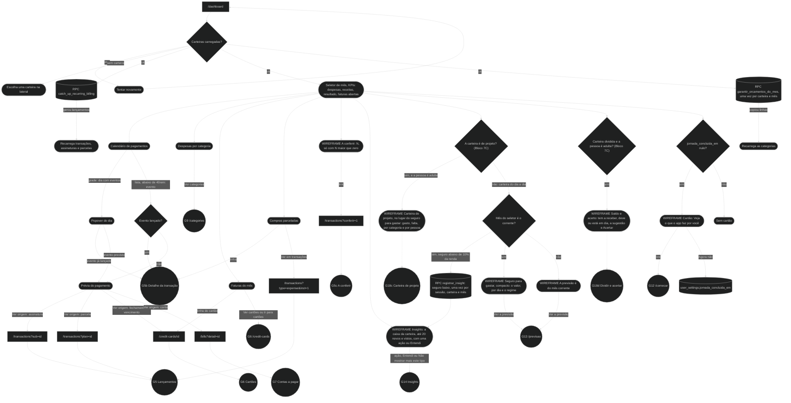

### Regras técnicas

| Ponto | Regra | Onde |
|---|---|---|
| Dados | Um hook agrega os blocos por mês e carteira | `src/components/dashboard/use-dashboard-data.ts` |
| Cobranças atrasadas | `catch_up_recurring_billing` roda uma vez por carteira ao montar; é idempotente com o cron | `src/lib/queries/use-recurring-billing-catchup.ts` |
| Calendário | Eventos: assinatura, parcela, fechamento, vencimento de cartão, vencimento de conta, receita e despesa lançadas. É a agenda do `Calendar` (rodada 242): na grade, o dia abre o popover e fica marcado (com a janela abaixo de 768px o popover abre como gaveta); abaixo de 40rem da largura da própria agenda ela vira a lista do mês — no telefone, e também num laptop estreito com a barra lateral aberta e o painel de próximos ao lado —, e o evento abre direto o detalhe ou a prévia, sem o popover. A lista mostra os últimos 5 dias passados com evento e todos os que vêm, com o selo do tipo. A grade de pontos do telefone saiu | `src/components/dashboard/dashboard-payments-calendar.tsx` |
| Prévia | "Ver origem" monta a rota pelo tipo do evento | `src/components/dashboard/dashboard-payment-event-preview-sheet.tsx` |
| A conferir (Bloco 3A) | Entre os indicadores e o calendário, o wireframe "A conferir: N" conta os lançamentos `needs_review` da carteira (pelo índice parcial `transactions_needs_review_idx`) e leva a `/transactions?conferir=1`. Com zero, some; um erro na contagem também o esconde | `src/components/wireframe/a-conferir-contagem-wireframe.tsx`, `src/app/(app)/dashboard/page-client.tsx` |
| Cartão da jornada (Bloco 4) | No alto do Painel, o wireframe "Veja o que o app faz por você" leva a `/comecar` enquanto `user_settings.jornada_concluida_em` é nulo; "Agora não" grava a data e o cartão some. Sem resposta da leitura, não aparece. Não há redirecionamento automático para a jornada | `src/components/wireframe/jornada-cartao-wireframe.tsx`, `src/app/(app)/dashboard/page-client.tsx` |
| Seguro para gastar (Bloco 5) | Entre o seletor de mês e os indicadores, o wireframe "Seguro para gastar" mostra o valor, o valor por dia (contando hoje) e o regime ("Caixa: o dinheiro que sai neste mês. A fatura conta no mês em que vence."), com o link "Ver a previsão" para `/previsao`. É compacto: o detalhe mora na rota. Só no mês corrente; em outro mês do seletor, o cartão diz "A previsão é do mês corrente" e mantém o link. Carregando ou em erro, o cartão diz isso e mantém o link. O Painel lê a previsão por `usePrevisao`, com os mesmos hooks e `queryKey` dele | `src/components/wireframe/seguro-para-gastar-wireframe.tsx`, `src/lib/previsao/use-previsao.ts`, `src/app/(app)/dashboard/page-client.tsx` |
| Insights (Bloco 6) | Entre o seguro para gastar e os indicadores, o wireframe "Insights" lista os `new` e `seen` da carteira, até 20, do mais novo ao mais velho (a RLS já tira o de outra pessoa e o tipo que a pessoa silenciou). Cada um tem uma ação ou "Entendi"; "Mais" abre "Dispensar este" e "Não mostrar mais este tipo". Os novos que aparecem viram `seen` (`marcar_insight`, uma vez por sessão). Sem a tabela (migração ainda não aplicada) a caixa fica vazia; um erro de leitura aparece como alerta. Ver 14 | `src/components/wireframe/insights-wireframe.tsx`, `src/lib/insights/use-insights.ts`, `src/app/(app)/dashboard/page-client.tsx` |
| Seguro baixo (Bloco 6B) | É o único insight que o cliente produz: ao abrir o Painel no mês corrente, se o seguro para gastar (`seguroParaGastar`, o mesmo do cartão ao lado) está abaixo de 10% da renda do mês (e há renda), `registrar_insight` grava o do mês, uma vez por sessão, carteira e mês. O texto da caixa mostra o seguro de agora, nunca o gravado; o insight some quando deixou de estar baixo e não aparece em mês que passou; a leitura da caixa já o tira (`filtroDaCaixa`), para o de um mês que passou não ocupar uma das 20 linhas | `src/lib/insights/use-insights.ts` (`useSeguroBaixo`), `src/lib/insights/acoes.ts` (`textoNaCaixa`) |
| Orçamentos que repetem (Bloco 5) | Ao abrir, o Painel chama `garantir_orcamentos_do_mes` (a mesma chamada de Categorias, no máximo uma vez por carteira e mês na sessão). Se a RPC criou linhas, as categorias são invalidadas e a tela refaz a busca. Erro vai ao console e a próxima abertura tenta de novo | `src/hooks/use-garantir-orcamentos-do-mes.ts`, `src/lib/category-budget-ops.ts` |
| "Em aberto" e "prevista" (Bloco 5) | O "em aberto" das faturas do Painel segue o `buildCardMonthlyInvoiceSnapshot`: **não** soma as assinaturas do cartão que ainda vão cair. A fatura "prevista" da previsão (`faturaPrevista`) soma. São dois números com dois nomes; a revisão de tela decide se o "em aberto" passa a ser o previsto | `src/components/dashboard/use-dashboard-data.ts`, `src/lib/previsao/fatura-prevista.ts` |
| Fatura e estorno (Bloco 2) | Nas faturas do mês, uma fatura fechada vale o total do banco quando a pessoa o informou (`credit_card_statement_totals`); a aberta segue o calculado. O estorno no cartão (receita com `payment_method = 'credit_card'`) abate a despesa do mês de fechamento e não conta como receita. A consulta do período pede `source`, `needs_review` e `import_batch_id`: sem a migração do Bloco 2, o Painel não carrega | `src/components/dashboard/use-dashboard-data.ts`, `src/lib/fatura/total-com-banco.ts`, `src/lib/expense-month-attribution.ts`, `src/lib/queries/use-transactions-range.ts` |
| Painel do convidado (Bloco 7A) | Com `guest`, `PainelPorPapel` troca o Painel da casa pelo wireframe dele: o limite do mês, o total, as dez últimas transações e "Lançar despesa" (ver 15b). Dono e membro seguem no Painel da casa. A caixa de insights, o seguro para gastar e as faturas não existem para ele | `src/components/dashboard/painel-por-papel.tsx` |
| Carteira de projeto no Painel (Bloco 7C) | Com `purpose = 'project'`, o Painel do adulto troca o cartão "Seguro para gastar" pelo resumo da carteira (gasto, falta do orçamento total, por categoria e por pessoa, somando a carteira inteira); o convidado não o vê. Sem o seguro, some o único link para a Previsão. Ver a jornada 18 | `src/app/(app)/dashboard/page-client.tsx`, `src/components/wireframe/projetos-wireframe.tsx` |
| Saldo e acerto (Bloco 7C) | Antes da caixa de insights, o wireframe "Saldo e acerto" aparece só numa carteira `split` e só para o adulto: o saldo de cada pessoa (`saldos_da_carteira`), a sugestão de quem paga quem, o "Acertar" que grava em `settlements` e o histórico. O saldo pode levar até 60 s para refletir uma despesa recém-salva: salvar uma transação não invalida a consulta dele. Ver a jornada 18 | `src/components/wireframe/divisao-wireframe.tsx`, `src/app/(app)/dashboard/page-client.tsx` |

---

## 5. Lançamentos

`/transactions`: a lista de despesas e receitas, e o formulário que as cria.
É a jornada para onde as outras mandam a pessoa quando querem mostrar dinheiro
que já se mexeu.

### 5a. Lista e filtros

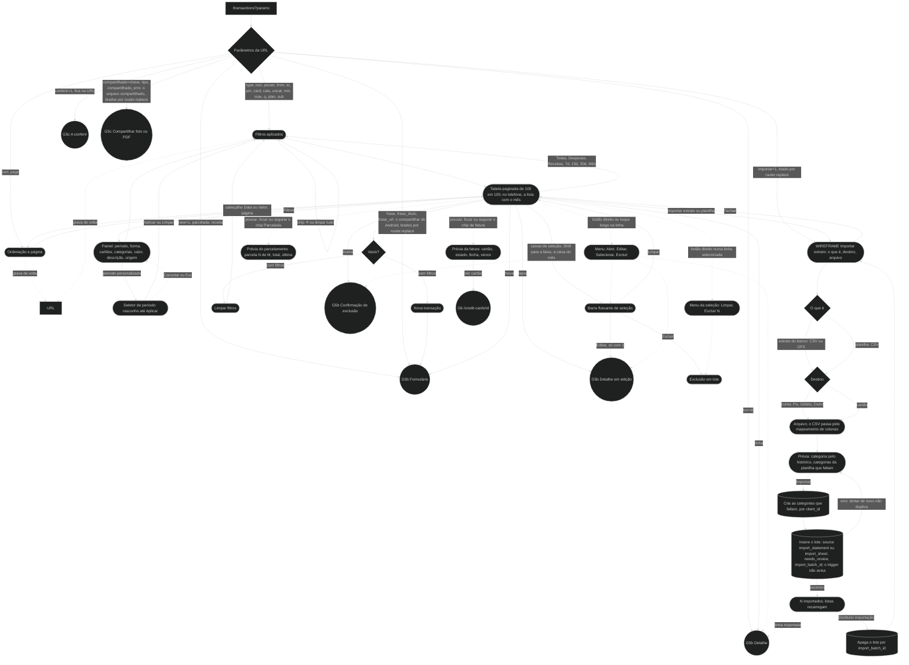

### 5b. Criar, editar e excluir

```mermaid
%%{init: {"theme": "dark"}}%%
flowchart TD
    open(["Formulário: modal no desktop, folha no mobile"]) --> type{"Tipo"}
    newTx(["+ Adicionar, Nova transação ou Nova transação de uma categoria"]) --> smartOn{"Lançamento inteligente ligado na conta (desde 3/nov/2026; antes, neste aparelho), ou veio do compartilhar do Android?"}
    smartOn -->|"não (Configurações › Lançamento)"| open
    newKind(["⌘K Nova receita ou Nova parcelada, ?new=receita"]) -->|"o tipo pedido escolhe o formulário"| open
    smartOn -->|"sim, o padrão"| pal(["Lançamento inteligente: só a pílula da frase e a pílula redonda do recibo"])
    pal -->|"Enter: o parser lê a frase"| rev(["Revisão abaixo do campo: tipo, valor, descrição, categoria, forma, data, parcelas"])
    pal -->|"Enter com valor ou descrição em dúvida: lê com a IA, uma vez por frase"| iaFrase[("Edge ia-ler, op frase: o texto redigido; cota de 30 por dia")]
    iaFrase -->|"campos; a dúvida ia deixa a conferir"| rev
    iaFrase -.->|"cota, sem IA ou erro: o aviso; a revisão do parser"| rev
    pal -->|"foto: pílula do recibo, colar ou soltar"| iaFoto[("Edge ia-ler, op imagem: a foto vai crua, sem redação; até 4 MB")]
    iaFoto -->|"campos; source share, a conferir; a revisão abre sozinha"| rev
    iaFoto -.->|"cota, sem IA ou foto ilegível: o aviso; a foto fica"| pal
    rev -->|"tocar numa linha: o controle no lugar; ok volta à linha"| rev
    rev -->|"reescrever a frase e Enter: relê, as edições à mão ficam"| rev
    rev -->|"Aprovar"| saveTx
    rev -->|"Aprovar, compra parcelada"| savePlan
    rev -->|"Formulário completo: leva os campos"| open
    pal -->|"fechar (Esc ou fora): descarta, sem perguntar"| closed
    open -->|"editar uma transação: sempre o formulário"| type
    type -->|"Despesa"| expense(["Valor, descrição, categoria, data, forma de pagamento"])
    type -->|"Receita"| income(["Valor, descrição, categoria, data"])
    type -->|"Parcelada"| inst(["Valor total ou por parcela, nº de parcelas, 1ª cobrança"])

    expense --> catPick(["Seletor de categoria"])
    income --> catPick
    catPick -->|"Gerenciar categorias"| G9(("G9 /categories"))
    expense -->|"forma: cartão de crédito"| cardPick(["Seletor de cartão"])
    expense -.->|"projeto ativo na carteira: seletor Projeto"| G18b(("G18b Projeto"))
    expense -.->|"carteira dividida e adulto: Quem pagou"| G18d(("G18d Dividir e acertar"))
    inst -.->|"carteira dividida: pesos desta parcelada"| G18d
    cardPick -->|"Cadastrar cartão ou sem cartões"| G6(("G6 /credit-cards"))
    cardPick -.->|"sem cartão escolhido"| disabled(["Salvar desativado"])

    expense -->|"Salvar"| saveTx[("Insere transação; pela frase, source quick_text; pela foto, share; needs_review com dúvida ou IA")]
    income -->|"Salvar"| saveTx
    income -->|"Estorno no cartão: escolher o cartão e a categoria de despesa"| refund(["WIREFRAME Estorno: receita no crédito, com o cartão e a categoria de despesa"])
    refund -->|"Salvar"| saveTx
    refund -.->|"abate a fatura do ciclo em que cai e a categoria no mês do fechamento; fora da receita do Painel"| G6
    inst -.->|"2 ou mais parcelas e valor, antes de salvar"| impacto(["WIREFRAME Impacto da parcela: parcela e fim, pico, próximas faturas, renda, mês no vermelho e limite"])
    pal -.->|"com parcelas e valor"| impacto
    planInfo -.->|"detalhe de compra parcelada"| impacto
    impacto -.->|"a mesma conta da previsão"| G13(("G13 Previsão"))
    inst -->|"Salvar"| savePlan[("RPC create_workspace_installment_plan")]
    saveTx -->|"offline"| queued(["Salva na fila offline"])
    saveTx -->|"erro"| keep(["Aviso; formulário continua aberto"])
    saveTx -->|"sucesso"| after[("Edges evaluate-budgets, evaluate-credit-card-alerts")]
    saveTx -.->|"com a foto do recibo"| fotoAnexo[("A foto vira anexo do lançamento; falhando, o lançamento fica")]
    saveTx -.->|"qualquer origem: paid_by e, na carteira dividida, as partes"| partesTrg[("Triggers definir_quem_pagou e gerar_partes")]
    partesTrg -.-> G18d
    saveTx -.->|"despesa manual, no insert"| notifyTrg[("Trigger transactions_notify_created: Edge notify-transaction-created avisa os membros")]
    after --> toast(["Transação criada; listas recarregam"])
    toast -->|"Ver, só online"| txOpen(("G5b Detalhe /transactions?txn=id"))
    savePlan -->|"sucesso"| toastPlan(["Compra parcelada registrada"])
    savePlan -.->|"pela frase ou pela IA"| markPlan[("Parcelas lançadas recebem source e needs_review; a foto vai à 1ª")]
    toastPlan -->|"Ver, só online"| planList(("G5 /transactions?plan=id"))
    open -->|"Cancelar, Esc ou fora, sem alterações"| closed(["Fecha e descarta"])
    open -->|"fechar com alterações"| discard(["Descartar alterações?"])
    discard -->|"Descartar"| closed
    discard -->|"Continuar editando"| open
    saveTx -.->|"salvando: nada fecha"| open

    detail(["Detalhe da transação"]) --> view(["Valor, data, categoria, forma, dica da fatura"])
    view -->|"é parcela"| planInfo(["Parcela k de n, total, lançado, restante"])
    view -->|"tem assinatura"| G8(("G8 /subscriptions"))
    view -->|"importado, a revisar ou Apple Pay com cartão da Wallet"| review(["WIREFRAME A conferir: Importado · a conferir"])
    review -->|"Confirmar"| reviewOk[("needs_review = false")] --> view
    review -->|"Lembrar 'nome' como este cartão, com o cartão escolhido"| walletAlias[("credit_cards.wallet_alias")] --> view
    review -->|"Desfazer importação do lote, confirmado"| reviewUndo[("Apaga o lote por import_batch_id")] --> sheetShut(["O detalhe fecha"])
    view -.->|"carteira dividida, adulto: Partes desta despesa"| G18d
    view --> attach(["WIREFRAME Anexos: lista, anexar foto ou PDF, abrir, apagar"])
    attach -->|"Anexar"| attachCheck{"Tipo aceito, até 10 MB e dentro da cota de 25 MB?"}
    attachCheck -->|"não"| attachErr(["Mensagem antes do envio"])
    attachCheck -->|"sim"| attachSave[("Foto vira WebP; objeto no bucket attachments e linha em attachments; a linha falhou, o objeto sai")]
    attachSave --> attach
    attach -->|"Abrir"| attachUrl(["URL assinada de 1 h em aba nova; popup bloqueado: link Abrir anexo, sem sair do app"])
    attach -->|"Apagar, confirmado"| attachDel[("Apaga a linha e o objeto")] --> attach
    view -->|"⋯ Editar"| editWhat{"É parcela?"}
    editWhat -->|"não"| editForm(["Editar campos"])
    editWhat -->|"sim"| scope(["O que editar: esta parcela ou plano da compra"]) --> editForm
    editForm -->|"Salvar: tira a marca, needs_review false"| updated(["Transação ou plano atualizado"]) --> view
    editForm -->|"Cancelar"| view
    view -->|"⋯ Excluir"| confirm(["Excluir transação?"])
    confirm -->|"Cancelar"| view
    confirm -->|"Excluir"| isInst{"É parcela?"}
    isInst -->|"não"| delTx[("Remove transação e os objetos dos anexos")] --> deleted(["Transação excluída"])
    isInst -->|"sim"| cascade[("RPC delete_workspace_installment_plan_cascade; objetos dos anexos ficam para o cron")] --> cancelled(["Compra parcelada cancelada"])
    confirm -.->|"offline"| queuedDel(["Exclusão enfileirada"])
```

### 5c. Captura sem abrir o app e "A conferir"

O Bloco 3A. A pessoa cria um token em Configurações e instala o Atalho do iPhone
pelo guia; o Atalho e a automação do Apple Pay lançam pela Edge `capture`, como
a pessoa. O Android compartilha um texto, que abre o formulário com a frase.
O que tem dúvida cai em "A conferir", que o Painel conta e o lembrete das 20h
aponta.

O Bloco 3B pôs a IA no caminho: a `capture` aceita a foto do recibo em
multipart e manda à IA a frase que o parser não leu; a compra parcelada
capturada vira plano; e o Android compartilha também foto e PDF, pelo service
worker.

```mermaid
%%{init: {"theme": "dark"}}%%
flowchart TD
    account(("G2 /settings")) --> tokens(["Configurações, Lançar pelo iPhone (a seção só existe no iPhone com o app instalado): a lista de aparelhos, ou o vazio com Conectar o iPhone"])
    tokens -->|"Adicionar iPhone, ou Conectar o iPhone: o GuiaDoAtalho, passo 1, nome e carteira padrão"| createTok[("RPC create_capture_token: guarda o sha256; até 10 ativos")]
    createTok --> shown(["Passo 5 do mesmo guia: o código fac_ à vista, copiado quando o navegador deixa, até fechar o guia"])
    tokens -->|"Desconectar, no ⋯ da linha, com confirmação num AlertDialog"| revokeTok[("RPC revoke_capture_token: revoked_at")]
    shown --> guide(["GuiaDoAtalho, 6 passos: nome e carteira; baixar o atalho assinado; abrir o arquivo; Configurar Atalho; colar o código (ou montar à mão); a Siri"])
    guide --> iphone(["Atalho do iPhone: ditar a frase, a foto do recibo redimensionada e em JPEG, ou Extrair texto da imagem"])
    tokens -->|"Lançar ao pagar, o cartão que só aparece com aparelho ativo: Configurar"| payGuide(["GuiaDoApplePay, 5 passos: o app Atalhos e o + com a tela do iPhone; colar a frase em Descrever um atalho; conferir, cartões, Executar Imediatamente, Lançar gasto, a notificação"])
    payGuide --> wallet(["Automação da Wallet: valor, estabelecimento e cartão do Apple Pay"])
    iphone -->|"POST text, ou multipart file, Bearer fac_"| capture[("Edge capture")]
    wallet -->|"POST amount, merchant, card, source apple_pay"| capture

    capture --> tokOk{"Token ativo, membro da carteira padrão e workspace_plan?"}
    tokOk -->|"não"| e401(["401 Token inválido, sem dizer por quê"])
    tokOk -->|"sim"| kind{"Foto ou frase?"}
    kind -->|"PDF ou outro tipo"| e422f(["422: PDF de fatura, use Conferir fatura no app; ou Envie uma foto"])
    kind -->|"foto até 4 MB"| iaCap[("IA: cota de 30 por dia, cache, Groq e depois Cloudflare")]
    kind -->|"frase sem valor ou com dúvida de descrição"| iaCap
    kind -->|"frase lida pelo parser, ou foto acima de 4 MB"| amountOk{"Achou o valor?"}
    iaCap -->|"campos, ou sem IA: o parser e o text"| amountOk
    amountOk -->|"não"| e422(["422 com a mensagem; nada gravado"])
    amountOk -->|"sim"| sameId{"Mesmo id de antes?"}
    sameId -->|"sim"| sameTx(["200 com o lançamento que já existe"])
    sameId -->|"não, ou sem id"| cardMatch{"Cartão casa pelo wallet_alias ou pelo nome?"}
    sameId -->|"não, e parcelas > 1"| planCap[("RPC criar_plano_parcelado: parcelas até hoje com source e needs_review; a chave na 1ª")]
    planCap --> resumo
    cardMatch -->|"inteiro, numa carteira da pessoa: vai para a carteira do cartão"| saveCap
    cardMatch -->|"parcial: mantém o cartão, a conferir"| saveCap
    cardMatch -->|"nenhum: sem cartão; no Apple Pay, walletCard em capture_meta"| saveCap
    saveCap[("Insere a transação como a pessoa: source shortcut, apple_pay ou share; needs_review com qualquer dúvida")]
    saveCap --> resumo(["200 com o resumo: R$ 42,00 · Mercado · Nubank"])
    saveCap -.->|"despesa nova"| evals[("Edges evaluate-budgets e evaluate-credit-card-alerts, pela service role")]
    saveCap -.->|"despesa"| notifyTrg[("Trigger transactions_notify_created")]
    saveCap -.->|"needs_review"| conferir
    saveCap -.->|"com foto"| capAnexo[("A foto vira anexo; cota de anexos cheia: anexo false")]

    android(["Compartilhar do Android: texto, foto ou PDF"]) -->|"share_target POST multipart"| swOn{"Service worker ativo?"}
    swOn -->|"sim"| swRoute[("SW: o arquivo vai ao Cache Storage captura-compartilhada; 303")]
    swOn -->|"não: route handler do Next"| nextRoute(["POST /transactions/compartilhar: só o texto segue; a foto cai sem aviso"])
    swRoute -->|"só texto"| shareUrl
    nextRoute -->|"303"| shareUrl["/transactions?frase=texto"]
    shareUrl -->|"abre o lançamento inteligente com a frase já lida; os parâmetros saem da URL"| txForm(("G5b Lançamento inteligente"))
    swRoute -->|"foto"| sharedPhoto["/transactions?compartilhado=chave"]
    swRoute -->|"PDF"| sharedPdf["/transactions?compartilhado=chave&tipo=pdf"]
    swRoute -->|"grande, vazio ou outro tipo"| sharedErr["/transactions?compartilhado_erro=1"]
    sharedPhoto -->|"lê e apaga o arquivo; abre o formulário com a Foto do recibo lendo"| fotoForm(("G5b Foto do recibo"))
    sharedPdf -->|"WIREFRAME aviso: abra o cartão e use Conferir fatura"| cardsLink(("G6 /credit-cards"))
    sharedErr --> shareWarn(["WIREFRAME aviso: arquivo recusado, ou já lido ou vencido"])
    sharedPhoto -.->|"arquivo lido ou com mais de 1 h"| shareWarn

    dash(("G4 Painel: A conferir N")) --> conferir
    iconConf(("G3 Atalho do ícone: A conferir")) --> conferir
    cron[("Cron review-reminder-daily, 23:00 UTC")] -.-> reminderFn[("Edge review-reminder")]
    reminderFn -.->|"quem lançou itens a conferir, por carteira, uma vez por dia"| deliver[("deliverNotification, tipo review")]
    settings["/settings"] -->|"O que receber: Itens a conferir"| prefs[("notify_review")]
    prefs -.->|"desligado: não avisa"| reminderFn
    deliver -.-> notif(("G3 Notificação Itens a conferir"))
    notif --> conferir

    conferir["/transactions?conferir=1"] --> listWf(["WIREFRAME A conferir: os itens needs_review, acima da lista"])
    listWf -->|"Confirmar"| confirmOk[("needs_review = false")] --> listWf
    listWf -->|"Abrir: txn=id, a lista continua"| detailG(("G5b Detalhe"))
    listWf -->|"Fechar: tira conferir da URL"| plainList["/transactions"]
    detailG -->|"Lembrar 'nome' como este cartão"| aliasSave[("credit_cards.wallet_alias")]
    detailG -->|"editar e salvar"| unmark[("needs_review = false")]
```

### Regras técnicas

| Ponto | Regra | Onde |
|---|---|---|
| Parâmetros | Lidos e gravados na URL; `new`, `txn` e `importar` são consumidos e removidos (`importar=1` abre o wireframe de importar e sai por `router.replace`, como o `new`). `frase`, `frase_titulo` e `frase_url` (o compartilhar do Android) também saem, e desde o Bloco 3B `compartilhado`, `tipo` e `compartilhado_erro` (o arquivo compartilhado); `conferir=1` fica, porque é uma vista | `src/lib/transactions-list-search-params.ts`, `src/app/(app)/transactions/page-client.tsx` |
| Ordenação e página | `sort=date.desc` · `date.asc` · `amount.desc` · `amount.asc` e `page=N` (a partir de 1) vão para a URL e voltam dela, também no voltar e avançar; o padrão (`date.desc`, página 1) não é escrito. Trocar um filtro volta à página 1. Só na página, não no modo embutido | `src/components/transactions/use-transactions-list-controller.ts`, `src/lib/transactions-list-search-params.ts` |
| Tabela | `DataTable` em modo `manual` (o banco ordena e pagina): a seleção não alcança as projetadas, que também não abrem nem têm menu; o mês só agrupa ordenado por data; a barra de seleção é flutuante e cancelar a exclusão mantém a seleção; no telefone, a lista gerada das colunas | `src/components/transactions/transactions-table.tsx`, `src/components/ui/data-table.tsx` |
| Formulário | Um componente para criar, e o mesmo campo a campo na edição | `src/components/transactions/transaction-form-dialog.tsx`, `transaction-form-use.tsx` |
| Parcelada | RPC `create_workspace_installment_plan`; editar o plano não muda parcelas já lançadas. Desde o Bloco 3B, a compra preenchida pela frase ou pela IA marca depois da RPC as parcelas já lançadas (`source` e `needs_review`, pela RLS de membro; falhando, o plano fica), e a foto do recibo vai à 1ª parcela (`primeiraParcelaDoPlano`). As parcelas que o cron lança depois nascem `app`, sem marca | `src/components/transactions/transaction-form-persistence.ts`, `src/components/transactions/transaction-form-use.tsx` |
| Impacto da parcela (Bloco 5) | O wireframe "Impacto da parcela" aparece em três lugares: no formulário, no modo Parcelada, com 2 ou mais parcelas, data e valor (e, no crédito, o cartão escolhido); na frase rápida, quando a frase aplicada traz parcelas e valor; e no detalhe de um lançamento de compra parcelada, com o plano ativo. Com "em 10x" na frase, o quadro aparece duas vezes (na frase e no formulário). Nenhuma conta própria: o "depois" é a mesma `projecaoMensal` e a mesma `faturaPrevista` com um plano sintético igual ao que o banco gravaria. Mostra a parcela e o mês da última, o pico de parcelas num mês (pelo mês da cobrança), as 3 próximas faturas antes e depois (só com cartão), a parcela como % da renda recorrente (`kind = income`; sem receita, diz que não há), o primeiro mês da linha do tempo com o seguro negativo, antes e depois, e o limite. O limite disponível desconta as faturas fechadas não pagas (o total do banco, quando gravado), o lançado na aberta e todas as parcelas futuras, e **não** as assinaturas; sem cartão (Pix, por exemplo), não há faturas nem limite, e o cartão sem `credit_limit` diz "Sem limite cadastrado" em vez de "Não cabe no limite do cartão" | `src/components/wireframe/impacto-parcela-wireframe.tsx`, `src/lib/previsao/impacto-parcela.ts`, `src/components/transactions/transaction-form-fields.tsx`, `src/components/wireframe/frase-rapida-wireframe.tsx`, `src/components/transactions/transaction-detail-sheet.tsx` |
| Detalhe | Mesmo painel no Painel, em Cartões e em Categorias | `src/components/transactions/transaction-detail-sheet.tsx` |
| Exclusão | Parcela cancela o plano inteiro por `delete_workspace_installment_plan_cascade`. Continua com confirmação, e não com o Desfazer do toast: a exclusão é física (`delete`), sem `deleted_at` nem RPC de restaurar, e recriar mudaria o id e quebraria parcelas, recorrência e faturas (verificado na rodada 228) | `src/lib/transactions/mutations.ts` |
| "Ver" do toast | Criar uma transação (não editar) mostra "Ver", que leva a `/transactions?txn=id` e abre o detalhe; a compra parcelada leva a `?plan=id`. Offline não há id, e o toast sai sem "Ver". A trava que abre o `txn` uma vez só volta a soltar quando a URL perde o parâmetro — antes, com `/transactions` aberta, o segundo `?txn=` não abria nada | `persistTransactionSave` em `src/lib/transaction-detail-sheet-mutations.ts`, `transaction-form-persistence.ts`, `use-transactions-list-controller.ts` |
| Offline | Criar e excluir entram na fila; pagar conta exige conexão | `src/lib/offline/` |
| Aviso aos membros | O trigger `transactions_notify_created` (`AFTER INSERT` em `transactions`, só `expense` sem `subscription_id`, `installment_plan_id` nem `import_batch_id`: desde o Bloco 2 a importação não avisa) chama `notify-transaction-created` por `invoke_edge_function` (`pg_net`, `x-cron-secret`). A função repete o `WHEN` (`triggerSkipReason`, em `_shared/transaction-notify-rules.ts`) e responde 200 com `skipped` ao que ele pula, mesmo chamada por um Database Webhook antigo. O cliente não chama a função: a despesa offline avisa quando a fila a insere. Parcela e assinatura lançadas pelo cron não avisam. Sem segredo no Vault ou com falha de rede, a despesa é salva e o aviso se perde | `supabase/migrations/20261021120000_internal_edge_dispatch.sql`, `supabase/functions/notify-transaction-created/`, `supabase/functions/_shared/transaction-notify-rules.ts` |
| Rascunho | No formulário clássico, fechar o formulário alterado (Cancelar, Esc, toque fora, ×, arrastar a gaveta) pergunta "Descartar alterações?"; salvar fecha sem perguntar. Trocar só a aba ou o tipo não conta como alteração. Enquanto salva, nada fecha (`Dialog pending`). **O lançamento inteligente não pergunta:** fechar descarta (lacuna 104) | `isDirty` em `src/components/transactions/transaction-form-use.tsx`, `src/components/transactions/transaction-form-dialog.tsx` |
| Enter | O `Enter` na busca do seletor não salva a transação: o popover é portalizado, e a submissão implícita do navegador só conta os campos cujo dono no DOM é o `<form>` | `Form` em `src/components/ui/form.tsx` |
| Período personalizado | Um `DatePicker` de intervalo com `confirm`: as pontas ficam em rascunho até Aplicar, Limpar tira o filtro, Cancelar e Esc descartam. Era um formulário à parte (`transactions-date-range-form.tsx`, removido) | `src/components/transactions/transactions-filters-panel.tsx` |
| Prévias dos chips | O chip de fatura e o "Parcelada" abrem uma prévia ao pousar, no foco e no toque longo (`HoverCard`); o clique no chip continua abrindo o detalhe da linha. A da fatura leva a "Ver cartão" (o ciclo atual: a página do cartão não abre uma fatura passada por parâmetro). O chip de fatura só existe a partir de `md` | `CreditInvoiceChip` e `InstallmentChip` em `src/components/transactions/transactions-table.tsx` |
| Importar extrato ou planilha (Bloco 2) | Wireframe acima da barra, pelo link "Importar extrato ou planilha" ou `?importar=1`. Extrato do banco (CSV ou OFX, `source = 'import_statement'`) ou planilha da pessoa (CSV, `import_sheet`), numa conta (Pix, Débito, Outro) ou num cartão. A categoria vem do histórico (a descrição normalizada igual; senão, a transação mais recente com a mesma primeira palavra significativa); as categorias da planilha que faltam são criadas antes. Todo item importado nasce com `needs_review` e o `client_id` gerado uma vez: repetir "Importar" não duplica. Parcela vira despesa simples com "(k/n)" na descrição. "Desfazer importação" apaga o lote (`import_batch_id`). Não avisa os membros nem dispara alerta de orçamento ou de cartão | `src/components/wireframe/importar-extrato-wireframe.tsx`, `src/components/wireframe/mapeamento-csv.tsx`, `src/lib/import/` |
| Estorno no cartão (Bloco 2) | No formulário de receita, a caixa "Estorno no cartão" grava `payment_method = 'credit_card'` com o cartão. O estorno abate a fatura do ciclo em que cai (que pode ficar negativa, saldo credor), reduz a despesa do mês de fechamento e não conta como receita no Painel. Desde o Bloco 9 o formulário pede, no estorno, uma categoria **de despesa**: é a que ele abate no orçamento, pelo mês do fechamento (`gastoDaCategoriaNoMes` e `buildCategoryCommitmentsForMonth`), e todo leitor de receita por categoria ignora a receita cuja categoria é de despesa (`ehEstornoNoCartao`, `tipoDaCategoria`). O estorno lançado antes do Bloco 9 tem categoria de receita e não desconta o orçamento (lacuna 92): ao abri-lo, a categoria é limpa | `src/components/wireframe/estorno-wireframe.tsx`, `formaDoPayload` em `src/components/transactions/transaction-form-use.tsx`, `src/lib/expense-month-attribution.ts` |
| A conferir (Bloco 2) | No detalhe, o lançamento importado ou com `needs_review` mostra "Importado · a conferir". "Confirmar" tira o `needs_review`; "Desfazer importação do lote", depois do `confirm`, apaga o lote inteiro e fecha o detalhe. A lista "A conferir" veio no Bloco 3A (`?conferir=1`) | `src/components/wireframe/a-conferir-wireframe.tsx`, `src/components/transactions/transaction-detail-sheet.tsx` |
| Frase rápida (Bloco 3A) | **Desde o lançamento inteligente, a caixa não está mais no formulário clássico; o parser e o preenchimento descritos aqui vivem agora no lançamento inteligente (próxima linha).** Antes: só ao criar, no topo do formulário, o wireframe "Frase rápida" lê a frase ("42 mercado nubank") com o mesmo parser da Edge (`_shared/frase.ts`) e, em "Preencher" ou no Enter, preenche valor, descrição, data, tipo, forma, cartão e categoria (`carregarHistoricoDaFrase`, sem travar offline). Enquanto se escreve, a linha "Entendi" mostra o que o Enter vai preencher e de onde veio cada palpite. **Categoria** (`casarCategoria`), a primeira que decide: a mesma descrição no histórico; uma palavra do nome de uma categoria na descrição ("42 mercado" → Mercado; empate não escolhe); a mesma primeira palavra no histórico; uma palavra comum ("uber" → Transporte, "ifood" → Restaurantes; tabela `COMUNS`). Só categorias existentes do tipo. **Forma e cartão**: o cartão nomeado é crédito nele (e vira o "último" do formulário); a forma dita vale; "crédito"/"cartão" sem nome usa o cartão que o formulário pré-escolhe ao tocar em Crédito (`cartaoPreEscolhido`: o único ativo ou o último escolhido na carteira neste aparelho) e, sem ele, o do último lançamento no crédito com cartão ativo (`cartaoDoCredito`), sem dúvida; parcelas sem forma dita são crédito nesse cartão; senão, a forma e o cartão da mesma descrição no histórico. Nome de cartão que não casa fica a conferir, sem palpite. A Edge `capture` segue só com o histórico. Não salva: quem salva é a pessoa, pelo botão de sempre. O payload ganha `source: 'quick_text'` e, com dúvida do parser, `needsReview: true`; a categoria escolhida à mão conta como conferida. O Enter do campo chama `preventDefault` e não envia o formulário. Desde o Bloco 3B, quando o parser não acha o valor, aparece "Tentar com IA": a frase vai à `ia-ler` (`lerFraseComIA`), e o que a IA leu se junta ao que o parser leu (forma, parcelas, estorno); a dúvida `ia` deixa o lançamento a conferir, e a data futura vira hoje com a dúvida `data`. Sem IA, o aviso diz por quê ("Você usou a IA 30 vezes hoje. Amanhã volta.", "A IA não respondeu agora. Confira à mão.") | `src/components/wireframe/frase-rapida-wireframe.tsx`, `src/lib/captura/frase-no-form.ts`, `src/components/transactions/transaction-form-use.tsx` |
| Lançamento inteligente | Criar uma transação (+ Adicionar, "Nova transação" em Transações, e a partir de uma categoria) abre o **"Lançamento inteligente"** **só no celular** (abaixo de 768px; no laptop e no desktop é sempre o formulário), quando o interruptor deste aparelho está ligado (Configurações › Lançamento, `useLancamentoInteligente`, padrão ligado, guardado no aparelho) e **sempre** que a pessoa chega do compartilhar do Android (`?frase=`, foto). Editar abre sempre o formulário clássico, e pedir outro tipo que não a despesa ("Nova receita" e "Nova parcelada" no ⌘K, `?new=receita`) também: quem escolheu o tipo escolheu o formulário. O convidado não vê Receita nem Estorno no tipo, e o que a frase lê como receita ou estorno vira despesa (`soDespesa`), como no formulário. O estorno sem cartão trava o "Aprovar" com "Falta o cartão" quando há cartão ativo. Com a tela fechada ou trocada pelo formulário completo, a resposta atrasada da IA não sobrescreve o formulário, e o histórico da frase recarrega a cada abertura. **Desde a v2 (pedido do dono, 2026-10-27) a tela não é mais a paleta** (sem exemplos, prévia ao vivo, sub-páginas nem dock): é um `Dialog` sem casca: sobre o véu flutuam só a pílula da frase (`SearchInput`, com o feixe da marca) e, ao lado, a pílula redonda do recibo ("Adicionar recibo"), no vidro da busca — no telefone, 12px acima do teclado; no desktop, no centro alto. No Enter a câmera **cola** no campo (o fechamento da busca do telefone; encostadas, um vidro só), é **absorvida** (a ponta recua para dentro do campo) e o próprio campo **vira o painel de revisão** (no telefone cresce para cima, no desktop para baixo; o conteúdo anda com o vidro e as peças chegam em cascata, no lugar). O painel é uma lista agrupada: o tipo com o motivo, o valor em destaque e as linhas com ícone e seta. Nada aparece nem vai ao formulário até o Enter. O **Enter lê a frase** (o mesmo parser) e não salva; com valor ou descrição em dúvida, a IA (`ia-ler`, op frase) lê **uma vez por frase**, com "Lendo com IA…". A leitura abre a **revisão** abaixo do campo, um `Form`: todas as linhas, lidas ou não (tipo com o motivo, valor, descrição, categoria, forma ou cartão, data, parcelas); a não lida diz "Não identificado", a em dúvida leva "Confira" e a lida pela IA, "IA". Tocar numa linha troca o valor pelo controle do design system (`Input money` e `Input`, com "ok" ou o Enter do campo para voltar à linha; `Select` e `Combobox` já abertos, e escolher volta à linha); a Data abre um `Dialog` com o `Calendar` e os atalhos Hoje e Ontem, e escolher o dia fecha. A edição à mão vence a frase — reescrever a frase e dar Enter de novo relê, mantendo as edições. O rodapé, preso embaixo enquanto a revisão rola, tem "Aprovar" (o único submit, travado com "Falta o valor"/"Falta o cartão") e "Formulário completo"; com a frase mudada depois do Enter, a revisão esmaece e o "Aprovar" pede "Enter para atualizar". A foto entra pela pílula do recibo, por colar ou por soltar (`ia-ler`, op imagem): lida, a revisão abre sozinha com a miniatura no topo (× tira), e ela vira anexo depois de salvar. "Formulário completo" troca para o diálogo clássico levando os campos. A frase do compartilhar já chega lida. O salvar é o de sempre (`useTransactionForm.salvar`, as mesmas RPCs). Desligado, o "+ Adicionar" abre o formulário clássico, sem as caixas de frase e foto. A Edge `capture` usa o parser melhorado no repositório, mas não foi publicada | `src/components/transactions/lancamento-inteligente.tsx`, `src/components/transactions/use-leitura-do-lancamento.ts`, `src/lib/captura/lancamento-inteligente.ts`, `src/hooks/use-lancamento-inteligente.ts`, `src/components/settings/theme-settings.tsx`, `src/components/transactions/transaction-form-dialog.tsx` |
| Editar tira a marca (Bloco 3A) | Toda edição salva grava `needs_review = false`; a criação só grava `source` e `needs_review` quando o payload os traz | `buildTransactionRow` em `src/lib/transactions/mutations.ts` |
| Compartilhar do Android (Blocos 3A e 3B) | Desde o Bloco 3B, o `share_target` do manifest é `POST /transactions/compartilhar` em `multipart/form-data`, com `files` (foto e PDF), `text`, `title` e `url`. Com o service worker ativo, a rota é dele (`receberCompartilhar`): guarda o primeiro arquivo aceito (JPEG, PNG, WebP, HEIC ou PDF, não vazio, até 10 MB) no Cache Storage `captura-compartilhada` e responde 303 para `/transactions?compartilhado=<chave>` (o PDF com `&tipo=pdf`); arquivo recusado leva a `?compartilhado_erro=1`; só texto, ao `?frase=` do 3A. A tela lê o arquivo pela chave e o apaga do cache (vale 1 hora): a foto abre o formulário de despesa com a "Foto do recibo" lendo (`fotoInicial`); o PDF, o arquivo que sumiu e o recusado viram o wireframe de aviso ("Para conferir a fatura, abra o cartão e use Conferir fatura.", com "Abrir cartões"). Sem service worker ativo (primeira instalação, troca de versão), o *route handler* do Next responde 303 só com o texto, e a foto cai sem aviso. O texto continua como no 3A: `frase`, `frase_titulo` e `frase_url` juntos (até 500 caracteres) abrem o formulário com a frase escrita, sem aplicar; com o formulário aberto, a frase nova troca a do campo | `src/lib/captura/compartilhado.ts`, `src/sw.ts`, `src/app/(app)/transactions/compartilhar/route.ts`, `src/app/(app)/transactions/page-client.tsx`, `src/components/wireframe/compartilhado-aviso-wireframe.tsx`, `src/app/manifest.ts` |
| Captura (Blocos 3A e 3B) | A Edge `capture` aceita JSON até 16 KB (`text`, ou `amount` + `merchant` + `card`; `date`, `id` e `source` opcionais) e, desde o Bloco 3B, `multipart/form-data` até 10 MB (`file`, a foto em JPEG, PNG ou WebP pelos bytes, e `text`, `source` e `id` opcionais), com `Authorization: Bearer fac_…`. PDF volta 422 "PDF de fatura: use Conferir fatura no app."; outro tipo, 422 "Envie uma foto (JPG, PNG ou WebP)."; o corpo só é lido depois do token, do plano e do membro. A foto até 4 MB vai à IA (`lerImagem`); a frase vai à IA (`interpretar`) só quando o parser não achou o valor ou ficou com dúvida de descrição, e o resultado passa pelo mesmo casamento de cartão e histórico. Sem IA (cota, provedor fora, sem chave), segue o parser; sem valor, 422 (com foto, "Não entendi a foto. Mande o valor no texto."). Todo lançamento que passou pela IA nasce `needs_review`, com `capture_meta.ia` (provedor e modelo). A foto vira anexo; com a cota de anexos cheia, o lançamento fica e a resposta diz `anexo: false`. A resposta ganha `ia` e `anexo`. Data de compra futura vira hoje, a conferir. Procura o token pelo `sha256`; revogado, desconhecido ou mal formado é o mesmo 401. Depois confere o `workspace_plan` da carteira padrão (402 sem plano) e se a pessoa ainda é membro dela. Grava com a service role repetindo a RLS: o autor é o dono do token, e cartão e categoria são da carteira de destino. Sem valor, 422 e nada gravado. Com `id`, o `client_id` deriva de `sha256(token_id:id)` e o retry devolve o mesmo lançamento. A foto vai para um caminho fixo por `client_id` (`<carteira>/<client_id>.<ext>`): o reenvio simultâneo recebe 409 e não cria um 2º anexo (Bloco 9b). `needs_review` com qualquer dúvida do parser, cartão de crédito citado sem casar, nenhuma categoria pelo histórico ou compra parcelada. Despesa nova chama `evaluate-budgets` e `evaluate-credit-card-alerts` com o Bearer da service role; o aviso aos membros é o do trigger | `supabase/functions/capture/`, `supabase/functions/_shared/captura.ts`, `supabase/functions/_shared/frase.ts` |
| Parcela capturada vira plano (Bloco 3B) | Com `parcelas > 1`, a `capture` chama a RPC interna `criar_plano_parcelado` (só a service role; confere o membro pelo `p_user_id`) com `source` da captura e `needs_review`: a parcela é `round(total / N, 2)` e a última fecha a diferença; a 1ª cobrança é a data do lançamento. As parcelas vencidas até hoje nascem marcadas; o `id` da resposta é o da 1ª parcela. Desde o Bloco 9 a RPC recebe `p_client_id` e `p_capture_meta`: toma `pg_advisory_xact_lock(hashtext('plano:' || p_client_id))`, devolve o plano que já existe para aquele `client_id` e grava o `client_id` e a `capture_meta` na 1ª parcela por dentro, sem o `update` à parte, então dois reenvios simultâneos dão um plano só, e desde o Bloco 9b ela acha o plano daquele `client_id` em qualquer carteira da pessoa: um destino diferente entre os reenvios (cartão ou carteira) não cria um 2º plano. A assinatura antiga sai, e o `create_workspace_installment_plan` do `main` a chama por posição e cai nos `default`s. A `capture` só sobe depois da migração (sem ela, a compra parcelada capturada dá 500) | `supabase/functions/capture/`, `supabase/migrations/20261102120000_bloco9.sql` |
| Foto do recibo (Bloco 3B) | **Desde o lançamento inteligente, a foto entra pela pílula redonda do recibo, ao lado do campo da frase, por colar ou por soltar; o formulário clássico não tem mais a caixa.** Antes: só ao criar, abaixo da frase rápida, o wireframe "Foto do recibo" (câmera ou arquivo) comprime a foto para WebP de lado maior 1600 px e a manda à `ia-ler` em multipart (`lerImagemComIA`, com o token da sessão). O que a IA leu preenche o formulário como a frase, com `source: 'share'` e a conferir; quem salva é a pessoa. A foto fica no formulário (suja o rascunho) e vira anexo do lançamento depois do salvar (na compra parcelada, da 1ª parcela); falhando o anexo, o lançamento fica. A resposta atrasada de uma foto trocada é jogada fora; o Enter do campo abre a câmera e não salva | `src/components/wireframe/foto-recibo-wireframe.tsx`, `src/lib/ia/ler.ts`, `src/components/transactions/transaction-form-use.tsx` |
| IA (Bloco 3B) | Um módulo só, `_shared/ia.ts`, com a cadeia em `_shared/ia-config.ts`: texto e fatura na Groq (`openai/gpt-oss-20b`, `openai/gpt-oss-120b`) e depois na Cloudflare (`@cf/qwen/qwen3-30b-a3b-fp8`); imagem na Groq (`qwen/qwen3.8-27b`, *preview*) e depois na Cloudflare (`@cf/meta/llama-4-scout-17b-16e-instruct`). Ordem: cache (`ia_cache`, não gasta cota) → chaves → cota (`consumir_cota_ia`, 30 por pessoa por dia de São Paulo) → provedores, 10 s cada; 429, 5xx, 401, 403, prazo e JSON inválido passam ao próximo, e cada chamada conta em `ia_eventos`. A saída é validada à mão (valor positivo até 1.000.000, data válida). Antes de enviar texto, `redigir` tenta tirar cartão (fica `•••• 1234`), CPF, CNPJ, e-mail, telefone, CEP, endereço e os nomes dos membros da carteira. É heurística e pode falhar em formatos incomuns (cartão que não passa no Luhn, nomes com menos de 3 letras, e-mail com acento), e a política diz isso; a imagem vai crua. A `ia-ler` (JWT da pessoa; confere membro e `workspace_plan`) devolve campos e nunca grava: `op` `frase`, `fatura` ou `imagem` (multipart, até 4 MB). Os motivos sem IA são `cota`, `sem_ia` e `fatura_grande` | `supabase/functions/_shared/ia.ts`, `supabase/functions/_shared/ia-config.ts`, `supabase/functions/_shared/redigir.ts`, `supabase/functions/ia-ler/`, `src/lib/ia/ler.ts` |
| Apple Pay e lembrar cartão (Bloco 3A) | O cartão casa pelo `wallet_alias` ou pelo nome (`casarCartao`); casamento parcial mantém o cartão e marca a conferir; sem casamento, grava crédito sem cartão, a conferir, com o nome da Wallet em `capture_meta.walletCard`. No detalhe, com um cartão escolhido, o wireframe oferece "Lembrar '<nome>' como este cartão", que grava `credit_cards.wallet_alias` (até 60 caracteres); a próxima captura casa. Aparece também no item já conferido, só com o "Lembrar" | `src/components/wireframe/a-conferir-wireframe.tsx`, `src/components/transactions/transaction-detail-sheet.tsx` |
| A conferir: lista (Bloco 3A) | `?conferir=1` mostra, acima da lista de sempre, o wireframe com os lançamentos `needs_review` da carteira. "Confirmar" tira a marca; "Abrir" leva a `?txn=id` mantendo a lista; "Fechar" tira o `conferir` da URL. Não é filtro do controlador da lista: vira filtro na revisão de tela | `src/components/wireframe/a-conferir-lista-wireframe.tsx`, `src/app/(app)/transactions/page-client.tsx` |
| Avaliadores pelo servidor (Bloco 3A) | `evaluate-budgets` e `evaluate-credit-card-alerts` aceitam o Bearer da service role ou o `x-cron-secret` (`isServiceAuthorized`, agora em `_shared/service-auth.ts`), além do JWT da pessoa; pelo servidor, o corpo traz o `workspace_id`, e a checagem de membro é pulada | `supabase/functions/_shared/service-auth.ts`, `supabase/functions/evaluate-budgets/`, `supabase/functions/evaluate-credit-card-alerts/` |
| Anexos (Bloco 2) | No detalhe, a seção de anexos: WebP, JPEG, PNG ou PDF, até 10 MB, e 25 MB por carteira; a foto vira WebP de lado maior 1600 px. O objeto mora em `<workspace_id>/<uuid>.<ext>` no bucket privado `attachments`, e a cota conta o tamanho real do objeto (`attachments_enforce_quota`). Se a linha falha depois do envio, o objeto é apagado. "Abrir" pede uma URL assinada de 3600 s numa aba aberta no clique; com o popup bloqueado, a seção mostra o link "Abrir anexo" com a URL assinada (`target="_blank"`), e a pessoa não sai do app. Excluir a transação avulsa apaga os objetos; em lote, parcelada ou offline, quem apaga é o cron semanal | `src/components/wireframe/anexos-wireframe.tsx`, `src/lib/anexos.ts`, `src/lib/transactions/mutations.ts`, `supabase/migrations/20261022130000_anexos.sql` |
| Projeto, quem pagou e as partes (Bloco 7C) | O formulário de despesa ganha o seletor "Projeto (opcional)" (os projetos ativos da carteira; some na receita, na parcelada e no escopo "plano") e, numa carteira dividida, "Quem pagou" (só os adultos; some na parcelada e na receita). O corpo de escrita só manda `project_id` e `paid_by` quando a pessoa escolheu algo que difere do padrão (Ruling 8 do 7B). A parcelada nova ganha "Pesos desta parcelada", gravados no plano logo depois do RPC. A folha de detalhe ganha "Partes desta despesa". Quem pagou e as partes são do banco, em gatilho, para toda origem de escrita. Ver a jornada 18 | `src/components/transactions/transaction-form-fields.tsx`, `src/components/transactions/transaction-form-use.tsx`, `src/components/transactions/transaction-detail-sheet.tsx`, `src/components/wireframe/divisao-wireframe.tsx` |
| Botão direito na linha | Atalho das ações da linha (os botões da coluna Ações continuam); sobre uma linha selecionada age na seleção inteira (`contextMenuTargets`); linhas projetadas não têm menu | `TransactionRowContextMenu` em `src/components/transactions/transactions-table.tsx` |

---

## 6. Cartões e faturas

`/credit-cards` e `/credit-cards/[cardId]`: cadastro dos cartões e o ciclo de
cada fatura.

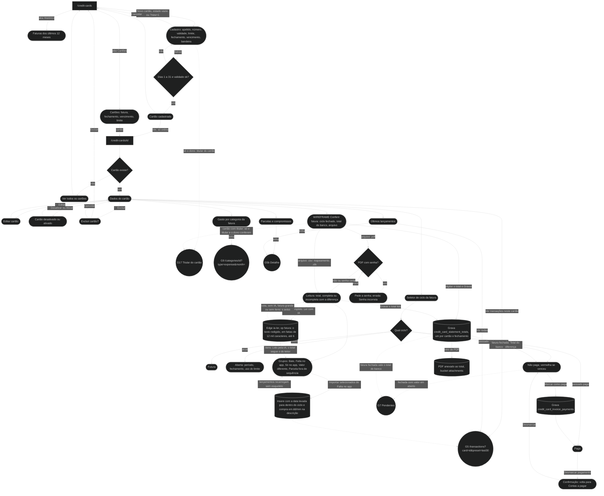

### Regras técnicas

| Ponto | Regra | Onde |
|---|---|---|
| Status no detalhe | `Futura`, `Aberta`, `Não paga`, `Paga`, pelo ciclo selecionado | `src/app/(app)/credit-cards/[cardId]/page-client.tsx` |
| Selo na tabela de transações | `Aberta`, `Fechada`, `Anterior`, `Paga`; Aberta é verde, Fechada âmbar, Anterior vermelha | `src/lib/credit-card-display.ts` |
| Pagamento de fatura | Linha em `credit_card_invoice_payments`, sem criar despesa | `src/lib/bills/pay-bill-flow.ts` |
| "Ver" do toast | Cadastrar um cartão (pela página ou pelo diálogo do "+ Adicionar") mostra "Ver", que leva a `/credit-cards/id`; na fila offline, sem "Ver" | `src/app/(app)/credit-cards/page-client.tsx`, `src/components/credit-cards/credit-card-create-dialog.tsx` |
| Conferir fatura (Bloco 2) | Wireframe na página do cartão, sobre os ciclos já fechados. O arquivo do banco é `.pdf` (lido no aparelho por `pdfjs-dist`, sem IA; com senha, pede e tenta de novo, e a errada mostra "Senha incorreta"), `.csv` (com o mapeamento de colunas) ou `.ofx`. A leitura cuja soma não fecha com o total fica incompleta e mostra a diferença, e ainda deixa importar o que achou. Os grupos são Bate, Falta no app, Só no app, Valor diferente e Parcela fora de sequência; o que já foi importado cai em Bate. "Importar selecionados" grava os itens de Falta no app como despesas do cartão (estorno como receita), com a data levada para dentro do ciclo (`ajustarAoCiclo`, que acrescenta "compra em dd/mm" à descrição), `source` `import_pdf` (PDF) ou `import_statement` (CSV, OFX), `needs_review` e o lote em `import_batch_id`, e recarrega só os lançamentos do cartão | `src/components/wireframe/conferir-fatura-wireframe.tsx`, `src/lib/fatura/ciclo.ts`, `src/lib/fatura/conferir.ts`, `src/lib/import/pdf-texto.ts`, `src/lib/import/fatura-texto.ts` |
| Ler com IA (Bloco 3B) | Quando a leitura de um PDF fica incompleta, aparece "Ler com IA": o texto do PDF já redigido no aparelho (`removerIdentificacao`), guardado da leitura, vai à `ia-ler` com o fechamento do ciclo, sem reler o arquivo nem pedir a senha. A Edge redige de novo e corta em fatias de 12.000 caracteres (até 6; acima, "Fatura grande demais para a IA. Use o CSV do banco."), cada uma gastando uma cota. Os itens da IA substituem os do leitor, com "Lido pela IA" no topo; o total continua o do leitor determinístico. Sem item válido, os itens do leitor ficam e o aviso diz "A IA não achou itens nesta fatura. Confira à mão.". Lida pela IA, o botão some | `src/components/wireframe/conferir-fatura-wireframe.tsx`, `src/lib/ia/fatura.ts`, `src/lib/ia/ler.ts` |
| Total do banco (Bloco 2) | Gravar o total (digitado ou lido) faz um `upsert` em `credit_card_statement_totals` (`workspace_id`, `credit_card_id`, `statement_close_date`), com `source` `manual`, `pdf`, `csv` ou `ofx`. Lido de PDF, o PDF vira anexo do total (o mesmo PDF não sobe duas vezes; falhar aqui não desfaz o total). Numa fatura fechada, o painel mostra "Total do banco · diferença", e o Painel, Contas a pagar e os avisos de fatura da Edge usam o total do banco no lugar do calculado | `src/components/wireframe/conferir-fatura-wireframe.tsx`, `src/lib/fatura/total-com-banco.ts`, `src/components/credit-cards/credit-card-invoice-analytics-panel.tsx` |
| Estorno (Bloco 2) | A fatura é despesas menos estornos (receita no cartão), e pode ficar negativa; os percentuais por categoria seguem sobre o gasto bruto. Os alertas de limite, fechamento e vencimento descontam o estorno | `src/lib/credit-card-billing.ts`, `src/lib/credit-card-invoice-analytics.ts`, `supabase/functions/_shared/credit-card-cycle.ts` |
| O vencimento da fatura (Bloco 9) | O vencimento é **o primeiro `min(due_day, dias do mês)` estritamente depois do fechamento**: no mês do fechamento se couber, senão no seguinte (`estimatedDueYmdForClose` no servidor, `estimatedDueDateForClose` no cliente). Um cartão que fecha no dia 5 e vence no 25 vence no 25 do mesmo mês; um que fecha no 28 e vence no 10 vence no 10 do mês seguinte. Na colisão de fevereiro (fechamento e vencimento presos ao mesmo dia), o vencimento vai para o mês seguinte. A mesma regra vale para quem assumia "o mês seguinte": a previsão (`fluxo.ts`), o Painel (`payment-events.ts` olha os fechamentos de `ym-1` e `ym`), a jornada do cartão (`datasDoCartao`, que anda para a frente), os avisos, o relatório do mês (`relatorioDoMes` filtra por `estimatedDueYmdForClose(close)` dentro do mês) e o texto de `credit-card-billing-copy.ts`. O aviso "Vencimento … incomum" saiu do formulário do cartão. Duas faturas podem vencer no mesmo dia (lacuna 94). A `credit-card-calendar-alerts` publicada só sobe de novo junto com o front 2.0 | `src/lib/credit-card-billing.ts`, `src/lib/jornada/jornada.ts`, `src/components/dashboard/payment-events.ts`, `supabase/functions/_shared/credit-card-cycle.ts`, `supabase/functions/credit-card-calendar-alerts/index.ts`, `supabase/functions/insights-daily/index.ts` |
| Titular e conferência (Bloco 7B) | O dono escolhe o titular do cartão (`holder_user_id`, nulo é o cartão da casa) no cadastro e na edição. Num cartão com titular, o total do banco, o PDF da fatura e a conferência são só do titular e do dono, e os avisos com dado do banco vão só a eles. Quem sai da carteira, ou vira convidado, deixa de ser titular (Bloco 9). Ver a jornada 17 | `src/components/wireframe/titular-do-cartao-wireframe.tsx`, `src/components/wireframe/conferir-fatura-wireframe.tsx` |
| Alertas | Limite, fechamento e vencimento geram notificações `cc_*`. A compra parcelada no cartão roda a conferência de limite, como a despesa avulsa. Numa fatura fechada (fechou, vence em breve, vence hoje e, no limite, a última fechada não paga), o valor é o total do banco quando gravado (`escolherTotal` em `_shared/credit-card-cycle.ts`, a regra de `totalComBanco`); o calendário lê `credit_card_statement_totals` numa consulta só por execução. A fatura que ainda fecha usa o calculado. Desde o Bloco 5 o `credit-card-calendar-alerts` também avisa a fatura acima do normal (ver a jornada 13, Previsão), com consulta própria | edges `evaluate-credit-card-alerts`, `credit-card-calendar-alerts`; `src/components/transactions/transaction-form-persistence.ts` |

---

## 7. Contas a pagar

`/bills`: contas recorrentes e o que está pendente, incluindo as faturas de
cartão que fecharam em aberto. A conta a pagar é paga pela pessoa, e o app
lembra e confirma; a assinatura (jornada 8) cobra sozinha, e o app lança. O
Pix Automático é assinatura.

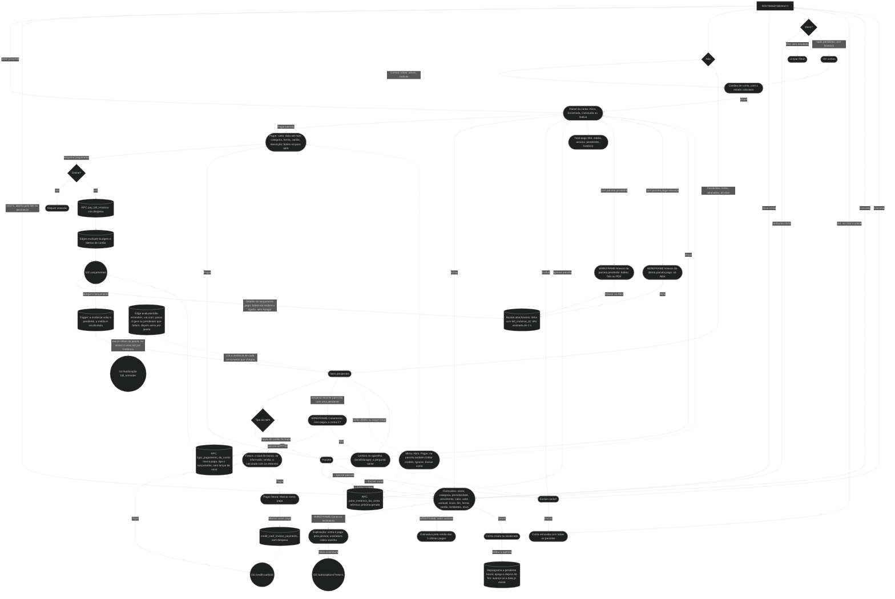

### Regras técnicas

| Ponto | Regra | Onde |
|---|---|---|
| Dados | Um RPC traz a página inteira; desde o Bloco 2 ele traz também as receitas no cartão (os estornos), e o total do banco das faturas vem à parte (`credit_card_statement_totals`) | `rpc_fetch_bills_page_bundle` em `src/lib/queries/fetch-bills-page-bundle.ts`, `supabase/migrations/20261022121000_bills_bundle_estornos.sql`, `src/lib/queries/use-statement-totals.ts` |
| Fatura como pendência | Projetada no cliente a partir dos ciclos fechados com valor em aberto. O valor é o total do banco quando a pessoa o informou na conferência da fatura; senão, o calculado (despesas menos estornos). Total zero ou negativo (saldo credor) não vira pendência | `src/lib/bills/credit-card-bill-projector.ts`, `src/lib/fatura/total-com-banco.ts` |
| Anexos (Bloco 2) | O painel da conta (`?detail=`) mostra os anexos da parcela pendente que ele exibe (`bill_instance_id`), com as mesmas regras dos anexos do lançamento, e abaixo os da última parcela paga (por vencimento), só para abrir: sem anexar nem apagar, e a seção some se ela não tem anexo | `src/components/bills/bill-detail-sheet.tsx`, `src/components/wireframe/anexos-wireframe.tsx` |
| Boleto (Bloco 6A) | O boleto é anexo da **instância** e não é copiado ao pagar. O diálogo de pagar o mostra só para abrir (a fatura virtual não tem instância); o detalhe do lançamento pago mostra os anexos da instância ligada (`bill_instances.transaction_id`), sem "Apagar" ali. `attachments` não ganhou política de `update` | `src/components/bills/pay-bill-dialog.tsx`, `src/lib/bills/anexos-da-conta.ts`, `src/components/transactions/transaction-detail-sheet.tsx` |
| Pagar conta | `pay_bill_instance` cria a despesa e avança a recorrência a partir do **vencimento pago**, e não do dia do pagamento (o ciclo é a referência); bloqueado offline. A data do pagamento não pode ser depois de hoje ("A data do pagamento não pode ser depois de hoje.") | `src/lib/bills/pay-bill-flow.ts`, `src/components/bills/pay-bill-dialog.tsx` |
| Pagar fatura | Só marca como paga: as compras já estão lançadas no cartão | `src/lib/bills/pay-bill-flow.ts` |
| Recorrência | Mensal, Bimestral, Trimestral, Anual, Única. **Uma regra só**, no `_shared`, que o cliente reexporta e a Edge usa: o dia 31 vence no último dia do mês curto (28 ou 29 em fevereiro, 30 em abril); a trimestral iniciada em 31/01 vence em 30/04; a anual de 29/02 vence em 28/02 no ano que não é bissexto | `supabase/functions/_shared/recorrencia-conta.ts`, `src/lib/bills/recurrence.ts` |
| Passo 0 (Bloco 6A) | A conta que não é paga não para: o primeiro passo do `evaluate-bills-reminders` cria, para cada conta ativa e não `one_time`, a pendência de cada vencimento que já chegou (até hoje), a partir da última instância. Respeita o `end_date`; `upsert` com `ignoreDuplicates` em `(bill_id, due_date)`, então o passo 0, o pagamento e o pular dão uma instância só por vencimento. Três meses sem pagar viram três pendências vencidas. O limite de 60 dias do lembrete vale para o aviso, não para a geração; a resposta traz `geradas` | `supabase/functions/evaluate-bills-reminders/index.ts`, `vencimentosQueFaltam` em `_shared/recorrencia-conta.ts` |
| Lembrete por janela (Bloco 6A) | A vencer: a instância avisa o **menor offset** da janela (`0 <= dias até o vencimento <= offset`), uma vez por offset, então um dia sem cron não perde o aviso. Atrasada: no 1º dia e a cada 7. Nos dois, `sent_on` fica no vencimento, e o `releaseDedupe` filtra também por `sent_on`. Depois do `end_date` não há aviso | `offsetDaJanela` em `supabase/functions/_shared/notification-schedule.ts`, `evaluate-bills-reminders/index.ts` |
| Editar a agenda | Mudar `due_day_of_month`, `frequency`, `start_date`, `end_date` ou reativar reprograma a pendente: a que ainda não venceu passa à próxima data do ciclo a partir do último vencimento pago ou pulado (nunca antes de hoje nem do início); a depois do fim é apagada; se a data já existe (23505), avança ao ciclo seguinte. A pendente vencida não muda, é dívida de um ciclo que passou. Reativar uma conta sem pendente cria a próxima. O replay offline faz o mesmo | `src/lib/bills/reprogramar.ts`, `updateBillRow` em `src/lib/bills/mutations.ts`, `src/lib/offline/handlers/bills.ts` |
| Pular | `pular_instancia_da_conta` é atômico: a instância é reivindicada com `status = 'pending'` e a próxima nasce com `on conflict do nothing`. Falha com `BILL_INSTANCE_NOT_PENDING` quando já não está pendente | `supabase/migrations/20261027120000_contas.sql`, `skipBillInstance` em `src/lib/bills/mutations.ts` |
| Encerrada e Concluída | Estados calculados, sem coluna: sem pendente, a `one_time` é **Concluída** e a recorrente com `end_date` antes de hoje é **Encerrada**; o resto é Ativa ou Inativa. Não nasce instância depois do `end_date`, nem a primeira | `statusDaConta` em `src/components/bills/bill-status.ts` |
| Valor variável (Bloco 6A) | `bills.valor_variavel` (padrão `false`). Quando a conta é variável, o gatilho `media_da_conta` grava `amount_estimated` como a média dos `paid_amount` das 3 últimas pagas (arredondada a centavo), dentro da carteira da instância, ao pagar, reabrir, editar o valor ou apagar uma instância paga. Sem nenhuma paga com valor, fica o valor digitado. Lista, lembrete e previsão já leem `amount_estimated`: a fonte é uma só | `supabase/migrations/20261027120000_contas.sql`, `src/components/wireframe/conta-valor-variavel-wireframe.tsx` |
| Lançamento apagado ou editado | Apagar o lançamento de uma conta paga reabre a instância (`pending`, com `paid_at`, `paid_amount`, `transaction_id` e `amount` nulos): ela volta às Pendentes e o lembrete volta a valer. Mudar o valor do lançamento acompanha o `paid_amount`. Os dois são gatilhos em `transactions` (`reabrir_instancia_ao_apagar`, `acompanhar_valor_pago`) | `supabase/migrations/20261027120000_contas.sql` |
| Instância da carteira da conta | O gatilho `same_ws_bill_id` impede `bill_instances.bill_id` de apontar para a conta de outra carteira | `supabase/migrations/20261027120000_contas.sql` |
| Casamento automático (Bloco 6A) | Na aba Pendentes, o cliente cruza as despesas dos últimos 40 dias com as pendentes: descrição parecida (o casador de palavras da conferência da fatura), valor dentro de ±15% e data dentro de ±5 dias do vencimento. Cada lançamento casa com uma conta só (a de maior semelhança), receita nunca casa, e um lançamento já ligado a qualquer conta não reaparece. "Sim" chama `ligar_pagamento_da_conta` (marca a instância paga com o valor e a data do lançamento e liga os dois, sem lançamento novo; `TRANSACTION_ALREADY_LINKED` e `BILL_INSTANCE_NOT_PENDING` fazem a pergunta sair). "Não" fica em `localStorage`, neste aparelho | `src/lib/bills/casamento.ts`, `src/components/wireframe/casamento-conta-wireframe.tsx`, `src/app/(app)/bills/page-client.tsx` |
| Conta ou assinatura | A explicação (wireframe) fica nos dois formulários e leva ao outro cadastro: `/subscriptions?new=1` e `/bills?new=1`. `new=1` abre o cadastro uma vez e sai da URL | `src/components/wireframe/conta-ou-assinatura-wireframe.tsx`, `src/app/(app)/bills/page-client.tsx` |
| O "hoje" da tela | Recalculado quando a janela volta ao foco e na virada do dia, e não mais congelado ao abrir a página | `src/hooks/use-hoje-ymd.ts` |
| Botão direito | No cartão de pendência, repete o "Pagar" e o menu de três pontos, que continuam à vista | `src/components/bills/bill-pending-card.tsx` |
| "Ver" do toast | Criar uma conta mostra "Ver", que leva a `/bills?detail=id` e abre o painel dela (sem levar os outros filtros da URL); na fila offline, sem "Ver" | `src/app/(app)/bills/page-client.tsx` |

---

## 8. Assinaturas

`/subscriptions`: cobranças recorrentes que viram lançamentos sozinhas.


### Regras técnicas

| Ponto | Regra | Onde |
|---|---|---|
| Dados | `rpc_fetch_subscriptions_page_bundle` | `src/lib/queries/fetch-subscriptions-page-bundle.ts` |
| Periodicidade | Semanal, Mensal, Bimestral, Anual | `src/components/subscriptions/subscription-form-dialog.tsx` |
| Cobrança | `run-recurring-billing` só aceita chamada com `CRON_SECRET`; o Painel recupera o atraso | `supabase/functions/run-recurring-billing/index.ts` |
| Receita recorrente (Bloco 5) | `workspace_subscriptions.kind` é `expense` (o padrão) ou `income`. O formulário ganha o wireframe "Receita recorrente" (Despesa ou Receita): com Receita, a categoria é de receita e a forma de pagamento perde o cartão (o check `workspace_subscriptions_income_no_card`: receita no cartão é estorno). `charge_subscription_cycle` e `seed_subscription_first_transaction` gravam `type = kind`, e o check `transactions_subscription_expense_only` saiu. A lista marca a receita com "Receita" e mantém o valor neutro. O salário cadastrado entra no extrato como `income` e soma no seguro; **não** aparece nos eventos de pagamento do calendário, nos compromissos da categoria de despesa nem na fatura de um cartão. A previsão trata as duas à parte (`fluxoDoMes`: a receita vai a "previstas" de receitas) | `src/components/wireframe/receita-recorrente-wireframe.tsx`, `src/components/subscriptions/subscription-form-fields.tsx`, `src/components/subscriptions/subscription-form-shared.ts`, `src/components/dashboard/payment-events.ts`, `supabase/migrations/20261026120000_previsao.sql` |
| Conta ou assinatura (Bloco 6A) | O formulário abre com a explicação (wireframe): a assinatura cobra sozinha e o app lança; o que a pessoa paga por boleto ou Pix é conta a pagar, e o link leva a `/bills?new=1` | `src/components/wireframe/conta-ou-assinatura-wireframe.tsx` |
| Filtro por assinatura | `/transactions?sub=id` | `src/lib/transactions-list-search-params.ts` |
| Estado na URL | `sort=<coluna>.<asc\|desc>`, `page=N` (a partir de 1), `q` (a busca) e `status=active` ou `inactive`, lidos ao abrir e gravados a cada troca; trocar de carteira zera os quatro | `urlState` do `DataTable` em `src/app/(app)/subscriptions/page-client.tsx` |
| Tabela | `DataTable` no cliente: busca sem acento, exportar CSV, colunas e densidade guardadas; Excluir da linha está no ⋯ (Editar fica à vista); cancelar a exclusão em lote mantém a seleção | `src/app/(app)/subscriptions/page-client.tsx` |

---

## 9. Categorias e orçamentos

`/categories`: as categorias da carteira e o limite mensal de cada uma. Não há
tela separada de orçamento: o limite mora na categoria. Na primeira visita de
cada carteira aparece um assistente.


### Regras técnicas

| Ponto | Regra | Onde |
|---|---|---|
| Assistente | Só em `/categories`, por carteira; nada redireciona para ele | `src/components/categories/categories-onboarding-wizard.tsx` |
| Detalhe | `rpc_fetch_category_detail_bundle` | `src/lib/queries/fetch-category-detail-bundle.ts` |
| "Ver" do toast | Criar uma categoria (pela tela ou pelo diálogo do "+ Adicionar") mostra "Categoria criada" com "Ver", que leva a `/categories/id?type=`; se o orçamento falhar, o aviso "Categoria criada, mas o orçamento não foi salvo" leva ao mesmo detalhe. Na fila offline, sem "Ver". A tela de categorias não mostrava toast nenhum ao criar | `src/components/categories/category-create-dialog.tsx`, `src/app/(app)/categories/page-client.tsx` |
| Entradas no detalhe | Lista de categorias, gasto por categoria do cartão, notificação de orçamento | `src/components/categories/detail/` |
| Orçamento | Avaliado depois de cada despesa criada ou editada e de cada conta paga; mudar o valor do orçamento rearma os avisos de 80%, 100% e estouro. Criar a categoria não notifica mais | edge `evaluate-budgets`, `src/lib/category-budget-ops.ts` |
| Orçamento que se repete (Bloco 5) | O formulário da categoria de despesa ganha o wireframe "Repetir todo mês" (ligado por padrão), que grava `budgets.repeats`. Sem novo valor, o upsert não roda e só a repetição do orçamento já salvo muda (`definirRepeticao`). O padrão do banco é `true`; só o mês corrente foi marcado na migração, e o histórico ficou `false`. `copiar_orcamentos_do_mes(p_period_start, p_workspace_id)` copia a linha do mês anterior com `repeats` para o mês dado, **uma vez por carteira e mês**: o marcador `orcamentos_copiados` entra antes e é ele que impede o orçamento apagado no mês de voltar. O mês que já tem a categoria não ganha outra (`on conflict do nothing` na chave única), a categoria apagada já levou o orçamento pela FK em cascata, e os avisos (`threshold_*`) nascem nulos. Roda pelo cron `orcamentos-do-mes` (`5 3 1 * *`, 00:05 em Brasília) e pelo RPC `garantir_orcamentos_do_mes(p_workspace_id)`, que confere o membro e a Categorias e o Painel chamam ao abrir | `src/components/wireframe/orcamento-repete-wireframe.tsx`, `src/lib/category-budget-ops.ts`, `src/hooks/use-garantir-orcamentos-do-mes.ts`, `supabase/migrations/20261026120000_previsao.sql` |
| Aviso pelo mês do fechamento (Bloco 5) | `evaluate-budgets` soma a categoria no mês pelo `gastoDaCategoriaNoMes` (`_shared/orcamento-mes.ts`): a despesa fora do cartão conta pelo dia; a do cartão, pelo mês do **fechamento** da fatura da compra. É a mesma regra do `postedTotal` de `buildCategoryCommitmentsForMonth`, travada pelos vetores dourados (`orcamento-mes-vectors.json`). A receita comum não entra. **O estorno no cartão abate a categoria de despesa dele** (Bloco 9): `type = 'income'`, `payment_method = 'credit_card'` e cartão, pelo mesmo mês do fechamento, com o sinal de `sinalNaDespesa`; os vetores de paridade ganharam um caso de estorno, e a tela de Categorias faz a mesma conta. Os chamadores (formulário, edição, conta paga, a fila offline e a `capture`) mandam `payment_method` e `payment_credit_card_id`, e a Edge avalia o orçamento do mês do fechamento. O front antigo de `main` não manda: a Edge avalia o dia e o fechamento da compra em cada cartão da carteira | `supabase/functions/evaluate-budgets/index.ts`, `supabase/functions/_shared/orcamento-mes.ts`, `src/lib/fixtures/orcamento-mes-vectors.json` |
| Botão direito | No cartão de categoria, o menu toma o lugar do menu do navegador sobre o link, por isso traz "Abrir em nova aba"; o ⋯ continua | `src/components/categories/category-card-context-menu.tsx` |
| Carteira de projeto (Bloco 7C) | Numa carteira `purpose = 'project'` o orçamento do mês não vale: `copiar_orcamentos_do_mes` (o cron do dia 1) e `garantir_orcamentos_do_mes` (a abertura do Painel e de Categorias) a pulam, e nenhuma linha vai a `orcamentos_copiados`. O planejamento dela é o orçamento total da carteira (jornada 18c) | `supabase/migrations/20261031120000_projetos.sql` |

---

## 10. Conta e segurança

O que é da pessoa, não da carteira. **A página Minha conta acabou (4/nov/2026)**: `/account` não tem conteúdo, só redireciona (`router.replace`) para `/me` no telefone e para `/dashboard` no desktop; o convidado também chega a ela (a guarda dele a deixa passar) e segue o mesmo redirecionamento. O perfil se edita pelo menu do usuário (desktop) ou pela foto da Você (telefone), o plano mora em Planos e pagamentos, a política em `/settings/privacidade` e o selo só na Você.

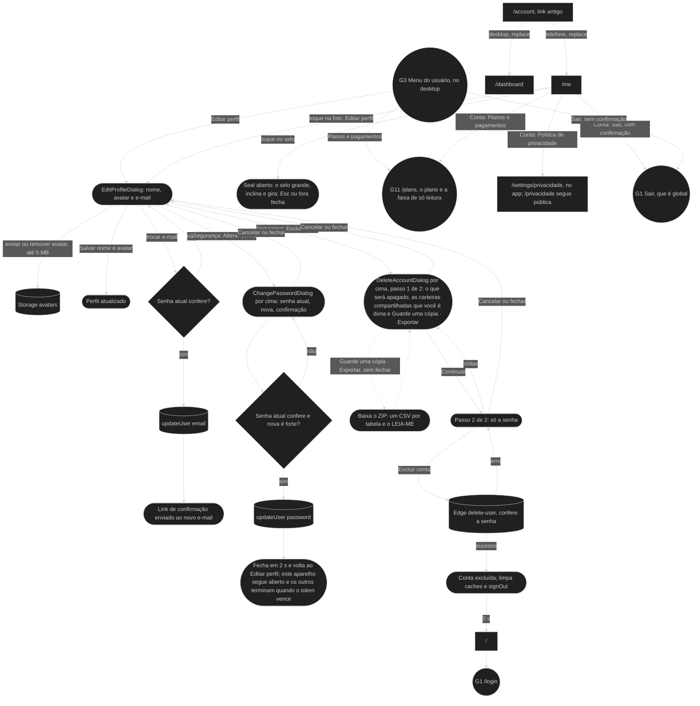

### Reativação: voltar a usar o app

O Finance é de uso diário. Dez dias sem abrir quer dizer que a pessoa não entendeu o app ou o apagou: o app registra o acesso, empurra por push no 3º e no 7º dia e, na volta, reforça o porquê.

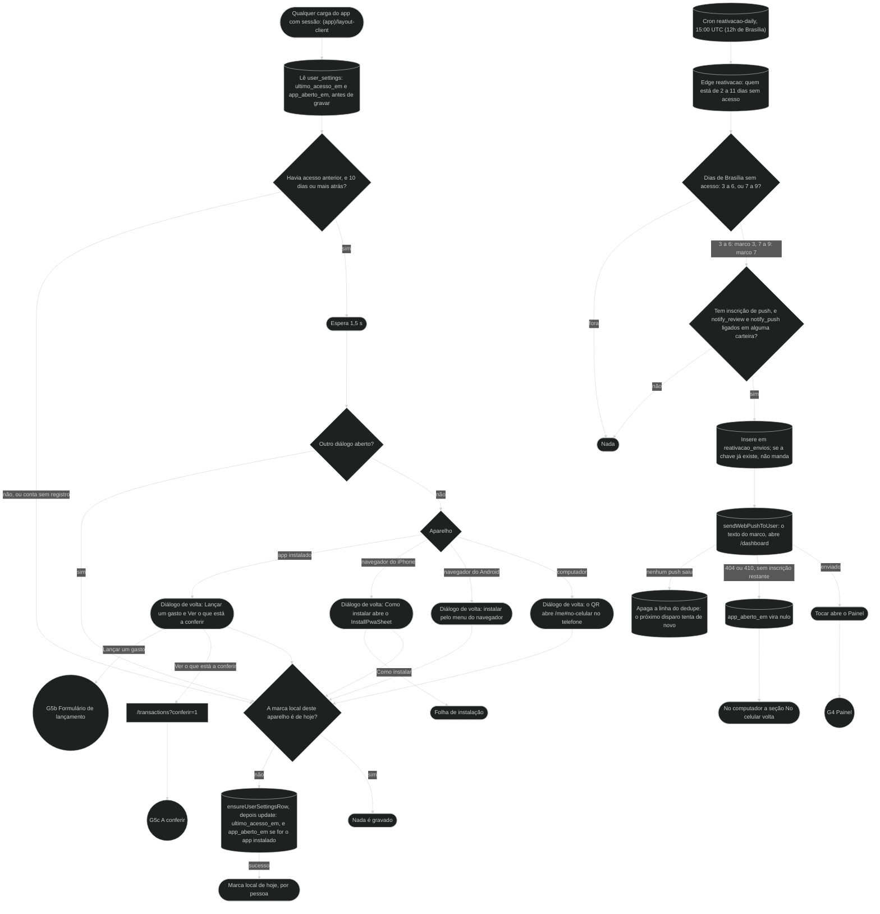

#### Regras técnicas

| Ponto | Regra | Onde |
|---|---|---|
| O sinal | `user_settings.ultimo_acesso_em` (qualquer lugar) e `app_aberto_em` (só o app instalado, `useDisplayMode().isStandalone`), nulas até o primeiro registro. O `RegistroDeAcesso` grava no máximo uma vez por dia por aparelho, com a marca `acesso:<user_id>` em `localStorage` (por pessoa; sem `localStorage` grava a cada carga), depois do `ensureUserSettingsRow`; a marca só vale depois de a gravação dar certo | `src/components/reativacao/registro-de-acesso.tsx`, `src/lib/reativacao.ts`, `src/app/(app)/layout-client.tsx` |
| Ler antes de gravar | `useAcesso` lê as duas colunas uma vez por carga, sem guardar no cache do aparelho (`staleTime: Infinity`, ninguém invalida, e `acesso` está em `NON_PERSISTED_ROOTS`) como estavam **antes** da gravação do dia: é esse valor que decide o diálogo. Quem não tem acesso anterior (conta nova, sem linha ou coluna nula) não vê o diálogo: o primeiro registro não é volta | `src/hooks/use-acesso.ts`, `voltouDeAusencia` |
| O diálogo de volta | `DialogoDeVolta`, aberto 1,5 s depois da carga, **uma vez por sessão**, em qualquer rota. Se outro diálogo (tour, assistente, guia) estiver aberto, não abre e não tenta de novo até a próxima ausência de 10 dias, porque a gravação do dia acontece igual. O título é o mesmo ("Que bom te ver de volta") e o resto muda pelo `useAparelhoDeLancar`: app instalado (iPhone e Android) "Lançar um gasto" (`useQuickCreateTransaction`, despesa) e "Ver o que está a conferir"; navegador do iPhone, "Como instalar" (`InstallPwaSheet`); navegador do Android, o caminho pelo menu do navegador; computador, o QR de "No celular". "Agora não" fecha em todos | `src/components/reativacao/dialogo-de-volta.tsx` |
| Os avisos do 3º e do 7º dia | A Edge `reativacao` (só chamada com `x-cron-secret`, `CRON_SECRET`) lê quem tem `ultimo_acesso_em` entre 2 e 11 dias atrás e conta os dias pela data de Brasília: 3 a 6 dias é o marco 3, 7 a 9 é o marco 7, e um dia de cron perdido só atrasa. Manda se a pessoa tem inscrição de push e `notify_review` e `notify_push` ligados em alguma carteira de que é membro; o `workspace_id` do aviso é o `current_workspace_id` se liberado, senão a primeira liberada. Textos: marco 3 "Seus gastos estão esperando" (com o dia da semana do último acesso); marco 7 "Uma semana sem lançar". O toque abre `/dashboard` | `supabase/functions/reativacao/index.ts`, `supabase/functions/_shared/reativacao.ts` |
| Dedupe | `reativacao_envios (user_id, marco, referente)`, chave nos três, `referente` é a data do último acesso: um novo acesso muda a referência e rearma os dois avisos. A Edge insere antes de mandar (violação `23505` é "já enviado"); se nenhum push sair, ou se algo falhar depois da reserva, apaga a linha para o próximo disparo tentar de novo. RLS ligada, sem grant: só a service role | `supabase/migrations/20261104120000_reativacao.sql` |
| O cron | `reativacao-daily`, `0 15 * * *` (15h UTC, 12h de Brasília), por `invoke_edge_function('reativacao')`, na mesma migração que cria as colunas e a tabela. A resposta conta `notified`, `candidates` e `failures` | `supabase/migrations/20261104120000_reativacao.sql` |
| O push recusado | Em `sendWebPushToUser`, quando uma inscrição volta 404 ou 410 e é apagada e a pessoa fica sem nenhuma, `app_aberto_em` vira nulo: a seção "No celular" volta no computador na hora. Com outra inscrição viva não mexe, porque pode ser o app. Vale para toda Edge que manda push | `supabase/functions/_shared/web-push-send.ts` |

### Regras técnicas

| Ponto | Regra | Onde |
|---|---|---|
| Troca de email e senha | Confere a senha atual entrando de novo antes de `updateUser`. A senha troca no `ChangePasswordDialog`, aberto por cima do Editar perfil (Segurança); ao fechar, a pessoa volta ao Editar perfil | `src/components/account/edit-profile-dialog.tsx`, `src/components/security/ChangePasswordDialog.tsx` |
| Excluir conta | Dois passos (4/nov/2026): o 1 lista o que será apagado com o total na ponta (lançamentos, carteiras e categorias de todas as carteiras que a pessoa criou, pela RPC `get_account_delete_impact`, que conta pelo criador: elas somem com a conta pela cascata de `created_by`; sem a contagem, a lista vem sem números) e oferece "Guarde uma cópia · Exportar", que baixa o ZIP (`baixarExportacao`, `src/lib/cofre/baixar.ts`) sem fechar o diálogo; **é o único lugar do app que exporta os dados** (a página Cofre aberto saiu em 4/nov/2026); o 2 pede só a senha (o e-mail saiu), com "Voltar" e o "Excluir conta" destrutivo; a senha é conferida na Edge Function. Abre do Editar perfil (Segurança), por cima dele; cancelar volta ao Editar perfil. O diálogo vale em só leitura (a Edge usa a service role) | `src/components/security/DeleteAccountDialog.tsx`, `src/lib/delete-account.ts` |
| Tela | Não há. `/account` só redireciona: `/me` no telefone, `/dashboard` no desktop (`router.replace`, depois da hidratação, sem montar nada). Desktop: o item "Editar perfil" do menu do usuário (rodapé da lateral) abre o `EditProfileDialog` (Segurança: Alterar senha, Excluir conta); Planos e pagamentos segue no menu (o Cofre aberto saiu). Telefone: Você › Conta traz Planos e pagamentos (`/plans`, voltar a Você), IAs conectadas (depois de conectar uma), Preferências de notificação e Política de privacidade (`/settings/privacidade`, título na barra, voltar a Você, a última), com o Sair abaixo do cartão, sem moldura. Sem subpáginas: as de sessões e de atividade não existem mais (404) | `src/app/(app)/account/page-client.tsx`, `src/components/layout/user-menu.tsx`, `src/config/mobile-navigation.ts` |
| Sair | É global: o `signOut()` sem `scope` encerra a conta em todos os aparelhos, e os outros só caem quando o token vence, sem aviso, indo ao login. Sem confirmação no menu do usuário do desktop (o erro vai em toast); em `/me` há confirmação. Segundo caminho para um aparelho perdido: trocar a senha encerra os outros aparelhos quando o token deles vence, e este segue aberto | `src/components/providers.tsx` |
| Sem sessões nem atividade | A tela não lista aparelhos, não encerra sessão e não grava log: `createActivity` saiu do perfil e da senha, o `x-app-session-id` saiu das chamadas e o `reason=session-expired` não existe mais; o login só mostra `reason=password-updated`. **Pendência para o 2.0 subir à `main`**: ver a lacuna 108 | `src/components/providers.tsx`, `src/lib/edge-invoke.ts` |

---

## 11. Plano e só leitura

`/precos`, `/plans` e a faixa de "só leitura": quanto custa, o que a pessoa tem
hoje, como ela assina, renova, cancela e pede o reembolso, e o que muda quando o
direito de uso acaba. **A só leitura está desligada:** com
`billing_settings.enforced_since` nulo, todo mundo é `familia` e ninguém é
barrado. A cobrança pelo Asaas (Bloco 8) funciona com o interruptor desligado,
mas antes do lançamento ninguém chega ao "Assinar": `/plans` com origem `livre`
não oferece nenhuma ação.

### 11a. Preço, plano e só leitura

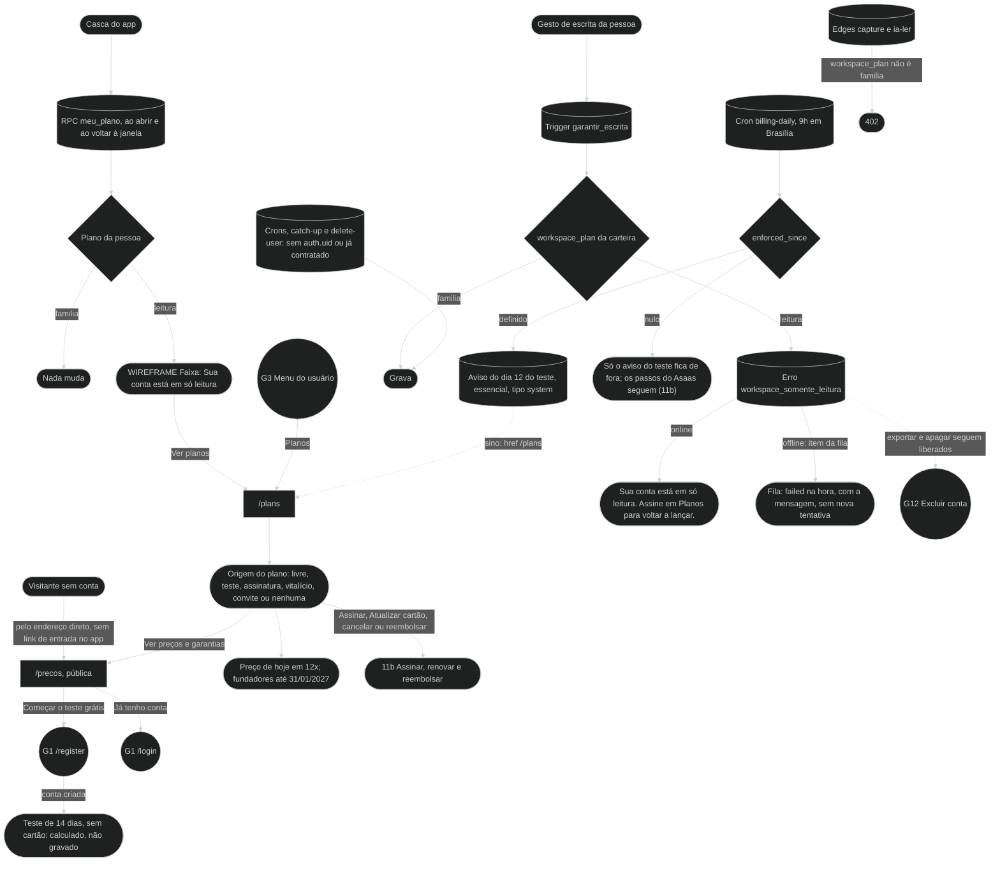

### 11b. Assinar, renovar e reembolsar

A compra é um parcelamento de 12x no cartão, criado por nós no Asaas e pago na
fatura dele: o cartão nunca passa pelo app. Quem renova é o cron, pelo token do
cartão, a partir de `fim − 2 dias`.

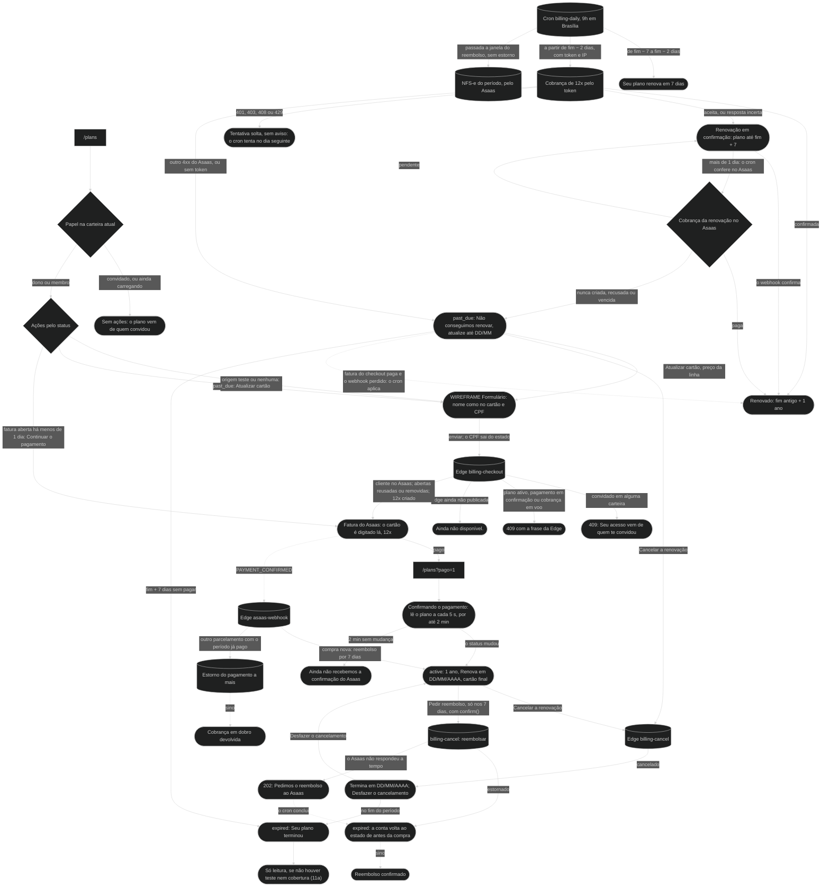

### Regras técnicas

| Ponto | Regra | Onde |
|---|---|---|
| O interruptor | `billing_settings.enforced_since` (uma linha só) nulo desliga a só leitura: `plano_do_usuario` e `workspace_plan` devolvem `familia` antes de ler qualquer outra coisa, o gatilho não lança erro e o cron não manda o aviso do teste. `billing_lancar()` o liga, só pela service role, no lançamento do 2.0 (§6 do roteiro do Bloco 8). Os passos do Asaas no `billing-daily` não leem o interruptor | `supabase/migrations/20261025120000_planos.sql`, `supabase/BLOCO_8_DEPLOYMENT.md` |
| `plano_do_usuario` | `familia` ou `leitura`. É `familia` com plano próprio, dentro do teste (`greatest(created_at, enforced_since)` mais 14 dias) ou coberta (`tem_cobertura`). Senão, `leitura`. O teste é calculado, não gravado | `supabase/migrations/20261025120000_planos.sql` |
| `tem_plano_proprio` | Assinatura `active` no período, vitalícia sem `current_period_end`, `active` com `grace_until` no futuro (a renovação cobrada que espera a confirmação, desde o Bloco 8) ou `past_due` dentro da `grace_until`. Quem paga em dia não cai em só leitura no aniversário | `supabase/migrations/20261101120000_cobranca_asaas.sql` |
| Cobertura | Ficam cobertas as até 5 pessoas distintas (fora o assinante) que entraram primeiro, por `min(joined_at)`, nas carteiras em que o assinante é `owner`. Não é transitiva, e nenhum convite é bloqueado: a 6ª pessoa só perde a cobertura da carteira pessoal dela | `supabase/migrations/20261025120000_planos.sql` |
| `workspace_plan` | Substitui o stub do Bloco 3A, com a mesma assinatura, e só a service role a executa (o stub a dava a `authenticated`, e com o uuid a pessoa descobriria o plano de outra carteira); o `garantir_escrita` a chama como dono, por ser `security definer`. A carteira segue o dono: `familia` se algum `owner` dela é `familia`. A `capture` e a `ia-ler` já devolvem 402 quando ele não é `familia` | `supabase/migrations/20261025120000_planos.sql`, `supabase/functions/capture/`, `supabase/functions/ia-ler/` |
| `garantir_escrita` | Gatilho antes de `insert`, `update` e `delete` em `transactions` e antes de `insert` em `workspace_installment_plans`, `workspace_subscriptions` e `attachments` (e, desde o 7C, `settlements`; desde o Bloco 9, também `projects` em `insert` e `update`, e `workspace_split_weights` e `workspace_member_limits` em `insert`, `update` e `delete`). Barra com `workspace_somente_leitura` o gesto da pessoa em `leitura`. Passa sem `auth.uid()` (crons, service role, `delete-user`), em cascata (`pg_trigger_depth() > 1`) e o lançamento de plano ou assinatura que já existia antes da transação. | `supabase/migrations/20261025120000_planos.sql`, `supabase/migrations/20261102120000_bloco9.sql` |
| `origem_do_cron` | Gatilho antes de `insert` em `transactions`: um lançamento `app` de um plano ou assinatura que já existia vira `recurring` (o cron e o catch-up do navegador, sem reescrever as funções deles). A captura grava a própria origem pela `criar_plano_parcelado`. É a origem que a lista A conferir mostra (`ROTULO_DA_ORIGEM`) | `supabase/migrations/20261025120000_planos.sql` |
| `meu_plano()` | A RPC da pessoa logada: `plano`, `origem` (`livre`, `vitalicio`, `assinatura`, `teste`, `convite`, `nenhuma`), `status`, `teste_ate`, `periodo_ate`, `cancelar_no_fim`, `preco_centavos`, `fundador` e, desde o Bloco 8, `cartao_final`, `reembolsavel_ate`, `carencia_ate` (a `grace_until`) e `checkout_url` (só com `pending` ou `past_due` e o link com menos de um dia). O token, o cliente do Asaas e o IP nunca saem por ela. A tela e a faixa leem por `usePlano`, ao montar, ao voltar à janela e depois de cada ação; em erro, `plano` fica nulo e nada aparece. Os campos do Bloco 8 são lidos com `?? null` (o banco sem a migração) | `supabase/migrations/20261101120000_cobranca_asaas.sql`, `src/lib/planos/plano.ts` |
| Faixa de só leitura | `SomenteLeituraWireframe`, na casca do app, acima de toda tela. Aparece só com o plano `leitura` e leva a `/plans`. Carregando ou em erro, não aparece | `src/components/wireframe/somente-leitura-wireframe.tsx`, `src/components/layout/sidebar-app-shell.tsx` |
| Mensagem e fila offline | O erro `workspace_somente_leitura` vira "Sua conta está em só leitura. Assine em Planos para voltar a lançar." (`SOMENTE_LEITURA_PT`). Na fila offline, o item rejeitado com essa mensagem fica `failed` na hora, sem as novas tentativas: nunca some calado | `src/lib/supabase-errors.ts`, `src/lib/offline/sync-engine.ts` |
| `/precos` | Rota pública fora de `(app)`, como `/privacidade`, sem mexer no `AuthGuard`. Mostra o Plano Família (12x de R$ 29,90, R$ 358,80 por ano) e, até 31/01/2027, o de fundadores (12x de R$ 19,90, congelado enquanto ativo), 14 dias grátis sem cartão e as garantias (7 dias de arrependimento, aviso 7 dias antes de renovar, cancelar em 1 toque), que o Bloco 8 cumpre. Liga a `/register` e `/login` | `src/app/precos/page.tsx`, `src/components/wireframe/precos-wireframe.tsx`, `supabase/functions/_shared/plano.ts` |
| `/plans` | A gestão do plano: o título e as linhas do `resumoDoPlano` (a origem, as datas, o cartão final, "Renovação em confirmação." ou "Atualize o cartão até DD/MM.", no horário de Brasília), o preço do dia e o link para `/precos`. **As ações seguem o `status`, não a `origem`** (Decisão 9): `past_due` oferece "Atualizar cartão" e "Cancelar a renovação" (cancelado, só "Desfazer o cancelamento"); `active` com origem `assinatura` oferece cancelar ou desfazer e, até `reembolsavel_ate`, "Pedir reembolso (7 dias)"; com `carencia_ate` não oferece cancelar (Ruling 12); origem `teste` ou `nenhuma` oferece "Assinar"; com `checkout_url`, "Continuar o pagamento" vem primeiro e tira "Assinar" e "Atualizar cartão". Com o papel `guest`, ou ainda carregando, nenhuma ação | `src/lib/planos/plano.ts` (`resumoDoPlano`), `src/components/wireframe/planos-wireframe.tsx` |
| Assinar e Atualizar cartão | Um `<form>` nativo com o nome como no cartão (3 a 100 caracteres) e o CPF, e um submit só. Chama a `billing-checkout` pelo `invokeEdgeJson` e abre a `url` devolvida (só `https:`) com `window.location.assign`. O CPF vai só no corpo e sai do estado no `finally`. No `past_due` o texto mostra o preço da linha; na compra nova, o do dia. O 404 do gateway vira "Ainda não disponível."; falha de rede, "Não foi possível falar com o servidor. Tente de novo."; o resto, a frase da Edge | `src/components/wireframe/planos-wireframe.tsx`, `src/lib/planos/plano.ts` (`assinar`) |
| `billing-checkout` | Na ordem: o JWT; 503 sem a configuração do Asaas ou sem `APP_BASE_URL`; nome e CPF (`cpfValido`), 400; o convidado (`role = 'guest'` em alguma carteira) recusado com 409 "Seu acesso vem de quem te convidou. Peça para essa pessoa cuidar do plano.", antes de qualquer chamada ao Asaas (Decisão 10); a linha decide por `planoDoCheckout`: um `active` em dia ou em confirmação é "Você já tem um plano ativo."; um link com menos de um dia é reusado; uma tentativa sem link com menos de 2 min é "Estamos tentando renovar com seu cartão…" (na 1ª compra, `pending`, "Estamos confirmando seu pagamento. Tente de novo em alguns minutos."); o `past_due` e o `active` vencido (Ruling 6) mantêm o preço e o `founder` da linha; só a compra depois de `expired`, ou sem linha, paga o preço do dia. Reivindica a linha antes de chamar o Asaas, cria o cliente só uma vez (o CPF vai só a ele, nunca a tabela ou log), confere se a fatura anterior já foi paga ("Seu pagamento está sendo confirmado."), **lista antes de criar** (Ruling 7: um parcelamento todo `PENDING` com o mesmo total é reusado, o resto é removido, e o do plano pago nunca é tocado), cria a cobrança de 12x sem dado de cartão (`externalReference` = a linha, vencimento hoje, `callback.successUrl` `/plans?pago=1`), registra o parcelamento e grava `ultimo_ip` (o 1º valor de `x-forwarded-for`). 502 quando o Asaas não responde | `supabase/functions/billing-checkout/index.ts`, `supabase/functions/_shared/billing.ts`, `supabase/functions/_shared/asaas.ts` |
| A volta do pagamento | `/plans?pago=1` (lido por `window.location.search`) lê o plano na hora e a cada 5 s, por até 2 min, enquanto `retornoConcluido` for falso: o status mudou em relação ao da chegada, ou já é `active` sem `carencia_ate`. Enquanto isso, "Confirmando o pagamento…"; aos 2 min, "Ainda não recebemos a confirmação do Asaas. Isso pode levar alguns minutos; atualize a página depois." A volta não confirma nada: quem ativa é o webhook | `src/components/wireframe/planos-wireframe.tsx`, `src/lib/planos/plano.ts` |
| `asaas-webhook` | Sem o `asaas-access-token` certo, 401 sem tocar no banco. O evento entra em `billing_events` pelo `id` com `processado_em` nulo e só é marcado depois do tratamento (Ruling 25): repetido e já tratado = 200; repetido sem a marca há menos de 5 min = 503 (outro processo o trata); há mais = retomado por uma gravação condicional e tratado de novo. Só vale para a linha do Asaas da `externalReference`, com o mesmo `customer` (`eventoDaLinha`); o resto é 200 ignorado. `PAYMENT_CONFIRMED` ou `RECEIVED` de um parcelamento novo ativa: a compra nova ganha 1 ano a partir de agora e 7 dias de reembolso; a renovação (a partir de `fim − 3 dias`, até `fim + 7`) estende o fim antigo em 1 ano. A ativação zera a carência e a tentativa (`checkout_*`, Ruling 17) e guarda o token, o final e a bandeira do cartão. As 12 parcelas do mesmo parcelamento não ativam de novo (`billing_parcelamentos.ativado_em`; o evento do parcelamento do plano cria o registro que faltou, já ativado). Um parcelamento fora do registro só entra nele quando o evento ativa a linha (Ruling 15, com o C1 da revisão final); senão, log "parcelamento desconhecido" e 200. Um parcelamento nosso, nunca ativado, com o período já pago por outro é cobrança em dobro e é estornado (Ruling 8), com o aviso "Cobrança em dobro devolvida". `PAYMENT_REFUNDED` ou `PAYMENT_CHARGEBACK_REQUESTED` do parcelamento do plano expiram a linha. Só erro de banco devolve 500 | `supabase/functions/asaas-webhook/index.ts`, `supabase/functions/_shared/billing.ts` |
| Cancelar e desfazer | `billing-cancel` com `acao`. `cancelar` liga `cancel_at_period_end` no `active` e no `past_due` (Ruling 11); recusa com 409 a renovação cobrada e em confirmação ("A renovação deste ano já foi cobrada…", Ruling 12) e a cobrança com menos de 5 min ("Estamos renovando seu plano agora…"). `desfazer` desliga enquanto o período (ou a tolerância do `past_due`) não acabou. Cancelado, o plano termina no fim do período e o preço de fundador se perde | `supabase/functions/billing-cancel/index.ts`, `supabase/functions/_shared/billing.ts` (`podeCancelar`, `podeDesfazer`) |
| Reembolso | Só na primeira compra de um período novo, até `reembolsavel_ate` (a renovação não tem janela). A tela pede `confirm()` ("O valor volta para o cartão em até 10 dias úteis e a conta volta ao estado de antes da compra."). A `billing-cancel` reivindica o estorno no registro, lê o parcelamento antes de pedir (prazos de 3 s e 6 s) e estorna o parcelamento inteiro: concluído, a linha fica `expired` na hora e chega "Reembolso confirmado"; qualquer falha depois da reivindicação fica `pendente` e devolve 202 "Pedimos o reembolso ao Asaas. Avisamos quando ele for confirmado.", que a tela mostra num `role="status"`. O cron conclui o pendente (Ruling 13) | `supabase/functions/billing-cancel/index.ts`, `supabase/functions/_shared/asaas.ts` (`estornarNoAsaas`) |
| Renovação | O `billing-daily` decide cada linha do Asaas por `acaoDoDia`. De `fim − 7` a `fim − 2 dias`: "Seu plano renova em 7 dias" (uma vez por período; sem token, pede para confirmar o cartão). A partir de `fim − 2 dias` (Ruling 20): sem token, IP ou cliente, `past_due` e o aviso do cartão, sem cobrar; com eles, tira do ar a fatura aberta do checkout, reivindica a linha e cobra 12x pelo token com o `ultimo_ip` (prazo de 60 s). Confirmada, renova; aceita ou incerta (rede, 5xx, prazo, 200 ilegível, Ruling 18), espera com `grace_until = fim + 7 dias` e "Renovação em confirmação."; 401, 403, 408 e 429 não são o cartão nem cobraram: a tentativa volta, sem aviso, e o cron tenta no dia seguinte (Ruling 26); só outro 4xx é recusa: `past_due`, `grace_until = fim + 7` e "Não conseguimos renovar seu plano. Atualize o cartão em Planos até DD/MM." A espera com mais de um dia é conferida no Asaas (Ruling 19): paga, ativa; pendente só com as parcelas vivas (`PENDING`, `AWAITING_RISK_ANALYSIS`, `AUTHORIZED`); nunca criada, recusada, vencida ou estornada, `past_due` e o aviso. A fatura do checkout paga cujo webhook se perdeu é aplicada pelo cron, como a conferida. Uma tentativa com menos de 2 dias não cobra de novo. O preço da linha (o de fundador também) se mantém | `supabase/functions/billing-daily/index.ts`, `supabase/functions/_shared/billing.ts` (`acaoDoDia`, `resultadoDaCobranca`, `vereditoDaEspera`) |
| Fim do plano | O cron expira o `past_due` na `grace_until` (antes, confere a fatura do checkout: paga e sem o webhook, aplica o pagamento em vez de expirar; o Asaas sem resposta adia o fim para o dia seguinte), a espera vencida e o `active` cancelado no fim do período, com o aviso "Seu plano terminou" ("Sua conta está em só leitura… Assine em Planos para voltar a lançar."). A pessoa só fica em só leitura se não tiver teste nem cobertura | `supabase/functions/billing-daily/index.ts` |
| NFS-e | Uma nota por período, com o parcelamento e o valor total, agendada pelo cron no Asaas depois de `reembolsavel_ate` (a renovação não tem janela) e nunca para um parcelamento com estorno (Ruling 21). `nfse_para` guarda o parcelamento já notado e é reivindicado, condicional, antes do pedido ao Asaas: nunca sai nota dupla. Sem `ASAAS_NFSE_SERVICO_CODIGO` e `_NOME`, o passo é pulado com um log; uma recusa (4xx) devolve a reivindicação e tenta no dia seguinte; rede, 5xx ou prazo deixam reivindicada, com o log "NFS-e incerta", para o suporte conferir no painel | `supabase/functions/billing-daily/index.ts`, `supabase/functions/_shared/asaas.ts` (`agendarNota`) |
| Avisos do plano | Todos pelo `deliverNotification`, tipo `system`, `essencial: true`, `metadata.href` `/plans`, na carteira pessoal da pessoa. O de renovação, o do cartão e o do fim têm dedupe por período em `billing_avisos` (o aviso de texto fixo que falha fica `pendente`, soma `tentativas` e desiste na 7ª falha, com `pendente = false` e o log `desistiu`); o do reembolso, por parcelamento | `supabase/functions/billing-daily/index.ts`, `supabase/functions/_shared/billing.ts` (`AVISOS`) |
| O convidado | Não assina: o plano dele vem de quem o convidou (`tem_cobertura`), e ele pode ser menor de idade. A tela não mostra ação ao `guest` da carteira atual, e o servidor recusa quem é `guest` em qualquer carteira (Ruling 1) | `src/lib/planos/plano.ts`, `supabase/functions/billing-checkout/index.ts` |
| Aviso do dia 12 | O cron `billing-daily` (`0 12 * * *` UTC, 9h em Brasília) chama a Edge por `invoke_edge_function`; só aceita o `x-cron-secret`. Só com `enforced_since` definido, avisa quem está entre o 12º e o 14º dia do teste, sem plano próprio nem cobertura, com o que o app fez no teste. Um aviso por pessoa (`billing_avisos`), essencial: ignora o interruptor do tipo, o `notify_in_app` e o `notify_email`, e o push segue a preferência | `supabase/functions/billing-daily/index.ts`, `supabase/functions/_shared/deliver-notification.ts`, `supabase/functions/_shared/notification-types.ts` |

---

## 12. Confiança: o começo

`/comecar`: mostrar o que o app faz sozinho. O Cofre aberto (`/cofre`) e o
Piloto Automático (`/piloto`) saíram em 4/nov/2026: exportar e apagar a conta
moram só em Excluir conta (jornada 10), e desfazer uma importação mora no fluxo
de importação e na lista A conferir. A tela é em wireframe, e a jornada de 4
passos não redireciona ninguém: a pessoa chega por um cartão do Painel.

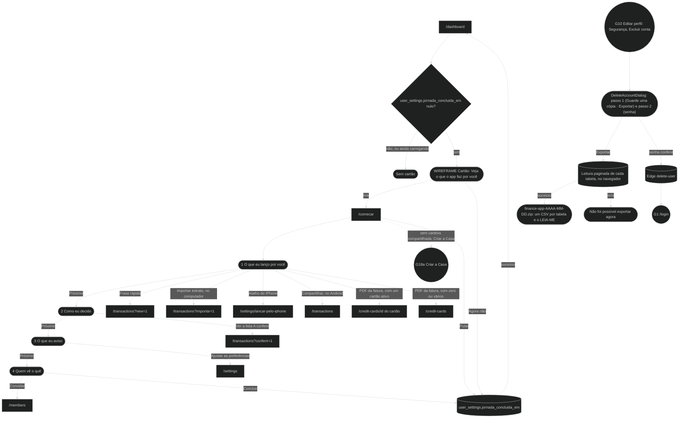

### Regras técnicas

| Ponto | Regra | Onde |
|---|---|---|
| Cartão do Painel | Aparece enquanto `user_settings.jornada_concluida_em` é nulo; sem resposta (carregando ou erro de leitura) não aparece, para não piscar. "Agora não" grava a data. Não há redirecionamento automático, então nenhuma ponte de jornada existente muda | `src/components/wireframe/jornada-cartao-wireframe.tsx`, `src/app/(app)/dashboard/page-client.tsx` |
| `/comecar` | Quatro passos. O 1º muda com a plataforma (`plataformaDe`): Frase rápida e PDF da fatura valem sempre, e o terceiro canal é o Atalho do iPhone, o compartilhar do Android (com o como: instalar pelo menu do navegador e usar Compartilhar → Finance App) ou a importação de extrato. O PDF leva ao detalhe do cartão (`creditCardDetailPath`) quando a carteira tem um cartão ativo só, e à lista de cartões com zero ou vários. O 3º lista os avisos ligados e o próximo de cada um (`proximosAvisos`), só com os cartões ativos e a conta em aberto que vence hoje ou depois; enquanto as preferências carregam, a coluna diz "carregando". "Concluir" e "Pular" gravam `jornada_concluida_em` e levam ao Painel; em erro, a tela fica e mostra o motivo | `src/components/wireframe/jornada-wireframe.tsx`, `src/lib/jornada/jornada.ts` |
| Apagar a conta | O `DeleteAccountDialog` do Editar perfil (passo 1 com "Guarde uma cópia · Exportar", que baixa o ZIP por `baixarExportacao`, sem fechar; passo 2 só com a senha), que confere a senha e chama a Edge `delete-user` (service role, sem `auth.uid()`, então livre em só leitura) | `src/components/security/DeleteAccountDialog.tsx`, `src/lib/delete-account.ts` |
| Cofre aberto removido (4/nov/2026) | A rota `/cofre`, o wireframe `cofre-aberto-wireframe.tsx`, o item "Cofre aberto" do menu do usuário (`account-menu-links.ts`), a linha de Você › Conta, o link "Abrir o Cofre aberto" da política de privacidade e `/cofre` da lista do convidado saíram. A exportação em ZIP (um CSV por tabela, com `;`, e um `LEIA-ME.txt`; anexos só como metadados; ZIP "store", sem compressão; só lê, então vale em só leitura) ficou só no passo 1 de Excluir conta, em "Guarde uma cópia · Exportar" (jornada 10). O Piloto Automático (`/piloto`) saiu no mesmo dia (rota, wireframe, `ROUTES.PILOTO` e título; de `src/lib/piloto/piloto.ts` resta só `ROTULO_DA_ORIGEM`, usado pela lista A conferir); `/comecar` segue só pelo cartão do Painel | `src/components/layout/account-menu-links.ts`, `src/config/mobile-navigation.ts`, `src/lib/cofre/exportar.ts`, `src/lib/cofre/zip.ts` |
| Título da tela | `APP_PAGE_TITLES` ganhou `/comecar` ("Começar") | `src/config/navigation.ts` |
| Privacidade | `/privacidade` diz que o teste de 14 dias não pede cartão, que o plano é guardado (tipo, situação e fim do período) e diz que o ZIP da exportação se baixa em "Excluir conta" (no Editar perfil). Desde o Bloco 8, "A cobrança do plano": o cartão é digitado no Asaas e o CPF passa pela `billing-checkout` sem ser guardado, a caminho do Asaas; guardamos só o token do cartão, os 4 últimos dígitos, a bandeira, o cadastro no Asaas e o IP da compra (para a renovação); a NFS-e é emitida pelo Asaas; e apagar a conta aqui não apaga o que o Asaas guarda por lei (as cobranças e as NFS-e), que se pede ao Asaas (lacuna 91) | `src/components/wireframe/privacidade-wireframe.tsx` |
| Criar a Casa (Bloco 7C) | No alto de `/comecar`, quem ainda não é dono de nenhuma carteira compartilhada vê o wireframe "Criar a Casa", que chama o modelo `casa` e troca para a carteira nova. Não é um dos 4 passos nem redireciona ninguém: só aparece, e some para quem já é dono. O `handle_new_user` não mudou. Ver a jornada 18 | `src/components/wireframe/modelos-de-carteira-wireframe.tsx`, `src/app/(app)/comecar/page.tsx` |

---

## 13. Previsão

`/previsao` e o cartão do Painel: quanto sobra para gastar no mês, os próximos 6
meses e o que uma compra parcelada faz a eles. É a jornada nova do Bloco 5, em
wireframe. **Os números são de caixa** (o dinheiro que sai no mês, com a fatura
contada no mês em que **vence**); o orçamento da categoria é de competência (a
compra no crédito conta no mês do **fechamento**). Cada tela diz qual regime mostra.


### Regras técnicas

| Ponto | Regra | Onde |
|---|---|---|
| Rota | `/previsao`, dentro do app, sem entrada no menu: a porta é o cartão do Painel (e o sino, quando a fatura passa do normal). `ROUTES.PREVISAO` e o título "Previsão" em `APP_PAGE_TITLES`; tem `loading.tsx` e `AdiarMontagem` | `src/app/(app)/previsao/`, `src/config/navigation.ts` |
| Regime e mês | O mês é o do calendário (sem `cycle_start_day`), e **não há saldo de partida**: cada mês começa do zero. O dia vem de `America/Sao_Paulo` (`localYmdFromDate` no cliente). O "seguro para gastar" é caixa; o orçamento é competência (ver 9) | `src/lib/previsao/fluxo.ts` |
| `fluxoDoMes` | A única fonte do seguro e da linha do tempo. **Entra:** receita fora do cartão (a que já passou e a prevista) e as cobranças de assinatura `income` ainda não lançadas. **Sai:** a despesa fora do cartão (paga e prevista), as cobranças de assinatura e de parcela fora do cartão ainda não lançadas, as contas a pagar e as faturas que **vencem** no mês. A receita no cartão é estorno: abate a fatura e não conta como receita. A conta é em centavos | `src/lib/previsao/fluxo.ts` |
| `faturaPrevista` | A fatura do snapshot (compras, estornos e parcelas projetadas) **mais** as assinaturas de despesa do cartão ainda não lançadas na janela. Fechada e com o total do banco, vale o do banco; **a aberta nunca usa o total do banco**. O rótulo é "prevista", não "em aberto" (ver Painel) | `src/lib/previsao/fatura-prevista.ts` |
| Contas a pagar | Toda instância `pending` com vencimento até o fim do mês entra pelo valor da instância ou o `amount_estimated` da conta, inclusive a vencida de mês anterior (sai no mês de hoje, porque o dinheiro ainda vai sair). As ocorrências seguintes da mesma conta são projetadas pela recorrência (`computeNextBillInstanceDueYmd`). Conta sem valor entra com 0 e é listada como "sem valor". A fatura paga continua no caixa do mês do vencimento e é marcada `paga` | `src/lib/previsao/fluxo.ts` |
| `seguroParaGastar` | `sobra do mês − reserva`. `diasRestantes` conta o dia de hoje (no último dia do mês, 1) e `porDia` é o seguro dividido por eles, 0 se o seguro não é positivo. "Já comprometido na próxima fatura" soma a fatura aberta de cada cartão que vence depois do mês. O fechamento no dia 31 vira o último dia do mês, e a fatura cujo vencimento cai no mês seguinte não entra no caixa deste | `src/lib/previsao/fluxo.ts` |
| `projecaoMensal` | Os 6 meses a partir do atual, cada um um `fluxoDoMes`, mais o "fim de parcelamentos" (o mês em que sai o dinheiro da última parcela: a data da cobrança fora do cartão, o vencimento da fatura que a contém no cartão) e o primeiro mês de sobra negativa | `src/lib/previsao/fluxo.ts` |
| Reserva | `workspaces.monthly_savings_target`, editada no campo "Reserva do mês" do detalhe. A escrita segue a política `Owners can update workspace`: o membro vê o campo desabilitado com o aviso; se o `update` não alcança linha, a tela diz que só o dono altera. Vale por carteira (o campo remonta ao trocar) | `src/components/wireframe/seguro-para-gastar-wireframe.tsx`, `supabase/migrations/20261026120000_previsao.sql` |
| Dados | `usePrevisao` usa os mesmos hooks e `queryKey` do Painel, mais as contas ativas (`previsaoContas`, só as colunas que a previsão lê) e uma janela própria de transações: do dia 1 de dois meses atrás ao fim do sexto mês à frente. Qualquer consulta pendente deixa a tela em "Carregando…"; qualquer falha mostra a mensagem | `src/lib/previsao/use-previsao.ts`, `src/lib/queries/invalidate-workspace-data.ts` |
| Impacto da parcela | Ver 5, "Impacto da parcela (Bloco 5)": o mesmo núcleo, com um plano sintético. O limite é o do banco: faturas fechadas não pagas, o lançado na aberta e todas as parcelas futuras, **sem** assinaturas | `src/lib/previsao/impacto-parcela.ts` |
| Alerta de fatura alta | No cron diário `credit-card-calendar-alerts` (12:00 UTC), para cada cartão ativo: a fatura em aberto mais as parcelas que ainda caem nela contra a média das 3 últimas fechadas (o total do banco, se gravado; a fatura sem movimento não conta). Acima de 120% (120% exatos não) e com 3 fechadas, avisa. Tipo `credit_card` e preferência `notify_credit_cards`, `metadata.href` `/previsao`, dedupe `cal:trending_high:{fechamento}:c:{cartão}` (uma vez por ciclo). O aviso de vencimento cobre as duas faturas que vencem no mesmo dia (`dueCyclesOnOrAfter`, `_shared/credit-card-cycle.ts`; Bloco 9b): a primeira mantém a chave de antes e a segunda leva `:f:<fechamento>`. A consulta é própria e paginada: falhar não derruba os outros avisos do calendário. **A mensagem diz o valor previsto e quanto ele passa da média, mas não diz quanto sobra no mês do vencimento**: isso exigiria reescrever o seguro em Deno, uma segunda conta; a pessoa vê o seguro em `/previsao` | `supabase/functions/credit-card-calendar-alerts/index.ts`, `supabase/functions/_shared/fatura-tendencia.ts`, `supabase/functions/_shared/notification-copy.ts` |
| Paridade | A projeção de parcelas do alerta espelha `sumProjectedCreditCardInstallmentsInWindow` do cliente, travada por `fatura-tendencia-vectors.json`; o gasto do orçamento, por `orcamento-mes-vectors.json` | `src/lib/fatura-tendencia-parity.test.ts`, `src/lib/orcamento-mes-parity.test.ts` |
| Carteira de projeto (Bloco 7C) | A carteira de projeto não tem previsão, mas só o link some: o Painel dela troca o "Seguro para gastar" pelo resumo, e esse cartão era a única porta. A rota `/previsao` aberta direto, o insight de seguro baixo e o quadro de impacto da parcela no formulário ainda calculam nela (lacuna 73) | `src/app/(app)/dashboard/page-client.tsx` |

---

## 14. Insights

O que o app nota sozinho nas carteiras: a fatura que fechou, o relatório do mês,
um gasto que se repete todo mês, um gasto fora do comum, uma assinatura que
mudou de preço, um lançamento repetido, parcelas que estão acabando, uma conta de
começo de ano que vem aí, itens a conferir e o seguro para gastar baixo. É a
jornada nova do Bloco 6B, em wireframe. Todo insight tem uma ação ou um
"Entendi", existe o "Não mostrar mais este tipo", e o tom é neutro.

```mermaid
%%{init: {"theme": "dark"}}%%
flowchart TD
    cron[("Cron insights-daily, 13h UTC: 10h em Brasília")] --> daily[("Edge insights-daily, por carteira com movimento")]
    daily --> achados(["Detectores: fatura que fechou, relatório do mês, recorrência, gasto atípico, preço, repetido, parcelas acabando, sazonal, a conferir"])
    achados --> corte(["No máximo 5 novos por carteira e execução, pela prioridade do tipo e, no mesmo tipo, o mais recente primeiro"])
    corte --> grava[("RPC inserir_insights: a chave de dedupe barra o repetido e o descartado")]
    grava -->|"insight novo"| quem{"Cada membro: tipo silenciado ou aviso desligado?"}
    settings["/settings"] -->|"WIREFRAME chave Insights"| prefsIns[("notify_insights")]
    prefsIns --> quem
    quem -->|"sim"| sem(["Não avisa; o insight fica na caixa"])
    quem -->|"não"| teto{"Quer push, tem aparelho e está abaixo de 3 na semana?"}
    teto -->|"sim"| claim[("RPC reivindicar_push_de_insight")] --> push(["Sino e push"])
    teto -->|"não"| inapp(["Só no sino, sem push"])
    push --> bell(("G3 Sino"))
    inapp --> bell
    bell -->|"o href da ação"| acao
    bell -->|"sem href: o Painel"| caixa

    dash(("G4 Painel")) --> caixa(["WIREFRAME Insights: a caixa da carteira"])
    dash -->|"mês corrente, seguro abaixo de 10% da renda"| reg[("RPC registrar_insight: seguro baixo")]
    reg --> caixa
    caixa -->|"o novo aparece"| visto[("RPC marcar_insight: visto")]
    caixa --> acao{"Qual ação?"}
    acao -->|"Entendi ou Dispensar este"| dispensa[("RPC marcar_insight: dispensado")]
    acao -->|"Não mostrar mais este tipo"| silencia[("insights_silenciados: por pessoa, em todas as carteiras")]
    acao -->|"recorrência: Criar"| dialogo(["Diálogo: assinatura ou conta, nome, valor ou variável, dia, categoria"])
    dialogo -->|"cartão ou débito automático"| virarAss[("RPC virar_assinatura: liga os lançamentos passados")]
    dialogo -->|"Pix, boleto ou dinheiro"| virarConta[("RPC virar_conta: uma parcela paga por lançamento e a próxima pendente")]
    virarAss --> G8(("G8 Assinaturas"))
    virarConta --> G7(("G7 Contas a pagar"))
    acao -->|"preço: Atualizar valor"| preco[("updateSubscription, depois marcar_insight")]
    preco --> G8
    acao -->|"repetido: Apagar um"| apaga(["Confirma, lê os dois e apaga o que não tem anexo, nem revisão, nem é o mais antigo"])
    apaga --> G5(("G5 Lançamentos"))
    acao -->|"Ver lançamentos ou Conferir agora"| lista["/transactions?q, cats ou conferir=1"]
    lista --> G5
    acao -->|"Ver fatura"| fatura["/credit-cards/id"]
    fatura --> G6(("G6 Cartões"))
    acao -->|"Ver mês, Ver previsão ou Ver o que pesa"| prev["/previsao"]
    prev --> G13(("G13 Previsão"))
    acao -->|"sazonal: Criar conta a pagar"| novaConta["/bills?new=1"]
    novaConta --> G7
```

### Regras técnicas

| Ponto | Regra | Onde |
|---|---|---|
| Quem produz | O cron `insights-daily` (`0 13 * * *`, 10h em Brasília) produz tudo, menos o seguro baixo: a fatura que fechou ontem ou anteontem, o relatório do mês (no dia 1, ou no 2 se o do dia 1 falhou; a chave `rel:{mes}` não repete), a recorrência, o gasto atípico, a mudança de preço, a duplicidade, as parcelas acabando, o sazonal e o "a conferir". O seguro baixo é do cliente, ao abrir o Painel (ver 4). Os insights do cron são da carteira (`user_id` nulo) | `supabase/functions/insights-daily/index.ts`, `supabase/functions/_shared/insights/detectores.ts` |
| O catálogo | Recorrência: a mesma descrição normalizada (minúsculas, sem acento, sem dígito nem pontuação) e o valor a ±10% em 3 meses seguidos, ou 2 meses no mesmo dia ±3, e sem vínculo (assinatura, conta ou parcela), nem com o nome de uma conta ou assinatura ativa (como no sazonal: o "Criar" não faz uma segunda "Aluguel" ao lado da que a família paga por Pix sem ligar). Gasto atípico: acima de 2× a média dos 3 meses anteriores. Seguro baixo: abaixo de 10% da renda do mês. A conferir: mais de 5 itens. Duplicidade: o mesmo valor e a mesma descrição no mesmo dia, fora de parcela, assinatura e estorno. Sazonal: de 1º de janeiro a 15 de fevereiro, `ipva`, `iptu`, `material escolar`, `matricula` ou `licenciamento` em janeiro a março do ano anterior, sem conta ativa parecida | `supabase/functions/_shared/insights/detectores.ts`, `src/lib/insights/insights.ts` (reexporta) |
| Quando vê o fato | O lançamento novo é visto pelo cron do dia seguinte, e não por gatilho: o caminho do lançamento não ganha mais uma chamada | `supabase/functions/insights-daily/index.ts` |
| Dedupe | Cada insight tem `dedupe_key`, e `(workspace_id, coalesce(user_id, zero-uuid), kind, dedupe_key)` é único. O cron e o de amanhã sobre o mesmo fato dão um só (o "a conferir" tem a chave da semana: um por semana); o insight descartado fica na tabela e não volta com a mesma chave. O cron grava por `inserir_insights` (o `on conflict` no índice de expressão), e só as linhas novas voltam: é a elas que manda o aviso | `supabase/migrations/20261028120000_insights.sql` |
| Limites do primeiro dia | A duplicidade só olha os últimos 30 dias e lançamentos de R$ 10 ou mais. No máximo 5 insights novos por carteira em cada execução, primeiro o que mais vale (fatura, relatório, a conferir, repetido…) e, no mesmo tipo, o mais recente (a data antes do tipo deixava a fatura que fechou ontem perder a vaga para os achados de hoje, e depois de anteontem ela não volta); o que já está gravado sai antes do corte, então o resto volta nos dias seguintes enquanto continuar verdade | `supabase/functions/insights-daily/index.ts`, `supabase/functions/_shared/insights/limitar.ts` |
| Teto de push | 3 por pessoa e semana (segunda a domingo, Brasília), somando todas as carteiras dela (`insights_push_semana`). `reivindicar_push_de_insight` soma 1 só abaixo de 3, num comando só. Quem não reivindicou, ou quem não tem aparelho inscrito, recebe o aviso só no app (`semPush` do `deliverNotification`); quem não tem aparelho não gasta o teto. E-mail não: insight não é essencial | `supabase/functions/insights-daily/index.ts`, `supabase/functions/_shared/deliver-notification.ts`, `supabase/functions/_shared/insights/semana.ts` |
| Silenciar | "Não mostrar mais este tipo" grava `insights_silenciados(user_id, kind)`: vale por pessoa, em todas as carteiras dela. O cron e `registrar_insight` não criam o insight pessoal de um tipo silenciado; o aviso também não vai. Num insight da carteira, quem silenciou não o vê (o filtro é na leitura, pela RLS), e `marcar_insight` o recusa | `src/lib/insights/use-insights.ts`, `supabase/migrations/20261028120000_insights.sql` |
| Estado compartilhado | O insight da carteira (`user_id` nulo) tem um status só: o "Entendi", a ação ou o visto de um membro vale para todos. Silenciar continua por pessoa. O `acted` não volta atrás e o `dismissed` não volta a `seen`; usar duas vezes é `INSIGHT_JA_USADO`, e dois toques ao mesmo tempo não criam a mesma assinatura duas vezes | `supabase/migrations/20261028120000_insights.sql` (`marcar_insight`) |
| Recorrência: assinatura ou conta | O destino vem sugerido pelo meio de pagamento: cartão de crédito ou débito automático (`credit_card`, `debit_card`) vira assinatura; Pix, TED, dinheiro ou outro (`pix`, `ted`, `cash`, `other`) vira conta a pagar. A pessoa pode trocar no diálogo, que também confere nome, valor, dia e categoria | `supabase/functions/_shared/insights/detectores.ts`, `src/components/wireframe/insights-wireframe.tsx` |
| `virar_assinatura` | `security invoker`: valem a RLS e o `garantir_escrita`. Marca o insight `acted` primeiro (uma falha desfaz a marca). Cria a assinatura mensal com a primeira cobrança no próximo `p_dia` depois de hoje (no dia de hoje, vai ao mês que vem, para não cobrar duas vezes) e grava `subscription_id` nos lançamentos do insight, no máximo um por dia; pela regra do Bloco 5 eles viram `recurring`. Ignora o lançamento que já tem assinatura ou conta | `supabase/migrations/20261028120000_insights.sql`, `src/lib/insights/acoes.ts` |
| `virar_conta` | Recusa o dia fora de 1–31 (`INSIGHT_DIA_INVALIDO`) e a próxima pendente antes de `app_today()` (`INSIGHT_DATA_INVALIDA`). Marca `acted`, cria a conta mensal (a estimativa é a média dos 3 últimos lançamentos), uma instância `paga` por lançamento (com `transaction_id`, `paid_amount` e `paid_at`) e a próxima `pendente` em `p_next_due_date`, que o cliente calcula pela recorrência do 6A e nunca nasce atrasada. O valor variável vem sugerido quando os valores diferem mais de 5%. Dois lançamentos no mesmo dia dão uma paga só | `supabase/migrations/20261028120000_insights.sql`, `src/lib/insights/acoes.ts` |
| Atualizar o preço e apagar um | "Atualizar valor" muda o `amount` da assinatura e só então marca `acted`; "Apagar um" pede confirmação, lê os dois lançamentos e mantém, nesta ordem, o que tem anexo, depois o já revisado (`needs_review = false`), depois o mais antigo, e apaga o outro (um erro ao ler os anexos aborta o apagar; se só um ainda existe, só marca o insight `acted`; lacuna 96, fechada no Bloco 9b: o insight é da carteira, só o adulto o lê e todo adulto vê os dois lançamentos). A mudança de preço só casa a compra com a assinatura quando a descrição normalizada é **igual** ao nome dela, ou está contida nele **e** tem o mesmo `payment_method` **e**, se a assinatura tem cartão, o mesmo cartão (Bloco 9). A mutação já vale quando o `marcar` falha: o insight volta na próxima leitura e repetir é inofensivo | `src/lib/insights/acoes.ts`, `supabase/functions/_shared/insights/detectores.ts` |
| Os links | Ver fatura (`/credit-cards/id`), Ver mês, Ver previsão e Ver o que pesa (`/previsao`), Ver lançamentos (`/transactions?q=…` ou `?cats=…`), Conferir agora (`/transactions?conferir=1`) e o sazonal (`/bills?new=1`). Tocar no link marca `acted`; o sazonal só abre o cadastro e fica `seen` | `supabase/functions/_shared/insights/textos.ts`, `src/lib/insights/acoes.ts` (`statusAoTocarOLink`) |
| O texto | Os modelos de frase moram num módulo só, sem import, que o servidor e o cliente usam (`textoDoInsight`). Tom neutro: nenhum modelo tem "culpado", "irresponsável", "deveria", "cuidado" nem "!", e a variação sai com sinal e uma casa. O "seguro cumprido" do relatório do mês é calculado na hora de mostrar, no cliente, com o `fluxoDoMes` do mês anterior; o payload do servidor não o traz | `supabase/functions/_shared/insights/textos.ts`, `src/lib/insights/acoes.ts` (`linhaDoSeguroDoMes`) |
| Aviso e preferência | O aviso é do tipo `insight`, vai pelo `deliverNotification` e respeita `notify_insights` (a chave "Insights" em Configurações), `notify_in_app` e `notify_push` da carteira. Desligar a chave não esconde a caixa do Painel | `supabase/functions/insights-daily/index.ts`, `src/components/wireframe/insights-wireframe.tsx` (`InsightsAvisoWireframe`) |
| Banco | `insights` (RLS: o adulto vê os da carteira, com `user_id` nulo, e os próprios; o convidado, só os dele; e tipo não silenciado), `insights_silenciados` (a pessoa lê, insere e apaga o seu) e `insights_push_semana` (só a service role). Ninguém escreve em `insights` direto: só as funções e a service role do cron | `supabase/migrations/20261028120000_insights.sql` |
| Limite da pessoa (Bloco 7A) | O tipo `limite_pessoa` é o único que não vem do cron: sai do `evaluate-budgets` ao salvar uma despesa, com `user_id` da pessoa e de cada dono e a chave `lim:{pessoaId}:{ym}:{nivel}` (a pessoa que gastou), sem push próprio (o aviso do sino já é o push). A ação "Ver limite" leva a `/members#limites` ou, para o convidado, a `/dashboard`. Ver 16 | `supabase/functions/evaluate-budgets/index.ts`, `supabase/functions/_shared/insights/textos.ts` |

---

## 15. Papéis: dono, membro e convidado

Quem pode o quê dentro de uma carteira compartilhada. O dono e o membro são
adultos e usam a casa inteira; o **convidado** (Bloco 7A, em wireframe) lança
despesa, vê só o que é dele e tem um app mais curto. O convidado entra pelo
convite com papel (ver 2b), e o dono pode trocar o papel de quem já está na
carteira. Numa carteira compartilhada todo adulto vê todos os gastos: não existe gasto privado (Bloco 9); o titular do cartão é a jornada 17.

| Ação | Dono | Membro | Convidado |
|---|---|---|---|
| Lançar despesa | sim | sim | sim (autor = ele) |
| Lançar receita | sim | sim | não |
| Ver transações | todas | todas | só as dele |
| Editar e excluir | tudo | tudo | só as dele |
| Categorias e cartões | gerencia | gerencia | só lê |
| Orçamento, faturas, previsão, contas, insights da casa | vê | vê | não |
| O próprio limite | vê | vê | vê |
| Convites e membros | gerencia | não | não |
| Projetos, partes, saldo e acerto (Bloco 7C) | gerencia | gerencia | não vê; só escolhe o projeto na despesa dele |
| Modo da divisão e pesos (Bloco 7C) | edita | não edita (a tela é do dono) | não |

### 15a. Trocar o papel

```mermaid
%%{init: {"theme": "dark"}}%%
flowchart TD
    members["/members"] --> isOwner{"É dona?"}
    isOwner -->|"não"| semTroca(["Sem seletor: só a dona troca o papel"])
    isOwner -->|"sim"| linha{"Linha de quem?"}
    linha -->|"a dela ou a de outra dona"| semSeletor(["Sem seletor de papel"])
    linha -->|"membro ou convidado"| seletor(["⋯ da linha: Tornar convidado ou Tornar membro"])
    seletor -->|"escolher"| troca[("RPC trocar_papel")]
    troca -->|"não é dona, papel inválido, a própria linha, a de uma dona ou membro inexistente"| erro(["Erro na frase da tela"])
    troca -->|"para Convidado"| resp(["Responsável = quem trocou, se ainda não tinha"])
    troca -->|"para Membro"| zera(["Responsável zerado"])
    resp --> log[("user_activity_logs: family_role_changed")]
    zera --> log
    log --> msg(["Mensagem: Fulano agora é convidado ou membro, e a lista recarrega"])
    msg -.->|"no próximo carregamento das carteiras da pessoa"| appConv(("G15b App do convidado"))
    direct["update direto de role no banco"] -->|"with check: dona e papel member ou guest"| nunca(["Ninguém vira dono por update"])
```

### 15b. O app do convidado

```mermaid
%%{init: {"theme": "dark"}}%%
flowchart TD
    carteiras[("fetch-workspaces-data: o papel em cada carteira")] --> papelQ{"Papel na carteira atual"}
    papelQ -->|"a caminho"| espera(["Navegação só com os itens comuns, Painel com esqueleto, guarda espera"])
    papelQ -->|"dono ou membro"| casa(("G3 e G4 como sempre"))
    papelQ -->|"convidado"| navCv(["Navegação: Painel, Transações, Categorias e Cartões"])
    navCv --> rota{"A rota está na lista dele?"}
    rota -->|"não: Orçamento, Previsão, Contas, Assinaturas, Membros, fatura e conferência"| volta(["ConvidadoRouteGuard: router.replace para /dashboard"])
    rota -->|"sim"| painelCv["/dashboard: WIREFRAME Painel do convidado"]
    volta --> painelCv
    painelCv --> limiteCv(["Seu limite em MÊS: X de Y, passou de N%, ou Sem limite definido"])
    painelCv --> totalCv(["Total do mês e as últimas 10 transações dele, mês escolhido por ele"])
    painelCv -->|"Lançar despesa"| formCv(["Gaveta de lançamento, a mesma do +, sem Receita"])
    formCv -->|"salvar: autor = ele"| insere[("transactions: RLS insert com user_id igual a auth.uid e type expense")]
    insere --> avisaCasa[("notify-transaction-created: avisa os adultos")]
    insere --> avalia[("evaluate-budgets: avalia o limite dele")]
    avalia --> G16(("G16 Limite por pessoa"))
    navCv --> transCv["/transactions: só as dele"]
    transCv --> G5(("G5 Lançamentos"))
    navCv --> catsCv["/categories: só leitura"]
    navCv --> cardsCv["/credit-cards: só leitura, o cartão não é link"]
    rota -->|"sim: Editar perfil, Configurações e Planos"| contaCv["/settings (no telefone, Você e /settings/*), /plans"]
    contaCv --> G10(("G10 Conta"))
```

### Regras técnicas

| Ponto | Regra | Onde |
|---|---|---|
| Os papéis no banco | `workspace_members.role` aceita `owner`, `member` e `guest`; `workspace_invites.role`, só `member` e `guest`. `is_workspace_adult(ws)` vale para dono e membro; `is_workspace_member` não mudou e inclui o convidado. O check do `guest` entrou com `not valid` e foi validado em seguida; `workspace_members.sponsor_user_id` é o responsável (nulo para adultos) e o 7C o usa como quem paga pelo convidado | `supabase/migrations/20261029120000_papeis.sql` |
| O que o convidado lê e escreve | **Transações:** vê, edita e exclui só as dele (`user_id = auth.uid()` e membro), e **só lança despesa**: o insert exige o autor ele e, de quem não é adulto, `type = 'expense'`; o `with check` do update exige o mesmo, então ele não vira uma despesa em receita (Ruling 11; a despesa parcelada continua dele). **Categorias e cartões:** lê; só o adulto escreve. **Orçamento, contas, parcelas das contas, assinaturas, parcelamentos, pagamentos de fatura, alertas de categoria do cartão e totais da fatura:** só o adulto, em tudo. **Anexos e o bucket:** o adulto, quem anexou ou o dono da transação ligada; o convidado só anexa à transação dele. **Insights:** os dele, nunca os da carteira. **Sair da carteira:** membro e convidado. Os splits seguem a RLS das transações | `supabase/migrations/20261029120000_papeis.sql`, `src/lib/papeis/migracao-papeis.test.ts` |
| As RPCs | Conferem adulto: `complete_workspace_categories_onboarding`, `garantir_orcamentos_do_mes` e `registrar_insight` (estas duas devolvem `0` e `null` em silêncio ao convidado, e `42501` a quem nem é membro). `pay_bill_instance`, `pular_instancia_da_conta`, `ligar_pagamento_da_conta`, `virar_assinatura`, `virar_conta` e os três `rpc_fetch_*_bundle` são `security invoker`: a RLS já barra, e o teste de fonte confere que continuam assim. Ficam abertas ao convidado porque lançar é dele: `criar_plano_parcelado`, `create_workspace_installment_plan`, `create_capture_token` e `marcar_insight` (só os insights dele). `delete_workspace_installment_plan_cascade` aceita o adulto ou o autor do plano | `supabase/migrations/20261029120000_papeis.sql` |
| Trocar o papel | `trocar_papel(p_workspace_id, p_user_id, p_role)` é `security definer` e só o dono chama. `p_role` é `member` ou `guest`; não troca a linha de um dono nem a própria. Para `guest`, `sponsor_user_id` fica o atual ou quem trocou; para `member`, zera. Grava `family_role_changed` em `user_activity_logs`. A política de `update` de `workspace_members` tem `with check` com a dona e `role in ('member','guest')`: ninguém vira dono por `update` direto | `supabase/migrations/20261029120000_papeis.sql`, `src/components/members/pessoas-secao.tsx` |
| O papel no cliente | O `WorkspaceProvider` expõe `papel` e `isAdulto` da carteira atual. A leitura das carteiras não converte mais o `guest` em `member`. Com o papel a caminho (`null`), a navegação mostra só os itens comuns aos dois papéis e o Painel espera com o esqueleto; os itens de adulto entram quando o papel chega | `src/components/workspace-provider.tsx`, `src/lib/queries/fetch-workspaces-data.ts`, `src/lib/papeis/papeis.ts` |
| As rotas dele | `/dashboard`, `/credit-cards`, `/me` e `/plans` (só a rota exata); `/transactions`, `/categories` (menos `/categories/new`), e `/settings`, com as subrotas e a query (`/account` só redireciona, e a guarda o deixa passar até ele). Ficam de fora `/bills`, `/subscriptions`, `/previsao`, `/members`, `/comecar` e `/credit-cards/[cardId]` (fatura e conferência) | `src/lib/papeis/rotas-do-convidado.ts` |
| A guarda | `ConvidadoRouteGuard` envolve as telas da casca: o convidado numa rota fora da lista não vê a tela e vai a `/dashboard` por `router.replace`. Com o papel a caminho, espera (`decidirRotaDoConvidado`); dono e membro nunca são tocados | `src/app/(app)/layout-client.tsx`, `src/components/layout/convidado-route-guard.tsx` |
| A navegação | A barra lateral, a barra de baixo, a página Você, o menu da conta e a paleta (⌘K) filtram pela lista dele: sem Membros, sem o "Assinatura" do menu de nova transação, ações só de despesa e parcelada (sem "Nova receita" na paleta e no "Nova transação"), e sem os grupos de cartões, parcelas, assinaturas, contas e membros. Planos fica (exportar e apagar, no Editar perfil, são sempre liberados). "+ Adicionar" não muda (abre em Despesa). O formulário tira a aba Receita do convidado (na edição, o trilho do tipo some), e toda porta de receita (`?new=receita`, a casca) abre o dele em despesa (`transaction-form-use.tsx`) | `src/lib/papeis/rotas-do-convidado.ts` (`itensDeNavegacaoPara`), `src/components/layout/` |
| O Painel dele | `PainelPorPapel` escolhe: convidado, o `ConvidadoPainelWireframe`; papel a caminho com a carteira carregando, o esqueleto; senão o Painel da casa. O wireframe mostra o limite, o gasto, o total do mês e as dez últimas transações dele (a RLS só devolve as dele), e recarrega a cada mutação de lançamento | `src/components/dashboard/painel-por-papel.tsx`, `src/components/wireframe/convidado-painel-wireframe.tsx` |
| O que o convidado não chama | `useGarantirOrcamentosDoMes` e `useSeguroBaixo` exigem `isAdulto`: o Painel da casa e Categorias não pedem ao banco o que a RPC devolveria vazio ou barrado | `src/hooks/use-garantir-orcamentos-do-mes.ts`, `src/lib/insights/use-insights.ts` |
| Só leitura | Categorias, o detalhe da categoria e Cartões escondem criar, editar e excluir para quem não é adulto, e o assistente de categorias não abre. O ladrilho do cartão não é link e mostra só as compras dele no ciclo ("Suas compras neste ciclo"), sem comparação nem uso do limite, que enganariam. O formulário de lançamento troca "Gerenciar categorias" por "Ver categorias" e esconde "Cadastrar cartão" | `src/app/(app)/categories/page-client.tsx`, `src/app/(app)/credit-cards/page-client.tsx` |
| Quem recebe aviso | O helper `adultosDaCarteira` (dono e membro) decide os destinatários: o lançamento de um membro **não** avisa o convidado, e a despesa do convidado avisa o dono e os membros. Orçamento, fatura, conta vencendo e insights da casa também são só dos adultos. Ao convidado, `evaluate-budgets` e `evaluate-credit-card-alerts` respondem `{ ok: true }`, sem dado da casa. O `review-reminder` fica de fora de propósito: cada pessoa é lembrada dos próprios itens a conferir | `supabase/functions/_shared/destinatarios.ts`, `src/lib/papeis/edges-papeis.test.ts` |
| A captura | O dono de um token que é convidado casa o histórico só com os lançamentos dele, e uma receita lida para uma carteira em que ele é convidado é recusada antes de gravar (`422`, "Convidado lança só despesa. Peça a um adulto da carteira para lançar a receita."); a `capture` passa o `transaction_id` ao `evaluate-budgets` para o limite do autor | `supabase/functions/capture/index.ts` |
| Assentos | O convidado ocupa um assento do Plano Família: a cobertura é dos 5 primeiros membros de quem assina, de qualquer papel (`tem_cobertura` não mudou). O filho coberto tem também o Família na própria carteira pessoal | `supabase/migrations/20261025120000_planos.sql` |
| Sem plano nada se desliga | `garantir_escrita` não mexe em RLS: sem plano, o convidado continua restrito e o limite dele continua visível | `supabase/migrations/20261029120000_papeis.sql` |
| A lista de membros | O convidado lê quem divide a casa com ele (`workspace_member_directory`: nome, foto e e-mail; a política de leitura de `workspace_members`, com os papéis e o responsável): fica de membro **de propósito**, porque ele precisa dos nomes (o autor das despesas, quem recebe aviso). A tela de Membros não existe para ele, mas a API responde (lacuna 59) | `supabase/migrations/20261029120000_papeis.sql`, `src/lib/papeis/migracao-papeis.test.ts` |
| O convidado e a divisão (Bloco 7C) | O convidado não vê `/projetos`, o resumo da carteira de projeto, as partes, o saldo nem o modo. A despesa dele tem `paid_by` igual ao responsável e nenhuma parte, e ele não entra no saldo. Pela API ele ainda lê `projects` (inclusive o `budget_total`, lacuna 74) e não lê `transaction_shares`, `settlements` nem `workspace_split_weights` | `supabase/migrations/20261031120000_projetos.sql`, `supabase/migrations/20261031130000_divisao.sql` |

---

## 16. Limite por pessoa

O dono dá a cada pessoa um limite mensal de gasto; o app avisa a pessoa e o dono
quando o gasto chega a 80% e a 100%. Bloco 7A, em wireframe. O limite é mensal e
**se repete** (não tem mês), a compra no crédito conta pelo mês do fechamento da
fatura, e quem manda é o **autor** da despesa: o limite é de quem gastou, e não de
quem pagou (o `paid_by` do 7C não muda a régua).

```mermaid
%%{init: {"theme": "dark"}}%%
flowchart TD
    members["/members, seção Limites"] --> isOwner{"É dona?"}
    isOwner -->|"não, mas é adulto"| leitura(["Vê o gasto e o limite de todos, sem editar"])
    isOwner -->|"sim"| formLim(["Toca na linha da pessoa: Dialog com o valor"])
    formLim -->|"Salvar"| grava[("workspace_member_limits: upsert, só a dona escreve")]
    formLim -->|"Remover limite"| tira[("workspace_member_limits: delete")]

    G5(("G5 Lançamentos")) -->|"despesa salva, editada, conta paga, plano parcelado ou captura"| avalia[("Edge evaluate-budgets: avaliarLimite")]
    imp(["Importação de extrato"]) -.->|"não avalia"| avalia
    avalia --> temLim{"O autor da linha tem limite?"}
    temLim -->|"não"| nada(["Nada acontece"])
    temLim -->|"sim"| gasto(["Gasto do mês: despesas dele, crédito pelo mês do fechamento"])
    gasto --> nivel{"Nível do gasto"}
    nivel -->|"abaixo de 80%"| nada
    nivel -->|"80% ou mais"| reivindica[("limites_avisados: on conflict do nothing, o 100 grava o 80 junto")]
    reivindica -->|"nível já avisado neste mês"| nada
    reivindica -->|"nível novo"| quem(["Destinatários: a pessoa e cada dona, uma vez cada"])
    quem --> insight[("RPC inserir_insights: limite_pessoa, um por destinatário")]
    quem --> notif[("deliverNotification: tipo budget, kind member_limit")]
    insight --> caixa(("G14 Caixa de insights"))
    notif --> sino(("G3 Sino"))
    sino --> destino{"Ver limite: papel de quem recebe"}
    caixa --> destino
    destino -->|"dono ou membro"| lim["/members, seção Limites"]
    destino -->|"convidado"| dash["/dashboard"]
```

### Regras técnicas

| Ponto | Regra | Onde |
|---|---|---|
| O limite | `workspace_member_limits(workspace_id, user_id, amount)`: uma linha por pessoa e carteira, `amount > 0`, chave estrangeira em `workspace_members` (não se grava limite de quem não é membro, e o limite sai junto quando a pessoa sai). RLS: o adulto lê o de todos e a pessoa lê o dela; só o dono escreve. Sem plano o limite continua visível | `supabase/migrations/20261029130000_limites.sql` |
| O gasto da pessoa | As despesas (`type = 'expense'`) com `user_id` igual à pessoa; no cartão de crédito, o mês do fechamento da fatura (`mesDaCompra`: a compra depois do dia de fechamento conta no mês seguinte; o dia de fechamento é preso ao fim do mês curto). A receita não entra. O módulo não importa nada e o cliente o reexporta; o teste confere `mesDaCompra` contra `statementCloseYmdForPurchaseYmd` em todo dia de 2026 | `supabase/functions/_shared/limite-pessoa.ts`, `src/lib/limites/limites.ts` |
| Quando avalia | Ao salvar uma despesa, no `evaluate-budgets`, junto com o orçamento: o formulário (novo e edição), o replay offline, o pagamento de uma conta, o plano parcelado e a `capture`. Roda **com ou sem categoria e com ou sem orçamento**. A **importação não avalia** (decisão do Bloco 2). O corpo antigo de `main`, sem `transaction_id` nem `workspace_id`, continua voltando `no_category` cedo | `supabase/functions/evaluate-budgets/index.ts`, `src/lib/import/importar.ts` |
| O autor é a régua | Com `transaction_id`, a Edge lê a linha pela service role: a carteira e o autor (`user_id`) saem da **linha**, nunca do corpo. Na edição, quem avalia é o limite do autor da linha, e não o de quem editou: o dono que edita a despesa do convidado confere o limite do convidado. Com só `workspace_id` (a conta paga, o plano parcelado), o autor é quem chama. Pelo JWT, quem chama precisa ser membro da carteira da linha (403); o convidado que chama sobre a linha de outra pessoa também leva 403 | `supabase/functions/evaluate-budgets/index.ts` |
| Níveis e dedupe | 80% e 100% (`nivelDoLimite`, em centavos). Um aviso por pessoa, mês e nível: a Edge reivindica em `limites_avisados(workspace_id, user_id, ym, nivel)` com `on conflict do nothing` antes de avisar, e ir de 79% a 101% grava o 80 junto com o 100 (o de 80 não sai depois). O segundo lançamento acima de 80% no mesmo mês não avisa de novo. A tabela tem RLS e nenhuma política: só a service role | `supabase/functions/_shared/limite-pessoa.ts` (`decidirAvisosDoLimite`, `nivelNovo`), `supabase/migrations/20261029130000_limites.sql` |
| Quem recebe | A pessoa e cada dono da carteira, **uma vez cada**: o dono que é a própria pessoa recebe um aviso, não dois. Quem é só membro e não é o autor não recebe. Quem não é membro da carteira não tem limite avaliado | `supabase/functions/_shared/limite-pessoa.ts`, `supabase/functions/_shared/destinatarios.ts` (`donosDaCarteira`) |
| O aviso e o insight | O aviso é `type: 'budget'` com `metadata.kind: 'member_limit'`, para não mexer no check de `notifications`, e respeita `notify_budget`. Junto entra um insight `limite_pessoa` por destinatário (`user_id` = o destinatário, `dedupe_key` `lim:{pessoaId}:{ym}:{nivel}`, com o id da pessoa que gastou), sem push próprio: o aviso já é o push. Os textos são "Limite de {nome}" (o dono) e "Seu limite do mês" (a pessoa), com a ação "Ver limite". Se o insight falha, ou se ninguém recebeu o aviso, a Edge libera os níveis que reivindicou e a próxima avaliação tenta de novo (uma falha parcial na entrega mantém a reivindicação); uma falha do limite só vai ao log e não muda a resposta do orçamento | `supabase/functions/evaluate-budgets/index.ts`, `supabase/functions/_shared/insights/textos.ts` |
| O destino de "Ver limite" | Dono e membro vão a `/members#limites`; o convidado, a `/dashboard`. Na caixa de insights o destino sai do papel de quem lê **agora** (`destinoDoInsightDeLimite`), e não de um papel guardado no payload; no aviso do sino, do papel do destinatário na hora do envio | `src/lib/papeis/papeis.ts`, `src/lib/insights/acoes.ts`, `supabase/functions/_shared/limite-pessoa.ts` |
| A tela | A seção Limites de Membros (só para o adulto) lista o gasto do mês contra o limite de cada pessoa (lido pelo cliente com `lerLancamentosDoMes`, paginado, o mês e o anterior). Cada linha mostra o gasto, "R$ x de R$ y" e um Progress com os cortes 80/100; só o dono toca na linha e edita num `Dialog surface="auto"` (valor de R$ 0,01 até R$ 9.999.999.999,99) com "Salvar" e "Remover limite"; o dono pode dar limite a si mesmo. Se a leitura falha, o estado neutro diz que os limites ainda não estão disponíveis | `src/components/members/limites-secao.tsx`, `src/lib/limites/limites.ts` |
| Insights do convidado | `limite_pessoa` entra nos checks de `insights.kind` e `insights_silenciados.kind` (o tipo pode ser silenciado). O convidado recebe o dele; o dono, um por pessoa que passou | `supabase/migrations/20261029130000_limites.sql` |
| Limite e quem pagou (Bloco 7C) | O limite segue contando as despesas que a pessoa **lançou** (`user_id`), e não as que pagou (`paid_by`): a despesa do convidado que o responsável paga continua no limite do convidado | `supabase/functions/_shared/limite-pessoa.ts` |

---

## 17. Titular do cartão

Numa carteira compartilhada, **todo adulto vê todos os gastos**: não existe gasto
privado. O recurso foi desenhado no Bloco 7B e saiu antes de ser publicado (Bloco
9): quem quer privacidade total usa outra carteira, como a pessoal. Do 7B ficou o
**titular do cartão**, em wireframe: o dono o escolhe entre os adultos da carteira,
e ele (com o dono) decide quem confere a fatura no banco e abre o PDF. Sem titular,
o cartão é "da casa" e a conferência é de todo adulto. Se o titular sai da carteira
ou deixa de ser adulto, o banco o solta sozinho (Bloco 9) e o cartão volta à casa.
Dois caminhos: escolher o titular (17a) e conferir a fatura de um cartão com
titular (17b).

### 17a. Titular do cartão

```mermaid
%%{init: {"theme": "dark"}}%%
flowchart TD
    cartao(["/credit-cards: Novo cartão ou Editar cartão"]) --> dono{"É dono da carteira?"}
    dono -->|"não"| semSeletor(["Sem o seletor de titular"])
    dono -->|"sim"| seletor(["WIREFRAME Titular do cartão: os adultos da carteira ou Cartão da casa"])
    seletor -->|"Cartão da casa"| casa(["holder_user_id nulo: a conferência é de todo adulto"])
    seletor -->|"um adulto"| titular(["holder_user_id = o adulto"])
    casa -->|"Salvar"| grava[("credit_cards: insert ou update")]
    titular -->|"Salvar"| grava
    grava --> gat[("Triggers conferir_titular e conferir_titular_troca")]
    gat -->|"quem grava não é dono, salvo o titular tirando a si mesmo"| erroDono(["TITULAR_SO_DONO: Só quem é dono da carteira escolhe o titular do cartão"])
    gat -->|"o titular não é dono nem membro da carteira"| erroAdulto(["TITULAR_NAO_ADULTO: O titular do cartão precisa ser adulto da carteira"])
    gat -->|"vale"| salvo(["Cartão salvo"])
    erroDono --> cartao
    erroAdulto --> cartao
    salvo -->|"com titular"| efeitos(["A fatura no banco passa a ser do titular e do dono"])
    efeitos --> G17b(("G17b Conferir a fatura"))
    efeitos -.->|"avisos com total do banco e o resumo da fatura"| avisos[("Edges: só o titular e os donos")]
    avisos --> G3(("G3 Sino"))
    salvo -->|"Ver cartões"| G6(("G6 Cartões"))
    saida(["O titular sai da carteira ou vira convidado (G2, G15a)"]) --> solta[("Trigger soltar_titular_que_sai: holder_user_id volta a nulo, o cartão é da casa")]
    solta -.-> casa
```

### 17b. Conferir a fatura de um cartão com titular

```mermaid
%%{init: {"theme": "dark"}}%%
flowchart TD
    detalhe["/credit-cards/id: Conferir fatura"] --> comTitular{"O cartão tem titular?"}
    comTitular -->|"não: cartão da casa"| aberta(["Como antes: todo adulto confere"])
    comTitular -->|"sim"| quem{"Quem abre?"}
    quem -->|"adulto que não é o titular nem o dono"| fechada(["Só o titular do cartão e o dono da carteira conferem esta fatura"])
    quem -->|"o titular ou o dono"| confere(["WIREFRAME Conferir fatura: total do banco e arquivo"])
    aberta --> confere
    confere -->|"gravar o total, anexar o PDF"| totais[("credit_card_statement_totals e attachments da fatura: só com conferencia_liberada")]
    confere --> grupos(["Bate, Falta no app, Só no app, Valor diferente, Parcela fora de sequência"])
    fechada -.->|"a RLS diz o mesmo: o total e o PDF não vêm"| totais
    totais -.->|"fatura fechada vale o total do banco"| G7(("G7 Contas a pagar"))
    totais -.->|"aviso de fatura e limite com o total do banco"| avisos[("credit-card-calendar-alerts e evaluate-credit-card-alerts: só o titular e os donos")]
    avisos --> G3(("G3 Sino"))
    totais -.->|"insight Fatura fechou"| fechou[("insights-daily: do titular e de cada dono, e não da carteira")]
    fechou --> G14(("G14 Insights"))
    grupos -->|"Importar selecionados"| G5(("G5 Lançamentos"))
```

### Regras técnicas

| Ponto | Regra | Onde |
|---|---|---|
| O titular | `credit_cards.holder_user_id` (nulo é "cartão da casa"). `conferir_titular` e `conferir_titular_troca` recusam: sem ser dono da carteira, `TITULAR_SO_DONO` (o titular atual só pode limpar a si mesmo; mudar qualquer cartão de carteira também pede o dono); o novo titular que não é dono nem membro da carteira, `TITULAR_NAO_ADULTO`. A service role passa. Só o dono vê o seletor, com os adultos da carteira e o "Cartão da casa"; um titular que saiu aparece como "(fora da carteira)" | `supabase/migrations/20261030120000_privado.sql`, `src/components/wireframe/titular-do-cartao-wireframe.tsx`, `src/lib/credit-cards/mutations.ts` |
| O titular que sai (Bloco 9) | O gatilho `soltar_titular_que_sai`, depois de apagar o membro ou de mudar o papel dele para fora de dono e membro, zera `credit_cards.holder_user_id` daquela pessoa naquela carteira (fecha a lacuna 66). Pula a carteira sendo apagada e a cascata (`pg_trigger_depth() > 1`). O `conferir_titular` deixa passar: quem tira ou rebaixa é o dono, e a service role não tem sessão. O titular que já tinha saído antes da migração não é limpo: o dono o troca pela tela | `supabase/migrations/20261102120000_bloco9.sql`, `supabase/tests/database/bloco9.test.sql` |
| A conferência | Num cartão com titular, `credit_card_statement_totals` (as quatro políticas) e os anexos de fatura só valem para o titular e o dono (`conferencia_liberada`). No cartão da casa, de todo adulto, como hoje. A tela mostra "Só o titular do cartão e o dono da carteira conferem esta fatura." a quem não é nenhum dos dois | `supabase/migrations/20261030120000_privado.sql`, `src/components/wireframe/conferir-fatura-wireframe.tsx` |
| Anexos da fatura | A política de `attachments` (ver, inserir e apagar) e a do storage escondem o anexo de uma fatura cuja conferência não está liberada (`anexo_oculto(uuid)`, `objeto_de_anexo_oculto`: as duas `security definer`, para o convidado e a RLS não lerem "não oculto"). O objeto órfão (sem linha de `attachments`) fica fechado, menos para quem o subiu e para o dono. O adulto que apaga o anexo de outro deixa o objeto até a limpeza semanal (lacuna 64) | `supabase/migrations/20261030120000_privado.sql` |
| Avisos e insights | `leitoresDoCartao(membros, titular, usaBanco)`: os adultos, e, com titular e dado do banco, só o titular e os donos (o titular que saiu some). O aviso de fatura com total do banco, o de limite com o total do banco e o resumo da conferência seguem a regra; o "fecha em breve" e a fatura sem total gravado vão a todo adulto (Ruling 6). O insight `fatura_fechou` de um cartão com titular é sempre do titular e dos donos, com `user_id` (Ruling 7), e o relatório do mês não conta a diferença para o banco de um cartão com titular | `supabase/functions/_shared/destinatarios.ts`, `supabase/functions/insights-daily/index.ts`, `supabase/functions/credit-card-calendar-alerts/index.ts`, `supabase/functions/evaluate-credit-card-alerts/index.ts` |
| O 2.0 sem a migração | O front do 2.0 roda contra um banco sem a migração do 7B (Ruling 8): a coluna nova só entra em consulta `*` ou tolerante, e o corpo de escrita só cita `holder_user_id` quando a pessoa muda o titular. Um teste de fonte tranca. Escolher um titular sem a migração falha: aplique-a antes de o dono testar. O `main` não manda a coluna | `src/lib/titular/colunas-tolerantes.test.ts`, `supabase/BLOCO_7B_DEPLOYMENT.md` |

---

## 18. Projetos, modelos de carteira e divisão

Duas ideias do Bloco 7C, em wireframe. A primeira é o **propósito** da carteira. A
regra mostrada ao escolher é esta: "Vai usar o cartão da casa e são as mesmas
pessoas? É um projeto. Gente de fora ou dinheiro separado? É uma carteira." Um
**projeto** é um rótulo dentro da carteira (as mesmas pessoas e o mesmo cartão,
com período e orçamento próprios); uma **carteira de projeto** é o espaço
separado, sem Previsão nem orçamento do mês. Os **modelos** (Casa, Casal,
Pessoal, Viagem, Reforma e Evento) criam a carteira já com as categorias. A
segunda ideia é a **divisão**: numa carteira dividida, cada despesa tem quem
pagou (`paid_by`) e partes entre os adultos, e o saldo de cada pessoa é o que
pagou menos o que lhe cabe, mais os acertos. O convidado não entra no saldo: o
responsável paga por ele. Quatro caminhos: criar a carteira com um modelo e a
Casa do primeiro uso (18a), o projeto (18b), a carteira de projeto (18c) e
dividir e acertar (18d).

### 18a. Criar uma carteira: os modelos e a Casa

```mermaid
%%{init: {"theme": "dark"}}%%
flowchart TD
    switcher(["Seletor de carteira: Criar carteira"]) --> dlg(["Nova carteira"])
    dlg --> regra(["WIREFRAME Modelos de carteira: a regra, Vai usar o cartão da casa e são as mesmas pessoas? É um projeto. Gente de fora ou dinheiro separado? É uma carteira."])
    regra --> escolha{"Qual modelo?"}
    escolha -->|"Sem modelo"| semModelo[("RPC create_shared_workspace: nome, ícone e cor, como sempre")]
    escolha -->|"Pessoal"| pessoal(["Abrir a Pessoal: sem nome e sem aparência"])
    pessoal --> pessoalRpc[("RPC criar_carteira_de_modelo pessoal: devolve a carteira pessoal que já existe, não cria nada")]
    escolha -->|"Casa, Casal, Viagem, Reforma ou Evento"| modeloRpc[("RPC criar_carteira_de_modelo, security invoker: grava purpose e split_mode, semeia as categorias do modelo e marca o assistente de categorias como concluído")]
    modeloRpc -->|"MODELO_DESCONHECIDO, WORKSPACE_NAME_REQUIRED ou NOT_AUTHENTICATED"| erro(["A frase em português, e o diálogo continua aberto"])
    modeloRpc -.->|"banco sem a migração: PGRST202"| indisp(["Ainda não disponível, e nada é criado"])
    modeloRpc -->|"sucesso"| aparencia[("updateWorkspace: o ícone e a cor que a pessoa escolheu valem sobre os do modelo")]
    aparencia --> tipo{"É modelo de projeto: Viagem, Reforma ou Evento?"}
    tipo -->|"não: Casa ou Casal"| nova(["A carteira nova vira a atual"])
    tipo -->|"sim"| datas(["Datas e orçamento total da carteira de projeto"])
    datas -->|"Salvar ou Agora não"| nova
    semModelo -->|"sucesso"| nova
    pessoalRpc --> nova
    nova --> G4(("G4 Painel"))
    nova -.-> G2(("G2 Carteiras"))

    comecar["/comecar"] --> dona{"É dona de alguma carteira compartilhada?"}
    dona -->|"sim"| semPasso(["Sem o passo"])
    dona -->|"não"| casa(["WIREFRAME Criar a Casa: a carteira do dia a dia, para dividir com quem mora com você"])
    casa -->|"Criar a Casa"| casaRpc[("RPC criar_carteira_de_modelo casa, com o nome Casa")]
    casaRpc -->|"sucesso"| troca(["A Casa vira a atual"])
    casaRpc -.->|"banco sem a migração"| indisp
    troca --> G4
    comecar -.-> G12(("G12 Confiança e o começo"))
```

### 18b. Projeto: criar, lançar, o resumo e arquivar

```mermaid
%%{init: {"theme": "dark"}}%%
flowchart TD
    menu(["Lateral: Projetos. No telefone, a página Você, grupo Carteira"]) --> lista["/projetos"]
    lista --> papel{"Dono ou membro?"}
    papel -->|"convidado: a rota não está na lista dele"| guestDash(("G15b Painel do convidado"))
    papel -->|"sim"| ler[("select em projects da carteira atual, tolerante à tabela ausente")]
    ler -.->|"banco sem a tabela: PGRST205"| indisp(["Ainda não disponível"])
    ler --> ativos(["Ativos e Arquivados: nome, período e orçamento"])
    ativos -->|"Criar projeto: nome, começa em, termina em, orçamento total"| criar[("insert em projects, created_by = auth.uid()")]
    criar --> lista
    ativos -->|"o nome do projeto"| det["/projetos/id"]
    det --> resumo(["WIREFRAME Projeto: gasto, falta do orçamento, por categoria e por pessoa"])
    det -->|"Salvar a edição"| edit[("update de name, starts_on, ends_on e budget_total")]
    edit --> det
    det -->|"Arquivar, confirmado"| arq[("update de archived_at")]
    arq --> arquivado(["Arquivado: sai dos Ativos e do seletor das despesas novas"])
    arquivado -->|"Desarquivar"| desarq[("archived_at nulo")]
    desarq --> det

    form(("G5b Formulário de despesa")) --> quando{"Despesa, fora da parcelada e do plano?"}
    quando -->|"não"| semSeletor(["Sem o seletor, e o projeto escolhido antes é descartado"])
    quando -->|"sim, e há projeto ativo"| seletor(["WIREFRAME Projeto opcional: os ativos, mais o atual se foi arquivado depois"])
    seletor -->|"Salvar com projeto"| tx[("transactions.project_id: só vai no corpo quando muda algo")]
    tx --> gat[("Triggers same_ws_project_id e recusar_projeto_arquivado")]
    gat -->|"projeto de outra carteira"| erroWs(["A escrita é recusada"])
    gat -->|"vínculo novo com projeto arquivado"| erroArq(["PROJETO_ARQUIVADO: Este projeto está arquivado e não aceita lançamento novo."])
    gat -->|"vale"| entra(["O lançamento entra no resumo do projeto"])
    entra -.-> resumo
```

### 18c. Carteira de projeto

```mermaid
%%{init: {"theme": "dark"}}%%
flowchart TD
    modelo(("G18a Viagem, Reforma ou Evento")) --> ws[("workspaces: purpose project, split_mode split, starts_on, ends_on e budget_total só aqui")]
    ws --> config["/settings"]
    config --> dono{"É dona da carteira?"}
    dono -->|"sim"| datas(["Diálogo Datas e orçamento: o fim não vem antes do começo, orçamento maior que zero, vazio grava nulo"])
    dono -->|"não"| semEditor(["Sem o editor"])
    datas -->|"Salvar"| upd[("update em workspaces, e zero linhas diz Nada mudou")]

    ws --> painel["/dashboard"]
    painel --> adulto{"A pessoa é adulta?"}
    adulto -->|"sim"| resumo(["WIREFRAME Carteira de projeto, no lugar do seguro para gastar: gasto, falta, por categoria e por pessoa"])
    adulto -->|"convidado"| nada(["Nada monta, e o Painel dele é o do 7A"])
    resumo --> lanc[("Despesas da carteira inteira, lidas por páginas")]

    ws --> orc[("copiar_orcamentos_do_mes e garantir_orcamentos_do_mes pulam a carteira de projeto")]
    orc --> semOrc(["Nenhum orçamento é copiado para ela, no dia 1 nem ao abrir o Painel"])
    semOrc -.-> G9(("G9 Categorias e orçamentos"))
    resumo -.->|"o link do seguro some do Painel"| G13(("G13 Previsão"))
    G13 -.->|"a rota /previsao aberta direto ainda abre numa carteira de projeto"| prev["/previsao"]
```

### 18d. Dividir e acertar

```mermaid
%%{init: {"theme": "dark"}}%%
flowchart TD
    config["/settings: Modo e pesos da carteira"] --> dono{"É dona, e a carteira não é a pessoal?"}
    dono -->|"não"| semModo(["Sem o editor"])
    dono -->|"sim"| modo(["Diálogo Divisão: pote único ou dividida, e um peso por adulto"])
    modo -->|"Salvar o modo"| modoDb[("workspaces.split_mode")]
    modoDb --> since[("Trigger carimbar_split_since: o dia em que virou split na primeira vez, nunca se perde")]
    dono -.->|"banco sem a migração"| semMig(["Ainda não disponível"])
    modo -->|"Salvar os pesos"| pesosDb[("workspace_split_weights, só os que mudaram, só o dono escreve e só peso de adulto: sem linha, o peso vale 1")]
    modoDb -.->|"trocar o modo não apaga nada"| partesDb

    form(("G5b Formulário de despesa")) --> divide{"Carteira dividida e a pessoa é adulta?"}
    divide -->|"não"| semQuem(["Sem Quem pagou"])
    divide -->|"sim, despesa que não é parcelada"| quem(["WIREFRAME Quem pagou: só os adultos, e o padrão é quem lança"])
    quem --> salvar[("insert ou update em transactions, com paid_by só se mudou")]
    divide -->|"parcelada nova"| pesosPlano(["WIREFRAME Pesos desta parcelada, ou os da carteira"])
    pesosPlano --> plano[("RPC create_workspace_installment_plan e, logo depois, update de split_weights do plano")]
    plano --> planoTrg[("Trigger refazer_partes_do_plano: refaz as parcelas automáticas")]
    salvar --> pagoTrg[("Trigger definir_quem_pagou: o autor, ou o responsável se o autor é convidado. Fora dos adultos, PAGADOR_INVALIDO. Valor, tipo ou carteira mudando zeram shares_manual")]
    pagoTrg --> partesTrg[("Trigger gerar_partes, depois de gravar: despesa, carteira split, data desde split_since, partes não escritas à mão")]
    partesTrg --> partesDb[("transaction_shares: floor de valor vezes peso sobre a soma dos pesos, e o resto de centavos para quem pagou, o autor se paid_by é nulo")]
    planoTrg --> partesDb

    partesDb --> detalhe(["WIREFRAME Partes desta despesa, no detalhe: quem pagou, a parte de cada um, automática ou à mão"])
    detalhe -->|"Editar à mão"| soma{"A soma fecha o valor?"}
    soma -->|"não"| naoFecha(["Salvar desabilitado, e o banco diria PARTES_NAO_FECHAM"])
    soma -->|"sim"| definir[("RPC definir_partes: shares_manual true")]
    detalhe -->|"Voltar ao automático"| auto[("RPC definir_partes com nulo: shares_manual false, e as partes são refeitas")]
    definir --> partesDb
    auto --> partesDb

    painel["/dashboard"] --> saldo(["WIREFRAME Saldo e acerto, só para adultos: tem a receber, deve ou está em dia"])
    partesDb --> saldoRpc[("RPC saldos_da_carteira: pago menos partes mais acertos, os adultos e quem saiu, marcado. Sem paid_by, pagou o autor. O convidado que nunca foi adulto, não")]
    saldoRpc --> saldo
    saldo --> sugestao(["Sugestão: o maior devedor paga ao maior credor, até zerar"])
    sugestao -->|"Usar esta sugestão"| acertar
    saldo -->|"Acertar: de, para, valor, data e nota, quem saiu também"| acertar[("insert em settlements: quem grava é adulto e uma das partes, a outra é alguém do saldo, created_by da pessoa, e o garantir_escrita")]
    acertar --> saldo
    saldo -->|"Apagar o próprio acerto, confirmado"| apagar[("delete em settlements, só de quem criou")]
    apagar --> saldo
    acertar -.->|"o Pix acontece fora do app, de propósito"| fora(["Fora do app"])
    saldo -.->|"quem saiu da carteira aparece como Ex-membro"| exm(["Sem nome na tela, com um sufixo do id no acerto"])
```

### Os modelos de carteira

| Modelo | Propósito e modo | Categorias |
|---|---|---|
| Casa | Dia a dia (`everyday`), pote único (`pooled`) | Despesa: Mercado, Contas da casa, Transporte, Saúde, Lazer, Educação e Outros. Receita: Salário e Outros |
| Casal | Dia a dia (`everyday`), dividida (`split`) | As mesmas da Casa |
| Pessoal | Não cria nada | Nenhuma: aponta para a carteira pessoal que o cadastro já criou |
| Viagem | Projeto (`project`), dividida (`split`) | Despesa: Passagens, Hospedagem, Alimentação, Passeios, Transporte e Outros |
| Reforma | Projeto (`project`), dividida (`split`) | Despesa: Material, Mão de obra, Projeto, Móveis e Outros |
| Evento | Projeto (`project`), dividida (`split`) | Despesa: Local, Comida e bebida, Decoração, Convites, Fornecedores e Outros |

### Regras técnicas

| Ponto | Regra | Onde |
|---|---|---|
| A regra e os modelos (Bloco 7C) | A frase mostrada ao escolher é a da spec, literal: "Vai usar o cartão da casa e são as mesmas pessoas? É um projeto. Gente de fora ou dinheiro separado? É uma carteira." Os seis modelos são Casa (dia a dia, pote único), Casal (dia a dia, dividida), Pessoal, e Viagem, Reforma e Evento (projeto, dividida). "Sem modelo" segue o `create_shared_workspace` de antes | `src/lib/projetos/modelos.ts`, `src/components/wireframe/modelos-de-carteira-wireframe.tsx`, `src/components/workspace/project-form-dialog.tsx` |
| O modelo no banco (Bloco 7C) | `criar_carteira_de_modelo(p_modelo, p_nome)` é `security invoker`, para a RLS e o `created_by = auth.uid()` valerem, e cria pelo mesmo caminho do `create_shared_workspace`: a carteira com `purpose`, `split_mode` e `categories_onboarding_completed_at = now()` (o assistente de categorias não abre), o vínculo de dono e as categorias na forma do `handle_new_user`. Erros: `NOT_AUTHENTICATED`, `MODELO_DESCONHECIDO`, `WORKSPACE_NAME_REQUIRED` e `CARTEIRA_PESSOAL_AUSENTE`. A Pessoal devolve a carteira pessoal mais antiga e não cria nada. O ícone e a cor que a pessoa escolheu valem sobre os do modelo (`updateWorkspace` depois da RPC) | `supabase/migrations/20261031120000_projetos.sql` |
| O primeiro uso cria a Casa (Bloco 7C) | Em `/comecar`, quem ainda não é dono de nenhuma carteira compartilhada vê "Criar a Casa" (`CriarACasaWireframe`), que chama o modelo `casa` com o nome "Casa" e troca para ela. O `handle_new_user` não mudou, porque o `main` depende dele | `src/components/wireframe/modelos-de-carteira-wireframe.tsx`, `src/app/(app)/comecar/page.tsx` |
| O projeto (Bloco 7C) | `projects(workspace_id, name, starts_on, ends_on, budget_total, archived_at, created_by)`. O nome não é vazio, o fim não vem antes do começo e o orçamento é maior que zero ou nulo. RLS: **select de qualquer membro, o convidado incluído** (ele marca a despesa dele); insert, update e delete só do adulto, e o insert exige `created_by = auth.uid()`. O update é por coluna (`name`, `starts_on`, `ends_on`, `budget_total`, `archived_at`): a carteira e o autor não se trocam. A tela de projetos é só do adulto (Ruling 3 do bloco) | `supabase/migrations/20261031120000_projetos.sql`, `src/components/wireframe/projetos-wireframe.tsx` |
| O lançamento no projeto (Bloco 7C) | `transactions.project_id` (`on delete set null`: apagar o projeto solta os lançamentos). `same_ws_project_id` exige o projeto da mesma carteira. `recusar_projeto_arquivado` recusa só o **vínculo novo** (insert, ou update que muda o `project_id`) com `PROJETO_ARQUIVADO`: editar um lançamento que já era do projeto passa. O seletor também não aparece na receita, na parcelada nem no escopo "plano" | `supabase/migrations/20261031120000_projetos.sql`, `src/components/transactions/transaction-form-fields.tsx` |
| O resumo (Bloco 7C) | `resumoDoProjeto` soma só as despesas, em centavos: o gasto, o que falta do orçamento (nulo sem orçamento, **negativo** quando o gasto passa dele: "Passou do orçamento em…"), a quebra por categoria e a por pessoa. O detalhe lê o projeto com as transações embutidas; o resumo da carteira de projeto lê as despesas da carteira por páginas (`fetchAllRows`), sem o teto de 1.000 linhas. A pessoa é o autor (`user_id`), e não quem pagou (lacuna 77) | `src/lib/projetos/resumo.ts`, `src/lib/projetos/dados.ts` |
| A carteira de projeto (Bloco 7C) | `workspaces.purpose` (`everyday`, o padrão, ou `project`), mais `starts_on`, `ends_on` e `budget_total`, que o check `workspaces_project_fields` deixa nulos fora do `project`. Com `project`: `copiar_orcamentos_do_mes` (o cron do dia 1) e `garantir_orcamentos_do_mes` (a abertura do Painel) pulam a carteira, e o Painel do adulto troca o "seguro para gastar" pelo resumo dela, o que tira o único link para a Previsão. As datas e o orçamento total só o dono edita, no Editar carteira (pelo seletor) e no passo depois de criar o modelo (`camposDaCarteiraProjeto`) | `supabase/migrations/20261031120000_projetos.sql`, `src/app/(app)/dashboard/page-client.tsx`, `src/lib/projetos/modelos.ts` |
| O banco sem a migração (Bloco 7C, Ruling 8 do 7B) | O 2.0 roda contra um banco sem as migrações do 7C: `tabelaTolerante` e `rpcTolerante` devolvem "Ainda não disponível" para a tabela ou a RPC ausente (`PGRST205`, `PGRST204`, `PGRST200`, `42P01`, `42703`; `PGRST202`, `42883`), o corpo de escrita só manda `project_id` e `paid_by` quando mudam algo, e o seletor de projeto some do formulário. Um teste de fonte tranca | `src/lib/projetos/dados.ts`, `src/lib/titular/colunas-tolerantes.test.ts` |
| Quem pagou (Bloco 7C) | `transactions.paid_by` (`on delete set null`). O `main` não o manda, e um `default` de coluna não lê outra coluna: o padrão vem do gatilho `definir_quem_pagou` (`before insert or update`). É o autor; o **responsável** (`sponsor_user_id`) quando o autor é convidado, ou o dono mais antigo se o responsável saiu. Um pagador que não é adulto: `PAGADOR_INVALIDO`. Uma edição que não mexe em `paid_by` nem na carteira não o toca. A tela só oferece os adultos e só manda `paid_by` quando difere do padrão; a parcelada e o plano seguem o autor | `supabase/migrations/20261031130000_divisao.sql`, `src/components/wireframe/divisao-wireframe.tsx` |
| O modo e o `split_since` (Bloco 7C) | `workspaces.split_mode` é `pooled` (o padrão) ou `split`; o dono o muda pela política de `update` de `workspaces`. `split_since` é carimbado por `carimbar_split_since` na primeira vez que o modo vira `split` (e no insert dos modelos que já nascem `split`) e **nunca se perde**: a despesa de antes dele não ganha parte, e voltar a `pooled` e depois a `split` mantém o dia | `supabase/migrations/20261031130000_divisao.sql` |
| Os pesos (Bloco 7C) | `workspace_split_weights(workspace_id, user_id, weight > 0)`: sem linha, o peso vale 1, a divisão igual. A regra da parcelada mora no plano: `workspace_installment_plans.split_weights`, um array de `{ user_id, weight }` (nulo vale os pesos da carteira). `validar_pesos_do_plano` recusa na escrita (`PESOS_INVALIDOS`) o array vazio, o elemento sem `weight` numérico, o `user_id` que não é adulto da carteira, o peso menor ou igual a zero e a pessoa repetida. A tela grava os pesos logo depois do RPC `create_workspace_installment_plan` (a assinatura dele não mudou: o `main` o chama), e mudar `split_weights` refaz as partes automáticas das parcelas (`refazer_partes_do_plano`). Apagar o plano solta as parcelas, que passam aos pesos da carteira (lacuna 71). O peso digitado vai de 0,01 a 9999,99, com vírgula. Todo adulto lê os pesos da carteira; só o dono os escreve (`is_workspace_owner`, como o modo), e só o peso de um adulto da carteira | `supabase/migrations/20261031130000_divisao.sql`, `src/lib/divisao/partes.ts`, `src/components/transactions/transaction-form-persistence.ts` |
| O algoritmo (Bloco 7C) | `dividir_em_partes(total em centavos, pesos, pagador)`, num lugar só: em centavos; a parte de cada um é `floor(total × peso ÷ soma dos pesos)`; os centavos que sobram vão **inteiros** para quem pagou; se quem pagou não está entre os pesos (um plano que o deixa de fora), vão para o menor `user_id`. R$ 100,00 entre três de peso igual: 33,33, 33,33 e 33,34. Pesos 2 e 1 em R$ 10,00: 6,66 e 3,34 se quem pagou tem peso 1, e 6,67 e 3,33 se tem peso 2. A tela nunca calcula as partes: só confere as escritas à mão (`partesFecham`) | `supabase/migrations/20261031130000_divisao.sql`, `supabase/tests/database/divisao.test.sql` |
| Quando há partes (Bloco 7C) | `gerar_partes` (`after insert or update of amount, paid_by, type, date, workspace_id, installment_plan_id, shares_manual`) chama `refazer_partes`, que só escreve em `transaction_shares`. A despesa ganha partes numa carteira `split`, com a data (em `America/Sao_Paulo`) a partir de `split_since` e as partes não escritas à mão; fora disso, as automáticas saem. A divisão é entre os **adultos** (dono e membro) daquele momento, pelos pesos do plano da parcela ou da carteira.. Vale para toda origem de escrita, porque é gatilho: a tela, a fila offline, a importação, a captura, o cron de assinatura e de parcela, `pay_bill_instance` e os `virar_*`. A despesa lançada antes de outro adulto entrar fica com quem estava (lacuna 70) | `supabase/migrations/20261031130000_divisao.sql`, `src/lib/divisao/migracao-divisao.test.ts` |
| O convidado fora do saldo (Bloco 7C) | A despesa do convidado tem `paid_by` igual ao responsável. O convidado não entra nos pesos (só `owner` e `member`), então nunca tem parte, e a `saldos_da_carteira` não o lista. A exceção é quem foi adulto e foi rebaixado a convidado: a parte e o pagamento antigos ficam, e ele aparece no saldo como quem saiu. O limite por pessoa (jornada 16) segue contando pelo autor, não por `paid_by` | `supabase/migrations/20261031130000_divisao.sql`, `supabase/functions/_shared/limite-pessoa.ts` |
| Trocar o modo (Bloco 7C) | De `split` para `pooled` nada se apaga: as partes ficam guardadas e o saldo some da tela (a divisão só aparece em `split`); a despesa que já tinha partes as mantém em dia, e a lançada no pote único não ganha nenhuma. De volta a `split`, elas valem de novo, e `pooled → split → pooled → split` não duplica nada. Mudar a despesa de carteira apaga as partes da carteira antiga. Mudar os pesos da carteira ou quem é adulto só vale para a frente (lacuna 76) | `supabase/migrations/20261031130000_divisao.sql`, `src/components/wireframe/divisao-wireframe.tsx` |
| Partes à mão (Bloco 7C) | `definir_partes(p_transaction_id, p_partes)` é `security definer` e só do adulto; o corpo é `[{ user_id, amount }]`. Cada um é adulto, aparece uma vez, tem até 2 casas e não é negativo (`PARTES_INVALIDAS`); a soma diferente do valor, no centavo, é `PARTES_NAO_FECHAM`; a despesa fora da divisão é `PARTES_FORA_DA_DIVISAO`. A forma é conferida antes das conversões: um id ou um valor malformado também é `PARTES_INVALIDAS`, e não o `22P02` do cast. Marca `shares_manual` antes de trocar as partes, para o gatilho não as refazer. `null` volta ao automático. Mudar o valor, o tipo ou a carteira também devolve a linha ao automático, venha de onde vier, inclusive de um update cru que liga `shares_manual` e muda o valor na mesma frase (Ruling 10); e a data que vai para antes do `split_since` solta a marca e apaga as partes | `supabase/migrations/20261031130000_divisao.sql`, `src/lib/divisao/dados.ts` |
| O saldo (Bloco 7C) | `saldos_da_carteira(p_workspace_id)`, só do adulto: `pago` é a soma do valor das despesas com partes (desde `split_since`) cujo `paid_by` é a pessoa (sem `paid_by`, o autor: a linha de antes da migração e a de quem apagou a conta, a mesma regra do `refazer_partes`), `partes` é a soma das partes dela, `acertos` é o que ela pagou menos o que recebeu em acertos, e `saldo = pago − partes + acertos`; positivo quer dizer que os outros devem a ela. Lista os adultos de hoje e **quem aparece** nas partes, nos pagamentos ou nos acertos da carteira, com `saiu` para quem não é mais adulto, e por isso a soma dos saldos é sempre 0. Como a RPC pede um adulto logado, o SQL Editor não a chama | `supabase/migrations/20261031130000_divisao.sql`, `src/lib/divisao/partes.ts` |
| O acerto (Bloco 7C) | `settlements(from_user, to_user, amount > 0, settled_on, note, created_by)`, com `from_user <> to_user`. Select e insert do adulto (o insert pede `created_by = auth.uid()`, quem grava como uma das duas partes, e as duas pessoas no `saldos_da_carteira`: os adultos de hoje e quem saiu mas tem parte, pagamento ou acerto na carteira, Ruling 8), delete só de quem criou, sem update (quem errou apaga e lança de novo), e o `garantir_escrita` barra o acerto de uma carteira só de leitura. A sugestão (`sugestaoDeAcerto`) faz o maior devedor pagar ao maior credor, até zerar. **O Pix acontece fora do app, de propósito** (lacuna 75) | `supabase/migrations/20261031130000_divisao.sql`, `src/lib/divisao/partes.ts` |
| A onda final (Bloco 7C) | Entrou nas duas migrações, antes de publicar: quem pagou é o autor quando `paid_by` é nulo, nas partes e no saldo (Σ saldo = 0); valor, tipo ou carteira mudando zeram `shares_manual` (Ruling 10); o acerto com quem saiu (a política de insert de `settlements` aceita quem aparece em `saldos_da_carteira`, com quem grava adulto e uma das partes, e a tela lista o "Ex-membro"); os pesos só do dono (`is_workspace_owner`, e só peso de adulto); e o `definir_partes` sem o `22P02` cru. O roteiro confere no banco (§1.4) | `supabase/BLOCO_7C_DEPLOYMENT.md`, `supabase/migrations/20261031130000_divisao.sql` |
| Navegação (Bloco 7C) | `ROUTES.PROJETOS` e `projetoDetailPath`. "Projetos" (`FolderIcon`) entra na lateral depois de Cartões e, no telefone, no grupo Carteira da página `/me`. O convidado não vê o item nem abre a rota (fica fora da lista dele). O título do telefone em `/projetos/{id}` é "Projeto" e o voltar leva a `/projetos`. A lateral acende o item também nas subpáginas (`/projetos/{id}`, `/credit-cards/{id}`, as de Configurações), por prefixo | `src/config/navigation.ts`, `src/config/mobile-navigation.ts`, `src/components/layout/app-header.tsx`, `src/components/layout/app-sidebar.tsx` |

---

## 19. Conectar uma IA

O MCP do app (Model Context Protocol): o endereço `…/functions/v1/mcp` que
Claude, ChatGPT ou o Claude Code usam como conector. A IA lê as carteiras da
pessoa (carteiras, categorias, lançamentos, resumo e orçamentos do mês,
faturas dos cartões, contas a pagar e assinaturas) e tem **uma** escrita,
`registrar_lancamento`, que grava sempre com `source = 'ia_externa'` e
`needs_review = true`, e por isso cai na conferência do Bloco 9. O
login é um OAuth do Supabase Auth (servidor OAuth e registro dinâmico de
cliente); a única tela do app no meio é o consentimento, `/oauth/consent`,
em wireframe, que mora dentro de `(app)`. Dois caminhos: conectar (19a) e
revogar em Configurações (19b). **Nada foi publicado:** o servidor OAuth está
desligado em produção (`feature_disabled`) e é um passo do dono no painel
(`supabase/MCP_DEPLOYMENT.md`).

### 19a. Conectar e usar

```mermaid
%%{init: {"theme": "dark"}}%%
flowchart TD
    ia(["A IA: Claude, ChatGPT ou Claude Code, com a URL do conector"]) --> semToken[("Edge mcp sem token: 401 com www-authenticate apontando para oauth-protected-resource")]
    semToken --> descoberta[("Descoberta: /functions/v1/mcp/oauth-protected-resource e /auth/v1/.well-known/oauth-authorization-server")]
    descoberta -.->|"OAuth Server desligado: feature_disabled"| semOauth(["A IA não consegue conectar"])
    descoberta --> registro[("Registro dinâmico do cliente, no Auth")]
    registro --> autorizar[("/auth/v1/oauth/authorize")]
    autorizar --> consent["/oauth/consent?authorization_id=…"]
    consent --> sessao{"Tem sessão?"}
    sessao -->|"não"| login["/login?next=/oauth/consent?authorization_id=…"]
    login -->|"entrou"| consent
    login -.-> G1(("G1 Acesso"))
    sessao -->|"sim"| detalhes[("getAuthorizationDetails")]
    detalhes -->|"erro"| erroDetalhes(["Não foi possível abrir o pedido"])
    detalhes -->|"IA já aprovada antes: redirect_url"| volta(["Volta à IA pelo redirect_url"])
    detalhes -->|"IA nova"| pergunta(["WIREFRAME Consentimento: o nome da IA, o que ela poderá fazer, Permitir e Recusar"])
    pergunta -->|"Permitir"| aprovar[("approveAuthorization")]
    pergunta -->|"Recusar"| negar[("denyAuthorization")]
    aprovar -->|"erro ou sem redirect_url"| pergunta
    aprovar -->|"sucesso"| volta
    negar --> volta
    volta -->|"a IA troca o código por um token"| chamadas[("Edge mcp com o token da pessoa: o RLS vale")]
    chamadas -->|"oito ferramentas de leitura"| leitura(["A IA responde com os dados das carteiras da pessoa"])
    chamadas -->|"registrar_lancamento"| escrita{"Parcelado?"}
    escrita -->|"não"| insere[("insert em transactions: source ia_externa, needs_review, capture_meta via mcp")]
    escrita -->|"sim"| plano[("RPC create_workspace_installment_plan com source, needs_review e capture_meta")]
    insere --> avalia[("evaluate-budgets e evaluate-credit-card-alerts, com o JWT da pessoa")]
    plano --> avalia
    avalia --> G5(("G5 Lançamentos: A conferir"))
    chamadas -.->|"plano em só leitura: workspace_somente_leitura"| barrado(["A IA recebe a frase: sua carteira está só leitura"])
    leitura -.-> G6(("G6 Cartões e faturas"))
```

### 19b. IAs conectadas, em Configurações

```mermaid
%%{init: {"theme": "dark"}}%%
flowchart TD
    account["/settings"] --> ias(["IAs conectadas: Conectar e a lista"])
    ias -->|"Conectar"| guia["Dialog Conectar minha IA: o guia de cinco passos"]
    guia --> escolha{"Passo 1: qual IA? O Próximo só com uma escolhida"}
    escolha -->|"Claude ou ChatGPT"| urlFinance(["Passo 2: copiar o endereço do Finance"])
    escolha -->|"Claude Code"| comando(["Passo 2: copiar o comando claude mcp add"])
    urlFinance --> caminho(["Passo 3: o caminho da IA escolhida, numa lista numerada"])
    comando --> caminho
    caminho --> autoriza(["Passo 4: autorizar no Finance, com as três garantias"])
    autoriza -.->|"a IA abre o consentimento"| G19a(("19a Conectar"))
    autoriza --> primeira(["Passo 5: a primeira pergunta, para copiar"])
    primeira -->|"Concluir"| ias
    guia -.->|"fechar descarta o progresso: abre de novo no passo 1"| ias
    ias --> grants[("listGrants")]
    grants -->|"erro"| erroLista(["Não foi possível carregar as conexões"])
    grants --> lista{"Alguma IA conectada?"}
    lista -->|"não"| vazio(["O vazio: a cena, as garantias e Conectar minha IA"])
    vazio -->|"Conectar minha IA"| guia
    lista -->|"sim"| linha(["Cada IA e desde quando, com o ⋯ Desconectar"])
    linha -->|"Desconectar, no ⋯"| confirma(["AlertDialog: ela perde o acesso na hora"])
    confirma -->|"cancelar"| linha
    confirma -->|"confirmar"| revogar[("revokeGrant")]
    revogar -->|"erro"| erroRevoga(["A frase de erro, e a lista fica"])
    revogar -->|"sucesso"| ias
    revogar -.->|"a IA volta a receber 401 e pede o consentimento de novo"| G19a(("19a Conectar"))
    ias -.-> G10(("G10 Conta"))
```

### Regras técnicas

| Ponto | Regra | Onde |
|---|---|---|
| A Edge `mcp` | Servidor MCP sem estado (um `McpServer` novo por requisição) em `https://<ref>.supabase.co/functions/v1/mcp`, com `createMcpHandler` e `withSupabase({ auth: 'user' })`. `verify_jwt = false` no `config.toml`, porque a descoberta chega sem token; quem confere o token é o `withSupabase`. Sem token: 401 com `www-authenticate: Bearer resource_metadata=".../functions/v1/mcp/oauth-protected-resource"` | `supabase/functions/mcp/index.ts`, `supabase/config.toml` |
| O login | OAuth do Supabase Auth (servidor OAuth e registro dinâmico de cliente), **desligado em produção** hoje: `/auth/v1/.well-known/oauth-authorization-server` responde `feature_disabled`. Ligar, definir o Authorization Path `/oauth/consent` e conferir a Site URL é passo do dono no painel; o projeto já assina o JWT em ES256 | `supabase/MCP_DEPLOYMENT.md` |
| A rota `/oauth/consent` | Dentro de `(app)`: sem sessão, o `AuthGuard` leva a `/login?next=/oauth/consent?authorization_id=…` e a pessoa volta depois de entrar. `getAuthorizationDetails` com `redirect_url` (IA já aprovada) redireciona direto; senão pergunta. `approveAuthorization` e `denyAuthorization` devolvem o `redirect_url` que o navegador segue. O wireframe mostra o nome da IA e o que ela poderá fazer, sem escolher carteira | `src/app/(app)/oauth/consent/`, `src/components/wireframe/mcp-consentimento-wireframe.tsx`, `src/components/layout/auth-guard.tsx` |
| O alcance | O token é o da pessoa e o RLS vale: a IA vê todas as carteiras em que a pessoa participa, sem escolher carteira no consentimento. Ler é liberado em qualquer plano; escrever segue o gatilho de plano que já existe. Sem `carteira_id`, a ferramenta usa a carteira pessoal (ou a primeira) e diz qual usou | `supabase/functions/mcp/index.ts` |
| As oito de leitura | `listar_carteiras`, `listar_categorias`, `listar_lancamentos`, `resumo_do_mes`, `orcamentos_do_mes`, `faturas_dos_cartoes`, `contas_a_pagar` e `assinaturas`, todas com `readOnlyHint`. Valores em reais como número e a string BRL; o cálculo é função pura testada | `supabase/functions/_shared/mcp/` |
| `registrar_lancamento` | A única escrita, com campos separados (sem frase livre nem Groq). Insere em `transactions` com `source = 'ia_externa'`, `needs_review = true` e `capture_meta = { via: 'mcp', client_id }`. Parcelado chama a RPC `create_workspace_installment_plan`, a mesma do formulário, passando as três marcas (`p_source`, `p_needs_review`, `p_capture_meta`), que ela grava nas parcelas. Depois de uma despesa chama `evaluate-budgets` e `evaluate-credit-card-alerts` com o JWT da pessoa, como o formulário; a falha deles é engolida (lacuna 101). A carteira em só leitura devolve a frase "sua carteira está só leitura no plano atual". Sem idempotência por `client_id` (lacuna 102) | `supabase/functions/mcp/index.ts`, `supabase/functions/_shared/mcp/lancamento.ts` |
| O token da IA | O token OAuth é um JWT da pessoa com a claim `client_id` (`public.eh_token_de_ia()`). Políticas `as restrictive` `ia_somente_leitura_insert/update/delete` em toda tabela de `public` com política de escrita e em `storage.objects`: o token lê, insere só em `transactions`, e só marcado (`ia_lancamento_marcado`: `source = 'ia_externa'` e `needs_review`), e não altera nem apaga. A RPC do parcelado força a marca com token de IA. As Edges de usuário recusam o token (`getAuthUserFromJwt` → 401), menos `evaluate-budgets` e `evaluate-credit-card-alerts`. As RPCs `security definer` não passam pelo RLS: o `db_pre_request` `guarda_do_token_de_ia` recusa ao token toda RPC fora `create_workspace_installment_plan`, e todo PATCH, PUT e DELETE. Residual: lacuna 103 | `supabase/migrations/20261103130000_mcp_token_somente_leitura.sql`, `supabase/migrations/20261103140000_mcp_guarda_rpc.sql`, `supabase/functions/_shared/auth-user.ts` |
| A origem `ia_externa` | A migração acrescenta `ia_externa` ao check de `transactions.source`. É ela e o `needs_review` que levam o lançamento à lista "A conferir" (G5c) e ao Painel, como os da captura | `supabase/migrations/20261103120000_mcp.sql` |
| IAs conectadas | Seção de `/settings`, depois de "Lançar pelo iPhone" (essa ordem vale no iPhone com o app instalado; nos outros aparelhos as IAs vêm depois de "No celular" ou do convite) (saiu de Minha conta em 3/nov/2026): "Conectar" (e o "Conectar minha IA" do vazio) abre o guia `ConectarIaDialog` (4/nov/2026), cinco passos com Voltar e Próximo: escolher a IA (Claude, ChatGPT ou Claude Code, em `RadioGroup variant="card"`; o Próximo só habilita com uma escolhida), copiar o endereço do Finance (`${NEXT_PUBLIC_SUPABASE_URL}/functions/v1/mcp`) ou, no Claude Code, o comando `claude mcp add --transport http finance <url>`, o caminho da IA escolhida, autorizar no Finance (as três garantias, `GARANTIAS` de `marcas-de-ia.tsx`, as mesmas do vazio) e a primeira pergunta para copiar; "Concluir" fecha, e fechar descarta o progresso (abre de novo no passo 1, sem IA); uma linha por IA (o ladrilho, o nome, desde quando, e o ⋯ com "Desconectar"), com `listGrants`; "Desconectar" é um `AlertDialog` e chama `revokeGrant` | `src/app/(app)/settings/(raiz)/page-client.tsx`, `src/components/account/ias-secao.tsx`, `src/components/account/conectar-ia-dialog.tsx`, `src/components/account/ias-vazio.tsx` |
| A ponte com a conferência | O lançamento da IA entra pela marca `needs_review` na conferência do Bloco 9: a pessoa vê o que a IA lançou e confirma ou apaga. Não há aviso nem bloqueio extra por ser da IA | G5c |

---

## 20. Lacunas encontradas

Coisas que o mapeamento achou no caminho. As de acesso foram corrigidas na
rodada de set/2026 e estão registradas abaixo da tabela; as que sobraram
continuam aqui para registro.

| # | Jornada | Lacuna |
|---|---|---|
| 2 | G3 | O provider global expõe abrir convite, mas nada chama essa função. (Nova categoria e novo cartão saem da paleta ⌘K desde 16/out/2026.) |
| 4 | G1 | A política de senha não vale para a troca de senha de dentro do app (`ChangePasswordDialog`), que ainda confere só o comprimento. |
| 5 | G8 | O detalhe de uma assinatura só abre pelo estado da tela; nenhum parâmetro de URL o abre (só existe `?new=1`). Por isso o toast de assinatura criada não tem "Ver", ao contrário de transação, cartão, conta e categoria (rodada 228). |
| 6 | G5 | Excluir uma transação é físico e sem volta: não há `deleted_at` nem RPC de restaurar, então o "Desfazer" do toast não substitui a confirmação. Ter o desfazer exige exclusão lógica no banco. |
| 7 | G2 | Os erros de carga do diretório de membros mostram ao usuário o arquivo SQL e a RPC a aplicar — texto de desenvolvedor (`members/page-client.tsx`). |
| 8 | G3 | O servidor das notificações foi revisado (textos, `?month=` no link do orçamento, regras de disparo), e o aviso de despesa e os crons passaram para uma migração (trigger e `pg_cron` com Vault). **Banco e funções publicados em 21/10/2026**: produção já manda os textos e as regras novas, o aviso de despesa vem do trigger e os dois crons diários estão agendados (não havia Webhook). Falta o front novo, depois dele apagar a `dispatch-notifications`, o teste de fumaça com duas pessoas e o backup semanal: ver `supabase/NOTIFICATION_DEPLOYMENT.md`. |
| 9 | G5 | Só a exclusão avulsa online apaga o objeto do anexo na hora. A exclusão em lote, a de compra parcelada (o plano sai em cascata no banco), a feita offline e o desfazer de um lote importado apagam as linhas de `attachments` em cascata, mas deixam os objetos no bucket até o cron `attachments-cleanup-weekly` (domingo) apagar o que não tem linha e passou de 24 h. Até lá eles ocupam o armazenamento do projeto, não a cota da carteira. |
| 12 | G5, G6, G7 | O Bloco 2 (estorno, total do banco, conferência da fatura, importação e anexos) está no repositório, com as telas em wireframe. **Banco e funções publicados em 21/10/2026** (migrações, bucket, políticas e cron conferidos); o front novo não foi publicado, então ninguém usa nada disso ainda. Aberta até o front subir e o teste de fumaça passar: `supabase/BLOCO_2_DEPLOYMENT.md`. |
| 14 | G3, G4, G5, G10 | O Bloco 3A (captura sem abrir o app) está no repositório, com as telas em wireframe, menos os tokens de Minha conta, já no design system, e **nada foi publicado**. O backend pode subir antes do front, porque nada dele aparece no front de `main`: `supabase/BLOCO_3A_DEPLOYMENT.md`. |
| 18 | G5 | Um item do Apple Pay com casamento parcial gravado antes de a `capture` guardar o `walletCard` nesse caso não tem `capture_meta.walletCard` e não oferece "Lembrar". |
| 20 | G5 | A captura pelo WhatsApp foi adiada pelo dono em 22/10/2026 e ficou fora do Bloco 3B. Só o Atalho do iPhone, o Apple Pay e o compartilhar do Android lançam de fora do app. |
| 21 | G5, G6 | A foto vai à IA sem redação: não há como tirar dado de uma imagem. Ela vai crua à Groq e, se a Groq falhar, à Cloudflare. Recibo e comprovante costumam mostrar o cartão mascarado, mas um documento fotografado vai inteiro. A política de `/privacidade` diz isso. |
| 22 | G5 | O modelo de visão da Groq (`qwen/qwen3.8-27b`) é *preview* e pode sair sem aviso. A Cloudflare cobre a foto enquanto isso; a troca é em `_shared/ia-config.ts`. |
| 24 | G5 | Numa compra parcelada capturada, ou preenchida pela frase ou pela IA, só as parcelas lançadas na hora levam a origem e a marca de a conferir. As que o cron lança nos meses seguintes nascem com `source` `recurring` (desde o Bloco 4; antes, `app`) e sem a marca de a conferir. |
| 25 | G5 | Sem service worker ativo (a primeira instalação, a troca de versão), o compartilhar do Android cai no *route handler* do Next, que segue só com o texto: a foto ou o PDF compartilhado some sem aviso. |
| 26 | G2, G5, G6 | O Bloco 3B (IA na captura e na fatura, e a política de privacidade) está no repositório, com as telas em wireframe, e **nada foi publicado**. O backend sobe junto com o do 3A ou depois dele, e pode subir antes do front: `supabase/BLOCO_3B_DEPLOYMENT.md`. |
| 28 | G3, G4, G10, G11, G12 | O Bloco 4 (planos e só leitura, `/precos`, e a jornada de 4 passos) está no repositório, com as telas em wireframe, e **nada foi publicado**. O backend pode subir antes do front, porque com `enforced_since` nulo nada dele muda o front de `main`: `supabase/BLOCO_4_DEPLOYMENT.md`. |
| 30 | G1, G11 | Nenhuma tela de acesso (`/login`, `/register`, a raiz) leva a `/precos`: hoje só se chega a ela pelo endereço direto ou pelo `/plans`. A porta pública do preço existe, mas ninguém a encontra antes de ter conta. |
| 31 | G4, G13 | O "em aberto" das faturas do Painel não soma as assinaturas do cartão que ainda vão cair; a "prevista" da previsão soma. Os dois números têm nomes diferentes de propósito, mas a mesma fatura mostra valores diferentes no Painel e em `/previsao`. A revisão de tela decide se o "em aberto" passa a ser o previsto. |
| 32 | G13, G3 | O aviso de fatura acima do normal diz o valor previsto e quanto ele passa da média, mas não quanto sobra no mês do vencimento. Para dizer, a conta do seguro teria de ser reescrita em Deno, uma segunda implementação. O link leva a `/previsao`, onde o seguro está. |
| 34 | G5 | Com "em 10x" na frase rápida, o quadro de impacto da parcela aparece duas vezes: na frase e, depois de aplicada, no formulário no modo Parcelada. |
| 36 | G4, G5, G8, G9, G13 | O Bloco 5 (previsão, receita recorrente, orçamento que se repete e aviso de fatura alta) está no repositório, com as telas em wireframe, e **nada foi publicado**. O backend pode subir antes do front, menos a Edge `credit-card-calendar-alerts`, que sobe com o front porque o aviso de fatura alta leva a `/previsao`, e com dois cuidados (uma receita recorrente cadastrada aparece como despesa em `main` e precisa ser apagada; o aviso de orçamento de `main` avalia mais de um mês): `supabase/BLOCO_5_DEPLOYMENT.md`. |
| 37 | G7 | Se a reprogramação da agenda falhar depois de o `update` da conta gravar (só no replay offline), o replay seguinte não a refaz: a agenda lida de antes já é a nova. Guardar a agenda de antes no payload resolve. |
| 38 | G7 | Uma conta `one_time` com `end_date` antes do 1º vencimento fica sem pendente e aparece como "Concluída", sem nunca ter sido paga. |
| 39 | G3, G7 | Os atrasos não são agrupados por conta: no 1º dia depois do deploy, o passo 0 cria as pendências vencidas que faltavam, e uma conta atrasada pode receber até 2 avisos de atraso nesse primeiro dia (um por instância atrasada que cai numa janela de aviso). |
| 40 | G3, G7, G8 | O Bloco 6A (contas a pagar revista: recorrência que não trava, lembrete por janela, reprogramar, pular atômico, valor variável, casamento e boleto) está no repositório, com as telas novas em wireframe, e **nada foi publicado**. A migração sobe antes do front (o front do 2.0 chama as RPCs novas e manda `valor_variavel`) e o `evaluate-bills-reminders` sobe junto com ela; a `credit-card-calendar-alerts` segue o Bloco 5 e só sobe com o front (§7 de `BLOCO_5_DEPLOYMENT.md`): `supabase/BLOCO_6A_DEPLOYMENT.md`. |
| 42 | G14 | Um lançamento novo é visto pelo cron do dia seguinte (até 1 dia de atraso), e não na hora: desvio consciente, para o caminho do lançamento não ganhar mais uma chamada. |
| 43 | G3, G4, G5, G7, G8, G13, G14 | O Bloco 6B (insights) está no repositório, com as telas em wireframe, e **nada foi publicado**. A migração sobe antes de tudo e o cron já nasce nela (sem a Edge, só deixa um 404 em `net._http_response`, sem erro); a Edge `insights-daily` só sobe junto com o front do 2.0, porque os links dela (`/previsao`, a caixa do Painel) não existem em `main`: `supabase/BLOCO_6B_DEPLOYMENT.md`. |
| 44 | G3, G14 | A notificação da recorrência leva a `/subscriptions?new=1` ou `/bills?new=1` com o formulário vazio, sem os dados nem o vínculo dos lançamentos: o "Criar" de um toque só existe na caixa do Painel, onde o insight continua `new`. |
| 45 | G14 | Não há como desfazer "Não mostrar mais este tipo": a policy de apagar de `insights_silenciados` existe, mas nenhuma tela lista os tipos silenciados com "Voltar a mostrar". Fica para a revisão da tela. |
| 47 | G14 | O gasto atípico não tem piso de valor: média de R$ 10 e mês de R$ 21 já viram "acima do comum". O teto de 5 por execução e a chave mensal limitam o ruído. |
| 49 | G15 | O convidado consegue ler `workspaces.monthly_savings_target` (a meta de poupança da carteira) pela API: a coluna mora em `workspaces`, e a política de leitura é de membro. Movê-la exigiria apagar uma coluna, e a migração só acrescenta. A tela do convidado não a mostra. |
| 50 | G16 | Subir o limite no meio do mês não reabre os avisos desse mês: o dedupe é por mês e nível (`limites_avisados`), então quem já recebeu o de 80% ou o de 100% não o recebe de novo, mesmo que o novo limite seja alcançado. Vale a partir do mês seguinte. |
| 51 | G5, G16 | A importação (extrato e planilha) não avalia o limite: o gasto importado conta no mês, mas o aviso só sai no próximo lançamento comum da pessoa. |
| 52 | G2 | O e-mail do convite ainda diz "workspace" ("convidou você para participar do workspace…" e o título "Convite para workspace"), e não "carteira". |
| 53 | G5, G16 | O limite é avaliado quando a despesa é salva. Na edição a Edge confere o limite do **autor** da linha, e não o de quem editou: o dono que edita a despesa do convidado confere o limite do convidado. Excluir uma despesa, mudar o limite ou mudar o fechamento do cartão não reavalia nada, e nenhum aviso já enviado é retirado. |
| 54 | G14, G15 | O insight `limite_pessoa` do convidado não aparece em lugar nenhum para ele: a caixa de insights é só da casa, e o Painel dele não lista insights. Ele recebe o aviso no sino, que leva ao Painel, onde está o limite. |
| 55 | G5, G15 | A folha de detalhe da transação lê `workspace_installment_plans`, que agora é só do adulto: a compra parcelada do convidado perde o "parcela x de y". |
| 56 | G15 | O papel pode ficar até 5 minutos velho no cliente (o `staleTime` das carteiras e o cache persistido): depois de `trocar_papel`, quem virou convidado continua com o Painel da casa e a navegação inteira até a próxima busca. A RLS protege: ele vê vazio. |
| 58 | G2, G3, G4, G5, G14, G15, G16 | O Bloco 7A (papéis e limites) está no repositório, com as telas em wireframe, e **nada foi publicado**. A migração dos papéis sobe antes das Edges de convite (`workspace-invites-create` e `-resend` gravam e leem `menor` e `consentimento_em`, e a Edge antiga cria convite de membro mesmo com `role: guest`), a dos limites antes do novo `evaluate-budgets`, e ninguém é convidado como `guest` antes do front do 2.0: `supabase/BLOCO_7A_DEPLOYMENT.md`. |
| 59 | G15 | O convidado lê a lista de membros pela API (nomes, fotos, e-mails, papéis e o responsável de cada convidado): `workspace_member_directory` e a política de leitura de `workspace_members` ficam de membro, de propósito, porque ele precisa dos nomes de quem divide a casa. Só a gestão (convidar, remover, trocar o papel) é do dono. |
| 63 | G6, G17 | O titular que não é o dono não consegue se tirar de titular pela tela: o seletor é só do dono (Ruling 4). O banco deixa o titular atual limpar o próprio `holder_user_id`; quem precisa sair do cartão pede ao dono. |
| 64 | G5, G6, G17 | O adulto que apaga um anexo que outro adulto subiu (e que ele pode ver) apaga a linha de `attachments` e deixa o objeto no bucket até o `attachments-cleanup-weekly` (domingo): o objeto é fechado a todos menos a quem o subiu e ao dono. |
| 65 | G3, G14, G17 | O insight `fatura_fechou` de um cartão com titular vai só ao titular e aos donos (Ruling 7), e o aviso de fatura, de limite e o resumo da conferência com dado do banco também (Ruling 5). O membro adulto que não é titular nem dono deixa de receber o resumo da fatura de um cartão que não é dele. O "fecha em breve" e a fatura sem total do banco gravado seguem a todos (Ruling 6). |
| 67 | G2, G3, G6, G14, G17 | O Bloco 7B (o titular do cartão; o gasto privado que ele trazia saiu no Bloco 9, antes de ser aplicado) está no repositório, com as telas em wireframe, e **nada foi publicado**. O SQL da migração nunca rodou contra um banco (nem o pgTAP roda aqui): valide-a num ramo de teste antes da produção; o `bloco9.test.sql` cobre o titular que sai. A migração sobe antes das Edges `insights-daily`, `credit-card-calendar-alerts` e `evaluate-credit-card-alerts`, que leem `holder_user_id`; o front do 2.0 roda sem a migração (Ruling 8): `supabase/BLOCO_7B_DEPLOYMENT.md`. |
| 69 | G2, G3, G4, G5, G12, G13, G15, G17, G18 | O Bloco 7C (projetos, modelos de carteira e divisão da conta) está no repositório, com as telas em wireframe, e **nada foi publicado**. O SQL das duas migrações nunca rodou contra um banco (nem o pgTAP roda aqui): valide-as num ramo de teste, com o `divisao.test.sql` (32 casos, pelo `psql` do ramo, nunca com `--linked`, que aponta para a produção) e as três contas do algoritmo, antes da produção. Antes de tudo, `select count(*) from public.transaction_splits` tem de dar 0, ou a migração se recusa. Nenhuma Edge muda; o front do 2.0 roda sem as migrações (Ruling 8 do 7B). A onda final de correções (o acerto com quem saiu, os pesos só do dono, quem pagou nulo e a marca de à mão) já está nas migrações: `supabase/BLOCO_7C_DEPLOYMENT.md`. |
| 70 | G18 | A despesa lançada antes de outro adulto entrar na carteira dividida fica com quem estava: as partes nascem na escrita, entre os adultos daquele momento, e não são refeitas quando alguém entra. Só a edição de uma destas colunas refaz as partes: valor, data, tipo, quem pagou, carteira ou plano de parcelas. |
| 71 | G5, G18 | Apagar o plano da compra parcelada direto na tabela (o botão do app apaga as parcelas junto) solta as parcelas (`on delete set null` em `installment_plan_id`), e o gatilho das partes as redivide pelos pesos da carteira: os pesos próprios do plano se perdem. |
| 72 | G18 | Quem saiu da carteira aparece como "Ex-membro", sem nome, porque o diretório de membros só lista quem está dentro: duas pessoas que saíram leem igual. No acerto, cada ex-membro leva um sufixo do id ("Ex-membro ·a1b2"), e só ali. O mesmo vale para quem foi rebaixado a convidado: a parte e o pagamento antigos ficam. O saldo dele continua na lista (marcado "saiu da carteira") para a soma fechar em 0, e o acerto com ele é aceito (Ruling 8), lançado por quem paga ou recebe dele; a parte dele sai quando as partes de uma despesa são editadas à mão (o `definir_partes` só aceita adultos). A linha anterior à migração, sem `paid_by`, também lê "Ex-membro" em "Pagou" até a primeira edição. |
| 73 | G13, G18 | A carteira de projeto não tem previsão, mas só o link do Painel some: `/previsao` aberta direto ainda abre nela, e o insight de seguro baixo e o quadro de impacto da parcela no formulário seguem calculando. A rota não tem guarda própria. |
| 74 | G15, G18 | O convidado lê o `budget_total` de um projeto pela API: a política de leitura de `projects` é de membro, de propósito, para ele marcar a despesa dele. A tela dele não mostra projeto, orçamento nem resumo (Ruling 3 do bloco). |
| 75 | G18 | O acerto grava só o registro. O Pix (ou a transferência) acontece **fora do app, de propósito**: o app não move dinheiro, não confirma que ele chegou e não cobra ninguém. |
| 76 | G18 | Mudar os pesos da carteira, o peso do plano ou quem é adulto vale só para a frente: as partes já gravadas não são refeitas, e a despesa só ganha as partes novas quando é editada. O mesmo vale para a despesa lançada no dia da virada do modo, antes dela, e para a lançada no pote único depois de a carteira voltar a `split`: ficam sem parte e fora do saldo até serem editadas. |
| 77 | G5, G18 | O resumo do projeto agrupa "por pessoa" pelo autor (`user_id`), e não por `paid_by`: a despesa do convidado conta para o convidado, e não para o responsável que paga. O projeto escolhido também se perde em silêncio quando a pessoa troca a despesa para Parcelada ou para o escopo "plano": o seletor some, e a parcelada não leva projeto. |
| 78 | G11 | A renovação automática depende de o Asaas devolver o token do cartão no `PAYMENT_CONFIRMED` de um pagamento feito na fatura hospedada, o que a documentação não confirma (a confirmar no Sandbox, §1 do roteiro, e pela tokenização em produção, que o Asaas habilita sob análise). Sem o token, cada aniversário vira `past_due` em `fim − 2 dias`, com o aviso do cartão, e a pessoa paga de novo na fatura pelo "Atualizar cartão". E o aviso de renovação sem token pede para "confirmar o cartão em Planos", mas a tela só oferece "Atualizar cartão" depois que a renovação falha. |
| 80 | G10, G11 | A exportação de Excluir conta (`exportarTudo`) não traz a linha do plano da pessoa: `billing_subscriptions` é só da service role, e o ZIP só lê o que o cliente lê. O plano aparece em `/plans`, mas não sai no arquivo. |
| 82 | G11 | Um reembolso pendente (o 202, "Pedimos o reembolso ao Asaas") não muda o `meu_plano`: ao recarregar, "Pedir reembolso" volta, e outro toque devolve a mesma mensagem, sem pedir de novo. A conta segue ativa até o cron confirmar o estorno, no dia seguinte. |
| 83 | G11 | Quem volta da fatura do Asaas pelo botão de voltar do navegador pode encontrar o botão preso em "Abrindo…" (a página vem do bfcache, e o CPF já saiu do campo). Recarregar resolve. |
| 84 | G11, G15 | A tela esconde "Assinar" pelo papel da carteira atual, e o servidor recusa quem é convidado em qualquer carteira (Ruling 1): quem é dono da carteira pessoal e convidado noutra vê o botão e recebe "Seu acesso vem de quem te convidou. Peça para essa pessoa cuidar do plano." |
| 88 | G11 | Um estorno pendente que o Asaas recusa sempre (o cliente do parcelamento não é o da linha) é tentado todo dia, só com log: não há alerta. O acompanhamento é manual (§8 do roteiro). |
| 89 | G11 | Uma assinatura cancelada e já vencida fica bloqueada para um checkout novo ("Você já tem um plano ativo.") até o cron expirá-la, por até um dia. |
| 90 | G3, G11, G12 | O Bloco 8 (cobrança pelo Asaas) está no repositório, com as telas em wireframe, e **nada foi publicado**. Nenhuma linha chamou o Asaas: o Sandbox (§1 do roteiro, num ramo de teste) é a primeira vez, e o §0 lista as perguntas que a documentação não responde. A migração sobe antes das quatro Edges, a cobrança só liga com o 2.0 em `main` (`billing_lancar()`), e uma Edge ainda não publicada aparece como "Ainda não disponível." (ou, sem CORS no 404, como falha do servidor): `supabase/BLOCO_8_DEPLOYMENT.md`. |
| 91 | G10, G11, G12 | Apagar a conta (`delete-user`) apaga a linha do plano em cascata e para a renovação, mas não toca no Asaas: o cadastro, as cobranças e as NFS-e ficam lá, e a nota tem guarda fiscal. A política diz isso e mandam pedir ao Asaas; o app não pede a exclusão por ele. |
| 92 | G5, G6, G9 | O estorno no cartão lançado **antes** do Bloco 9 tem categoria de receita (ou nenhuma) e não desconta o orçamento de categoria nenhuma. Ao abri-lo para editar, o formulário limpa a categoria e pede uma de despesa; não há migração de dados, então o estorno antigo só passa a descontar quando a pessoa o revisa. |
| 93 | G3, G11 | Um aviso já entregue por push ou e-mail não se recolhe: se o fato muda depois (o lançamento apagado, o insight resolvido, o estorno desfeito), o texto que saiu continua com a pessoa. O `billing_avisos.pendente` só reenvia o que falhou na entrega. |
| 98 | G5 | A importação por conta sugere a categoria pelo histórico sem olhar o tipo: um crédito pode ganhar a categoria de despesa de um débito parecido. Já era assim antes do Bloco 9. |
| 99 | G2, G3, G4, G5, G6, G11, G14 | O Bloco 9 (correções antes do lançamento) e o 9b (as lacunas 94 a 97) estão no repositório e **nada foi publicado**. A Edge `workspace-invites-accept` sobe antes da migração `20261102120000_bloco9.sql`, a `capture` depois dela, e as de cobrança e as demais só com o 2.0 em `main`; a migração `20261102120000_bloco9.sql` (editada no lugar, com `billing_avisos.tentativas`) e as Edges `capture`, `credit-card-calendar-alerts` e `billing-daily` do 9b seguem a mesma ordem; o `bloco9.test.sql` (21 asserções) roda no projeto de teste: `supabase/BLOCO_9_DEPLOYMENT.md`. |
| 100 | G19 | O MCP (conectar uma IA: a Edge `mcp`, o consentimento `/oauth/consent` em wireframe e as IAs conectadas em Configurações) está no repositório, e **nada foi publicado**. O servidor OAuth do Auth está desligado em produção (`feature_disabled`) e ligá-lo é passo do dono no painel. O fluxo OAuth nunca rodou de verdade: não há stack local nem banco de teste, e o primeiro teste de ponta a ponta no Claude e no ChatGPT é do roteiro. Também não está conferido que `supabase functions deploy mcp` resolve os imports `npm:` sem um `deno.json` (com falha, `--use-api`) nem que `/functions/v1/mcp/oauth-protected-resource` responde: `supabase/MCP_DEPLOYMENT.md`. |
| 101 | G19 | O `registrar_lancamento` chama `evaluate-budgets` e `evaluate-credit-card-alerts` com o token OAuth da IA, e a falha é engolida. As duas o aceitam de propósito (`permitirTokenDeIA`), mas isso nunca rodou no ar: se recusarem, o lançamento da IA grava e o aviso de orçamento ou de fatura não sai. |
| 102 | G19 | O `registrar_lancamento` não tem idempotência por `client_id`: uma IA que repete a chamada cria dois lançamentos. O `needs_review` põe os dois na conferência, onde a pessoa apaga o repetido. |
| 103 | G19 | O token da IA não altera nem apaga: o RLS fecha as tabelas e a guarda `guarda_do_token_de_ia` (o `db_pre_request` do PostgREST) recusa toda RPC fora a do parcelado e todo PATCH, PUT e DELETE. Falta conferir que o Auth recusa um `PUT /auth/v1/user` (trocar e-mail ou senha) com esse token: é checagem do roteiro, antes de ligar o registro dinâmico (`supabase/MCP_DEPLOYMENT.md` §1a). |
| 104 | G5 | Fechar o lançamento inteligente (Esc, fora) descarta o que foi lido ou editado sem perguntar; o formulário clássico pergunta "Descartar alterações?". |
| 105 | G5 | Os wireframes antigos `frase-rapida-wireframe.tsx` e `foto-recibo-wireframe.tsx` ficam sem uso no repositório até o dono aprovar apagá-los. |
| 106 | G5, G10 | A Edge `capture` compartilha o parser melhorado (dias da semana, receita, motivo do tipo), mas não foi publicada: o Atalho do iPhone e o Apple Pay seguem com o parser antigo até a próxima publicação. |
| 108 | G10 | **Pendência para o 2.0 subir à `main`** (a tela nova de Minha conta já não chama sessões nem atividade, mas o front de `main` ainda chama): (1) uma migração, antes de apagar, remove de `auth.sessions` o `auth_session_id` das linhas de `user_sessions` com `is_active=false` (a revogação do front de `main` só valia pelo `validateCurrentSession`, que saiu), apaga `user_sessions` (a função `cleanup_expired_sessions()`, do baseline, lê essa tabela e sai com ela; nenhum cron a chama nas migrações, confira no painel) e as linhas de `user_activity_logs` que não são de convite nem `family_role_changed` (de `papeis.sql`); (2) apagar as Edges `sessions` e `activity-logs`; (3) apagar `_shared/session-guard.ts`. A tabela `user_activity_logs` **fica**: as Edges de convite gravam nela e `_shared/invite-rate-limit.ts` lê dela o limite de convites. Até lá as Edges seguem no ar. |
| 109 | G2, G10 | A reativação (o registro de acesso, o diálogo de volta, o "No celular" que some e os avisos do 3º e do 7º dia) foi publicada em 4/nov/2026 em parte: a migração `20261104120000_reativacao.sql` (colunas, tabela do dedupe e o cron `reativacao-daily`) e a Edge `reativacao` estão no ar. **As outras Edges que usam `_shared/web-push-send.ts` não foram republicadas**, então só os envios da própria `reativacao` zeram o `app_aberto_em` ao receber 404/410; as demais passam a zerar quando forem republicadas. Quem nunca ligou o push não tem 410, e para essa pessoa a seção volta só pelo prazo de 10 dias. O push sai só para quem liga `notify_push` em alguma carteira, e a chave é `notify_review` (a do lembrete das 20h); uma chave própria fica para depois. |

### Fechadas em 1 e 2/nov/2026

| Era | Lacuna | O que fechou |
|---|---|---|
| 107 | O QR Code de Configurações abre `/settings#no-celular` no telefone, mas, sem sessão no telefone, o `AuthGuard` montava o `next` do login sem o hash: depois do login a pessoa chegava ao topo de Configurações, não à seção | O `AuthGuard` soma `window.location.hash` ao `next` (codificado com o resto); `getSafeInternalNextPath` já aceita o `#`, e o `router.push` do login rola até a seção |
| 19 | O link do guia do Atalho apontava para `docs/captura/atalho-iphone.md` em `main` no GitHub e dava 404 até o `finance-app-2.0` ir para `main` | O guia saiu do GitHub: "Adicionar iPhone" abre o `GuiaDoAtalho` dentro do app, e `docs/captura/atalho-iphone.md` virou referência de quem monta à mão |
| 3 | As subpáginas de sessões e de atividade redirecionavam para `/login` sem `next`, então a pessoa não voltava para a página depois de entrar | As duas subpáginas saíram com a tela nova de Minha conta (404), e o front não lista mais sessões nem atividade |

### Fechadas no Bloco 9b (26/out/2026)

| Era | Lacuna | O que fechou |
|---|---|---|
| 94 | Duas faturas que vencem no mesmo dia: a `credit-card-calendar-alerts` só avisava a primeira | O aviso cobre as duas (`dueCyclesOnOrAfter`); a primeira mantém a chave de antes e a segunda leva `:f:<fechamento>`. Só sobe com o front 2.0 |
| 95 | Reenvio simultâneo da captura com foto subia dois anexos, e destino diferente criava dois planos | A foto vai para `<carteira>/<client_id>.<ext>` e o reenvio simultâneo recebe 409; o `criar_plano_parcelado` acha o plano do `client_id` em qualquer carteira da pessoa |
| 96 | O "Apagar um" do convidado marcava o insight resolvido sem apagar (não acontecia) | O insight de duplicidade é da carteira (`user_id` nulo), só o adulto o lê e só os adultos recebem o push; todo adulto vê os dois lançamentos (`duplicidade-da-casa.test.ts`) |
| 97 | Aviso de cobrança sem destino era tentado todo dia, sem teto | `billing_avisos.tentativas`: o `billing-daily` soma a tentativa e, na 7ª falha, grava `pendente = false` e loga `desistiu` |

### Fechadas no Bloco 9 (26/out/2026)

| Era | Lacuna | O que fechou |
|---|---|---|
| 23 | Dois reenvios simultâneos de uma compra parcelada pela `capture` criavam dois planos | O `criar_plano_parcelado` toma uma trava por `client_id`, devolve o plano que já existe e grava a chave na 1ª parcela por dentro |
| 33 | O vencimento do cartão era sempre posto no mês seguinte ao do fechamento | É o primeiro `min(due_day, dias do mês)` estritamente depois do fechamento, na previsão, no Painel, na jornada, nos avisos e no relatório |
| 35 | O orçamento da categoria não abatia o estorno no cartão | O estorno escolhe uma categoria de despesa e a abate pelo mês do fechamento; a receita por categoria ignora a de despesa. Resta a lacuna 92 |
| 46 | "Atualizar valor" podia trocar o preço errado com um nome curto | A mudança de preço só casa com a descrição igual ao nome da assinatura, ou contida nele com o mesmo método e o mesmo cartão |
| 48 | "Apagar um" apagava o lançamento de id maior | Mantém o que tem anexo, depois o já revisado, depois o mais antigo. A lacuna 96 se mostrou inexistente (fechada no Bloco 9b) |
| 57 | O convidado criava linha de `attachments` para um objeto que não subiu | O `attachments_enforce_quota` lê o dono do objeto: quem não é adulto só cria linha de objeto dele (`anexo_de_outro`, `42501`) |
| 60 | Quem saiu como convidado voltava como membro por um link ativo | `workspace_ex_convidados` e o status `ex_convidado`: o link recusa com 403, o convite por e-mail passa |
| 66 | O titular que saía da carteira seguia titular no banco | O gatilho `soltar_titular_que_sai` zera o titular ao sair ou virar convidado |
| 79 | A só leitura não cobria projetos, pesos e limites | O `garantir_escrita` também em `projects`, `workspace_split_weights` e `workspace_member_limits` |
| 81 | O cliente do Asaas não era atualizado depois da 1ª compra | A `billing-checkout` atualiza o nome e o CPF do cliente que já existe antes de criar a cobrança |
| 87 | Aviso de fim ou estorno que falhava na entrega se perdia, sem carteira nenhum aviso saía e o estorno concluído decidia pelo `provider_ref` | O aviso fica `pendente` e o `billing-daily` o reenvia depois de 1 hora; o destino é uma função só (pessoal, senão a mais antiga em que é dona, senão qualquer, senão só e-mail); o texto decide pelo `ativado_em`. Resta a lacuna 93 |
| 61, 62, 68 | O gasto privado: a busca pelo original, a categoria que sumia e o texto antigo em avisos e insights | O gasto privado saiu antes de ser aplicado (Decisão 1 do Bloco 9): `is_private`, `transacoes_privadas`, `guardar_privado` e a chave "Privado" não existem mais |

### Fechadas na rodada de acesso (set/2026)

| Era | Lacuna | O que fechou |
|---|---|---|
| 1 | "Confirme seu e-mail" aparecia mesmo quando o `signUp` voltava com sessão | A condição passou a ser só `data.session`, sem exigir `next` |
| 2 | `/login` e `/register` sem guarda para quem já entrou | `AuthSignedInRedirect`, com `/forgot-password`, `/reset-password` e `/invites/accept` isentas |
| 3 | Dois fluxos de redefinir senha que não se conversavam | Um formulário só, com duas portas de entrada |
| 4 | Erro de esqueci/redefinir senha em inglês | Tudo passa por `formatAuthErrorMessagePt` |
| 5 | `/invites/accept` cercada pela casca do app para quem não entrou | A rota foi para o grupo `(auth)` |

### Fechadas em 5/nov/2026

| Era | Lacuna | O que fechou |
|---|---|---|
| 1 | A recuperação pedia um código de 6 dígitos que o modelo de e-mail do Supabase não trazia | A recuperação usa o link padrão do e-mail; o passo do código e o `verifyOtp` saíram |
| 2 | Quem já estava logado e abria um link de recuperação expirado via o campo de senha, pela sessão que já existia | `lerLinkDeRecuperacao` checa `error`/`error_code` antes de qualquer sessão e mostra "Link expirado" |

### Fechadas em 12/out/2026

| Era | Lacuna | O que fechou |
|---|---|---|
| 1 | O `next` se perdia na recuperação de senha | `recoveryLinks` o leva do pedido ao `redirectTo`, a "Pedir novo link" e ao login final |
| 2 | Sem como reenviar o código ou o e-mail de confirmação | "Reenviar link" e "Reenviar e-mail", com espera de 60 s |
| 3 | O fallback de carregamento do convite ficava fora do casco | Passou a vestir o `AuthShell` |

Risco conhecido: o `redirectTo` com `?next=` só funciona se a allowlist de
redirecionamento do Supabase, configurada fora do repositório, aceitar a query
string. Se recusar, o link cai na Site URL como antes.

### Fechadas em 21/out/2026

| Era | Lacuna | O que fechou |
|---|---|---|
| 10 | O painel da conta mostrava só os anexos da parcela pendente; o boleto da parcela paga sumia | O painel mostra também os anexos da última parcela paga, só para abrir (`AnexosWireframe somenteLeitura`) |
| 11 | Com o popup bloqueado, "Abrir" um anexo levava a URL assinada à mesma janela, e a pessoa saía do app | Com o popup bloqueado, a seção mostra o link "Abrir anexo" com a URL assinada, numa aba nova |
| 13 | Os avisos de fatura da Edge usavam o total calculado e podiam discordar do total do banco | `credit-card-calendar-alerts` e `evaluate-credit-card-alerts` usam o total do banco na fatura fechada (`escolherTotal`, `_shared/credit-card-cycle.ts`), lido numa consulta só por execução |

### Fechadas em 22/out/2026

| Era | Lacuna | O que fechou |
|---|---|---|
| 15 | Imagem crua, PDF e arquivo compartilhado ficavam para o Bloco 3B: a `capture` só aceitava JSON, e o compartilhar do Android só levava texto | A `capture` aceita a foto em multipart e a lê com IA (o PDF volta 422 com o caminho da conferência); o compartilhar do Android leva foto e PDF pelo service worker |
| 16 | Uma compra parcelada capturada virava um lançamento simples, com "(1/N)" na descrição | A `capture` cria o plano de verdade pela `criar_plano_parcelado`, com as parcelas lançadas marcadas a conferir |
| 17 | Uma compra parcelada escrita na frase rápida do formulário era salva com `source` `app` e sem a marca de a conferir | Depois da RPC, o formulário marca as parcelas já lançadas com a origem e o `needs_review` da frase ou da IA |

### Fechadas em 24/out/2026

| Era | Lacuna | O que fechou |
|---|---|---|
| — | A recorrência da conta travava sem pagamento: a próxima instância só nascia quando a atual era paga ou pulada, então uma conta esquecida parava de vencer e de lembrar | O passo 0 do `evaluate-bills-reminders` gera, todo dia, a pendência de cada vencimento que já chegou, a partir da última instância, pela regra única de `_shared/recorrencia-conta.ts`; o lembrete passou a valer pela janela |

### Fechadas em 25/out/2026

| Era | Lacuna | O que fechou |
|---|---|---|
| 41 | O "limite da pessoa" (o gasto de alguém da família passou do limite dela) e o "o convidado recebe só os insights do próprio limite" ficavam para o Bloco 7: o limite por pessoa e o papel `guest` não existiam | `workspace_member_limits` e o papel `guest` entraram no Bloco 7A; o `evaluate-budgets` avisa em 80% e 100% a pessoa e o dono, com o insight `limite_pessoa` (`user_id` da pessoa e de cada dono), e o convidado só lê os insights dele no banco (a tela dele não os mostra: lacuna 54) |

### Fechadas em 26/out/2026

| Era | Lacuna | O que fechou |
|---|---|---|
| 85 | Na renovação pelo token, todo 4xx do Asaas contava como cartão recusado: um 429 ou um 401/403 levava a linha a `past_due` e mandava o aviso do cartão, sem que nada tivesse sido cobrado | Ruling 26: 401, 403, 408 e 429 soltam a tentativa (`checkout_criado_em` volta, condicional), com um `console.error`, e o cron tenta no dia seguinte; o 5xx segue incerto (espera e a verificação do dia seguinte); só os outros 4xx são recusa (`resultadoDaCobranca`) |
| 86 | Se o webhook de uma fatura paga pelo checkout se perdesse, o cron não aplicava o pagamento: esperava, e um `past_due` podia expirar com o plano pago | O cron aplica a fatura paga como a renovação conferida (`aplicarPagamento`), na renovação e antes de expirar um `past_due`; o webhook que chegue depois não muda nada |
| 27 | "Assinar" só abria no Bloco 8: o botão em `/plans` ficava desabilitado ("A assinatura abre no lançamento") e ninguém conseguia assinar | O Bloco 8 ligou o checkout do Asaas: "Assinar" e "Atualizar cartão" abrem a fatura de 12x, e cancelar, desfazer e reembolsar funcionam. A cobrança continua desligada até o lançamento (`billing_lancar()`, §6 de `supabase/BLOCO_8_DEPLOYMENT.md`) |
